# 01 — Bawaba Architecture

> Status: draft v2 · 2026-11-03 · Binding input: [`00-decisions.md`](00-decisions.md). Upstream reference:
> [`../upstream/shamel-api.md`](../upstream/shamel-api.md). Security model: [`02-security.md`](02-security.md).
>
> This document owns: component boundaries, deployment topologies, process/listener layout, the data-plane
> pipeline order, upstream client mechanics, connector transport, cluster coordination (coalescing, snapshots,
> config distribution), performance design, failure behaviour, repository layout and the configuration model. The
> consolidated list of questions for ISCO is [`08-isco-questions.md`](08-isco-questions.md) (cited "08 ISCO-nn");
> §16.2 maps this document's open questions to it. API resource shapes, the security model in depth, the data model,
> audit storage and webhooks are refined in their own documents; where they touch this one, they must keep the
> pipeline order and mechanisms defined here. On security mechanisms (keys, PKI, credential custody, edge trust,
> plane separation) 02 is authoritative and this document summarizes it.

---

## 0. Terminology

| Term | Meaning |
|---|---|
| **Upstream** | One Shamel Pro Web API server and how it is reached: `tunnel` (through connectors), `direct` (URL) or `mock`. First-class entity; one exists in v1. In tunnel mode the gateway never knows Shamel's address (02 OH-8). |
| **Shamel identity** | A Shamel username/password pair registered on an upstream. 02 and 04 call it a **credential** (`cred_<id>`, table `shamel_credentials`); its id is written `cred_id` here. Each upstream has one *default service account*; a token may be *pinned* to another identity (e.g. a salesman). Custody depends on the mode (§7.1). |
| **Session** | A Shamel `token` obtained from `/Main/Login` for one identity. Held by the connector in tunnel mode and by the gateway in direct mode (§7.1). |
| **Session holder** | In tunnel mode with `credential_session_mode: single_holder` (default), the one connector instance allowed to log in and hold the session for a credential at a given epoch (§7.1, 02 §7.5). |
| **Operation** | A named, statically registered unit of API behaviour (e.g. `customers.list`, `vouchers.get`, `vouchers.create`). Every `/v1` and `/legacy` route resolves to exactly one operation. |
| **Plane / node** | A node is one `bawaba-gateway` process. It runs exactly one **plane**: `data` (roles `data`, `tunnel`, `worker`) or `control` (role `control`). The two planes never share a process or OS user (§5.1). |
| **Control node** | The host running the control-plane process (admin API + dashboard, loopback only). In topologies A and B it is the same host as the data plane, as a separate process. |
| **Compiled config** | Immutable, versioned, in-memory form of tokens, policies, firewall lists, connectors and upstream settings, built by the control plane and loaded by every data-plane node. |
| **Coalescing key (`ck`)** | Keyed hash identifying one upstream fetch; identical concurrent requests with the same `ck` share one live upstream call. |
| **Snapshot** | The normalized, *unfiltered* result of one live upstream fetch, in the operation's default sort order, stored chunked and encrypted in Valkey for ~60 s when pagination or a cross-node follower needs it (§9.4). |
| **View** | A token-bound, filtered and ordered selection of snapshot records: ascending positions into the snapshot, or materialized records (§9.5). Cursors point into views. |
| **Tunnel session** | One authenticated, multiplexed connection from a `bawaba-connector` instance to a gateway node. |
| **Key notation** | In Valkey key names, `<x>` is a placeholder (`<t>` = tenant id) and `{…}` marks the Valkey Cluster hash tag. |

---

## 1. Architectural principles

1. **Origin hiding by construction.** The gateway never forwards upstream bytes. Every upstream response is
   decoded into typed DTOs and re-encoded; client response headers are built from scratch from an allowlist;
   upstream errors are mapped to Bawaba error codes. There is no code path that copies an upstream header, body
   fragment, URL or error string to a client. Raw upstream material goes only to the encrypted audit log.
2. **One pipeline.** `/v1` and `/legacy` both resolve to an operation and run the same stages (§6). Legacy
   differs only in its request parser and response encoder.
3. **Stateless data plane.** Any data node can serve any request. Shared state lives in PostgreSQL (system of
   record), Valkey (ephemeral/distributed coordination) and the blob store (audit bodies).
4. **No PostgreSQL on the read hot path.** Authentication, authorization and routing use the in-memory compiled
   config. PostgreSQL is touched synchronously only by writes (write-ahead audit) and a few agent endpoints.
5. **Always live.** No business-data caching. The only reuse is (a) in-flight request coalescing and
   (b) cursor-bound ~60 s pagination snapshots, exactly as decided.
6. **Protect Shamel.** A cluster-wide per-upstream concurrency cap with per-token fair queueing, retries only for
   idempotent reads, a circuit breaker, and background work (webhook polling) at lower priority.
7. **Fail closed on security, degrade on advice.** Authentication, authorization, idempotency and write audit
   fail closed; rate-limit precision, polling warnings and cross-node coalescing degrade gracefully (§13).
8. **The control plane has no network surface and its own process.** Separate process and OS user
   (`bawaba-control`), loopback/Unix-socket listener only, separate handler tree, separate PostgreSQL role and
   Valkey user, and its own key file (`master.key`). A data-plane process cannot run the control role and never
   holds `master.key` (§5.3, 02 §12.1).
9. **Inform, then restrict.** Every response carries rate/usage headers; misuse produces `Bawaba-Warning`
   headers and owner alerts before it produces errors.
10. **Least custody.** In tunnel mode Shamel's address, the Shamel passwords and the Shamel sessions exist only at
    the connector; the gateway stores sealed ciphertext and sends typed calls (02 §7.5, OH-8).

---

## 2. Components

| Component | Artifact | Responsibility | Network exposure |
|---|---|---|---|
| **bawaba-gateway** (data plane) | binary `bawaba-gateway` (`serve --plane=data`), image `bawaba/gateway` | Serves `/v1`, `/legacy`, `/docs`; runs the pipeline; terminates connector tunnels; data-plane background workers. Stateless, horizontally scalable. OS user `bawaba-data`, key file `data.key`. | Public ingress for the `api.` and `connect.` hostnames (Cloudflare Tunnel unix socket by default, or an AOP listener); optional private relay listener. |
| **Control plane** | same binary, `serve --plane=control`; always a separate process | Admin API, bilingual (ar/en, RTL) web dashboard, owner auth, approvals, token issuance, config compilation, PKI signer, alert manager and e-mail sender, audit maintenance (GC, compaction, dictionary training), Cloudflare ban sync, key management. OS user `bawaba-control`; the only process that loads `master.key`. | `127.0.0.1` TCP + Unix socket (`0600 root:root`) only. Reached via SSH tunnel. |
| **bawaba-connector** | binary `bawaba-connector`, image `bawaba/connector`, Windows service | Runs next to Shamel; dials **out** to the gateway; opens the sealed Shamel credentials, logs in and holds the Shamel session; executes typed calls from its compiled endpoint table against its single, locally configured Shamel base URL (never sent to the gateway); scrubs origin markers and compresses responses. | **No listening ports.** Outbound HTTPS only. |
| **bawaba** (CLI) | binary `bawaba` | Owner operations on the server (root via the control socket, or `bawaba login` over `127.0.0.1:7443`); agent operations over the network (agent token); `--json` everywhere. | Client only. |
| **bawaba-mock** | binary `bawaba-mock`, image `bawaba/mock`; also embedded in the gateway | Emulates the Shamel HTTP surface and quirks with a deterministic fake dataset (Arabic names). Used for tests and the sandbox. | Loopback / internal network only. |
| **PostgreSQL** | external (≥ 15) | System of record: tenants, upstreams, identities (tunnel mode: ciphertext sealed per connector; direct mode: envelope-encrypted), tokens (HMAC-hashed), policies, compiled config, wrapped keys, certificate requests, approvals, access requests, audit index, usage rollups, webhook subscriptions/events. | Private. |
| **Valkey** | external (≥ 8, Redis-protocol compatible) | Rate-limit leases, pagination snapshots and views, coalescing coordination, idempotency records, Shamel session sharing (direct mode), session-holder records (tunnel mode), queues (Streams), pub/sub invalidation, node/tunnel registry, bans. | Private. |
| **Blob store** | filesystem or S3-compatible | Content-addressed, zstd-compressed audit bodies, encrypted under per-node epoch keys sealed to the control plane (02 §9.2). | Private. |
| **Cloudflare** | external | Public hostnames, TLS, WAF, DDoS absorption, origin IP hiding. | Public. |
| **cloudflared** | external (Cloudflare) | Keeps outbound connections to Cloudflare and routes `api.` and `connect.` to the data-plane socket (`edge.mode: tunnel`, default). | Outbound only. |
| **SMTP relay** | external | Owner alert e-mails. | Outbound from the control plane only. |

---

## 3. System context

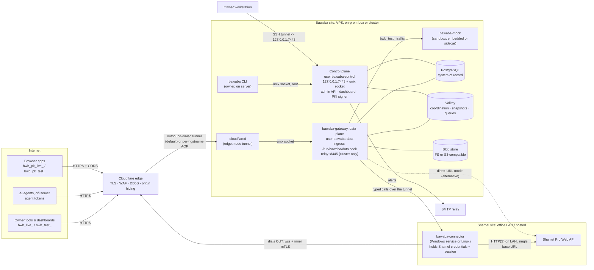

Trust boundaries: (1) Internet ↔ Cloudflare; (2) Cloudflare ↔ data-plane ingress (only `cloudflared` can open the
`0660 bawaba-data:cloudflared` socket, or in `aop` mode only Cloudflare peers presenting the owner's per-hostname
AOP certificate); (3) data plane ↔ control plane (separate processes and OS users, no route, separate DB role,
Valkey user and key file); (4) gateway ↔ connector (inner mTLS with the Bawaba tunnel CA, end to end through
Cloudflare; typed frames only); (5) connector ↔ Shamel (LAN).

---

## 4. Deployment topologies

### 4.1 Packaging and platforms

| Artifact | Linux amd64/arm64 | Windows amd64 | Docker image |
|---|---|---|---|
| `bawaba-gateway` | yes (primary) | no (unsupported) | `bawaba/gateway` (distroless, non-root, read-only rootfs); one image, two services (data and control) |
| `bawaba-connector` | yes (systemd, user `bawaba-connector`) | **yes — Windows service** | `bawaba/connector` |
| `bawaba` CLI | yes | yes (agent-side commands only) | included in gateway image |
| `bawaba-mock` | yes | yes | `bawaba/mock` |

Docker Compose bundles in `deploy/compose/`: `single.yml` (data-plane service `gateway`, control-plane service
`control` with `network_mode: host`, `cloudflared`, PostgreSQL, Valkey, FS blobs), `single-aop.yml` (the same
without `cloudflared`, data plane publishing 443 for `edge.mode: aop`), `connector.yml`. PostgreSQL and Valkey
expose unix sockets on a shared volume mounted into both Bawaba services, so the host-network control container
needs no published database port. Standalone installs use systemd units in `deploy/systemd/`:
`bawaba-data.service` (`LoadCredential=data.key:…`), `bawaba-control.service` (`LoadCredential=master.key:…`) and a
one-shot `bawaba-migrate.service`; the Windows connector ships as an MSI with a `service install` command. All
processes restart automatically after reboot (`Restart=always`, `restart: unless-stopped`, Windows service
auto-start with recovery actions).

### 4.2 Topology A — cloud VPS behind Cloudflare + Connector at the office (recommended)

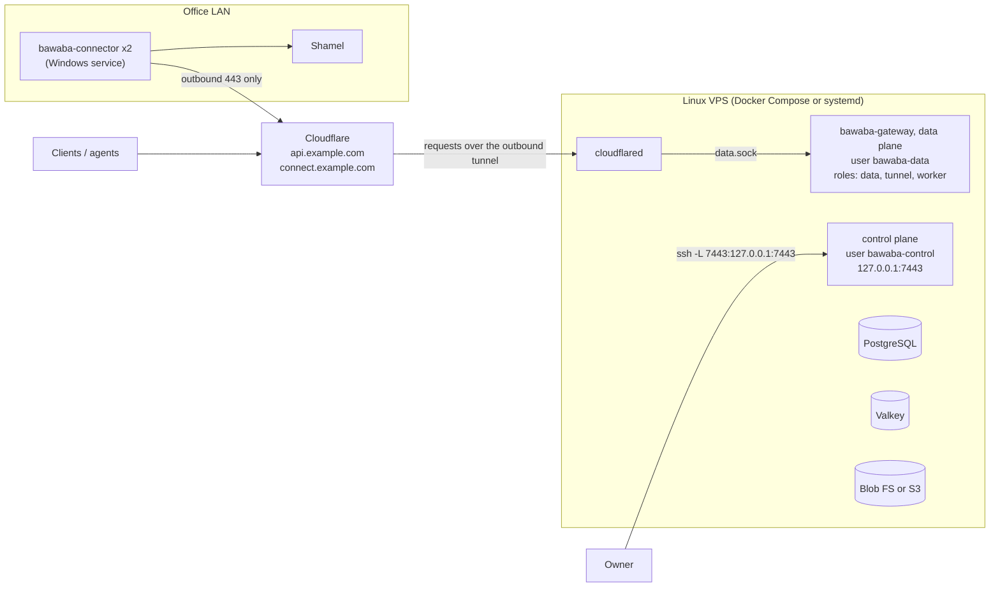

- Office needs **no public IP and no inbound port**; Shamel is never addressable from the Internet.
- With the default `edge.mode: tunnel` the VPS opens **no** inbound port for Bawaba; SSH is published through
  Cloudflare Access or WireGuard (zero inbound ports) or restricted to the owner's addresses (02 §15.5). In `aop`
  mode nftables admits 443 only from Cloudflare ranges, and the origin requires the owner's per-hostname AOP
  client certificate (§6.3 S1).
- Data plane and control plane run as two processes under two OS users on the same VPS (§5.1).
- Two connector instances (same or different office hosts) for HA (§8.5): by default one is the session holder
  and the other a hot standby.
- Why recommended: strongest origin hiding (two layers: Cloudflare hides the VPS, the tunnel hides Shamel),
  Shamel passwords never leave the office (§7.1), no office network changes, the VPS is easy to back up and scale
  vertically.

### 4.3 Topology B — single on-prem box next to Shamel

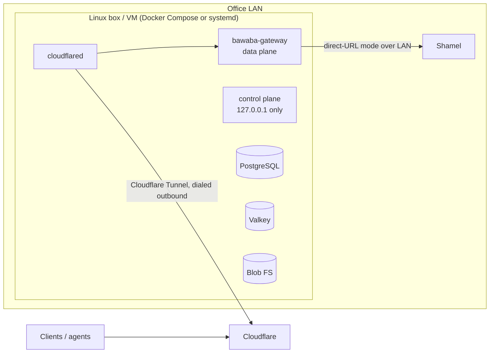

- Public exposure through **Cloudflare Tunnel** (`edge.mode: tunnel`, the default): `cloudflared` reaches the data
  plane over the unix socket `/run/bawaba/data.sock`, so the office opens no inbound ports.
- Shamel reached in **direct-URL mode** on the LAN (§8.7): HTTPS with a pinned certificate is preferred; plain HTTP
  is allowed only to a private (RFC 1918/ULA) address **and** with `allow_plaintext: true`, and the owner then gets
  a daily alert (02 DU-3). No connector needed. Alternatively a connector on the Shamel host with tunnel mode keeps
  the Shamel passwords off the Bawaba box (§7.1, 02 §7.8).
- Trade-off: depends on office power/Internet uptime; backups must leave the building (encrypted).

### 4.4 Topology C — scaled-out cluster

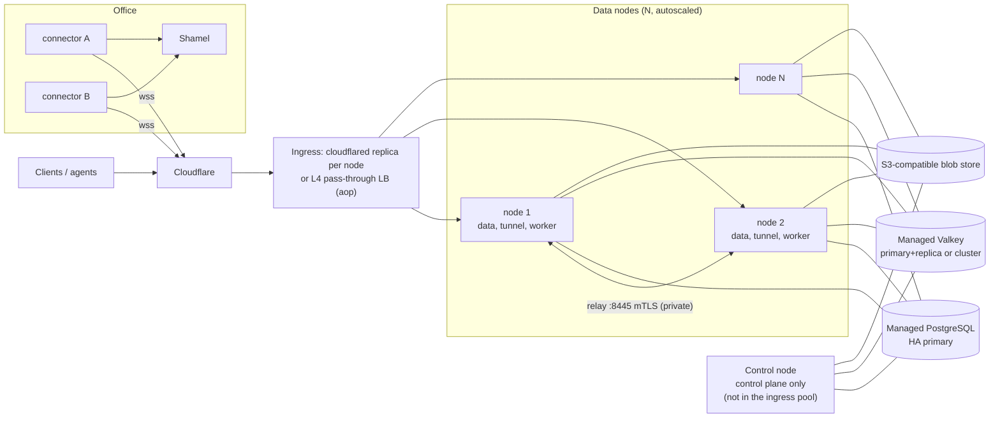

- Data nodes are identical and stateless; scale on CPU. Ingress is either a `cloudflared` replica of the same
  Cloudflare Tunnel on every node (Cloudflare balances across replicas; no load balancer) or, in `aop` mode, an L4
  pass-through load balancer so that each node verifies the per-hostname AOP certificate itself.
- The control node is a separate small VM the owner SSHes into; it runs only the control plane, is not in the
  ingress pool and is the only host with `master.key`.
- Connectors land on arbitrary nodes; other nodes reach Shamel through the **relay** (§8.6).
- Valkey keys put a hash tag (`{…}`) only around the part that multi-key operations share (e.g. `{<sid>}` for a snapshot), so keys spread across slots and Valkey Cluster works.
- Rolling deploys: SIGTERM → node marks itself not-ready, sends yamux GoAway to its connectors (they reconnect
  elsewhere), drains in-flight requests (≤ 95 s), exits.

### 4.5 Choosing

| Situation | Topology |
|---|---|
| Shamel on an office LAN, connector can be installed | **A** |
| Owner wants everything in the office, has a spare Linux box/VM | **B** |
| Sustained heavy load or HA requirement for the gateway itself | **C** |
| Connector cannot be installed and Shamel is reachable over a VPN/allowlisted IP | A or C with direct-URL mode |

---

## 5. Process and listener layout

### 5.1 Planes and roles

`bawaba-gateway serve --plane=data|control` selects the plane. The planes never share a process: putting `control`
into a data-plane process (or any data-plane role into the control plane) is a fatal startup error with no
override. A single-node install therefore always runs **two processes**: `bawaba-data.service` and
`bawaba-control.service` (or the Compose services `gateway` and `control`).

| Plane | OS user (Docker uid) | Roles (`node.roles`) | Keys loaded | PostgreSQL role / Valkey user |
|---|---|---|---|---|
| data | `bawaba-data` (65532) | any subset of `data`, `tunnel`, `worker`; default all three | `data.key` → KEK_data → data-plane purposes only (§15.3) | `bawaba_data` / `data` |
| control | `bawaba-control` (65533) | `control` (fixed) | `master.key` → KEK_control and KEK_data → all purposes | `bawaba_control` / `control` |

| Role | Runs |
|---|---|
| `data` | Public ingress for `edge.public_hosts`: `/v1`, `/legacy`, `/docs`, `/llms.txt`, `/healthz`; the full pipeline. |
| `tunnel` | Connector endpoints on `edge.connector_hosts` (`/connector/tunnel`, `/connector/enroll`); tunnel sessions; registry; relay server (if the `relay` listener is set). |
| `worker` | Data-plane lease-based singleton/background jobs (§5.6). Safe to run on every data node. |
| `control` | Control listener (loopback TCP + Unix socket): admin API, dashboard, config compiler, approvals, and the control-only jobs of §5.6 (PKI signer, alert manager and mailer, audit maintenance, Cloudflare ban sync, key rotation). |

In Docker the control service uses `network_mode: host` so that its loopback bind means host loopback (02 §12.1).

### 5.2 Listeners

| Listener | Plane | Default address | Protocol | Serves | Notes |
|---|---|---|---|---|---|
| `public` | data | `edge.mode: tunnel`: unix socket `/run/bawaba/data.sock` (`0660 bawaba-data:cloudflared`); `aop`: `0.0.0.0:443` (or `:8443` behind a Cloudflare Origin Rule); `none`: `listeners.public.addr` | Plain HTTP/1.1 over the socket (Cloudflare terminates edge TLS; cloudflared ↔ Cloudflare is encrypted). `aop`: TLS 1.3, Cloudflare Origin CA certificate, client certificate required and verified against the owner's per-hostname AOP CA, SNI allowlist, no default certificate. | Host in `edge.public_hosts`: `/v1/*`, `/legacy/*`, `/docs/*`, `/llms.txt`, `/healthz`. Host in `edge.connector_hosts` (nodes with the `tunnel` role): WebSocket `GET /connector/tunnel` and `GET /connector/enroll`. | Host dispatch happens before any routing; an unknown `Host` gets `404 not_found`. |
| `tunnel` | data | disabled | as `public` | Connector endpoints only | Optional dedicated listener for `edge.mode: none` labs or a dedicated tunnel pool with its own hostname (§8.6). Outside labs never reachable except through Cloudflare. |
| `relay` | data | disabled (private IP:8445 in topology C) | HTTPS, mTLS with internal-CA node certificates | `POST /_relay/upstream/{upstream_id}`, `POST /_relay/registry` | Node-to-node only; never exposed through the ingress or Cloudflare. |
| `control` | control | `127.0.0.1:7443` + `/run/bawaba/control.sock` | HTTP on loopback (TLS optional) | Admin API `/admin/v1/*`, dashboard `/` | Bind address validated at startup: loopback IP literal or unix socket only; anything else is a fatal config error (not overridable). |
| `ops` | each process | data: `127.0.0.1:9090` (private IP in topology C); control: `127.0.0.1:9091` | HTTP | `/healthz`, `/readyz`, `/metrics`; `/debug/pprof` only if `ops.pprof: true` | Never routed from Cloudflare. The public `/healthz` on `api.` is a constant `{"status":"ok"}` (02 LV-17). |

HTTP server hardening on `public`/`tunnel` (keys and defaults in 02 §10.6): `http.read_header_timeout` 5 s,
`http.read_timeout` 30 s, `http.write_timeout` 95 s, `http.idle_timeout` 120 s, `http.max_header_bytes` 16 KiB,
per-operation body limits enforced by a `MaxBytesReader` (`http.max_body_bytes` 256 KiB, batch 2 MiB),
`http2.max_concurrent_streams` 250 (h2 only over TLS in `aop`), no h2c, `http.max_conns` 10,000 per node,
`firewall.max_conns_per_ip` 100, no HTTP/1.0 keep-alive quirks, `Server` header never set. Hijacked WebSocket
connections of the tunnel endpoints leave these timeouts and use the tunnel liveness rules (§8.3).

Control listener TLS is optional (default off) because the only network hop is the owner's SSH tunnel and
browsers treat `http://localhost` as a secure context (so `Secure`/`__Host-` cookies work). The Unix socket
(`0600 root:root`) is used by the CLI; the control plane checks `SO_PEERCRED` (uid must be 0) and records peer uid,
pid and `loginuid` in the admin event log (02 §12.3). A non-root operator uses `bawaba login` over
`127.0.0.1:7443` with the owner password (and TOTP).

### 5.3 Control-plane separation guarantees

- **Separate process, OS user and entry point.** The data-plane router is built in `internal/api/...`; the admin
  router in `internal/controlplane/...`. A Go build-time import check (`tools/archcheck`, run in CI) forbids
  `internal/api/**` and `internal/pipeline/**` from importing `internal/controlplane/**` and vice-versa for
  handlers, and a test asserts that the data-plane route table contains no control route. There is no
  proxy/forwarding handler anywhere in the data plane that could reach the control listener.
- **Separate PostgreSQL roles.** `bawaba_data` (data plane): `SELECT` on `compiled_config` and the read tables it
  needs (credential ciphertext, wrapped data-plane keys via `crypto_keys_data`), `INSERT` on the audit index,
  `audit_epoch_keys`, usage, security events, `ip_bans`, `cert_requests`, `media_objects`, approval items and
  access requests, `EXECUTE` on a few `SECURITY DEFINER` functions (access-request cancel/claim, approval executor
  claim/finalize, 04 §10.4, §11.6), column-level `UPDATE` only on `tokens(last_used_at)` and
  `connectors(last_seen_at, last_ip)`. The authoritative grant list is 02 §12.4 (plus 05 §10). `bawaba_control`:
  DML on configuration, keys and approvals. `bawaba_migrate`: DDL, used only by `bawaba migrate`. Data-plane
  processes never possess control credentials, in every topology.
- **Separate Valkey users** (`data`, `control`) with the key patterns of 02 §12.4; `bwb:deny` is read-only for
  `data`.
- **Keys per plane.** The data plane loads only `data.key` and never `master.key`, `pki_ca`, `totp_seed`,
  `admin_chain`, `cf_api_token`, the SMTP password file or an `audit_seal` private key; a data-plane process that can read
  `security.master_key_file` refuses to start (§15.3).
- **No network path.** The control listener is loopback-only; on a shared host nftables rejects loopback TCP to
  7443 from `meta skuid "bawaba-data"`; the socket is `0600 root:root`. The control plane answers any request
  carrying `Cf-Ray`, `Cf-Connecting-Ip`, `Cf-Visitor` or `Cdn-Loop` with 403 and a critical alert (catches a
  `cloudflared` rule pointed at it).
- **Owner-only actions** (approve, firewall edits, live-token creation, identity credentials, connector
  confirm/kill, certificate signing) exist only in the control plane. Agent-level actions (create access requests,
  read docs, read own usage) are ordinary data-plane operations gated by the `agent` token kind and
  `access_requests:write`.

### 5.4 Control plane with N nodes: compiled config distribution

The control plane is the only writer of configuration. After every committed change it **compiles** the full
runtime config into an immutable artifact and stores it in the same transaction:

```
compiled_config(version BIGINT PK, created_at, sections JSONB  -- per-section version + sha256
                payload BYTEA                                   -- zstd + AES-256-GCM (purpose compiled_config)
                )
```

Sections: `tokens`, `policies`, `firewall`, `upstreams`, `connectors`, `rate_defaults`, `cors`, `alerts`, `webhooks`
(05 §2.9), `audit` (`audit_retention`, `audit_caps`, 05 §1.11). A node reloads only sections whose hash changed.
High-frequency data-plane-generated state (auto-bans, usage) is **not** part of compiled config; it flows through
Valkey (§6, S3).

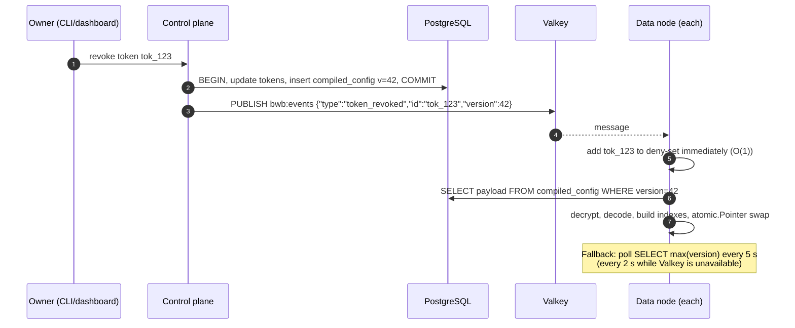

- Propagation target: p99 < 1 s with pub/sub, ≤ `config.poll_interval` (5 s) worst case via polling. This
  implements "instant revoke".
- Nodes never serve with a config older than the version they last saw; swaps are atomic (`atomic.Pointer`),
  readers are lock-free.
- **Emergency revocation** when PostgreSQL is down: `bawaba token revoke --emergency <id>` (control plane) publishes
  a deny entry sealed under the `compiled_config` purpose key (AEAD, so nodes verify it) to `bwb:events` and stores
  it in `bwb:deny` (no TTL, read-only for the data-plane Valkey user) so restarting nodes pick it up; it is
  replayed into PostgreSQL when it recovers. Nodes apply it regardless of config age (02 §9.7).
- **Staleness:** without PostgreSQL a node serves on the last compiled config for `config.max_staleness` (6 h),
  then fails closed; a node that reaches neither PostgreSQL nor Valkey (so cannot receive any revocation) answers
  `503 service_unavailable` on authenticated routes after `config.blind_staleness` (5 min) (02 §16).
- If the control-plane process dies, the data plane keeps serving with the last compiled config; administration,
  certificate signing and alert e-mail are unavailable until the control plane is started again on a host with
  `master.key` (all state is in PostgreSQL; alerts queue in `alert_outbox`).

### 5.5 Cluster membership

Each data node writes `bwb:node:<node_id>` (hash: roles, version, started_at, relay certificate serial, local
tunnel sessions, load) with a 15 s TTL, refreshed every 5 s, and is listed in the sorted set `bwb:nodes`
(score = expiry). Membership drives: per-node slot sizing (§7.6), relay target selection and relay peer
verification (§8.6), the dashboard cluster view, and local fallbacks when Valkey is unreachable (the last known
node count, node registry and tunnel registry are retained, §8.6, §13.2).

### 5.6 Background workers

Data-plane jobs run under the `worker` role. Singleton jobs hold a Valkey lease `bwb:lease:<job>`
(`SET NX PX 30000`, renewed every 10 s, fencing token = lease generation written into job output); parallel jobs
consume Valkey Streams with consumer groups. Control-plane jobs run in the one control-plane process on the control
node (§5.1, §5.4). Jobs that read stored audit content or delete audit objects run there, because only the control
plane holds the `audit_seal` keys, blob-store read credentials and `DELETE` on `audit_blobs` (05 §1.10).

| Job | Plane | Kind | Notes |
|---|---|---|---|
| Webhook change detection per poll stream (05 §2: upstream, identity, request variant, detector) | data | singleton per stream | Polls Shamel every 5 min (configurable) only for subscribed events; `background` class with cluster-wide background slots (§7.6). |
| Webhook delivery | data | parallel (`bwb:q:webhooks`) | HMAC `Bawaba-Signature`, retries with backoff; events also persisted in PostgreSQL. Timeouts, retries and limits are `webhooks.delivery.*` (05 §2.9). |
| Approved-write executor | data | parallel (`bwb:q:approved_writes`) | Executes writes the owner approved through the claim/finalize functions of 04 §11.6; `write` priority class. |
| Audit pipeline flusher | data | per node | §10.2. |
| Usage rollup flush | data | per node | Every 10 s into `usage_1m`. |
| Alert emitters | data (every process) | per node | Event-driven `alerts.Emit`: a per-node buffer flushed every 1 s as raw rows into `alert_outbox`; spills to `bwb:q:alerts` while PostgreSQL is down; never sends mail (05 §3.1). |
| Alert threshold evaluator | data | singleton (`bwb:lease:alert_eval`) | Threshold rules every 30 s over cluster-wide counters; writes raw alerts like the emitters; never sends mail (05 §3.1). |
| Partition maintenance | data | singleton | Creates audit partitions 7 days ahead through the `SECURITY DEFINER` function `audit_ensure_partitions(days)` owned by `bawaba_migrate`, because neither runtime role has DDL (02 §12.4, 05 §1.3.1); usage snapshots. Blob GC is a control-plane job (below). |
| Stale token flagger | data | singleton, daily | Flags tokens unused for 90 days. |
| Config compiler | control | on change | §5.4. |
| PKI signer | control | polls `cert_requests` (2 s and `LISTEN`) | Signs connector, gateway-tunnel and relay certificates with `pki_ca` (§8.2). |
| Alert manager and digest job | control | singleton | Deduplicates, throttles, escalates and routes raw alerts from `alert_outbox` and `bwb:q:alerts`; maintains `alert_instances`; builds digests (05 §3.1–§3.2). |
| Alert mailer (SMTP sender) | control | reads ready rows of `alert_outbox` | SMTP via the relay with retries (1 min → 30 min, for 24 h); the only process that reads the SMTP password file `alerts.smtp.password_file` (05 §3.1, §3.5; 02 §9.2). |
| Audit maintenance | control | singletons | Daily blob GC and pack consolidation/compaction (`audit.blob_gc.schedule`, 05 §1.6.2); cold-segment writing and the drop of hot partitions whose segment is verified (05 §1.8); weekly compression-dictionary training (05 §1.4.4); in `segment_first` mode also hourly segment compaction and object-index merge (05 §1.12). |
| Cloudflare ban sync | control | optional | Mirrors bans ≥ 24 h from `ip_bans` to Cloudflare (`cf_api_token`, 02 §10.3). |
| Key maintenance | control | scheduled | Monthly `audit_seal` rotation, KEK/DEK rotations, retirement of epoch keys no longer referenced (02 §9.6). |

---

## 6. Data-plane request pipeline

### 6.1 Operation registry

`internal/ops` holds a static registry. Each operation descriptor declares everything the pipeline needs, so
stages are generic and data-driven:

```go
type Operation struct {
    ID               string        // "customers.list"
    Public           bool          // docs, llms.txt, healthz: skips auth/policy/upstream
    Methods          MethodSet     // GET, POST, PATCH, DELETE; HEAD is never served
    Scopes           []Scope       // e.g. customers:read; writes may add vouchers:write:<type> dynamically
    Kinds            KindSet       // token kinds allowed (tool, agent, publishable)
    Idempotent       bool          // safe to retry upstream
    Write            bool
    Snapshot         bool          // list/report: paginated over a snapshot, distributed coalescing
    DefaultSort      SortKey       // snapshot order (§9.4); views in this order stay unmaterialized
    SortKeys         []SortField   // sort allowlist; text/code fields get precomputed collation keys (03 §5.5)
    Cost             CostRule      // 03 §23.3: class per upstream call (none | small | report | list) from the
                                   // request shape; report and list calls are "large" in §7.6, §7.9 and §8.5
    Plan             UpstreamPlan  // one or more Shamel calls: endpoint id (compiled table), header params, form field;
                                   // may be a range-split plan (§7.11)
    Request          Schema        // query/body schema, size limit
    Resource         ResourceType  // normalized record type (+ generated encoder)
    Dimensions       DimensionMap  // data-scope dims -> record field paths + 04 §4.4 enforcement code
                                   // (store, salesman, customer, currency, price_class, voucher_type)
    Fields           FieldCatalog  // hideable fields (bit positions for masks, occurrence bits)
    Timeout          time.Duration // upstream budget (§7.7)
    MaxResponseBytes int64         // upstream response cap by class (02 §10.6): single record 4 MiB,
                                   // master data 16 MiB, large lists/reports 256 MiB; ≤ upstream.max_response_bytes
    PollInterval     time.Duration // recommended minimum polling interval (warnings)
}
```

### 6.2 Request context

One pooled `reqctx` per request (reset on return to a `sync.Pool`) carries: request id, client IP, matched
operation, token pointer (into compiled config), policy decision, typed request, upstream selection, timings per
stage, warnings, audit draft. Stages are plain functions `func(*reqctx) *apierr.Error` executed by a fixed runner
(not a generic middleware chain), which makes ordering explicit and lets the runner record a per-stage histogram.

### 6.3 Stages

Order is normative and matches 02 §10.1 (the security view of the same pipeline). "Failure" lists the
client-visible result; every failure still emits an audit event (S16) with the stage reached, and every response
carries `Bawaba-Request-Id`. Routes are resolved only **after** authentication, so every unauthenticated `/v1` or
`/legacy` request gets the same 401 whether or not the route exists (02 P4). Requests on `edge.connector_hosts`
run S1–S3 and then the tunnel handler (authenticated by inner mTLS or the enrollment secret, §8.2), never S4–S17.

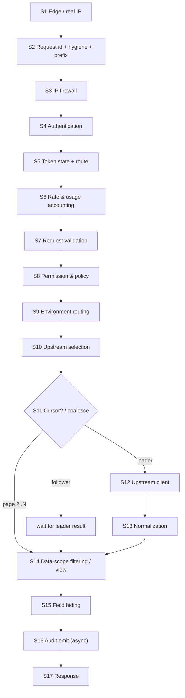

#### S1 — Edge / real IP
- **Does:** establishes the true client IP and that the request came through the sanctioned edge (02 §6.1–§6.2).
  Modes (`edge.mode`):
  - `tunnel` (default): requests arrive only on the unix socket `/run/bawaba/data.sock`
    (`0660 bawaba-data:cloudflared`), so only `cloudflared` can connect; client IP = `CF-Connecting-IP`.
  - `aop`: TCP peer must be in the Cloudflare range list (checked in a `net.Listener` wrapper before TLS; connection
    closed otherwise); TLS requires a client certificate verified against the owner's **per-hostname** AOP CA (the
    zone-level origin-pull CA shared by all Cloudflare customers is rejected at startup); client IP =
    `CF-Connecting-IP`.
  - `none`: peer address; lab/LAN only (startup banner and owner alert; a non-private bind requires `dev_mode`).

  `CF-Connecting-IP` must occur exactly once and parse as an IP. `X-Forwarded-For`, `X-Real-Ip`, `True-Client-Ip`
  and `Forwarded` are never read; they and all `Cf-*` headers (after use) are deleted. `Host` must be in
  `edge.public_hosts` or `edge.connector_hosts`. Connection limits (`http.max_conns`,
  `firewall.max_conns_per_ip`) apply here. Records `CF-Ray` for audit correlation.
- **Needs:** Cloudflare CIDR list (embedded, refreshed weekly by `bawaba edge sync-cloudflare-ips`; a failed refresh
  keeps the last good list), mode, host lists, AOP CA.
- **Failure:** non-edge peer → connection closed (no bytes); bad edge header → `400 invalid_request`; unknown
  `Host` → `404 not_found`.
- **Perf:** CIDR check on a pre-built prefix trie (~50 ns); header parse without allocation.

#### S2 — Request id, protocol hygiene and prefix check
- **Does:** generates `req_` + 26-char Crockford base32 UUIDv7 (time-sortable); sets `Bawaba-Request-Id`; runs
  protocol hygiene (02 §10.1 step 5): method allowlist (`GET`, `POST`, `PATCH`, `DELETE`, `OPTIONS`; `HEAD`,
  `TRACE`, `CONNECT` and unknown methods → 405), URL and header limits, path hygiene (`//`, dot segments, encoded
  `/ \ . NUL`, `;` and backslashes rejected before any `ServeMux`, so no path-cleaning redirect is ever issued),
  request framing, no request `Content-Encoding`, no token-shaped string in the URL; then classifies the **prefix**
  only (03 §6.5): `/v1/`, `/legacy/`, `/docs`, `/llms.txt`, `/healthz`. Routes are not resolved here. Client-supplied
  ids are never trusted (`Bawaba-Client-Request-Id` is recorded in audit only).
- **Needs:** prefix table, limits.
- **Failure:** answered after S3's ban and global-rule checks, so a banned IP only ever sees `403 ip_blocked`:
  `400 invalid_request`, `400 token_in_url`, `405 method_not_allowed`, `414 uri_too_long`,
  `415 unsupported_media_type`, `431 headers_too_large`; unknown prefix → `404 not_found` (feeds the
  `scanner_paths` auto-ban signal).
- **Perf:** ~200 ns; id generation from a per-P buffered CSPRNG.

#### S3 — IP firewall
- **Does:** ban set (IPv6 matched by /64), global deny list, global allow list (if non-empty, default-deny); then
  the deferred S2 result; then the pre-auth per-IP budget (`firewall.preauth_rate`, 20 req/s, burst 40; a local
  token bucket charged for unauthenticated and failed requests) that blunts floods of invalid tokens. Per-token IP
  rules are checked in S5.
- **Needs:** compiled `firewall` section (CIDR tries for IPv4/IPv6); local mirror of `bwb:ban:*` populated from
  Valkey on start and updated via `bwb:events` (`ip_banned`/`ip_unbanned`) and a periodic resync.
- **Failure:** `403 ip_blocked` (banned: same code, `Retry-After` for temporary bans, no ban details); pre-auth
  budget exceeded → `429 rate_limited` with `Retry-After`.
- **Perf:** two trie lookups + one map lookup; no network I/O.

#### S4 — Authentication
- **Does:** parses `Authorization: Bearer <token>`; validates format (prefix in {`bwb_live_`, `bwb_test_`,
  `bwb_pk_live_`, `bwb_pk_test_`}, length, alphabet and CRC32 checksum, 02 §9.7) before any lookup; computes
  `lookup = HMAC-SHA256(token_pepper[v], token)`, looks it up in the compiled token index (older live pepper
  versions on a miss, at most 2) and confirms in constant time. Skipped for `Public` operations; `/v1/media/{id}`
  carries a presigned signature that is verified here instead (02 §5.4). CORS preflight (`OPTIONS`) is answered
  here without a token from the compiled union of all publishable origins (03 §23.5).
- **Needs:** compiled `tokens` section (map keyed by lookup hash → token record pointer); the `token_pepper` MAC
  key, a data-plane purpose key that is never stored unwrapped (a stolen DB cannot be used to test guesses
  offline).
- **Failure:** no `Authorization` header → `401 unauthenticated`; malformed, bad checksum, unknown, bad media
  signature → `401 invalid_token` (uniform message and timing class; revoked and suspended tokens take the same
  path in S5). Each failure increments `bwb:authfail:<ip>` (pipelined, async) and the `token_spray` counter;
  crossing the auto-ban thresholds (02 §10.3) creates a ban (Valkey + PostgreSQL record + `bwb:events` + batched
  owner e-mail).
- **Perf:** one HMAC over ~60 bytes (~300 ns) + map lookup. Token hashes are fast hashes by design: tokens carry
  256 bits of entropy, so slow password hashing adds no security.

#### S5 — Token state checks and route resolution
- **Does,** in this order (02 §10.1 steps 9–12):
  1. status `active` (not revoked/suspended/pending), node-local deny-set (instant and emergency revocation,
     §5.4), prefix environment and kind == token record, not expired (`expires_at` optional);
  2. per-token IP rules from the policy spec (deny, then allow; 02 §10.2);
  3. browser rules (02 §10.7): a publishable token's `Origin` must be in **its** allowed origins; a
     non-publishable token sent with an `Origin` header is refused when `reject_browser_origin` (default true);
  4. route resolution: method + path → operation (stdlib `ServeMux` patterns compiled at startup; `/legacy`
     canonicalization and allowlist per 02 §11.3);
  5. operation-level kind rules: publishable tokens only for read operations with read scopes (never webhooks,
     never `/legacy`); `access_requests:write` only for `agent`; `/legacy` only if the token has legacy enabled for
     that endpoint.
- **Needs:** token record (already resolved), deny-set, clock, route table.
- **Failure:** revoked/suspended/pending/deny-set/prefix mismatch → `401 invalid_token` (prefix mismatch also
  raises a security event); expired → `401 token_expired`; IP rule → `403 ip_blocked` (which rule is never
  disclosed); `403 origin_not_allowed`; `403 secret_token_in_browser`; unknown route → `404 route_not_found`;
  wrong method → `405 method_not_allowed`; kind → `403 token_kind_not_allowed`; legacy →
  `403 legacy_not_enabled`; `/legacy/Main/Login` or Shamel credential headers on `/legacy` →
  `400 shamel_credentials_not_accepted` (§6.5).
- **Perf:** in-memory only.

#### S6 — Rate & usage accounting
- **Does:** per-token GCRA rate limits (defaults generous, per-token adjustable; `limits.defaults.<kind>`,
  03 §23.3) over three buckets: **reads** (1 unit per read request, cursor pages included), **writes** (1 unit per
  Shamel write; a batch costs its operation count) and **upstream units** (each read costs the sum of the cost
  classes of the upstream calls its plan will make: `none` 0, `small` 1, `report` 5, `list` 10, weights in
  `limits.cost_weights`). S6 computes the cost from the matched route, the token's policy and the request's
  syntactic shape (cursor present, path code form, `include` values, number of date-range slices) through the
  operation's `Cost` rule, before execution and whether or not the call is later coalesced. Publishable tokens
  additionally have per-(token, client IP) reads and upstream buckets. All buckets use **local quota leasing**: each
  node keeps an in-memory GCRA bucket per active (token, bucket) and leases batches of units from the cluster-wide
  GCRA state `bwb:<t>:rl:<token>:<bucket>[:<ip>]`; one script call (`take`) refills every bucket a request needs and
  returns the granted counts (Valkey `TIME` is the single clock). The batch size adapts to the token's recent rate
  on that node (default 10 % of the burst, min 1, never less than the request's own cost); a refill is issued
  asynchronously when a local balance falls below half a batch, and unused units are returned after 1 s of
  idleness. Most requests make **no** Valkey call. A request is admitted only if every bucket it consumes has the
  units; otherwise nothing is charged to the others. `RateLimit-Limit`, `RateLimit-Remaining` and `RateLimit-Reset`
  describe the **most constrained** bucket the request consumed (lowest `remaining / limit` after the charge),
  computed from the local view (local balance + the cluster-wide remaining reported by the last `take`); below
  `limits.warn_ratio` (20 %) the response adds `Bawaba-Warning: rate_limit_approaching`. Usage advice (05 §4.3, H1–H8) is evaluated on node-local per-(token, normalized query) state, which each node
  merges every 1 s with one pipelined merge call into `bwb:<t>:adv:<token>:<qhash>`, receiving the merged state
  back; warnings may lag by ≤ 1 s, which is acceptable for advice. Tight polling adds
  `Bawaba-Warning: polling_too_frequent;observed=8;recommended=60` (syntax 03 §23.4) and counts toward the
  "abusive/buggy tool" score. Usage counters (requests by op/status, latency histogram, `last_used_at`) are
  recorded in a per-node lock-free aggregator and flushed every 10 s. Runs **before** validation so malformed
  requests still consume budget.
- **Needs:** token limits and cost weights from compiled config; Valkey (lease refills and advice merges only).
- **Failure:** a bucket exhausted → `429 rate_limited` + `Retry-After` with `details[{code: "bucket_exhausted",
  param: "reads" | "writes" | "upstream"}]` (03 §23.3). Valkey unavailable → local GCRA with
  `limit / last_known_node_count`, advice from node-local state only, metric
  `bawaba_degraded{function="rate_limit"}`.
- **Perf:** in the common case ≤ 5 µs and no network I/O; a request waits for a refill (1 RTT) only when the local
  balance is exhausted. Overshoot is bounded by the units leased but unused across nodes (≤ N × batch).

#### S7 — Request validation
- **Does:** strict parsing into the operation's typed request: path/query parameters (allowlisted per route; types,
  enums, ranges; `limit` bounds), JSON bodies (`application/json` only; strict decoder: unknown fields rejected,
  duplicate keys rejected, case-sensitive names, UTF-8 valid, depth and size limits), `Idempotency-Key` presence
  and format on writes, cursor unsealing and binding checks (§9.6). All values that will become Shamel header
  parameters are validated against per-parameter allowlists here (§7.2).
- **Needs:** operation schema; `cursor` key.
- **Failure:** `400 invalid_request` (syntax), `400 unknown_parameter`, `422 validation_failed` (semantics, with
  field paths); `400 idempotency_key_required`; `400 invalid_cursor`; `409 cursor_invalidated` (the token's
  `policy_version` changed since the cursor was issued); `409 snapshot_expired` (cursor past `expires_at`); body
  too large → `413 payload_too_large`; wrong content type → `415 unsupported_media_type`.
- **Perf:** generated decoders; no reflection on the hot path; bodies read through a pooled buffer.

#### S8 — Permission & policy evaluation
- **Does:** produces a `Decision`:
  - scope check: required scopes ⊆ token scopes (compiled into a bitset); voucher writes require
    `vouchers:write:<voucher_type>` derived from the validated body;
  - data-scope pre-check for targeted requests (e.g. `GET /v1/customers/{code}` where `code` is outside the
    token's customer/salesman scope → `404 not_found`, never 403, to prevent enumeration); decisions decidable from
    allow-sets alone may skip the upstream call, decisions that need derived data (04 §4.3 code `D`) never do
    (04 §9.3);
  - **pushdown** filters where Shamel can filter natively (e.g. `store`, `itemCode`, `customerCode` header
    parameters) — pushdowns become part of the upstream request and therefore of the coalescing key;
  - **row filter** for dimensions Shamel cannot filter (applied in S14);
  - **field mask** for the operation (precomputed per token × operation at compile time);
  - **approval required** flag for writes from tokens configured for the approval queue.
- **Needs:** compiled `policies` section: scope bitsets, per-dimension allow-sets (`map[string]struct{}`),
  per-operation field masks, presets (read-only, write-only, …) already expanded.
- **Failure:** `403 insufficient_scope` (lists the missing scope); `403 data_scope_filter_required` /
  `403 data_scope_unsupported` (03 DS-7); `404 not_found` for out-of-scope targets.
- **Perf:** bitset AND + a few map lookups; zero allocation.

#### S9 — Environment routing (live vs sandbox)
- **Does:** `bwb_live_` / `bwb_pk_live_` → environment `live`; `bwb_test_` / `bwb_pk_test_` → `sandbox`.
  Asserts the three-way invariant: prefix environment == token record environment == selected upstream
  environment. Sandbox requests go to the tenant's virtual upstream of kind `mock` (§11).
- **Failure:** invariant violation → `401 invalid_token` + security alert (indicates tampering or a bug); sandbox
  disabled → `503 sandbox_disabled`.
- **Perf:** constant.

#### S10 — Upstream selection
- **Does:** resolves (upstream, identity, transport): upstream from the token (v1: exactly one); identity =
  token's pinned identity or the upstream's default service account; transport = `mock` | `direct` |
  `tunnel(local session)` | `tunnel(relay → holder node)` (§8.6). In tunnel mode with
  `credential_session_mode: single_holder` (default) the call must go to a session of the identity's **session
  holder** instance (`bwb:<t>:credrole:<upstream>:<cred_id>`, cached locally and updated by `credrole_changed`,
  §7.1); with `per_connector` any connected instance qualifies. Only instances whose `hello` advertised the
  operation's endpoint ids are eligible. Within the eligible sessions: the session class matching the call's cost
  class (`report` and `list` calls use the bulk session, §8.5), then least in-flight, preferring sessions whose last
  `shamel_probe` succeeded. Fast-fails if the circuit breaker for the call's size class (small or large, §7.9) is
  open or no eligible session exists anywhere (after a
  `tunnel.connector_grace` of 2 s for brief flaps).
- **Needs:** compiled `upstreams` section, local tunnel table, tunnel registry (`bwb:tun:<upstream>`, cached
  locally and refreshed on change events), holder records, breaker state.
- **Failure:** `503 upstream_unavailable` + `Retry-After` (an endpoint no connected instance advertises also raises
  an owner "upgrade connector" alert).
- **Perf:** in-memory; registry cached with 1 s refresh.

#### S11 — Coalescing / snapshot lookup
- **Does:** (a) request carries a cursor → load the view and the needed chunks from Valkey in one pipelined batch
  (§9.6) and go to S14 (no upstream call); (b) otherwise compute `ck` (§9.1), join a local single-flight; for
  `Snapshot` operations also coordinate across nodes (§9.3). Only the **leader** runs S12–S13; followers receive
  the leader's result. Writes skip coalescing and instead perform the idempotency reservation (§6.4).
- **Needs:** Valkey (distributed path), coalescing key.
- **Failure:** cursor's view/snapshot gone → `409 snapshot_expired` (client restarts from page 1); view bound to an
  older policy → `409 cursor_invalidated`; Valkey down → local-only coalescing; follower wait exceeding its
  deadline → `504 upstream_timeout`.
- **Perf:** local join ~100 ns; distributed join = 1 RTT (one script: election plus follower registration).

#### S12 — Upstream client
- **Does:** acquires a slot from the upstream's concurrency limiter (per-token fair queueing, §7.6), passes the
  circuit breaker, then executes via the selected transport. Direct and mock: obtains a Shamel session (gateway
  session manager), builds header parameters and form body, performs the HTTP exchange. Tunnel: sends a typed
  `ShamelCall` frame (endpoint id, parameter ids and values, form field, sealed credential reference, deadline,
  response cap); the connector logs in, adds `username`/`token` and calls Shamel (§8.4). In every mode it
  stream-decodes the body tolerantly under the operation's response cap, classifies the outcome, and retries
  idempotent reads once on retryable failures. Details in §7.
- **Needs:** direct mode: encrypted identity credentials (login only), session cache, upstream settings; tunnel
  mode: the identity's sealed credential for the selected connector instance (`cred_id`, version).
- **Failure:** `503 upstream_busy` (queue full/timeout, per-token queue cap), `503 upstream_unavailable` (breaker
  open, connector offline), `504 upstream_timeout`, `502 upstream_error` (unclassified upstream failure),
  `502 upstream_response_too_large`, `422 upstream_rejected` or a mapped catalogue code (Shamel rejected a write;
  Shamel's text is replaced by a mapped code/message, raw text goes to audit only, 03 §22.3).
- **Perf:** queue wait and upstream time are measured separately and excluded from the gateway overhead budget.

#### S13 — Response normalization
- **Does:** maps Shamel DTOs to `/v1` resources (or re-encodes the Shamel shape for `/legacy`): snake_case,
  typo fixes (`sale_parice→sale_price`, `orgnization→organization`, `grantee→guarantee`,
  `refrenceId→reference_id`, `Classificaiton→classification`, `Branchs→branches`), voucher type ints → snake_case
  names, dates → `YYYY-MM-DD`, timestamps → RFC 3339 in the upstream's business timezone (default
  `Asia/Hebron`), monetary/quantity values kept as exact decimal text (never round-tripped through `float64`),
  unknown upstream fields dropped and counted (`bawaba_upstream_schema_drift_total{op,field}`). For `Snapshot`
  operations the leader also precomputes, once per record, the CLDR collation keys
  (`Collator.KeyFromString`, `language.Arabic`, `collate.Numeric`; collators from a `sync.Pool`) of every text or
  code field in the route's sort allowlist and the normalized search keys (03 §5.5–§5.6); they are stored with the
  snapshot record, never returned to clients, and count toward `pagination.snapshot_max_bytes`. Catalog images: in
  tunnel mode the connector has already replaced each `image_path` with an opaque `cref`; the gateway maps it to a
  stable `med_<id>` (`media_objects`) and emits a presigned `/v1/media/{media_id}?tok=…&exp=…&sig=…` URL (02 §5.4);
  while `media.enabled=false` (default) `image_url` is `null`. Runs once per coalesced fetch (in the leader),
  streaming record by record into the snapshot build (§9.4, §10.2).
- **Failure:** undecodable body → `502 upstream_error` (raw body to audit); body above `MaxResponseBytes`
  (counted after decompression) → `502 upstream_response_too_large`.
- **Perf:** streaming decode; the leader's memory per flight is the snapshot build arena, then the compressed
  chunks plus a compact record column, admitted against `pagination.flight_mem_max` (§9.4, §10.1).

#### S14 — Data-scope filtering (view construction)
- **Does:** per requester: applies the S8 row filter over the normalized records using the operation's
  `Dimensions` (store, salesman, customer, currency, price class, voucher type), filters sub-collections (e.g. item
  stock rows by allowed store, price columns by allowed price class), then client filters/search/sort, producing
  the page and — for paginated results — a **view** stored in Valkey (§9.5). A default-order view only filters the
  snapshot's stored default order and needs no sort; any other sort is a stable sort of positions comparing the
  precomputed collation keys with `bytes.Compare` (typed values for decimals, dates and booleans; `null` last; ties
  in upstream order), and `q` ranking is a stable partition (03 §5.5–§5.6). A view is stored as ascending positions
  when it is in the snapshot's default order and keeps ≥ 50 % of its records, otherwise as materialized records.
  On cursor reads the
  view must be bound to the token's current `policy_version` (else `409 cursor_invalidated`), and each record is
  still re-checked against the current policy as defense in depth.
- **Needs:** decision, flight result (or the snapshot's key column and chunks).
- **Failure:** none client-visible besides Valkey write failure for multi-page results → `503
  pagination_unavailable` (never silent truncation).
- **Perf:** allow-set lookups and key comparisons over the key column (no chunk decode for filtering
  or sorting; no collator call per comparison); positions encoded as delta-varint pages.

#### S15 — Field hiding
- **Does:** effective mask = policy mask ∧ client sparse-fieldset (`?fields=`). The generated encoder for each
  resource skips masked fields (fields are **omitted**, not nulled). Masks apply to nested objects too. The same
  encoding pass runs the origin-marker scan on every string value (02 §5.2 step 9).
- **Perf:** fused with S17 encoding: `AppendJSON(dst []byte, mask FieldMask) []byte`, one pass, no maps.

#### S16 — Audit emit
- **Does:** builds the audit event (request metadata, decision trace, stage timings, upstream call records
  including the upstream request spec with credentials replaced by `cred_<id>`, the raw upstream response (already
  scrubbed by the connector in tunnel mode) and error text, final response) and enqueues it into the node's async
  audit pipeline (§10.2). Writes additionally have a synchronous write-ahead record (§6.4).
- **Failure:** queue full → spill to local encrypted spool; spool full → fail closed for new requests
  (`503 audit_unavailable`) unless `audit.on_spool_full: metadata_only` is configured (owner alerted either way).
- **Perf:** O(1) enqueue of references to already-built buffers (no copy of large bodies).

#### S17 — Response
- **Does:** assembles the response **completely** in pooled 64 KiB chunks, applies the size guard
  (`http.max_response_bytes`) and the origin-marker scan, and only then writes the status line and body, so a
  half-written body or leaked fragment is impossible; above `http.response_spill_bytes` (8 MiB, legacy whole-list
  responses) further chunks spill to an anonymous temp file encrypted under a per-process key (02 §10.8). Writes
  status, `Content-Type`, `Bawaba-Request-Id`, `Bawaba-Environment`, `RateLimit-*`, `Bawaba-Warning` (max 3),
  `Cache-Control: no-store`, the security headers of the closed allowlist (02 §10.7), CORS headers for publishable
  tokens; gzip/zstd compression above 1 KiB when accepted; streamed via a pooled `bufio.Writer`. Errors use the
  shared envelope `{"error":{"code","message","message_ar","request_id","docs_url"}}` from the `apierr` catalogue.
  Finalizes usage counters and audit (bytes written, client abort).

### 6.4 Write path additions (milestone 2)

Inserted without changing stage order:

1. **S7:** `Idempotency-Key` required on Shamel writes (`400 idempotency_key_required`).
2. **S8:** voucher-type scope; approval flag.
3. **S11 (writes):** `SET bwb:<t>:idem:<lineage_id>:<sha256(idempotency_key)> <record> NX PX 86400000`, record
   encrypted (purpose `idempotency`, AAD bound to the lineage and key hash, 02 §9.3) =
   `{state:"in_progress", fingerprint, token_id, …}` (03 §15.2). The namespace is the token's **lineage**
   (04 §2.4.5; `LineageID` is part of the compiled policy, 04 §9.1), not the token id: a rotated token's successor
   shares its predecessor's namespace, so a write resent with the same key after a rotation returns the stored
   outcome instead of posting a duplicate voucher. Same fingerprint → behaviour per 03 §15.2 (replay with
   `Bawaba-Idempotent-Replay: true`, `409 request_in_progress`, or the approval's `202`); different fingerprint →
   `409 idempotency_conflict`. A missing Valkey record is checked against the PostgreSQL backstop
   `idempotency_keys`, primary key `(tenant_id, lineage_id, key_hash)` with `key_hash = sha256(idempotency_key)`
   (03 §15.2), before a new reservation. Valkey unavailable → `503 idempotency_unavailable` (fail closed). Views and
   cursors stay token-bound (§9.5, §9.6).
4. **Write-ahead audit:** synchronous `INSERT` into `audit_writes` (full payload, status `pending`) and
   `idempotency_keys` in one PostgreSQL transaction before contacting Shamel; failure → `503 audit_unavailable`.
5. **Approval hold:** if required, store the prepared upstream request (encrypted, `approval_payload`) as an
   approval item and return `202` with the approval id; the approved-write executor later runs S10–S13 with the
   stored identity (04 §11.6).
6. **S12:** a write is **never retried once it may have reached Shamel**. Before sending, the session holder (the
   gateway in direct mode, the holder connector in tunnel mode) validates the session with a cheap read probe if it
   had no successful call within `session.write_probe_after` (60 s), so an expired session is renewed before the
   write is sent. If the write itself returns `auth_failed`, the session is renewed for later calls but the write is
   not retried: when the transport reports that the request was never sent (connector outcomes `not_sent`,
   `not_holder`, login failure before sending) the client gets `503 upstream_unavailable` and the idempotency key is
   released; otherwise `504 write_outcome_unknown`, because Shamel's ordering of authentication and execution is
   unverified (08 ISCO-54). Timeout after the request was sent → outcome `unknown`: `504 write_outcome_unknown`; the
   idempotency record stores `outcome_unknown`, and the owner is alerted to reconcile (Shamel has no idempotency
   support, Q39).
7. **After S13:** Shamel reference id recorded in `audit_writes` and in the idempotency record.

### 6.5 Legacy passthrough specifics

`/legacy/<original Shamel path>` (e.g. `/legacy/Customer/GetCustomers`) matches a **strict allowlist** of Shamel
paths (case-insensitive match on `^/legacy/[A-Za-z0-9]{1,64}/[A-Za-z0-9]{1,64}$`, canonical path used upstream,
02 §11.3). Each entry maps to the same operation as its `/v1` counterpart plus a legacy parser (reads Shamel-style
header parameters such as `lastupdatedate`, `code`, `getBalance`, with the same validators) and a legacy encoder
(Shamel field names, Shamel envelope). Authentication is always the Bawaba bearer token: client Shamel `username`,
`token` or `password` headers, and `/legacy/Main/Login`, are refused with `400 shamel_credentials_not_accepted` and
an owner alert (03 §20.5, 02 LV-28). `/Voucher/Post` is never allowlisted. Data-scope filtering, field hiding, URL
rewriting and error sanitization apply identically; legacy errors use the Bawaba error envelope. Legacy operations
never paginate and never write snapshots; whole-list responses use the spill-to-disk assembly of S17.

### 6.6 Page 1 and page 2 sequences

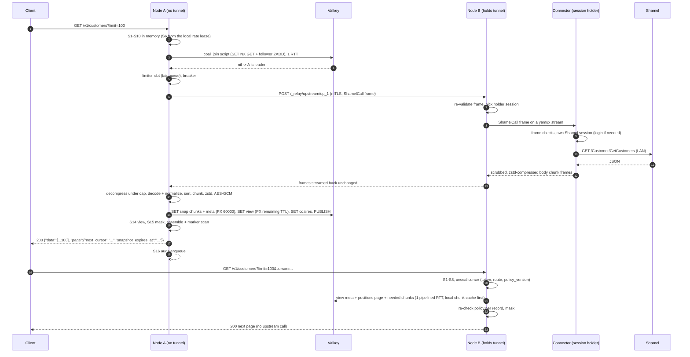

---

## 7. Upstream client

The client has two halves. The gateway half (limiter, breaker, typed call construction, decoding, classification)
runs in every mode. The Shamel-facing half (login, session, HTTP headers, form body, HTTP exchange) runs in the
gateway for `direct` and `mock` upstreams and in the connector for `tunnel` upstreams (02 §7.4, §7.5).

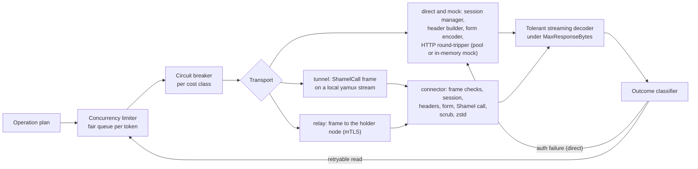

### 7.1 Credential custody and session manager

| Mode | Who stores the Shamel username and password | Who logs in and holds the session | What the gateway learns |
|---|---|---|---|
| Tunnel (connector) | Gateway stores only HPKE ciphertext sealed to each connector instance's sealing key | The connector (in memory; single-flight; one holder per credential by default) | `cred_id`, label, salesman code (non-secret, reported by the connector) |
| Direct | Gateway, envelope-encrypted (purpose `shamel_credential`) | Gateway session manager (below) | Everything (unavoidable) |
| Sandbox (mock) | None (mock credentials) | Gateway session manager against the mock | – |

**Tunnel mode (02 §7.5).** The owner enters a Shamel password only in the control plane; it is sealed at once with
HPKE (X25519 / HKDF-SHA256 / AES-256-GCM, `aad = conn_id ‖ cred_id ‖ version`) to every active connector instance of
the upstream, one ciphertext per (credential version, instance), and the plaintext buffer is zeroized. Each
`ShamelCall` carries `credential{cred_id, version, sealed}` for the target instance. The connector opens it (frame
check 6), runs the login single-flight (`POST /Main/Login`, requires `success=true` and `userIsDisabled=false`,
validates the token against `^[\x21-\x7E]{1,512}$`), keeps the session in memory, adds `username`/`token` to
every Shamel request itself, and re-logs in after `auth_failed`. Login failures get the same negative cache as
below (30 s → 5 min) and are reported to the gateway as outcome `auth_failed` with an enum reason, never text.
The gateway has no session cache, no `shamel_credential` key use and no login code path for tunnel upstreams. A
replacement connector instance needs the passwords re-entered (accepted cost: the gateway cannot decrypt them).

**Session holder protocol** (`upstreams[].credential_session_mode`, 02 §7.5). Because a second login may invalidate
the first (unknown, 08 ISCO-01), independent logins by two connector instances could knock each other out forever.

| Mode | Behaviour |
|---|---|
| `single_holder` (**default**) | For each `(upstream, cred_id)` exactly one instance is the holder at a given epoch; only it logs in, and S10 routes every call for that credential to its sessions. |
| `per_connector` | Every instance logs in independently; calls spread across all instances. Use only after ISCO or calibration confirms that concurrent sessions per user coexist. |

- **Assignment:** `bwb:<t>:credrole:<upstream>:<cred_id> = {conn_id, epoch}`, changed only by a compare-and-set
  script that increments `epoch`. The node that observes the holder's loss (tunnel registry expiry or tunnel close,
  §8.6) or an owner action (`bawaba connector suspend|kill`) elects the connected instance with the most recent
  successful `shamel_probe`, preferring the instance that already holds the upstream's other credentials (so one
  primary instance normally holds all of them, §8.5), and publishes `credrole_changed` on `bwb:events`. A connected
  holder is never rebalanced.
- **Handover:** the node holding the old holder's tunnel sends `SessionRole{cred_id, epoch, holder=false}`; the
  connector drops that session (logs out if Shamel offers it) and acks; without an ack within 2 s the node closes
  the old holder's tunnels. Only then does the new holder's node send `SessionRole{…, holder=true}`, await the ack
  and start routing. The `welcome` message carries an instance's current roles.
- **Connector rules:** log in only while holder at the highest epoch seen; a `ShamelCall` whose `role_epoch`
  differs, or for a credential it does not hold, is answered `not_holder` without contacting Shamel.
- **Gateway rules:** `not_holder` triggers one re-selection with a fresh holder lookup; it counts for neither the
  breaker, the retry budget nor the connector's reject counter. No holder connected → `503 upstream_unavailable`.
- **Valkey unavailable:** nodes keep the last known holder; a holder change waits for Valkey unless exactly one
  instance is connected, which then becomes holder locally.
- **Calibration:** `bawaba upstream calibrate` logs in twice and probes with the first token, then recommends the
  mode.

**Direct and mock mode: gateway session manager.** Keyed by `(upstream_id, cred_id)`. Shamel's token lifetime and
whether a new login invalidates older tokens are **unknown** (08 ISCO-01), so the design assumes the worst: tokens may
expire at any time and a new login may kill the previous token. Therefore sessions are **shared cluster-wide** and
logins are **serialized**.

- **Local cache:** `atomic.Pointer[session]{token, generation, obtained_at, shamel_user_id, salesman_code}`.
- **Shared cache:** `bwb:<t>:sess:<upstream>:<cred_id>` in Valkey, value encrypted under purpose `upstream_session`
  (AAD `upstream_id‖cred_id`), TTL = `session.max_age` if configured, else 12 h (refreshed on successful use, at
  most once per minute).
- **Login (single-flight):** local `singleflight` per identity → `SET bwb:<t>:sesslock:<upstream>:<cred_id>
  {node} NX PX 15000`. Holder re-checks the shared cache (someone may have just logged in), decrypts the
  credentials, `POST /Main/Login` (`application/x-www-form-urlencoded`: `username`, `password`), requires
  `success=true` and `userIsDisabled=false`, validates the returned token (`^[\x21-\x7E]{1,512}$`), writes the
  shared entry with `generation+1`, releases the lock (compare-and-delete script). Non-holders wait on the
  `bwb:events` `session_renewed` message or poll the shared key every 100 ms (max 10 s).
- **Auth failure handling:** the outcome classifier (§7.5) flags `auth_failed` for responses matching the
  upstream's auth-failure signatures. The client invalidates its session only if the failing request used the
  current generation (`CAS` on generation), runs the login flow requiring `generation > failed_generation`
  (adopting a newer shared session if one exists), and retries **reads** once. Writes are never retried
  (§6.4 step 6).
- **Login failures** (bad password, disabled user): negative cache with exponential backoff 30 s → 5 min (avoids
  locking the Shamel account), circuit for that identity, owner alert `shamel_login_failed`; clients get `502
  upstream_error`.
- **Credential decryption:** identity credentials are encrypted under the data-plane purpose `shamel_credential`
  (AAD binding `upstream_credentials/<cred_id>/<version>`, 02 §9.3). Decrypted only inside the login function into a
  `[]byte` that is zeroed after the form body is written (best effort; Go GC caveat accepted); never logged,
  never in audit, never in errors.
- **Calibration:** because Shamel reports everything as HTTP 500, `bawaba upstream calibrate <upstream>` performs
  a deliberate invalid-token call and records the auth-failure signature (normalized body pattern) into the
  upstream's runtime settings; in tunnel mode the connector executes the calibration calls on the gateway's
  request and returns only normalized signatures. Defaults ship with conservative patterns; `bawaba-mock`
  reproduces the format.

The session lifecycle is the same in the gateway (direct) and the holder connector (tunnel):

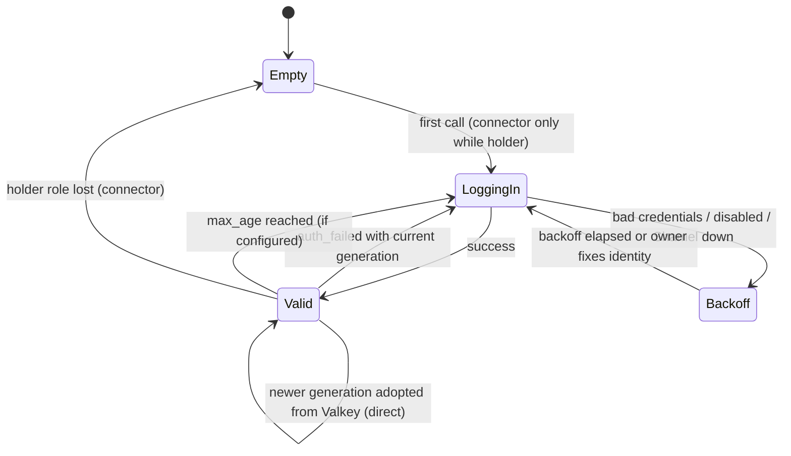

### 7.2 Header parameter builder

Shamel takes parameters in HTTP headers (`username`, `token`, `lastupdatedate`, `code`, `vatreg`, `getBalance`,
`getAll`, `itemCode`, `store`, `serial`, `filters`, `voucher_code`, `manual`, …).

- Header **names** come only from a constant `ParamSpec` table per endpoint (shared by gateway and connector); client
  input never names a header. In tunnel mode the gateway sends `{param_id, value}` pairs and the connector maps ids
  to names from its compiled table; `username` and `token` are set only by the session holder.
- Header **values** come only from S7-validated typed fields: codes `^[A-Za-z0-9._/-]{1,64}$` (refined per field
  once real data is seen), dates strictly `YYYY-MM-DD` re-formatted from a parsed `civil.Date`, booleans emitted
  as the literal `true` or the header omitted (Q8), JSON-valued headers (`filters`) marshalled from typed structs
  with **ASCII-only escaping** (`\uXXXX` for non-ASCII, so Arabic text is safe in a header).
- Final guard on every value (validator V, 02 §11.1, run in the gateway and again in the connector): every byte in
  `0x21–0x7E`, `0x20` only inside the value (so CR, LF, NUL, DEL, obs-text can never appear), at most
  `upstream.max_header_value_bytes` (4 KiB) per value and `upstream.max_header_total_bytes` (8 KiB) in total. A
  guard violation is a bug → internal error mapped to `502 upstream_error`, logged as `header_guard_violation`.
- `getAll=true` (bypasses Shamel salesman scoping) is sent only when the token's policy explicitly allows it
  *and* the identity is not a pinned salesman identity.

### 7.3 Form encoder (`obj` / `filters`)

Writes and some reports send JSON inside a form field (`obj=` for `/Customer/Post`, `/Item/Post`,
`/CostCenter/Post`, `/Voucher/Post2`, `/Report/GetAccountsheet`; `filters=` for
`/CostCenter/GetCostCenterAccountsheet`).

- Typed upstream DTOs with Shamel's exact field names (`Name`, `VatReg`, `customer_code`, …) and explicit JSON
  tags; marshalled once, then form-encoded (`application/x-www-form-urlencoded; charset=utf-8`).
- Decimals emitted from exact decimal text without exponent notation; strings validated UTF-8, control
  characters stripped/rejected in S7.
- In tunnel mode the gateway sends the typed JSON as `form{field_id, value}`; the connector checks that the field is
  the endpoint's `obj` or `filters`, parses the JSON, enforces `policy.max_form_bytes` (1 MiB) and re-encodes it
  with `url.Values` (02 §7.4 check 5).
- The encoded body is kept (by reference) for the audit event and the write-ahead record.

### 7.4 Tolerant response decoder

Built on a streaming tokenizer (`jsontext`), driven by per-DTO field tables:

| Quirk (observed or plausible) | Handling |
|---|---|
| Inconsistent key casing (`Success` / `success`, `userId` / `UserId`) | Case-insensitive field matching (safe because the output is re-encoded). |
| Numbers as strings (`credit`, `debit`, `balance` in account sheets) | Lenient scalar coercion to exact decimal; `""` → null. |
| Booleans as `0/1`, `"true"`, `"True"` | Lenient bool coercion (e.g. item `stopped` is int, customer `stopped` is bool). |
| `ErrorMessage` as string or string[] | Normalized to `[]string`. |
| Double-encoded JSON (top-level string containing JSON) | Decode the inner document once (bounded). |
| UTF-8 BOM | Stripped. |
| `Content-Type` other than `application/json` (e.g. an ASP.NET HTML error page), empty body | `bad_response` (02 §5.2 step 3). |
| Date variants (`yyyy-MM-dd`, `yyyy-MM-ddTHH:mm:ss`, `/Date(…)/`) | Ordered layout list in the upstream timezone; unparseable → null + drift metric. |
| `null` where a list is expected | Empty list. |
| Unknown fields | Skipped (no allocation), counted as schema drift. |

Hard limits: the operation's `MaxResponseBytes` (single record 4 MiB, master data 16 MiB, large lists and reports
256 MiB; never above `upstream.max_response_bytes`, 256 MiB), enforced on the stream and counted **after
decompression** (tunnel bodies arrive zstd-compressed, direct-mode bodies may be gzip); nesting depth 64.
Exceeding the cap → `502 upstream_response_too_large`, audit keeps the first 1 MiB.

### 7.5 Outcome classifier

Class names follow 02 §5.6; `upstream_error` is kept as a separate sub-class of 02's `bad_response` because it is
neither retried nor counted by the breaker.

| Upstream observation | Class | Client result | Retry (reads) | Counts for breaker |
|---|---|---|---|---|
| 2xx, decodes | `ok` | normal | — | success |
| 2xx `Success=false`, or 500 matching a curated rejection pattern | `business_rejected` | `422 upstream_rejected` or a mapped catalogue code (raw text → audit) | no | no |
| 500 matching the auth signature | `auth_failed` | reads: re-login + one retry, else `502 upstream_error`; writes: §6.4 step 6 | yes, once | no |
| 500 other (unclassified application error) | `upstream_error` | `502 upstream_error` | no | no |
| Connect refused/reset before the request was written, no tunnel, connector killed or suspended | `transport_unavailable` | `503 upstream_unavailable` | yes | yes |
| Connector answered `not_holder` | `not_holder` | one holder re-selection, invisible to the client | re-selection | no |
| Connector queue full or queue timeout | `busy` | `503 upstream_busy` | no | no |
| Timeout before response headers | `timeout` | `504 upstream_timeout` | yes (reads only, within budget) | yes |
| Body truncated/malformed, non-JSON, 3xx, 401/407 challenge | `bad_response` | `502 upstream_error` | yes (reads) | yes |
| Body above `MaxResponseBytes` | `too_large` | `502 upstream_response_too_large` | no | no |

Known Shamel validation messages can be mapped to specific Bawaba codes via a runtime mapping table (owner/ops
maintained, fixture-tested, returns codes only); unmapped messages become `upstream_rejected` with a generic
bilingual message.

### 7.6 Concurrency limiter and queue (protects Shamel)

Per upstream: `max_concurrency` (runtime setting, default **8** — conservative until ISCO answers / benchmarks).
The common path has **no per-request network call**.

1. **Exact global cap.**
   - **Tunnel mode:** the connector FIFO is the exact safety net. Σ `cap_share` over the upstream's connector
     instances = cap: in `single_holder` mode the primary holder receives `cap_share = cap` and standbys 0; if
     credentials are split across instances, cap is divided in proportion to their recent per-credential call rate
     (min 1 per holder); in `per_connector` mode `cap / instances`. Updates go out on the control stream. The
     connector queues excess frames by priority class and frame deadline, and answers `busy` when the deadline
     cannot be met. A local `policy.max_concurrency` on the Shamel host can only lower its share (02 §7.4).
   - **Direct mode:** nodes acquire slots from a Valkey ZSET semaphore (`bwb:<t>:sem:<upstream>`, lease =
     2 × the largest operation timeout, Lua acquire/release) in **batches**: a node keeps a leased slot while it has
     queued work and returns it after 200 ms idle, and a releasing request hands its slot directly to a local
     waiter (no Valkey op). A single-node install skips Valkey (N = 1, the local semaphore is exact).
2. **Node slots.** Each node's local semaphore has `node_slots = min(cap, ceil(2 × cap / N))` in tunnel mode
   (oversubscribed, so load-balancer skew never idles capacity; the connector FIFO absorbs the excess) and the
   currently leased slots in direct mode. `N` comes from the node registry; recomputed on membership change.
3. **Classes and reservations.** Priority classes: `interactive` (API reads), `write` (API writes and the
   approved-write executor), `background` (webhook change detection). Size classes from the call's cost class
   (03 §23.3): `large` calls (class `report` or `list`: full lists, reports, voucher date-range slices, list-shaped
   sub-calls of combined endpoints) may hold at most
   `large_max_share` (default 50 %, min 1) of the node's slots, so small single-entity reads always find a slot.
   **Background** slots are allocated cluster-wide: `background_slots = max(1, round(cap × background_max_share))`
   (default 25 % → 2 of 8), acquired by the singleton job leaders from `bwb:<t>:sem:<upstream>:bg` before they take
   a node slot at the lowest priority; a background call that has waited 30 s is promoted to `interactive`
   priority so it is throttled, never starved.
4. **Per-token fairness.** Inside each class the queue is a deficit round-robin over token ids (one quantum per
   call). A token may hold at most `upstreams[].max_inflight_per_token` slots per node (default
   `max(1, cap / 4)`) while other tokens have queued work in the same class (work-conserving: an idle upstream lets a
   single token use every slot). Each token may queue at most `upstreams[].max_queue_per_token` calls per node
   (default 32); beyond that it gets `503 upstream_busy` + `Retry-After: 2` + `Bawaba-Warning: upstream_saturated`
   while other tokens proceed. Sub-calls of a combined endpoint count against the calling token.
5. **Flight memory admission.** A new `large` leader flight is admitted only while the node's
   `pagination.flight_mem_max` budget has room (§9.4); otherwise it waits in this queue (a flight is always admitted
   when no other large flight runs on the node).

Queueing limits: `queue_timeout` (default 15 s, capped by the remaining request deadline) and `max_queue`
(default 256 per node per upstream) → `503 upstream_busy` + `Retry-After: 2` + `Bawaba-Warning:
upstream_saturated`. Metrics: queue depth and wait time per class, slot utilization, per-token rejections (also in
usage rollups); owner alert when saturation persists > 5 min, naming the top tokens by slot-seconds.

### 7.7 Timeouts

| Budget | Default | Key |
|---|---|---|
| Overall request deadline | 90 s (must stay < Cloudflare's 100 s origin timeout) | `server.request_timeout` |
| Direct dial / TLS handshake | 5 s / 5 s | `upstreams[].direct.dial_timeout` |
| Single-record and master-data reads (cost class `small`) | 30 s | `Operation.Timeout`, override per upstream |
| Large lists (`GetItems`, `GetCustomers`, `GetItemsStores`, price rows, catalog) | 75 s | 〃 |
| Voucher date-range slices (`GetVouchers`, `GetExtraVouchers`, §7.11) | 30 s per slice; the whole plan within the remaining request deadline | 〃 |
| Reports (`GetAccountsheet`, cost-center sheet, last price) | 60 s | 〃 |
| Writes | 60 s | 〃 |
| Login | 15 s | `session.login_timeout` |
| Queue wait | 15 s | `upstreams[].queue_timeout` |

Invariants checked at startup (02 §10.6): `queue_timeout` + the largest operation budget ≤
`server.request_timeout`, and no budget above 80 s; each call's effective budget is
`min(Operation.Timeout, remaining request deadline)`. Deadlines propagate via `context`; `ShamelCall.deadline_ms`
carries the absolute deadline (clamped by the connector to `policy.max_deadline`, 90 s) so the connector cancels the
Shamel call when the gateway gives up.

### 7.8 Retries

Only for operations with `Idempotent: true` (all reads, including POST-shaped reads such as
`GetAccountsheet`), only for classes marked retryable in §7.5, at most **1 retry** (2 attempts), full-jitter
backoff 100–400 ms, only if ≥ 50 % of the remaining budget is left, and subject to a per-upstream **retry budget**
(retries ≤ 10 % of requests over a 10 s window) to prevent retry storms. A retry re-enters the limiter queue. A
tunnel stream that fails before any response byte may be retried on another eligible session (§8.5) within the same
budget; a `not_holder` re-selection is not a retry. Writes are never retried by the gateway (§6.4).

### 7.9 Circuit breaker

Per (node, upstream, size class) — `small`, or `large` for calls of cost class `report`/`list` —
`sony/gobreaker/v2` semantics: trips when, over a rolling 30 s window with ≥ 20
requests, the failure ratio ≥ 50 %, or after 5 consecutive `transport_unavailable`/`timeout` outcomes. Only
`transport_unavailable`, `timeout` and `bad_response` count — application errors (`upstream_error`,
`business_rejected`), `busy`, `not_holder` and `too_large` do not. Keying by size class means legitimately slow
large fetches can open only the `large` breaker, never the one guarding small reads. Open duration 5 s, doubling up
to 60 s; half-open admits 3 probes. Open → `503 upstream_unavailable` immediately with `Retry-After`. Breaker
transitions are published (`bwb:events`) for the dashboard and alerting; they are not shared as state (each node
learns independently, which avoids a single bad node tripping the cluster).

### 7.10 Connection pooling

- **Direct mode:** one `http.Transport` per upstream: keep-alive on, `MaxConnsPerHost = node slots + 2`,
  `MaxIdleConnsPerHost = node slots`, `IdleConnTimeout 90s`, HTTP/1.1 (Shamel is presumed IIS/ASP.NET;
  HTTP/2 used if negotiated), redirects disabled, proxy env ignored unless configured, dial to the pinned
  `address` (§8.7).
- **Tunnel mode:** yamux streams are cheap (no handshake); the connector keeps its own keep-alive pool to Shamel.
- **Relay:** one HTTP/2 client per peer node (multiplexed, long-lived).

### 7.11 Combined endpoints

Combined operations (e.g. customer 360, stock across stores) have multi-call `UpstreamPlan`s executed by a plan
executor (`errgroup` with the request deadline). Every sub-call goes through coalescing and the limiter
individually (with its own cost class, charged to the calling token), so a combined call never exceeds the upstream
cap. A failed mandatory sub-call fails the request; a sub-call marked `optional` yields `null` plus a
`Bawaba-Warning: partial_result`.

**Range-split plans** (03 §12.2, §12.3). `GetVouchers` has no paging and returns full vouchers, so a long date range
would exceed every response cap and timeout. A `/v1/vouchers` range (at most `api.vouchers.max_range_days`,
default 31) longer than `api.vouchers.slice_days` (7) becomes consecutive slices `[from, from+6]`,
`[from+7, from+13]`, …, `[…, to]`; `/v1/voucher-summaries` (`GetExtraVouchers`, light rows) uses
`api.voucher_summaries.slice_days` (31) up to `api.voucher_summaries.max_range_days` (366). Slices are fetched
**sequentially**, each as its own upstream call admitted by the limiter (class `report`) and coalesced on its own
key (§9.1), so tools asking for overlapping ranges share slices; pushdowns apply to every slice. The normalized
slices are appended in slice order into the build arena of **one** snapshot (§9.4), so the client sees an ordinary
list with one cursor walk; a voucher appears once because its date falls into exactly one slice. The whole plan
must finish within the page-1 deadline, otherwise the request fails with `504 upstream_timeout` and no partial
snapshot is kept. S6 charges one `report` unit set per slice.

---

## 8. Connector transport

### 8.1 Decision

**WebSocket (wss) → inner TLS 1.3 with mutual certificate authentication → yamux stream multiplexing; one typed,
length-prefixed protobuf exchange per yamux stream (02 §7.4).** No HTTP is spoken between gateway and connector.

| Option | Verdict |
|---|---|
| Raw mTLS over TCP | Rejected as default: cannot pass through the Cloudflare HTTP proxy (TCP needs Spectrum) and would expose the gateway IP; no corporate-proxy traversal. |
| HTTP/2 with role reversal (connector serves h2 over a conn it dialed) | Viable, but only gateway→connector requests; connector-initiated control/telemetry needs a second mechanism, and the connector would parse HTTP from the gateway. |
| gRPC bidirectional streams | Same typed messages with a heavier runtime (HTTP/2 + gRPC) on both sides. |
| Relaying HTTP/1.1 requests per stream with a path-prefix allowlist | Rejected: an allowlist of prefixes admits `/Main/Login` with arbitrary credentials and undocumented paths (`/Voucher/Post`), and HTTP parsing between the two sides invites desync. |
| **WebSocket + inner mTLS + yamux + typed frames (chosen)** | Traverses Cloudflare proxy *and* Cloudflare Tunnel (both support WebSockets), and office HTTP proxies (`HTTPS_PROXY`); inner TLS is end-to-end so Cloudflare sees only ciphertext and cannot impersonate either side; yamux gives bidirectional streams, per-stream flow control and GoAway; typed frames name an endpoint id from a table compiled into the connector, so the connector is no open proxy and every value is re-validated (02 CN-4, CN-5). Cost: double encryption (negligible at these rates). |

```
┌──────── yamux streams (1 per Shamel call, stream 1 = control); length-prefixed protobuf frames ┐
│ inner TLS 1.3, mutual auth, Bawaba tunnel CA, ALPN "bawaba-tunnel/1", X25519MLKEM768 / X25519  │
│ WebSocket binary messages (RFC 6455) via websocket.NetConn                                     │
│ outer TLS (Cloudflare edge ↔ connector; Cloudflare ↔ origin via cloudflared or AOP)            │
│ TCP 443 outbound from the office                                                               │
└────────────────────────────────────────────────────────────────────────────────────────────────┘
```

Frames (illustrative; the protobuf schema lives in `internal/tunnel/proto`):

- `ShamelCall{request_id, endpoint_id (uint16), headers [{param_id, value}], form {field_id, value}?,
  credential {cred_id, version, sealed}, role_epoch, deadline_ms, max_response_bytes, priority, cost_class}`.
- Response: a header frame `{status, content_type, outcome, compression}`, body chunk frames (≤ 256 KiB each, one
  zstd stream), a trailer `{outcome, timings, bytes}`.
- Other operations: `MediaFetch{cref}`, `Ping`, `RenewCert{csr}`, `ResealCredentials{blobs}`,
  `SessionRole{cred_id, epoch, holder}` / `SessionRoleAck`, `Kill{reason}`; control-stream messages `hello`,
  `welcome`, `status`, `cap_share` (§8.3).

### 8.2 Enrollment and identity

Per 02 §7.2–§7.3; certificate signing happens **only** in the control plane.

1. Owner (server): `bawaba connector create --upstream up_1 --name office-1` → a one-time enrollment bundle
   `bwbenroll1.<base64url(JSON)>.<crc6>` (gateway URL, root SPKI pin, gateway install id, 256-bit secret, expiry
   1 h), shown once; the secret is stored as an HMAC, and five failed attempts invalidate it.
2. Office: `bawaba-connector enroll <bundle>` generates a TLS key (ECDSA P-256) and a sealing key (X25519) locally,
   opens `wss://connect.example.com/connector/enroll` with inner TLS pinned to the bundle's root and gateway URI SAN,
   and sends `EnrollRequest{secret, CSR, sealing_pub, host_fingerprint}`.
3. Data plane: HMAC lookup, consumes the secret atomically, inserts a `cert_requests` row. The control-plane **PKI
   signer** (the only holder of `pki_ca`) signs a 30-day client certificate with exactly one URI SAN
   `bawaba://connector/<conn_id>` (EKU clientAuth), sets the connector to `enrolled_pending`, and the data plane
   returns the chain. A compromised data plane cannot mint certificates.
4. The connector's console shows a 6-digit SAS (`SHA-256(cert_DER ‖ sealing_pub) mod 10^6`); the owner runs
   `bawaba connector confirm conn_x --sas 482913` → `active` and a new config version. Until then the gateway
   accepts only control frames from that connector and routes no request stream to it.
5. The owner seals the Shamel credentials to the new instance (§7.1).

Gateway-side certificates come through the same queue: each data node generates its own key and gets a 30-day
tunnel server certificate with URI SAN `bawaba://gateway/<install_id>` (EKU serverAuth) and, in topology C, a relay
certificate `bawaba://node/<node_id>` (EKU serverAuth + clientAuth). Keys stay on the node
(`/var/lib/bawaba/tls`, `0600`); renewal at two thirds of validity. Root CA 10 years, issuing CA 1 year (connectors
pin the root SPKI); no DNS or IP SANs anywhere. Verification checks the chain, the URI SAN, the connector status
(`active`, or `enrolled_pending` for control frames only) and the certificate serial against the connector's
registered serial set; session tickets are disabled (02 §7.2).

Revocation and kill: connector status and serial sets are in compiled config; `bawaba connector kill` closes that
connector's tunnels within the config propagation time and is persistent on the connector (re-enrollment needed);
`suspend|resume` closes tunnels without destroying the identity (02 §7.6).

### 8.3 Session lifecycle

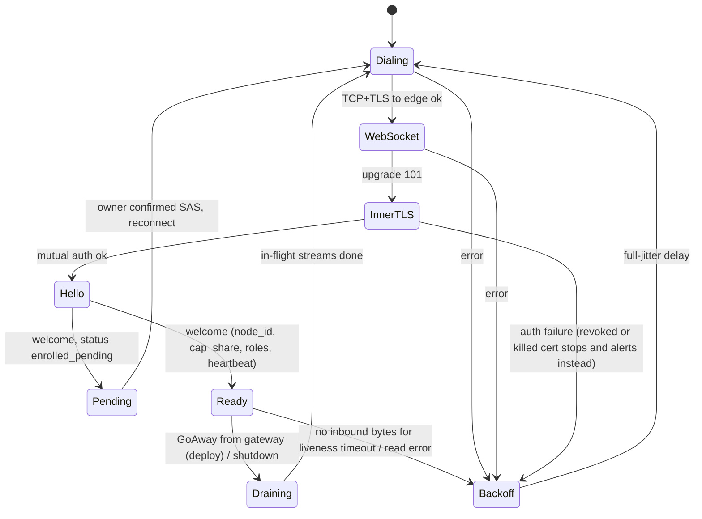

- **Hello/welcome** on yamux stream 1 (control stream, length-prefixed protobuf): `hello{connector_id, version, os,
  session_index, session_class, endpoint_table_version, endpoint_ids[], shamel_probe: {reachable, rtt_ms}}` →
  `welcome{node_id, status, cap_share, roles[{cred_id, epoch, holder}], heartbeat_s, min_version}`. The control
  stream also carries periodic `status` (Shamel reachability probe every 30 s: TCP connect + lightweight HTTP HEAD
  of the base URL, no credentials), `cap_share` updates, `SessionRole`, certificate renewal and `Kill`.
- **Liveness is progress-based:** an application `Ping` on the control stream every 15 s (well under Cloudflare's
  ~100 s WebSocket idle limit); a session is dead only when **no inbound bytes at all** arrived for
  `tunnel.liveness_timeout` (60 s). yamux's own keepalive is disabled and its `ConnectionWriteTimeout` is 60 s,
  because on a saturated office uplink pings and pongs queue behind data frames; a session busy streaming a body is
  alive by definition.
- **Flow control:** the gateway sets yamux `MaxStreamWindowSize` = `tunnel.stream_window` (4 MiB) for its receive
  side, so a response stream is not capped at 256 KiB per round trip through Cloudflare; the connector keeps the
  default window (requests are small). At most 256 streams per session.
- **Reconnect:** exponential backoff with full jitter, base 1 s, factor 2, cap 60 s; reset after 60 s healthy.
  Handshake timeout 10 s. Gateway enforces per-IP handshake rate limits and a cap on pending handshakes.
- **Version skew:** gateway rejects connectors below `min_version` with a specific close reason; connector logs
  and alerts locally. The gateway never routes an endpoint a connector did not advertise, so a rolling connector
  upgrade never turns into rejected frames (02 §7.4).

### 8.4 Request streams and connector checks

The gateway opens a stream and writes one `ShamelCall` frame. The connector treats the gateway as potentially
hostile and checks every frame (02 §7.4):

| # | Check | On failure |
|---|---|---|
| 1 | Known operation type for the protocol version | Reject stream |
| 2 | `endpoint_id` in the compiled table (upstream §1 endpoints minus undocumented ones such as `/Voucher/Post`); `/Main/Login` is internal to the connector's session manager | Reject |
| 3 | Endpoint in local `policy.allow_endpoints` (default all); writes also need `policy.writes: allow` (**default `deny`**) | Reject |
| 4 | Header parameters belong to the endpoint's documented set; values pass validator V | Reject |
| 5 | Form field is the endpoint's `obj` or `filters`, valid JSON, ≤ `policy.max_form_bytes` (1 MiB), re-encoded | Reject |
| 6 | Sealed credential opens with AAD `conn_id ‖ cred_id ‖ version` | Reject |
| 7 | `single_holder`: this instance is the credential's holder at `role_epoch` | `not_holder` |
| 8 | In-flight within the effective cap (`cap_share`, lowered by local `policy.max_concurrency`; optional `policy.max_rps`) | Queue (FIFO per priority), then `busy` |
| 9 | Deadline ≤ `policy.max_deadline` (90 s) | Clamp |

The connector then builds `base_url + endpoint.canonical_path` itself, sends fixed `Accept: application/json` and
`User-Agent`, adds `username`/`token` from its own session, sets no other headers and never follows redirects.
A frame failing checks 1–6 is rejected **individually** (stream reset with a reason enum); the tunnel is closed with
a 5-minute backoff only on an authentication or framing violation or a sustained reject ratio (> 50 % of frames
over 60 s and ≥ 20 rejects); `not_holder` and `busy` never count.

**Responses.** The connector streams the body as chunk frames: it first **scrubs** its own origin markers (base URL
host, resolved IPs, local hostname and NetBIOS name, media roots) with the streaming JSON scanner of 02 §7.4, then
**compresses** with zstd (level 1–3, encoder reused per session; flagged in the header frame). JSON shrinks 8–10×,
so a ≈ 70 MB 50,000-item `GetItems` crosses the office uplink as ≈ 7–9 MB. The body is capped at
`min(frame.max_response_bytes, compiled per-endpoint cap, local policy.max_response_bytes)`, counted after
decompression. The gateway decompresses through the operation's `MaxResponseBytes` limiter (decompressed bytes,
§7.4). Transport failures are reported as outcome enums, never Go error strings. The connector logs metadata only
(request id, endpoint id, status, duration, bytes), never bodies.

**Item images (02 §5.4).** During the scrub the connector replaces every `image_path` with an opaque reference
`cref = base64url(nonce ‖ AES-256-GCM(k_media, nonce, path))` (synthetic IV, keys never leave the connector), so
the gateway never sees the path. `MediaFetch{cref}` makes the connector decrypt the reference and serve the file
only if it canonicalizes under one of `media.roots` (no `..`, alternate data streams, device names, `\\?\` or
`\\.\` prefixes, UNC unless the root is UNC; symlinks resolved and re-checked; regular files ≤ `media.max_bytes`,
5 MiB) or, for HTTP image URLs, only on the Shamel base URL origin or a `media.http_prefixes` entry. The gateway
sniffs the type, bounds dimensions and re-encodes the image (dropping metadata). `media.enabled=false` until ISCO
confirms the format (08 ISCO-34).

### 8.5 High availability

- Each connector instance opens `tunnel.sessions` parallel sessions (default 2) with **classes**: session 0
  `interactive` (small calls, writes, control traffic), session 1 `bulk` (calls of cost class `report` or `list`).
  If one session is lost its class falls back to the other session of the instance until it reconnects. Bulk
  transfers therefore never delay interactive streams or control frames.
- Run ≥ 2 connector instances per upstream (different hosts where possible). In `single_holder` mode (default)
  one primary instance normally holds all credentials and carries the traffic; the others are hot standbys with
  tunnels up and probes running, and take over through holder failover (§7.1) within ~2 s plus one login. In
  `per_connector` mode all instances are active.
- Selection within eligible sessions: session class, then least in-flight streams, preferring sessions whose last
  `shamel_probe` succeeded.
- A stream that fails before any response byte is retried on another eligible session for idempotent reads (counts
  against the retry budget). For credential-affine traffic "eligible" means a session of the holder instance; if
  the holder is gone, failover runs first.

### 8.6 Reaching the tunnel from any node: registry + relay

Behind a load balancer a connector cannot choose its node, and connecting to every node is impossible behind
Cloudflare. **Decision:** tunnel registry in Valkey + node-to-node relay.

- On `Ready`, the holding node `ZADD bwb:tun:<upstream> <expiry_ms> <node_id>/<session_id>/<conn_id>/<class>`
  (refreshed every 5 s, expiry 15 s), publishes `tunnel_up`/`tunnel_down` on `bwb:events`, and also pushes the same
  events to its peers over the relay HTTP/2 connections (`POST /_relay/registry`), so registries stay current
  without Valkey.
- S10 selection order: local eligible session → remote node holding an eligible session (least loaded per node
  registry) via the relay → `503 upstream_unavailable`.
- Relay: `POST /_relay/upstream/{upstream_id}` on the private `relay` listener, mTLS with internal-CA node
  certificates (`bawaba://node/<node_id>`); the peer must be a registered node whose certificate serial matches the
  node registry. Body = the typed `ShamelCall` frame plus routing hints (session class, holder epoch). The holder
  node **re-validates** the frame against the operation registry (endpoint id, parameter ids, validator V, form
  field, sizes) before writing it unchanged to its local tunnel, so a stolen node certificate yields at most the
  same typed calls a data node can make; response frames are streamed back unchanged (still compressed; the caller
  decompresses). Extra latency: one private-network hop (~0.2–1 ms).
- A node that no longer has a matching session answers at once with outcome `no_session`, and the caller tries the
  next candidate.
- **Valkey unavailable:** nodes keep the last-known tunnel registry, node registry and holder records in memory and
  keep relaying to the last-known holders for `tunnel.registry_grace` (10 min), kept current by peer pushes and
  `no_session` answers; after the grace only nodes with a local session serve that upstream.
- Optional: dedicate nodes to the `tunnel` role behind a separate hostname/pool (`connect.example.com`) for very
  large clusters; no code difference.
- Single-node topologies need none of this (relay disabled).

Rejected alternatives: routing request/response bodies through Valkey queues (adds latency and memory pressure
for large lists); requiring sticky "tunnel node" singletons (single point of failure).

### 8.7 Direct-URL mode

For sites where the connector cannot be installed. The gateway dials Shamel itself. Upstream runtime settings
`direct.{base_url, address, host_header, sni, tls.ca_file | tls.pin_spki_sha256, allow_plaintext, dial_timeout}`
are encrypted at rest (purpose `upstream_config`) and masked in dashboard and CLI output (02 DU-5).

- **Addressing (02 DU-4):** `address` (IP:port) is configured explicitly, with separate `host_header` and `sni`;
  Shamel is never looked up in public DNS.
- **Encryption (02 DU-3), in order of preference:** (a) a site-to-site WireGuard tunnel with Shamel on a private
  address; (b) HTTPS with `tls.pin_spki_sha256` (a self-signed certificate is fine when pinned) or `tls.ca_file`.
  **Plain HTTP over the internet is refused:** startup fails unless the address is private (RFC 1918, ULA or a
  WireGuard interface) **and** `allow_plaintext: true` is set; while plaintext is in use the owner gets a daily
  alert.
- Redirects disabled. All gateway nodes egress through one static IP, and Shamel's firewall allows only that
  IP/32 for IPv4 and IPv6 (02 DU-1, DU-2); a Shamel-side reverse proxy that admits only the allowlisted paths is
  strongly recommended (DU-8).
- Custody: the gateway holds the credentials and sessions (§7.1); the blast radius of a gateway compromise is
  larger than in tunnel mode (02 §7.8), which is why the connector is preferred.
- Everything above the transport (limiter, breaker, decoder, classifier) is identical; the marker scan enforces the
  exact origin markers (host, IPs, port, SNI) in the gateway.

### 8.8 Connector configuration and service

`/etc/bawaba/connector.yaml` (Linux) or `%ProgramData%\Bawaba\connector.yaml` (Windows). Local only: nothing
here is ever sent to the gateway, and no remote config push exists (02 CN-8).

```yaml
gateway_url: wss://connect.example.com/connector/tunnel   # from the enrollment bundle
ca_pin: sha256/…                    # root SPKI pin from the bundle
gateway_id: <install_id>            # expected gateway URI SAN
cert_file: connector.crt
key_file: connector.key             # Windows: DPAPI + ACL to the service SID; Linux: 0600
sealing_key_file: sealing.key       # X25519; opens the sealed Shamel credentials
shamel:
  base_url: http://shamel.lan:8080/  # the ONLY destination ever contacted; never sent to the gateway
  tls_pin_spki_sha256: ""
  host_header: ""
policy:
  writes: deny                      # default; enabling writes is a deliberate local act
  allow_endpoints: all              # can only narrow the compiled table
  max_concurrency: 0                # 0 = follow cap_share from welcome
  max_rps: 0                        # 0 = off
  max_deadline: 90s
  max_form_bytes: 1MiB
  max_response_bytes: 0             # 0 = compiled per-endpoint caps
media:
  roots: []                         # image directories; empty = media disabled
  http_prefixes: []
tunnel:
  sessions: 2                       # session 0 interactive, session 1 bulk
proxy_url: ""                       # optional office HTTP proxy
log: { level: info, file: connector.log, max_size_mb: 50, max_files: 5 }
```

Windows: runs as a virtual service account (`NT SERVICE\BawabaConnector`) via `golang.org/x/sys/windows/svc`,
logs to the Windows Event Log plus rotating file, `bawaba-connector service install|uninstall|status`, local kill
with `bawaba-connector disable`. Linux: systemd unit with user `bawaba-connector`, keys `0600` under
`/var/lib/bawaba-connector`, `ProtectSystem=strict`, no capabilities (02 §7.9, §15.4).

---

## 9. Coalescing and pagination snapshots

### 9.1 Coalescing key

```
ck = base64url( HMAC-SHA256( coalesce_key,
       tenant_id ‖ upstream_id ‖ environment ‖ cred_id ‖
       upstream_call_signature ‖ normalizer_version ) )

upstream_call_signature = endpoint_id ‖ sorted(param_id=value…) ‖ canonical(form field)
```

- **Identity (`cred_id`) is in the key** because Shamel applies salesman scoping per identity: two tokens share a
  fetch only if they would receive byte-identical upstream data (02 §20.1).
- **Future optimization (not in v1):** poll streams drop the identity for Shamel endpoints that calibration has
  marked `identity_sensitive = false` (05 §2.3), and the coalescing key could do the same (constant in place of
  `cred_id`, with the flag's verification generation in the key so that a flip back to `true` stops sharing at
  once). It is not adopted yet because 02 §20.1 requires `cred_id` in the key and §9.7 relies on byte-identical
  upstream data; adopting it needs 02 to accept S14's data scope (including a pinned credential's effective
  salesman set, 04 §4) as the boundary instead.
- **Pushdown filters are in the key** automatically (they are header parameters/body fields).
- **Token-specific policy is deliberately *not* in the key**: the shared object is the *unfiltered* upstream
  result, and S14/S15 apply each requester's data scope and field mask afterwards. Sharing therefore never widens
  what a token can see (see §9.7).
- `normalizer_version` prevents sharing across rolling-deploy code versions.
- Keyed HMAC (`coalesce`, a data-plane MAC key) so Valkey keys reveal nothing (e.g. customer codes).
- Session `username`/`token` are not part of the signature (the session holder adds them).

### 9.2 Local single-flight

A per-node map `ck → *flight` (sharded mutex map). The leader's fetch runs on a **detached context** whose deadline
is the latest deadline among its local waiters and the remote followers registered for its generation (§9.3),
capped by `op.Timeout`. The flight is cancelled (reads only) only when every local waiter has cancelled **and** no
remote follower is registered; on cancellation or node shutdown the leader publishes `retry` for its generation so
remote followers re-elect at once.

The flight result is immutable and shared read-only: (a) the snapshot chunks as compressed byte slices in default
sort order (the same plaintext bytes that are encrypted and written to Valkey), (b) the **key column**: per record
its upstream position, dimension values, filterable typed values, collation sort keys and search keys
(03 §5.5–§5.6), typically 100–300 B per record (≈ 5–15 MiB for 50,000 records), used by S14 to filter, sort and
search without decoding chunks, (c) the snapshot id. Followers decode only the chunks their page needs, through the
node-local chunk cache (§9.4).

### 9.3 Distributed coordination (operations with `Snapshot: true`)

```
join (one script, coal_join.lua; both keys share the hash tag {<ck>}):
  SET  bwb:<t>:coal:{<ck>} <gen_id> NX PX (op.timeout + 5s) GET
  -> nil       : this node is leader for gen_id
  -> <gen_id>  : follower of that generation; the script also runs
                 ZADD bwb:<t>:coal:{<ck>}:w:<gen_id> <deadline_ms> <node_id>  (PEXPIRE op.timeout + 5s)
leader:  every 1 s extends its deadline to the max registered follower deadline (capped by op.timeout)
leader done:
  ok, snapshot written   -> SET bwb:<t>:coalres:<gen_id> <snapshot_id> PX 5000
  upstream outcome error -> SET coalres:<gen_id> <class> PX 5000   (transport_unavailable, timeout,
                                                                   bad_response, upstream_error)
  no snapshot needed, cancelled, shutting down -> SET coalres:<gen_id> retry PX 5000
  then PUBLISH bwb:coal <gen_id>; DEL coal:{<ck>} if value == gen_id (CAS script)
follower: wait for PUBLISH or poll coalres:<gen_id> every 50 ms until its own deadline;
          retry -> re-elect immediately; coal:{<ck>} expired without a result (leader died) -> re-elect once
```

- **Freshness rule:** a follower only accepts the result of the generation that was *in flight when it
  arrived*. A request arriving after the leader finished starts a new live fetch. Coalescing never serves
  completed results to new page-1 requests — "always live" holds, including after a `retry`.
- Only upstream-outcome classes are shared, so a failing Shamel is not hit N times; a leader's local cancellation
  or shutdown is never shared as an error (`retry` instead).
- Non-snapshot operations (single entity, status checks) coalesce **locally only** — cross-node waiting costs
  more than it saves for small, fast calls.

### 9.4 Snapshot storage

**Decision: snapshots live in Valkey, chunked, zstd-compressed and AES-256-GCM-encrypted at rest.** Snapshots
contain balances and prices; Valkey persistence files and replicas must be as useless to a thief as a stolen
database. AES-GCM with AES-NI runs at several GB/s per core, far below zstd cost.

**Build.** The leader decodes and normalizes the stream into a compact build arena (internal binary record
encoding) and fills the key column (§9.2: upstream position, dimension values, collation sort keys and search keys,
precomputed once per record, 03 §5.5). At the end of the stream it computes the permutation for the operation's
`DefaultSort` with a stable sort on the precomputed keys (`bytes.Compare`; skipped when records already arrived in
order, which is detected on the fly, and then records stream straight into chunks without the arena) and **stores
the snapshot in that order**: chunks of 512 records are cut along the permutation, compressed with zstd, and the
arena is dropped. Each record keeps its upstream position, which is the final tie-breaker of every other sort, so
ties still keep upstream order as 03 §5.5 requires. Peak memory per flight ≈ the compact size of the result
(≈ 0.3–0.5 × the upstream JSON; ≈ 25 MiB for 50,000 items) during the build, then the compressed chunks plus the key
column. Builds are admitted against the node budget `pagination.flight_mem_max` (default 25 % of `GOMEMLIMIT`,
§7.6). Default-ordered views are therefore monotonic and touch only contiguous chunks.

**Lazy materialization.** The leader writes the snapshot to Valkey only when (a) a requester on its node (the leader
request or a local follower) needs more than one page, or (b) remote followers are registered for its generation
when the fetch completes. Otherwise it writes nothing and publishes `retry` (a late follower re-elects and fetches
live). `/legacy` operations never write snapshots. Chunk writes run concurrently with S14/S15; a response with a
non-null `next_cursor` is sent only after the snapshot and view writes are acknowledged (else
`503 pagination_unavailable`).

| Key | Content | TTL |
|---|---|---|
| `bwb:<t>:snap:{<sid>}:m` | meta: `ck`, `created_at`, `expires_at`, record count, chunk count, chunk size, sort key, resource type, normalizer version, key id | 60 s absolute |
| `bwb:<t>:snap:{<sid>}:c:<n>` | chunk *n*: 512 normalized records in default sort order (compact internal binary encoding, with their sort and search keys) → zstd → AES-256-GCM (purpose `snapshot`, AAD `snapshot/<sid>/<n>`) | same |
| `bwb:<t>:snap:{<sid>}:k` | the key column (§9.2) → zstd → AES-256-GCM (AAD `snapshot/<sid>/k`), so a remote follower builds its view without decoding record chunks | same |

- `{<sid>}` is the Valkey hash tag, so all keys of one snapshot share a slot. Encryption uses the record envelope of
  02 §9.3 (fresh HKDF subkey per message, key id in the envelope).
- TTL is absolute from creation (`pagination.snapshot_ttl`, default 60 s) and reported as
  `snapshot_expires_at`; it is not extended by reads.
- **Memory limits:** `pagination.snapshot_max_bytes` (default 64 MiB compressed per snapshot, records plus sort and
  search keys; exceeded while building → page 1 fails with `422 result_too_large`, whose advice is to narrow the
  request with **pushdown** filters, the only filters that shrink the unfiltered upstream result, 03 §5.3–§5.4),
  `pagination.max_views_per_token` (default 32 live views), and Valkey `maxmemory` with `volatile-ttl` eviction (all
  snapshot/view keys carry TTLs). Early eviction surfaces as `409 snapshot_expired`, never as wrong data. Metric
  `bawaba_snapshot_bytes` estimates resident bytes of snapshots and materialized views (written − expired by
  schedule).
- **Separate client:** snapshot and view chunk I/O uses a dedicated `valkey-go` client with its own connections,
  so multi-MB values never share a pipeline with hot-path commands (rate leases, elections, idempotency).
- **Node-local chunk cache:** a byte-bounded LRU of decoded immutable chunks keyed `(sid, n)`, each entry expiring
  at its snapshot's `expires_at` (`pagination.local_chunk_cache_bytes`, default 256 MiB). It serves cursor pages and
  followers of the same snapshot only, never outlives the snapshot, and so adds no business-data caching beyond the
  decided ~60 s snapshot.
- Non-snapshot operations never touch Valkey for results.

### 9.5 Views

A view is created on page 1 per (token, query) for results that need more than one page. TTL = the snapshot's
remaining TTL; all values encrypted (purpose `view`, AAD `view/<vid>/<token_id>/<policy_version>` extended with the
key suffix `m`, `p/<n>` or `c/<n>`, so pages and chunks cannot be swapped within a view).

| Key | Content |
|---|---|
| `bwb:<t>:view:{<vid>}:m` | meta: `sid`, `token_id`, `route_id`, `policy_version`, `query_hash`, kind (`positions` \| `materialized`), record count, page map (first/last snapshot chunk per positions page) |
| `bwb:<t>:view:{<vid>}:p:<n>` | `positions` kind: 1,024 ascending snapshot record indexes per page, delta-varint |
| `bwb:<t>:view:{<vid>}:c:<n>` | `materialized` kind: 256 records that passed the data scope and client filters, in view order (compact binary → zstd → AES-256-GCM) |

- **Positions** when the requested sort equals the snapshot's default sort and the view keeps ≥ 50 % of the
  snapshot's records: a page touches only ⌈limit/512⌉+1 contiguous snapshot chunks.
- **Materialized** otherwise (another sort, search, or a selective data scope or filter): a page reads
  ⌈limit/256⌉+1 view chunks, independent of how the records were scattered in the snapshot. Materialized records
  are unmasked; S15 still applies the current mask on every page.
- **Size:** positions ≈ 1 B per row before zstd (≈ 20–60 KiB for 50,000 rows); a materialized view is at most the
  kept fraction of the snapshot's compressed size.

### 9.6 Cursors

`next_cursor = base64url( seal(cursor, AAD = cursor/<token_id>/<route_id>, {v, vid, sid, offset, query_hash,
policy_version, expires_at, chunk_hint}) )`

- Opaque and tamper-proof; unsealed in S7. It must open under the calling token and route (AAD) and match the
  request's normalized query (`query_hash`); otherwise `400 invalid_cursor`. A cursor used by a different token is
  rejected even if both tokens could see the data.
- The token's current `policy_version` must equal the cursor's; otherwise `409 cursor_invalidated` (any policy
  change ends running walks, 03 DS-9, 04 §9.4). Past `expires_at` (5 s tolerance) → `409 snapshot_expired`.
- `limit` may differ between pages; filters/sort may not.
- A page read is one pipelined batch: the view meta, the positions page or view chunks for `[offset, offset+limit)`,
  and the snapshot chunks named by `chunk_hint` (local cache hits skipped) — about one Valkey RTT, and S6 adds
  none in the common case. A changed `limit` may cost one extra round trip for chunks the hint did not cover. A
  view meta that disagrees with the cursor (sid, token, policy version) → `409 cursor_invalidated`; missing keys →
  `409 snapshot_expired`.
- Defense in depth: on each page read, every record is re-checked against the token's current policy and mask
  (S14/S15).

### 9.7 Safety argument

Data reaches a client only through S14+S15 of *that client's* request. The shared artifacts (in-memory flight
result, snapshot, node-local chunk cache) contain exactly what Shamel returns to the identity configured for the
token, so a token can only coalesce with tokens that use the same identity on the same upstream and environment.
Views and cursors are token-bound and bound to the policy version they were built under. Therefore coalescing and
snapshots never let a token see a record or field its own policy would hide.

---

## 10. Performance design

### 10.1 Targets and overhead budget

"Gateway overhead" = total server time − upstream time (incl. tunnel/relay) − limiter queue wait.

| Metric | Target (4 vCPU node, same-DC Valkey RTT < 0.5 ms) |
|---|---|
| Overhead p50 / p99 / p99.9, responses ≤ 64 KiB | ≤ 1 ms / ≤ 5 ms / ≤ 15 ms |
| Large lists: additional overhead | ≤ 8 ms per MiB of upstream JSON (streaming decode + normalize + sort + snapshot write) |
| Throughput, small authenticated reads against embedded mock (0 ms latency), full audit on | ≥ 5,000 req/s per node |
| Cursor page reads (no upstream) | ≥ 10,000 req/s per node |
| Valkey commands per small read in steady state | ≈ 0 (rate leases ≈ 1 call per batch, advice merged every 1 s) |
| Horizontal scaling efficiency to 8 nodes | ≥ 85 % of linear |
| Heap per large flight | build arena (≈ compact result size) during the build, then O(compressed snapshot + key column, typically 100–300 B × records); node-wide cap `pagination.flight_mem_max` |
| Heap per cursor page | O(⌈limit/chunk⌉ decoded chunks + output buffer) |
| Tunnel: 50,000-item `GetItems` (≈ 70 MB JSON, ≈ 8 MB zstd) | ≤ 10 s on a 10 Mbit/s office uplink; ≤ 40 s at the 2 Mbit/s minimum, inside the 75 s large-list budget |

Indicative per-stage p99 budget (small request): S1–S5 ≤ 50 µs, S6 ≤ 5 µs from the local lease (≤ 1 ms when a
synchronous refill is needed), S7–S10 ≤ 100 µs, S11 ≤ 1 ms (distributed path) / ≤ 5 µs (local), S13–S15 ≤ 200 µs +
size-proportional, S16 ≤ 20 µs.

**Cluster-wide audited throughput.** The throughput targets above are per node. In the default
`audit.metadata_mode: postgres` every audited request adds ≈ 2.8 index rows on the one PostgreSQL primary, which
caps the whole cluster at ≈ 2,000 audited req/s (05 §1.12: rating for a dedicated 8 vCPU / NVMe primary, to be
confirmed by the `audit-pg-ingest` load test before release), far below 8 nodes × 5,000 req/s. The per-node targets
and the 85 % scaling target therefore hold cluster-wide only in `audit.metadata_mode: segment_first`, the opt-in
alternative for heavy load, in which metadata goes to per-node segments in the blob store (05 §1.12). In `postgres`
mode the alert `audit_ingest_near_capacity` fires at 70 % of `audit.capacity.pg_rows_per_second` (05 §1.12).

### 10.2 Techniques

- **Stateless nodes** (§1): scale by adding nodes; no affinity required (cursors work on any node).
- **In-memory compiled config:** immutable structs behind `atomic.Pointer`; scopes as bitsets, data-scope as
  allow-sets, field masks precomputed per (token, operation); zero locks on the read path.
- **Local rate leases and advice** (S6): no Valkey round trip on the common request path.
- **Streaming JSON:** the upstream body (decompressed on the fly) is tokenized element by element; each record is
  normalized into the build arena, or straight into chunks when it already arrives in default order. The full
  upstream body is never materialized as a Go object graph. The response is assembled completely and sent only
  after the upstream body is fully consumed and the response guards ran (so truncated upstream responses and leaked
  fragments are never partially exposed, S17).
- **Allocation discipline:** pooled `reqctx`, byte buffers (`sync.Pool`, size-classed), generated
  `AppendJSON` encoders with masks, no `map[string]any` on hot paths, no reflection in per-record code, string
  interning for repeated codes (currencies, stores) within a snapshot. CI runs `-benchmem` gates.
- **Connection pooling:** keep-alive pools (direct), yamux (tunnel), HTTP/2 (relay), `pgxpool`; `valkey-go`
  auto-pipelining for hot-path commands on one client and a separate client for snapshot/view chunk I/O.
- **Tunnel efficiency:** zstd-compressed bodies, 4 MiB receive window, a dedicated bulk session per connector
  instance (§8.3, §8.5).
- **Async audit pipeline** (05 §1.5, authoritative): S16 enqueues into a bounded MPSC ring (`audit.ring_size`,
  65,536 events, and `audit.ring_max_bytes`, 256 MiB of body charge, per node; bodies ≤ `audit.copy_max` (64 KiB)
  are copied, larger pooled buffers are reference-counted). Workers: strip transport framing (chunked encoding,
  gzip; body bytes are otherwise stored exactly as sent and received, never re-formatted, 05 §1.2) → record-aligned
  chunking of JSON arrays (05 §1.4.3), which is what makes repeated records dedupe → keyed object ids (`audit_addr`
  MAC key) → dedup check (node LRU of recent ids, then `audit_blobs`) → zstd with trained dictionaries →
  AES-256-GCM under the node's current epoch DEK (sealed to `audit_seal`, 02 §9.2) → local WAL → pack, plus batched
  `COPY` of index rows into time-partitioned PostgreSQL tables every 250 ms or 1,000 rows. Back-pressure: ring full
  → spill queue (`audit.spill_queue`) → local encrypted spool (`audit.spool_dir`; WAL, spool and capture temp files
  share `audit.spool_max_bytes`, default 10 GiB), replayed later; spool full → `audit.on_spool_full`. In
  `audit.metadata_mode: segment_first` metadata goes to per-node Parquet segments instead of per-request rows
  (05 §1.12). Details in 05 §1.
- **No per-request PostgreSQL** on reads; usage and audit are batched.
- **GC tuning:** `GOMEMLIMIT` set from the container limit (80 %), `GOGC` default; profile-guided optimization
  (PGO) profile from load tests committed under `cmd/bawaba-gateway/default.pgo`.

### 10.3 Observability

`log/slog` JSON logs (no bodies, no secrets; request id on every line), Prometheus metrics on the `ops` listener
(`bawaba_request_duration_seconds{op,status}`, `bawaba_overhead_seconds{op}`, `bawaba_stage_duration_seconds{stage}`,
`bawaba_upstream_duration_seconds{upstream,op,outcome}`, `bawaba_upstream_queue_wait_seconds{class}`,
`bawaba_coalesce_total{result=leader|follower|local}`, `bawaba_snapshot_bytes`, `bawaba_flight_mem_bytes`,
`bawaba_chunk_cache_hits_total`, `bawaba_tunnel_sessions{class}`, `bawaba_tunnel_bytes_total{direction}`,
`bawaba_degraded{function}`, `bawaba_audit_queue_depth`), optional OpenTelemetry tracing (OTLP; spans per stage
and per upstream call, sampled). Sandbox tokens additionally receive a `Server-Timing` header to help agents
diagnose their own tools; live tokens do not.

### 10.4 Load-testing approach

- **Harness:** k6 scenarios in `test/load/`, run against a cluster wired to `bawaba-mock` with latency/size
  profiles (`--latency p50=80ms,p99=600ms`, `--customers 20000`, `--items 50000`), real connectors on shaped links,
  and toxiproxy-wrapped Valkey/PostgreSQL for fault injection.
- **Scenarios:** (1) small-read baseline; (2) large-list pagination walk, default order and re-sorted; (3)
  thundering herd of identical requests — assert upstream calls per generation = 1; (4) many tokens with different
  scopes on the same identity — assert no cross-token leakage (content assertions) and shared upstream calls; (5)
  mixed reads/writes with idempotency replays; (6) Valkey latency +5 ms and outage; (7) connector flapping and node
  kill during load; (8) 24 h soak: heap, goroutines (`goleak` in tests), file descriptors flat; (9) abusive
  patterns: invalid-token floods, slowloris, oversize bodies; (10) fairness: one token floods large lists while
  others make small reads — assert bounded queue wait for the others and `upstream_busy` for the flooder; (11) slow
  uplink: tunnel shaped to 2 Mbit/s carrying a 50,000-item `GetItems` next to small reads — assert no session death
  and interactive p99 within target; (12) two connectors in `single_holder` mode, kill the holder under load —
  assert exactly one login on the new holder and no login ping-pong.
- **Gates:** microbenchmarks per stage with `benchstat` (fail CI on > 10 % regression in ns/op or allocs/op);
  nightly k6 on a fixed hardware profile with thresholds from §10.1; results published to the repo
  (`test/load/results/`).
- **Upstream capacity:** a separate, owner-approved, low-rate calibration run against the real Shamel (off-hours)
  to set `max_concurrency` (find the knee of Shamel's latency curve, then use ~70 % of it). `bawaba upstream
  calibrate` also measures the tunnel throughput (the connector streams a synthetic compressed payload) and warns
  when the office uplink is below the 2 Mbit/s minimum.

---

## 11. Sandbox

- **Routing:** `bwb_test_` / `bwb_pk_test_` tokens resolve (S9) to the tenant's virtual upstream `sandbox` of
  kind `mock`. Live upstreams can never be selected for a test token (invariant asserted in S9 and S10).
- **Embedded vs separate:** `sandbox.mode: embedded` (default) mounts the `bawaba-mock` handler in-process and
  calls it through an in-memory `http.RoundTripper` — no network, no extra service, and the **entire direct-mode
  upstream client path** (sessions, headers, `obj` encoding, tolerant decoding, error classification) is exercised.
  `external` points at a `bawaba-mock` container (`sandbox.url`) for load tests or isolation; `disabled` turns the
  sandbox off (`503 sandbox_disabled`). The tunnel framing is covered by end-to-end tests that run a real connector
  against `bawaba-mock`.
- **Fidelity:** the mock reproduces Shamel's HTTP surface: header parameters, `obj`/`filters` forms, `/Main/Login`
  sessions with expiry, HTTP 500 with raw error text, casing/number quirks, `lastupdatedate` filtering, salesman
  scoping and `getAll`.
- **Deterministic dataset:** generated from `sandbox.seed` with a pinned generator version
  (`sandbox.dataset_version`) using `math/rand/v2` PCG: currencies (ILS, USD, JOD), cities (نابلس، رام الله، الخليل،
  جنين، طولكرم، بيت لحم…), stores, six price classes, salesmen, ~2,000 customers with Arabic names (e.g. "شركة
  النور للتجارة العامة"), ~5,000 items with Arabic and English names, groups, serials, stock per store, and
  24 months of vouchers of every type with consistent balances and account sheets. Same seed + version ⇒
  byte-identical data, so agents can write stable tests.
- **Writes in sandbox:** applied to an overlay per sandbox namespace (default: per token) stored in Valkey
  (`bwb:<t>:mock:<ns>:*`, 7-day TTL) so embedded mocks on different nodes agree; `bawaba sandbox reset
  [--token …]` clears it.
- **Fault scenarios:** test tokens may send `Bawaba-Mock-Scenario` (`slow`, `timeout`, `upstream_error`,
  `unavailable`, `busy`, `auth_expired`, `rejected`, `outcome_unknown`, `approve_after_10s`, `reject_after_10s`,
  `snapshot_expire`; 03 §21.3 owns the list and effects) to exercise their error handling; ignored (and stripped)
  for live tokens.
- Sandbox traffic is audited and rate-limited like live traffic, flagged `environment=sandbox`.

---

## 12. Multi-upstream and latent tenant model

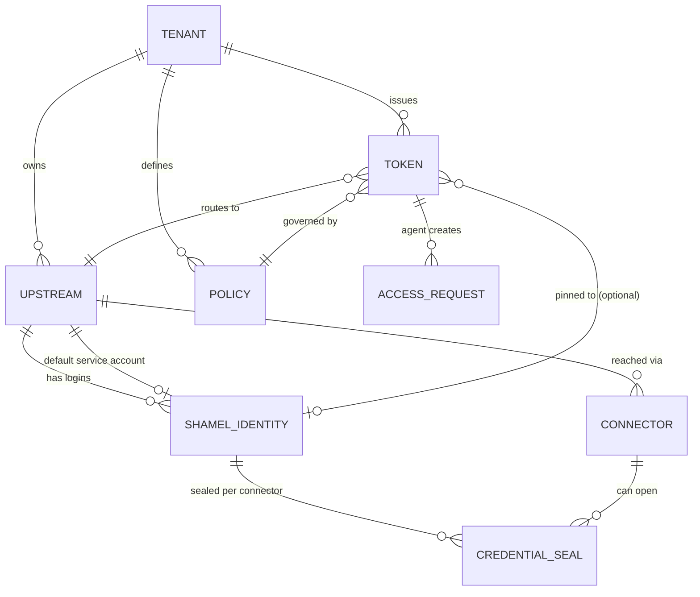

- **Tenant:** exactly one row (`ten_default`) in v1. Every table carries `tenant_id NOT NULL`; uniqueness
  constraints are tenant-scoped; every Valkey key carries the tenant segment `<t>`; compiled config is per
  tenant. No billing, plans, licensing or quota-for-billing fields exist.
- **Upstream:** `id`, `name`, `environment` (`live` | `sandbox`), `mode` (`tunnel` | `direct` | `mock`),
  `direct.*` settings (direct only, encrypted, §8.7), `timezone` (default `Asia/Hebron`), `max_concurrency`,
  `credential_session_mode`, fairness and share settings (§7.6), timeouts, auth-failure signatures, error-message
  mapping, `default_identity_id` (04: `default_credential_id`). A tunnel upstream stores no Shamel address at all.
- **Shamel identity** (04 `shamel_credentials`): `id` (`cred_…`), `upstream_id`, `label`, `salesman_code` (from
  the registration test login, connector-reported in tunnel mode, 04 §6.2), `last_login_at`, `status`. Secret
  material: tunnel mode — one HPKE ciphertext per (credential version, connector instance) (`CREDENTIAL_SEAL`);
  direct mode — username and password envelope-encrypted (`shamel_credential`).
- **Connector:** `id`, `upstream_id`, status (`created` | `enrolled_pending` | `active` | `suspended` | `killed` |
  …, 02 §7.6), registered certificate serials (current, next), sealing public key, advertised endpoint-table
  version, last seen, version.
- **Token:** bound to exactly one upstream in v1 (a test token to the sandbox upstream). Adding a second Shamel
  server = inserting an upstream + identities + connector and issuing tokens bound to it; no code change.
  Per-request upstream choice (one token, many upstreams) is a possible later extension (`Bawaba-Upstream`
  header), deliberately not in v1.

---

## 13. Failure modes

### 13.1 Summary

| Failure | Detection | Behaviour | Client sees | Owner alert |
|---|---|---|---|---|
| Shamel down | connect errors, connector probe, breaker | Breaker opens; webhook polling pauses; login attempts back off | `503 upstream_unavailable` + `Retry-After` | yes, after 60 s |
| Shamel slow | latency histograms, queue depth | Requests queue up to `queue_timeout`; timeouts trip the breaker of that cost class; background class throttled first; per-token fairness keeps small readers moving | `503 upstream_busy` / `504 upstream_timeout`; `Bawaba-Warning: upstream_saturated` | yes, sustained > 5 min |
| Shamel session invalidated | auth signature | Reads: single-flight re-login (gateway in direct mode, holder connector in tunnel mode), one retry. Writes: not retried (§6.4 step 6) | reads transparent; writes `504 write_outcome_unknown` unless never sent | only if login fails |
| Shamel credentials wrong / user disabled | login result | Identity backoff 30 s → 5 min (gateway or holder connector) | `502 upstream_error` | yes, immediately |
| Connector disconnected (all instances) | registry empty, liveness timeout | 2 s grace, then fast-fail; connectors reconnect with backoff | `503 upstream_unavailable` | yes, after `alerts.connector_down_after` (2 min) |
| One session or standby instance lost | liveness | Traffic shifts to the remaining session of the instance | transparent (idempotent reads retried) | warning |
| Session-holder instance lost | registry expiry, tunnel close | Holder failover: new epoch, handover, one login on the new holder (§7.1) | ~2 s + one login of `503`/retries | warning |
| Slow office uplink | tunnel byte metrics, transfer times | Bulk session isolates large transfers; progress-based liveness keeps sessions up; large-list budget 75 s | `504 upstream_timeout` for lists that cannot cross the uplink in time | yes, when p95 transfer time > 50 % of the budget |
| Gateway node crash | ingress health, registry TTL | Ingress removes node; its tunnels reconnect elsewhere; coalescing leases and follower registrations expire and followers re-elect | in-flight requests on that node fail | yes |
| Control-plane process down | supervisor, `ops` health | Data plane serves on the last compiled config; no administration, approvals or certificate signing (30-day certificates renew at 2/3 of life, so days of slack; a new node without certificates stays not-ready for tunnel/relay); alerts queue in `alert_outbox` | transparent | systemd/Docker restart; queued mails sent on recovery |
| Valkey down | client errors | Per function, §13.2 | mostly transparent; writes and multi-page lists `503` | yes |
| PostgreSQL down | pool errors | Reads continue on last compiled config for `config.max_staleness` (default 6 h), then fail closed; a node that also cannot reach Valkey fails closed after `config.blind_staleness` (5 min); audit index rows spooled; writes, access requests, webhook subscription changes fail closed; control plane read-only/unavailable; emergency revocation via Valkey (§5.4). Startup without PostgreSQL is refused. | reads OK; writes `503` | yes |
| Blob store down | put errors | Audit bodies (already encrypted) spooled locally; when spool full → `503 audit_unavailable` (default) or metadata-only (if configured) | transparent until spool full | yes, at 50 % spool |
| Audit spool disk full | disk metrics | As above | `503 audit_unavailable` | yes |
| Cloudflare outage | external | No bypass is offered (it would expose the origin) | unreachable | — |
| Master key or data-plane key missing/unreadable/wrong permissions/wrong `kcv` | startup check | That plane's process refuses to start; a data-plane process that can read `master.key` also refuses | — | systemd/Docker failure |
| Internal CA / connector or node certificate near expiry | daily job | Auto-renew through the signer; alert at 7 days remaining | — | yes |
| Upstream schema drift | drift metrics | Unknown fields dropped; unparseable values null | normalized data | yes (first occurrence per field) |
| Clock skew | see §13.3 | | | yes |

### 13.2 Valkey unavailable — per function

| Function | Mode | Behaviour |
|---|---|---|
| Rate limits | degrade | Local GCRA at `limit / last_known_N`. |
| Polling warnings | degrade | Node-local advice only (no cross-node merge). |
| Auth-failure counting / auto-ban | degrade | Node-local counters and bans; existing bans already mirrored in memory stay enforced; bans persisted to PostgreSQL and re-synced on recovery. |
| Config invalidation | degrade | PostgreSQL version poll every 2 s; blind-node rule if PostgreSQL is also down (§5.4). |
| Emergency deny-set | degrade | Last known set kept in memory. |
| Coalescing | degrade | Local single-flight only. |
| Snapshots / views / cursors | **fail closed for multi-page** | Single-page results served normally; results needing a cursor → `503 pagination_unavailable`; cursor reads → `503`. Never silent truncation. |
| Idempotency records | **fail closed** | Writes `503 idempotency_unavailable`. |
| Shamel session sharing (direct mode) | degrade | Per-node sessions and logins (risk of token churn if Shamel allows one session per user — 08 ISCO-01). |
| Session-holder records (tunnel mode) | degrade | Last known holder kept; a change only if exactly one instance is connected (§7.1). |
| Distributed concurrency lease (direct mode) | degrade | Local `floor(cap / last_known_N)`, min 1. Tunnel mode is unaffected (connector cap). |
| Background slots | pause | Webhook detection and the alert threshold evaluator need leases and pause with them. |
| Tunnel registry / relay | degrade | Last-known registry and holders used for `tunnel.registry_grace` (10 min) with peer pushes and `no_session` answers; then only nodes with a local session serve that upstream (§8.6). |
| Queues (webhooks, approved writes) | pause | Producers write the PostgreSQL record (source of truth) and enqueue later; consumers resume on recovery. Alerts are unaffected: emitters write `alert_outbox` rows in PostgreSQL first (05 §3.1). |
| Sandbox overlay | degrade | Sandbox writes `503`; reads use the deterministic base dataset. |

Valkey deployment requirement: AOF `appendfsync everysec` (idempotency records and queues must survive a Valkey
restart), `maxmemory-policy volatile-ttl`, TLS + ACL user per plane (02 §12.4).

### 13.3 Clock skew

- Single time source for distributed algorithms: GCRA and leases use Valkey `TIME` inside scripts; snapshot and
  view expiry are Valkey TTLs (server-side).
- Nodes compare local time with Valkey `TIME` at each heartbeat: skew > 2 s → warning metric/alert; > 30 s →
  node reports not-ready (cursor expiry, token expiry and certificate validation would become unreliable).
- Certificates issued with `NotBefore = now − 5 min`. Cursor `expires_at` checks allow 5 s tolerance.
- NTP (chrony/systemd-timesyncd; Windows Time for the connector) is a documented deployment requirement.

---

## 14. Repository layout and libraries

Single Go module (module path TBD, placeholder `github.com/<org>/bawaba`), Go ≥ 1.26 (track latest stable).

```
.
├── cmd/
│   ├── bawaba-gateway/        # main; serve --plane=data|control; default.pgo
│   ├── bawaba-connector/      # main; Linux daemon + Windows service
│   ├── bawaba/                # CLI (cobra); --json on every command
│   └── bawaba-mock/           # standalone mock Shamel server
├── internal/
│   ├── app/                   # wiring, plane/role startup, graceful shutdown
│   ├── config/                # bootstrap config per plane: file + env + *_file secrets, validation
│   ├── keyring/               # root key files (master.key / data.key), KEK/DEK unwrap, per-plane purpose lists, envelope, HPKE
│   ├── pki/                   # PKI signer (control plane only), cert_requests queue, verification helpers
│   ├── edge/                  # edge modes (tunnel socket, AOP), Cloudflare ranges, host dispatch
│   ├── pipeline/              # reqctx, stage runner, stages/s01..s17
│   ├── ops/                   # operation registry (descriptors)
│   ├── api/v1/                # /v1 routes, request schemas
│   ├── api/legacy/            # /legacy allowlist, legacy parsers/encoders
│   ├── docs/                  # /docs, OpenAPI, llms.txt serving
│   ├── auth/                  # token format, lookup, publishable/CORS
│   ├── firewall/              # CIDR tries, bans, auto-ban
│   ├── ratelimit/             # GCRA lease script, local buckets, advice state and merge
│   ├── policy/                # compiled policy, scopes, data scope, field masks
│   ├── upstream/
│   │   ├── shamel/            # compiled endpoint table (shared with the connector), DTOs, header builder,
│   │   │                      # form encoder, tolerant decoder, classifier
│   │   ├── session/           # session manager (direct/mock; reused by the connector)
│   │   ├── limiter/           # node slots, distributed lease, priority classes, per-token DRR
│   │   ├── breaker/
│   │   └── transport/         # direct, tunnel, relay, mock round-trippers
│   ├── tunnel/                # gateway side: ws accept, inner mTLS, yamux, protobuf frames, registry, holder protocol
│   ├── connector/             # connector side: frame checks, session holder, scrub, zstd, media
│   ├── cluster/               # node registry, relay server/client, registry push
│   ├── coalesce/              # local single-flight, distributed election and follower registration
│   ├── snapshot/              # snapshot build/store, views, cursors, local chunk cache
│   ├── normalize/             # Shamel DTO -> v1 resources; generated AppendJSON encoders
│   ├── audit/                 # emitter, ring, workers, spool, CAS blobs, epoch keys; reader, GC (control)
│   ├── blob/                  # fs + s3 backends
│   ├── idempotency/
│   ├── approvals/
│   ├── webhooks/              # change detection, delivery, signing
│   ├── alerts/                # emitters, evaluator (data plane); manager, digests, mailer (control)
│   ├── workers/               # leases, stream consumers
│   ├── controlplane/          # admin API, owner auth, dashboard handlers, config compiler
│   ├── configsync/            # compiled config loader, invalidation subscriber
│   ├── store/postgres/        # sqlc queries, embedded goose migrations
│   ├── store/valkey/          # clients (hot path, bulk), Lua scripts, key builders
│   ├── apierr/                # error code catalogue (en/ar), docs_url
│   ├── i18n/                  # message catalogs shared by API errors and dashboard
│   ├── mock/                  # mock Shamel handler + deterministic dataset generator
│   └── observability/         # slog, metrics, tracing
├── web/dashboard/             # html/template views, htmx (vendored), CSS (logical props for RTL), ar/en catalogs
├── api/openapi/               # bawaba-v1.yaml (source of truth), examples, llms.txt source
├── deploy/
│   ├── compose/               # single.yml, single-aop.yml, connector.yml
│   ├── docker/                # Dockerfiles (distroless, non-root)
│   ├── systemd/               # bawaba-data / bawaba-control / bawaba-migrate units, nftables example
│   ├── windows/               # connector MSI (WiX) + service scripts
│   └── cloudflare/            # tunnel ingress config, AOP notes, WAF rules
├── docs/                      # design/, upstream/, user/ (ar + en)
├── test/
│   ├── e2e/                   # full-stack tests against bawaba-mock (testcontainers), real connector
│   ├── load/                  # k6 scenarios, results
│   └── chaos/                 # toxiproxy scenarios, link shaping
└── tools/                     # codegen (encoders from field catalog), archcheck, release
```

| Concern | Choice | Why |
|---|---|---|
| HTTP router | stdlib `net/http` `ServeMux` (method + wildcard patterns), behind a top-level hygiene handler | Zero dependency, fast enough (routing ≪ 1 µs), operations carry the real metadata; the hygiene handler prevents mux redirects. |
| PostgreSQL | `github.com/jackc/pgx/v5` + `pgxpool`, queries via `sqlc` | Fastest maintained driver, native types, `COPY` for audit batches; sqlc gives typed queries without an ORM. |
| Migrations | `github.com/pressly/goose/v3` with `embed.FS` | Migrations ship inside the binary; run by `bawaba migrate` with the migrate role. |
| Valkey | `github.com/valkey-io/valkey-go` | Official Valkey client; RESP3, automatic pipelining (cuts RTT cost under concurrency), cluster support; two client instances (hot path, bulk). |
| JSON | `encoding/json/v2` + `jsontext` (via `github.com/go-json-experiment/json` while the stdlib package is experimental in the pinned toolchain) | Streaming tokenizer, case-insensitive matching option, much faster and fewer allocations than v1; generated encoders for hot resources. |
| Compression | `github.com/klauspost/compress` (zstd, gzip) | Fastest pure-Go zstd/gzip; also used for tunnel bodies. |
| Tunnel | `github.com/coder/websocket` (`NetConn` adapter) + `github.com/hashicorp/yamux` + `google.golang.org/protobuf` | Small, maintained WebSocket lib; yamux is battle-tested multiplexing with flow control; protobuf gives compact, explicitly framed messages. |
| Crypto | stdlib `crypto/aes`, `crypto/cipher` (GCM), `crypto/hkdf`, `crypto/hpke` (or `github.com/cloudflare/circl/hpke` until available in the pinned Go), `crypto/ecdsa`, `crypto/x509`, `crypto/tls` (X25519MLKEM768); `golang.org/x/crypto/argon2` (owner passwords) | Standard, audited, constant-time primitives. |
| Circuit breaker | `github.com/sony/gobreaker/v2` | Small, well-known, generic API. |
| Logging | `log/slog` (JSON handler) | Stdlib structured logging, low allocation. |
| Metrics / tracing | `github.com/prometheus/client_golang`; `go.opentelemetry.io/otel` (OTLP, optional) | De-facto standards; tracing off by default. |
| Config | `github.com/knadh/koanf/v2` (YAML + env + file providers) | Layered config with env overrides and file watching, small dependency tree. |
| CLI | `github.com/spf13/cobra` | Standard subcommand UX, shell completion. |
| Windows service | `golang.org/x/sys/windows/svc` (+ `eventlog`) | First-party, no wrapper dependency. |
| S3 blobs | `github.com/minio/minio-go/v7` | Works with any S3-compatible store; lighter than the AWS SDK. |
| IDs | `github.com/google/uuid` (UUIDv7) | Time-ordered ids → index locality; request ids derived from them. |
| Dashboard | `html/template` + vendored htmx, server-rendered | No npm toolchain/runtime dependency tree on a security-critical admin surface; strict CSP (`script-src 'self'`); RTL via `dir` + CSS logical properties; shares i18n catalogs with API errors. |
| Testing | `testcontainers-go`, `go.uber.org/goleak`, toxiproxy, k6 | Real PostgreSQL/Valkey in tests, leak detection, fault injection, load. |

---

## 15. Configuration model

### 15.1 Bootstrap vs runtime

| Kind | Where | Contents | Changed by |
|---|---|---|---|
| **Bootstrap** | `/etc/bawaba/bawaba.yaml` (data plane) or `/etc/bawaba/control.yaml` (control plane) + env overrides + secret files | node id/roles, listeners, TLS files, edge mode, PostgreSQL/Valkey/blob connection, key file paths, spool dirs, sandbox mode, memory budgets, tunnel transport, logging, limits that require restart | Operator (file), restart or SIGHUP for reloadable keys |
| **Runtime** | PostgreSQL → compiled config | upstreams (incl. `direct.*`, `credential_session_mode`, concurrency, fairness and share settings), identities, connectors, tokens, policies, firewall lists, rate defaults and cost weights (`limits.*`, 03 §23.3), voucher range and slice sizes, CORS origins, alert rules, error mappings, auth signatures, webhook settings (`webhooks.*`: poll interval, detectors, `webhooks.delivery.*`, `max_pending_target_requests_per_token`, 05 §2.9), pagination TTL/limits, audit retention and caps (`audit_retention`, `audit_caps`, 05 §1.11) | Owner via control plane (dashboard/CLI); versioned and audited; propagates in < 1 s |

Keys written `upstreams[].…` in 02 §19 and 03 §26 are runtime upstream settings (compiled config section
`upstreams`, set with `bawaba upstream set`), not bootstrap YAML.

### 15.2 File, environment, secrets

- Search order: `--config` flag → `BAWABA_CONFIG` → `/etc/bawaba/bawaba.yaml` for `--plane=data`,
  `/etc/bawaba/control.yaml` for `--plane=control`. Each plane validates its file against its own schema; keys
  that belong only to the other plane are errors (e.g. `listeners.control` in the data file).
- Env overrides: `BAWABA_` + upper-case path with `__` as separator, e.g. `BAWABA_LISTENERS__PUBLIC__SOCKET`,
  `BAWABA_POSTGRES__DSN`.
- **Secrets only via files:** every secret key has a `*_file` form (`postgres.password_file`,
  `valkey.password_file`, `alerts.smtp.password_file` (control plane only), `blob.s3.secret_key_file`), compatible
  with Docker/Compose secrets (`/run/secrets/...`) and systemd credentials. Plain secret values in the YAML or env
  are rejected at startup unless `dev_mode: true` (which also forbids `live` upstreams).
- Startup validation is strict: unknown keys are errors; the control listener must be loopback; `edge.mode: none`
  on a non-private bind requires `dev_mode`; `edge.mode: aop` requires a per-hostname AOP CA and rejects the
  shared Cloudflare origin-pull CA; a data-plane process that can read `security.master_key_file` refuses to start;
  `queue_timeout` + the largest operation budget must fit `server.request_timeout` and no budget may exceed 80 s.
- Each file accepts the keys of 02 §19, 03 §26 and 05 that apply to its plane; the data-plane file below shows the
  keys this document owns or that 02 asked it to accept (`security.data_key_file`, `security.audit_epoch`,
  `security.rotation.*`, `config.blind_staleness`, the `http.*` limits) and the audit keys 05 asked it to accept
  (`audit.metadata_mode`, `audit.ring_max_bytes`, `audit.copy_max`, `audit.spill_queue`, `audit.blocked.*`,
  `audit.capacity.*`, `audit.segment_first.*`; full list and defaults in 05 §1.11). Audit keys used only by
  control-node jobs (dictionary training, pack consolidation/compaction, `audit.blob_gc.*`, `audit.deep_search.*`)
  are read from `control.yaml` (05 §1.11).
- Webhook settings are runtime keys (§15.1, 05 §2.9). Delivery timeouts and limits are nested under
  `webhooks.delivery.*`, the one accepted spelling: 02 §19's `webhooks.timeout` and `webhooks.max_response_read` are
  written `webhooks.delivery.timeout` and `webhooks.delivery.max_response_bytes`; API re-sends of delivered events
  are bounded by `webhooks.delivery.replay_delivered_max_age`, and pending webhook target requests per token by
  `webhooks.max_pending_target_requests_per_token`.

```yaml
# /etc/bawaba/bawaba.yaml (data plane, user bawaba-data)
node:
  id: ""                        # default: stable id persisted in /var/lib/bawaba/node-id
  roles: [data, tunnel, worker] # any subset; "control" is rejected
listeners:
  public:  { socket: /run/bawaba/data.sock, socket_mode: "0660", socket_group: cloudflared }
           # edge.mode aop: { addr: "0.0.0.0:443", tls: { cert_file: /etc/bawaba/tls/origin.pem, key_file: /etc/bawaba/tls/origin.key, client_ca_file: /etc/bawaba/tls/aop-hostname-ca.pem } }
  tunnel:  { addr: "" }         # optional dedicated connector listener (edge.mode none, tunnel pools)
  relay:   { addr: "" }         # private IP:8445 in topology C
  ops:     { addr: "127.0.0.1:9090", pprof: false }
edge:
  mode: tunnel                  # tunnel | aop | none
  public_hosts: [api.example.com]
  connector_hosts: [connect.example.com]
  cloudflare_ips_refresh: 168h
security:
  data_key_file: /etc/bawaba/data.key        # or $CREDENTIALS_DIRECTORY/data.key
  master_key_file: /etc/bawaba/master.key    # checked only: this process must NOT be able to read it
  audit_epoch: 1h
postgres: { dsn: "postgres://bawaba_data@db:5432/bawaba?sslmode=verify-full", password_file: /run/secrets/pg_data_password, max_conns: 20 }
valkey:   { addrs: ["valkey:6379"], username: data, password_file: /run/secrets/valkey_data_password, tls: true }
blob:     { backend: fs, fs: { root: /var/lib/bawaba/blobs } }
audit:
  metadata_mode: postgres       # postgres | segment_first (05 §1.12)
  ring_size: 65536              # events
  ring_max_bytes: 256MiB        # body bytes charged to queued events
  copy_max: 64KiB               # larger bodies are reference-counted, not copied
  spill_queue: { events: 4096, max_bytes: 64MiB }
  spool_dir: /var/lib/bawaba/spool
  spool_max_bytes: 10GiB        # WAL + spool + capture temp files
  on_spool_full: reject         # reject | metadata_only
  blocked: { aggregate_above: 120/min }
  capacity: { pg_rows_per_second: 5600 }
  segment_first: { roll_interval: 5m, roll_bytes: 64MiB, index_shards: 256 }
server:   { request_timeout: 90s }
http:     { read_header_timeout: 5s, write_timeout: 95s, idle_timeout: 120s, max_body_bytes: 256KiB, max_response_bytes: 256MiB, response_spill_bytes: 8MiB }
upstream: { max_response_bytes: 256MiB, max_header_value_bytes: 4096, max_header_total_bytes: 8192 }
tunnel:   { stream_window: 4MiB, liveness_timeout: 60s, connector_grace: 2s, registry_grace: 10m }
pagination: { flight_mem_max: 0, local_chunk_cache_bytes: 256MiB }   # 0 = 25 % of GOMEMLIMIT
session:  { login_timeout: 15s, write_probe_after: 60s }
config:   { poll_interval: 5s, max_staleness: 6h, blind_staleness: 5m }
sandbox:  { mode: embedded }
log:      { level: info, format: json }
```

```yaml
# /etc/bawaba/control.yaml (control plane, user bawaba-control)
listeners:
  control: { addr: "127.0.0.1:7443", socket: /run/bawaba/control.sock }   # loopback / unix only
  ops:     { addr: "127.0.0.1:9091" }
security:
  master_key_file: /etc/bawaba/master.key    # or $CREDENTIALS_DIRECTORY/master.key
  rotation: { audit_seal: 720h, default: 8760h }
postgres: { dsn: "postgres://bawaba_control@db:5432/bawaba?sslmode=verify-full", password_file: /run/secrets/pg_control_password, max_conns: 5 }
valkey:   { addrs: ["valkey:6379"], username: control, password_file: /run/secrets/valkey_control_password, tls: true }
control:  { session_idle: 30m, session_max: 12h, stepup_window: 5m }
alerts:   { smtp: { host: smtp.example.com, port: 587, username: bawaba, password_file: /run/secrets/smtp_password } }
audit:    { blob_gc: { schedule: "23 4 * * *", grace: 7d }, deep_search: { max_bytes: 2GiB, max_duration: 10m } }
          # plus the dictionary-training and pack-compaction keys of 05 §1.11
log:      { level: info, format: json }
```

### 15.3 Key files and key hierarchy

Summary of 02 §9.2–§9.6, which is authoritative.

- **Two root files**, created by `bawaba init`: `master.key` (MK) — loaded **only** by the control plane, the one key
  the owner must back up offline and separately from data backups; `data.key` (DK) — loaded **only** by the data
  plane, needs no backup (`bawaba key reissue-data-key` re-issues it from the control plane). Lines
  `bawaba-mk1:<install_id>:<key_id>:<key>:<crc>` / `bawaba-dk1:…`; a second line only during rotation.
- **Files and delivery:** `/etc/bawaba/master.key` and `/etc/bawaba/data.key`, `root:root 0400`, outside the
  database and outside backups of `/var/lib/bawaba`. systemd: `LoadCredential=master.key:/etc/bawaba/master.key`
  only in `bawaba-control.service`, `LoadCredential=data.key:/etc/bawaba/data.key` only in `bawaba-data.service`;
  each service reads `$CREDENTIALS_DIRECTORY/<name>` (TPM2 `LoadCredentialEncrypted=` recommended). Docker:
  `master.key` bind-mounted read-only at `/run/secrets/master.key` into the control container only (gid
  `bawaba-mk`, `0440`), `data.key` at `/run/secrets/data.key` into the data container only (gid `bawaba-dk`); no
  container receives both.
- **Hierarchy:** MK wraps KEK_control and a copy of KEK_data; DK wraps KEK_data; the versioned KEKs
  (`crypto_keks`) wrap per-purpose DEK and MAC keys (`crypto_keys`, `active | decrypt_only | destroyed`). Rotating MK
  rewraps KEK rows only; no data is re-encrypted. Envelope records carry the key id (02 §9.3), so DEK rotation needs
  no downtime.
- **Purposes used in this document.** Data plane: `shamel_credential`, `upstream_config` and `upstream_session`
  (direct mode), `media_ref`, `snapshot`, `view`, `cursor`, `idempotency`, `queue`, `approval_payload`,
  `compiled_config`, `audit_spool`; MAC keys `token_pepper`, `coalesce`, `audit_addr`, `media_id`, `media_sign`.
  Control plane only: `pki_ca`, `totp_seed`, `admin_chain`, `cf_api_token`, `audit_seal` (the SMTP password is a bootstrap secret file, `alerts.smtp.password_file`, not a key purpose; 02 §9.2). Audit
  bodies and metadata are encrypted under per-node epoch DEKs (`security.audit_epoch`, 1 h) sealed to the
  `audit_seal` public key, so a data node cannot read audit content stored in earlier epochs.
- **Startup checks** (any failure exits non-zero): own file present, no world bits, owner root (or credentials
  directory), format and CRC valid, `install_id` matches, key check value matches `crypto_meta`; a data-plane
  process that can read `master.key` refuses to start.
- A stolen database, Valkey dump, blob bucket or backup without the key files is useless. Rotation procedures,
  paper backup, Shamir split and the future KMS/Vault option are in 02 §9.5–§9.6.

### 15.4 Reload matrix

| Setting | Hot (no restart) | Mechanism |
|---|---|---|
| Tokens, policies, firewall, rate defaults, CORS, upstream settings, connectors, alert rules, error mappings, webhook settings (`webhooks.*`), audit retention and caps | yes | Compiled config + `bwb:events` |
| Auto-bans | yes | Valkey + `bwb:events` |
| TLS certificate/key files (`aop` origin certificate), internal tunnel/relay certificates | yes | File watch / signer result → `tls.Config.GetCertificate` swap |
| Cloudflare range list | yes | `bawaba edge sync-cloudflare-ips` or SIGHUP |
| KEK versions | yes | Config version notice → nodes unwrap the new KEK_data with DK |
| Log level | yes | SIGHUP or control API |
| Sandbox seed/dataset version | yes (resets sandbox overlays) | Control API |
| Listener addresses, roles, edge mode, tunnel transport, memory budgets | no | restart |
| Audit pipeline keys (`audit.*` bootstrap keys, 05 §1.11) | no | restart (rolling); a changed `audit.metadata_mode` applies from the next UTC day boundary (05 §1.12), so every node should run the new value before then |
| PostgreSQL/Valkey/blob endpoints and credentials | no | restart (rolling in topology C) |
| `master.key` / `data.key` contents | no (the new key is loaded on restart of that plane's units; the old line remains during rotation, 02 §9.6) | restart |

---

## 16. Assumptions and open questions

### 16.1 Assumptions

Assumptions made in this document (to be validated):

1. Shamel speaks HTTP/1.1 (likely IIS/ASP.NET); HTTPS availability unknown (08 ISCO-05) — the connector makes it
   irrelevant for the Internet path.
2. Shamel read endpoints are `GET` with header parameters except those documented as form posts; the exact
   method per path will be confirmed by `bawaba upstream calibrate` and ISCO (08 ISCO-12).
3. Shamel's capacity is modest; default `max_concurrency = 8` until measured (08 ISCO-20).
4. Item `image_path` values are relative paths, local paths or URLs on the Shamel host; media stays disabled until
   ISCO confirms the format (08 ISCO-34).
5. The office uplink sustains at least 2 Mbit/s toward the Internet in connector mode (§10.1); calibration measures
   it.
6. One Shamel session per credential (the holder's) carries all of that credential's traffic without per-session
   throttling by Shamel (`single_holder`, until 08 ISCO-01 or calibration says otherwise).

### 16.2 Questions for ISCO (see 08)

The authoritative, bilingual list of questions for ISCO is [`08-isco-questions.md`](08-isco-questions.md) (ids
`ISCO-01` … `ISCO-55`, cited "08 ISCO-nn"). Only that list is sent to ISCO, answers are recorded there, and new
questions are added there, not here. The table maps the open questions of this document (and those 00 §11 requires)
to it. An earlier draft of this section numbered its own list `ISCO-1` … `ISCO-28`; those ids are retired, the rows
below keep their order, and 08 Appendix A.5 maps each old id to its 08 question.

| Topic | 08 id(s) |
|---|---|
| Permission to wrap the API; offering Bawaba to other Shamel customers later; licence terms, fees | ISCO-53 |
| API versioning, change notices, changelog, test server; deployed versions; patch cadence, vulnerability reports | ISCO-50, ISCO-51, ISCO-10 |
| HTTPS and certificates; base URL and scheme; HTTP method per endpoint; gzip; response `Content-Type` | ISCO-05, ISCO-07 (a), ISCO-12, ISCO-11 (d), ISCO-17 (c), (f) |
| Undocumented paging, limit, sort or field-selection parameters; largest response sizes | ISCO-21 (b), (c), (e) |
| Recommended concurrency and requests per second; throttling; server-side timeouts | ISCO-20 |
| IIS Windows authentication; binding the API site to `127.0.0.1` | ISCO-06, ISCO-07 (b) |
| Stable serialization; wire JSON casing; `null` versus empty string | ISCO-17 (a), (b), (d) |
| Session lifetime; second login invalidates the first (`credential_session_mode`); server-side revocation, logout | ISCO-01, ISCO-02 |
| Error bodies for an invalid token and for failed logins; lockout policy; content of the `username` header | ISCO-18 (c), ISCO-03 |
| Authentication checked before a write executes (§6.4 step 6) | ISCO-54 |
| API users versus desktop users; API access per user; restricted API-only user | ISCO-04 |
| Logging of request headers by Shamel or IIS | ISCO-08 |
| Stack traces or SQL in errors; `ErrorMessage` shapes; rejection messages for duplicates and validation | ISCO-18 (a), (d), ISCO-19, ISCO-43 (b) |
| Salesman scoping per endpoint; `store` header on `GetItems` | ISCO-25 (a), ISCO-35 (a) |
| `GetCustomers` for a user without salesman binding; salesman scoping on writes | ISCO-25 (b), (d) |
| `/Files/GetSalesmen` response | ISCO-26 |
| `lastupdatedate` semantics | ISCO-22 |
| Date-range inclusivity, maximum range, timezone; `GetVouchers` date basis; `update_date` | ISCO-24, ISCO-21 (d), ISCO-23 (c), (d) |
| Deletions and how to observe them | ISCO-23 (a), ISCO-22 (g) |
| `ItemCatalog.image_path` format; image endpoint (§8.4) | ISCO-34 |
| `GetCustomerPricesAsRows` filters and fields | ISCO-33 |
| `GetLastPriceReport`: `customer` code or name; global or per customer | ISCO-37 (b), (c) |
| `GetAccountsheet`: accounts accepted, number format, `start_date`, `type` | ISCO-38 |
| `GetDelivery`; voucher types of `GetExtraVouchers`; `GetStatus` | ISCO-41 (a), ISCO-40 (b), ISCO-42 |
| Voucher-write semantics (`debit_credit`/`cr_dr`, `accounts`, cash amount, totals and VAT, prefixes, destination store, `system_id`) | ISCO-49, ISCO-47 (a), (b), (d), ISCO-46 (a), ISCO-45 (a), ISCO-44 |
| Currency fields and rates; customer fields; undocumented enumerations | ISCO-28, ISCO-32, ISCO-49 |
| `/Voucher/Post` still active; other undocumented endpoints to know about or block (§6.5) | ISCO-50 (d), ISCO-55 |
| SQL Server reachable from the LAN; other exposed services | ISCO-09 |
