# 01 — Bawaba Architecture

> Status: draft v1 · 2026-11-03 · Binding input: [`00-decisions.md`](00-decisions.md). Upstream reference:
> [`../upstream/shamel-api.md`](../upstream/shamel-api.md).
>
> This document owns: component boundaries, deployment topologies, process/listener layout, the data-plane
> pipeline order, upstream client mechanics, connector transport, cluster coordination (coalescing, snapshots,
> config distribution), performance design, failure behaviour, repository layout and the configuration model.
> API resource shapes, the security model in depth, the data model, audit storage and webhooks are refined in
> their own documents; where they touch this one, they must keep the pipeline order and mechanisms defined here.

---

## 0. Terminology

| Term | Meaning |
|---|---|
| **Upstream** | One Shamel Pro Web API server (base URL + reach mode). First-class entity; one exists in v1. |
| **Shamel identity** | A Shamel username/password pair registered on an upstream. Each upstream has one *default service account*; a token may be *pinned* to another identity (e.g. a salesman). |
| **Session** | A Shamel `token` obtained from `/Main/Login` for one identity. |
| **Operation** | A named, statically registered unit of API behaviour (e.g. `customers.list`, `vouchers.get`, `vouchers.create`). Every `/v1` and `/legacy` route resolves to exactly one operation. |
| **Node** | One `bawaba-gateway` process. A node runs one or more **roles**: `data`, `tunnel`, `control`, `worker`. |
| **Control node** | The single node running the `control` role (admin API + dashboard, loopback only). |
| **Compiled config** | Immutable, versioned, in-memory form of tokens, policies, firewall lists and upstream settings, built by the control plane and loaded by every node. |
| **Coalescing key (`ck`)** | Keyed hash identifying one upstream fetch; identical concurrent requests with the same `ck` share one live upstream call. |
| **Snapshot** | The normalized, *unfiltered* result of one live upstream fetch, stored encrypted in Valkey for ~60 s. |
| **View** | A token-bound, filtered and ordered list of positions into a snapshot. Cursors point into views. |
| **Tunnel session** | One authenticated, multiplexed connection from a `bawaba-connector` to a gateway node. |
| **Key notation** | In Valkey key names, `<x>` is a placeholder (`<t>` = tenant id) and `{…}` marks the Valkey Cluster hash tag. |

---

## 1. Architectural principles

1. **Origin hiding by construction.** The gateway never forwards upstream bytes. Every upstream response is
   decoded into typed DTOs and re-encoded; client response headers are built from scratch from an allowlist;
   upstream errors are mapped to Bawaba error codes. There is no code path that copies an upstream header, body
   fragment, URL or error string to a client. Raw upstream material goes only to the encrypted audit log.
2. **One pipeline.** `/v1` and `/legacy` both resolve to an operation and run the same stages (§6). Legacy
   differs only in its request parser and response encoder.
3. **Stateless data plane.** Any data node can serve any request. Shared state lives in PostgreSQL (system of
   record), Valkey (ephemeral/distributed coordination) and the blob store (audit bodies).
4. **No PostgreSQL on the read hot path.** Authentication, authorization and routing use the in-memory compiled
   config. PostgreSQL is touched synchronously only by writes (write-ahead audit) and a few agent endpoints.
5. **Always live.** No business-data caching. The only reuse is (a) in-flight request coalescing and
   (b) cursor-bound ~60 s pagination snapshots, exactly as decided.
6. **Protect Shamel.** A cluster-wide per-upstream concurrency cap with queueing, retries only for idempotent
   reads, a circuit breaker, and background work (webhook polling) at lower priority.
7. **Fail closed on security, degrade on advice.** Authentication, authorization, idempotency and write audit
   fail closed; rate-limit precision, polling warnings and cross-node coalescing degrade gracefully (§13).
8. **The control plane has no network surface.** Separate listener, loopback/Unix-socket only, separate handler
   tree, separate PostgreSQL role; data-only nodes do not even contain an enabled control listener.
9. **Inform, then restrict.** Every response carries rate/usage headers; misuse produces `Bawaba-Warning`
   headers and owner alerts before it produces errors.

---

## 2. Components

| Component | Artifact | Responsibility | Network exposure |
|---|---|---|---|
| **bawaba-gateway** (data plane) | binary `bawaba-gateway`, image `bawaba/gateway` | Serves `/v1`, `/legacy`, `/docs`; runs the pipeline; terminates connector tunnels; background workers. Stateless, horizontally scalable. | Public listener (behind Cloudflare), tunnel listener, optional private relay listener. |
| **Control plane** | same binary, role `control` | Admin API, bilingual (ar/en, RTL) web dashboard, owner auth, approvals, token issuance, config compilation. | `127.0.0.1` TCP + Unix socket only. Reached via SSH tunnel. |
| **bawaba-connector** | binary `bawaba-connector`, image `bawaba/connector`, Windows service | Runs next to Shamel; dials **out** to the gateway; forwards tunnel streams only to its single configured Shamel base URL. | **No listening ports.** Outbound HTTPS only. |
| **bawaba** (CLI) | binary `bawaba` | Owner operations on the server (via control socket); agent operations over the network (agent token); `--json` everywhere. | Client only. |
| **bawaba-mock** | binary `bawaba-mock`, image `bawaba/mock`; also embedded in the gateway | Emulates the Shamel HTTP surface and quirks with a deterministic fake dataset (Arabic names). Used for tests and the sandbox. | Loopback / internal network only. |
| **PostgreSQL** | external (≥ 15) | System of record: tenants, upstreams, identities (encrypted), tokens (hashed), policies, compiled config, approvals, access requests, audit index, usage rollups, webhook subscriptions/events. | Private. |
| **Valkey** | external (≥ 8, Redis-protocol compatible) | Rate limits, pagination snapshots and views, coalescing coordination, idempotency records, Shamel session sharing, queues (Streams), pub/sub invalidation, node/tunnel registry, bans. | Private. |
| **Blob store** | filesystem or S3-compatible | Content-addressed, zstd-compressed, AES-256-GCM-encrypted audit bodies. | Private. |
| **Cloudflare** | external | Public hostname, TLS, WAF, DDoS absorption, origin IP hiding. | Public. |
| **SMTP relay** | external | Owner alert e-mails. | Outbound from workers. |

---

## 3. System context

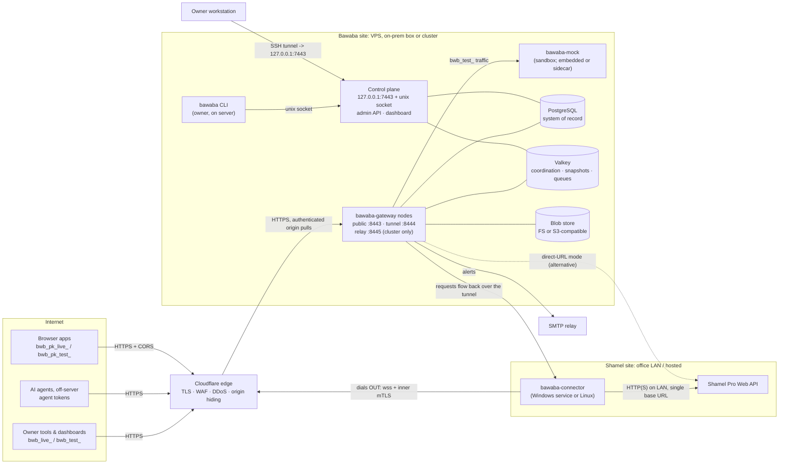

Trust boundaries: (1) Internet ↔ Cloudflare; (2) Cloudflare ↔ public/tunnel listeners (only Cloudflare may
connect; authenticated origin pulls); (3) data plane ↔ control plane (no route; separate DB role); (4) gateway ↔
connector (inner mTLS with a Bawaba-internal CA, end to end through Cloudflare); (5) connector ↔ Shamel (LAN).

---

## 4. Deployment topologies

### 4.1 Packaging and platforms

| Artifact | Linux amd64/arm64 | Windows amd64 | Docker image |
|---|---|---|---|
| `bawaba-gateway` | yes (primary) | no (unsupported) | `bawaba/gateway` (distroless, non-root, read-only rootfs) |
| `bawaba-connector` | yes (systemd, `DynamicUser=yes`) | **yes — Windows service** | `bawaba/connector` |
| `bawaba` CLI | yes | yes (agent-side commands only) | included in gateway image |
| `bawaba-mock` | yes | yes | `bawaba/mock` |

Docker Compose bundles in `deploy/compose/`: `single.yml` (gateway + PostgreSQL + Valkey + FS blobs),
`single-cloudflared.yml` (adds `cloudflared` for Cloudflare Tunnel mode), `connector.yml`. Standalone installs use
systemd units in `deploy/systemd/` (with `LoadCredential=` for the master key) and an MSI/`service install`
command for the Windows connector. All processes restart automatically after reboot (`Restart=always`,
`restart: unless-stopped`, Windows service auto-start with recovery actions).

### 4.2 Topology A — cloud VPS behind Cloudflare + Connector at the office (recommended)

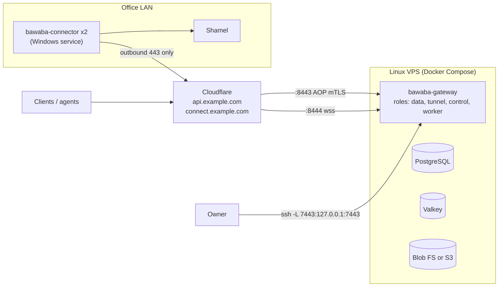

- Office needs **no public IP and no inbound port**; Shamel is never addressable from the Internet.
- VPS host firewall (nftables) admits TCP 8443/8444 only from Cloudflare ranges, SSH only from the owner's
  addresses (or via a bastion). Alternatively run `cloudflared` on the VPS and open **no** inbound ports at all.
- Two connector instances (same or different office hosts) for HA (§8.5).
- Why recommended: strongest origin hiding (two layers: Cloudflare hides the VPS, the tunnel hides Shamel),
  no office network changes, the VPS is easy to back up and scale vertically.

### 4.3 Topology B — single on-prem box next to Shamel

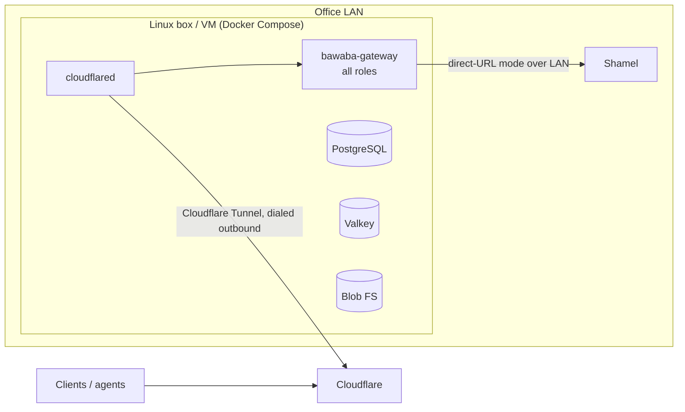

- Public exposure through **Cloudflare Tunnel** (`edge.mode: cloudflare_tunnel`), so the office opens no
  inbound ports. The public listener binds to `127.0.0.1` and only `cloudflared` reaches it.
- Shamel reached in **direct-URL mode** on the LAN (plaintext HTTP permitted only to private/loopback addresses,
  §8.7). No connector needed.
- Trade-off: depends on office power/Internet uptime; backups must leave the building (encrypted).

### 4.4 Topology C — scaled-out cluster

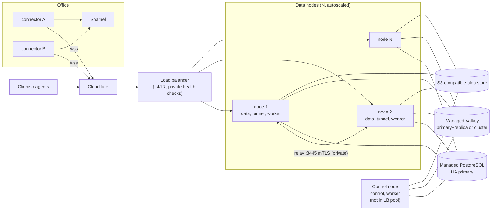

- Data nodes are identical and stateless; scale on CPU. The control node is a separate small VM the owner SSHes
  into; it is not behind the load balancer and has no public listener enabled.
- Connectors land on arbitrary nodes; other nodes reach Shamel through the **relay** (§8.6).
- Valkey keys put a hash tag (`{…}`) only around the part that multi-key operations share (e.g. `{<sid>}` for a snapshot), so keys spread across slots and Valkey Cluster works.
- Rolling deploys: SIGTERM → node marks itself not-ready, sends yamux GoAway to its connectors (they reconnect
  elsewhere), drains in-flight requests (≤ 95 s), exits.

### 4.5 Choosing

| Situation | Topology |
|---|---|
| Shamel on an office LAN, connector can be installed | **A** |
| Owner wants everything in the office, has a spare Linux box/VM | **B** |
| Sustained heavy load or HA requirement for the gateway itself | **C** |
| Connector cannot be installed and Shamel is reachable over a VPN/allowlisted IP | A or C with direct-URL mode |

---

## 5. Process and listener layout

### 5.1 Roles

`node.roles` selects what a `bawaba-gateway` process runs. Default (single node): all four.

| Role | Runs |
|---|---|
| `data` | Public listener: `/v1`, `/legacy`, `/docs`; the full pipeline. |
| `tunnel` | Tunnel listener; accepts connector sessions; registers them; serves relay requests (if `relay` listener set). |
| `control` | Control listener (loopback TCP + Unix socket): admin API, dashboard, config compiler, approvals. |
| `worker` | Lease-based singleton/background jobs (§5.6). Safe to run on every node. |

### 5.2 Listeners

| Listener | Default address | Protocol | Serves | Notes |
|---|---|---|---|---|
| `public` | `0.0.0.0:8443` (`127.0.0.1:8443` in `cloudflare_tunnel` mode) | HTTPS (TLS 1.2+, h2 + http/1.1) | `/v1/*`, `/legacy/*`, `/docs/*` | Cloudflare Origin CA cert; client cert required = Cloudflare origin-pull CA (`edge.mode: cloudflare`). |
| `tunnel` | `0.0.0.0:8444` | HTTPS → WebSocket at `/_bawaba/connect` → inner mTLS → yamux | Connector sessions and enrollment | Separate hostname (e.g. `connect.example.com`) proxied by Cloudflare; Origin Rule maps it to 8444. |
| `relay` | disabled (set to a private IP in topology C) | HTTPS mTLS (internal CA) | `POST /_relay/upstream/{upstream_id}` | Node-to-node only; never exposed through the load balancer. |
| `control` | `127.0.0.1:7443` + `/run/bawaba/control.sock` | HTTP on loopback (TLS optional) | Admin API `/admin/v1/*`, dashboard `/` | Bind address validated at startup: must be loopback; anything else is a fatal config error (not overridable). |
| `ops` | `127.0.0.1:9090` (private IP in topology C) | HTTP | `/healthz`, `/readyz`, `/metrics`; `/debug/pprof` only if `ops.pprof: true` | Never routed from Cloudflare. |

HTTP server hardening on `public`/`tunnel`: `ReadHeaderTimeout 5s`, `IdleTimeout 120s`, `MaxHeaderBytes 16 KiB`,
per-operation body limits enforced by a `MaxBytesReader`, h2 `MaxConcurrentStreams 250`, no h2c, no HTTP/1.0
keep-alive quirks, `Server` header never set.

Control listener TLS is optional (default off) because the only network hop is the owner's SSH tunnel and
browsers treat `http://localhost` as a secure context (so `Secure`/`__Host-` cookies work). The Unix socket
(`0660 root:bawaba-admin`) is used by the CLI; the control plane checks `SO_PEERCRED` uid/gid in addition to the
owner session.

### 5.3 Control-plane separation guarantees

- **Separate `http.Server` and handler tree.** The data-plane router is built in `internal/api/...`; the admin
  router in `internal/controlplane/...`. A Go build-time import check (`tools/archcheck`, run in CI) forbids
  `internal/api/**` and `internal/pipeline/**` from importing `internal/controlplane/**` and vice-versa for
  handlers. There is no proxy/forwarding handler anywhere in the data plane that could reach the control
  listener.
- **Separate PostgreSQL roles.** `bawaba_data` (data/tunnel/worker): `SELECT` on `compiled_config` and a few
  read tables, `INSERT` on `access_requests`, `audit_*`, `usage_*`, `webhook_subscriptions` (owned by the calling
  token), `UPDATE` limited to execution-status columns (`audit_writes.status`/`reference_id`, approval execution
  results). `bawaba_control`: DML on configuration tables.
  `bawaba_migrate`: DDL, used only by `bawaba migrate`. In topology C, data nodes do not possess control
  credentials at all.
- **Owner-only actions** (approve, firewall edits, live-token creation, identity credentials) exist only as
  control endpoints. Agent-level actions (create access requests, read docs, read own usage) are ordinary
  data-plane operations gated by the `agent` token kind and `access_requests:write`.

### 5.4 Control plane with N nodes: compiled config distribution

The control plane is the only writer of configuration. After every committed change it **compiles** the full
runtime config into an immutable artifact and stores it in the same transaction:

```
compiled_config(version BIGINT PK, created_at, sections JSONB  -- per-section version + sha256
                payload BYTEA                                   -- zstd + AES-256-GCM (config KEK)
                )
```

Sections: `tokens`, `policies`, `firewall`, `upstreams`, `rate_defaults`, `cors`, `alerts`. A node reloads only
sections whose hash changed. High-frequency data-plane-generated state (auto-bans, usage) is **not** part of
compiled config; it flows through Valkey (§6, S3).

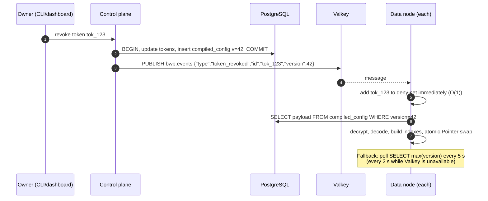

- Propagation target: p99 < 1 s with pub/sub, ≤ 5 s worst case via polling. This implements "instant revoke".
- Nodes never serve with a config older than the version they last saw; swaps are atomic (`atomic.Pointer`),
  readers are lock-free.
- **Emergency revocation** when PostgreSQL is down: `bawaba token revoke --emergency <id>` publishes a signed
  deny entry (`HMAC(config KEK)`) to Valkey `bwb:events`, and stores it in `bwb:deny` (no TTL) so restarting nodes
  pick it up; it is replayed into PostgreSQL when it recovers.
- If the control node dies, the data plane keeps serving with the last compiled config; administration is
  unavailable until the control role is started on any host (all state is in PostgreSQL).

### 5.5 Cluster membership

Each node writes `bwb:node:<node_id>` (hash: roles, version, started_at, local tunnel sessions, load) with a 15 s
TTL, refreshed every 5 s, and is listed in the sorted set `bwb:nodes` (score = expiry). Membership drives: per-node
concurrency shares (§7.6), relay target selection (§8.6), the dashboard cluster view, and local fallbacks when
Valkey is unreachable (last known node count is retained).

### 5.6 Background workers

Run under the `worker` role. Singleton jobs hold a Valkey lease `bwb:lease:<job>` (`SET NX PX 30000`, renewed
every 10 s, fencing token = lease generation written into job output); parallel jobs consume Valkey Streams with
consumer groups.

| Job | Kind | Notes |
|---|---|---|
| Webhook change detection per (upstream, event type) | singleton | Polls Shamel every 5 min (configurable) only for subscribed events; uses the `background` priority class (§7.6). |
| Webhook delivery | parallel (`bwb:q:webhooks`) | HMAC `Bawaba-Signature`, retries with backoff; events also persisted in PostgreSQL. |
| Approved-write executor | parallel (`bwb:q:approved_writes`) | Executes writes the owner approved; `write` priority class. |
| Audit pipeline flusher | per node | §10.2. |
| Usage rollup flush | per node | Every 10 s into `usage_1m`. |
| Alert mailer | parallel (`bwb:q:alerts`) | SMTP; de-duplicated per alert key and window. |
| Retention / partition maintenance | singleton | Audit partitions, blob GC, snapshot of usage. |
| Stale token flagger | singleton, daily | Flags tokens unused for 90 days. |

---

## 6. Data-plane request pipeline

### 6.1 Operation registry

`internal/ops` holds a static registry. Each operation descriptor declares everything the pipeline needs, so
stages are generic and data-driven:

```go
type Operation struct {
    ID           string        // "customers.list"
    Public       bool          // docs: skips auth/policy/upstream
    Scopes       []Scope       // e.g. customers:read; writes may add vouchers:write:<type> dynamically
    Kinds        KindSet       // token kinds allowed (tool, agent, publishable)
    Idempotent   bool          // safe to retry upstream
    Write        bool
    Snapshot     bool          // list/report: result stored as snapshot, distributed coalescing
    Plan         UpstreamPlan  // one or more Shamel calls (path, method, header params, form body)
    Request      Schema        // query/body schema, size limit
    Resource     ResourceType  // normalized record type (+ generated encoder)
    Dimensions   DimensionMap  // data-scope dims -> record field paths (store, salesman, customer, currency, price_class)
    Fields       FieldCatalog  // hideable fields (bit positions for masks)
    Timeout      time.Duration // upstream budget
    PollInterval time.Duration // recommended minimum polling interval (warnings)
}
```

### 6.2 Request context

One pooled `reqctx` per request (reset on return to a `sync.Pool`) carries: request id, client IP, matched
operation, token pointer (into compiled config), policy decision, typed request, upstream selection, timings per
stage, warnings, audit draft. Stages are plain functions `func(*reqctx) *apierr.Error` executed by a fixed runner
(not a generic middleware chain), which makes ordering explicit and lets the runner record a per-stage histogram.

### 6.3 Stages

Order is normative. "Failure" lists the client-visible result; every failure still emits an audit event
(S16) with the stage reached, and every response carries `Bawaba-Request-Id`.

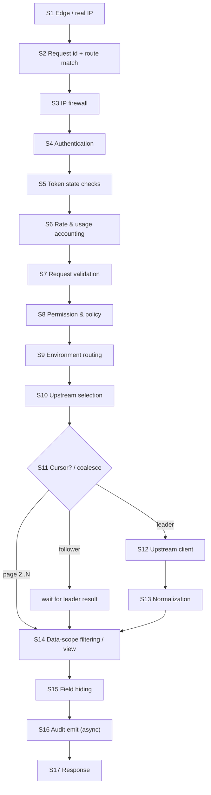

#### S1 — Edge / real IP
- **Does:** establishes the true client IP and that the request came through the sanctioned edge. Modes
  (`edge.mode`): `cloudflare` (TCP peer must be in the Cloudflare range list — checked in a `net.Listener` wrapper
  before TLS, connection closed otherwise; TLS requires the Cloudflare origin-pull client certificate; client IP
  = `CF-Connecting-IP`), `cloudflare_tunnel` (peer must be loopback; client IP = `CF-Connecting-IP`),
  `trusted_proxies` (rightmost untrusted `X-Forwarded-For` hop), `direct` (peer address; dev/LAN only).
  `Host` must be in `edge.public_hosts`. All other forwarding headers are ignored and stripped. Records `CF-Ray`
  for audit correlation.
- **Needs:** Cloudflare CIDR list (shipped, refreshable with `bawaba edge refresh-ranges`), mode, host list.
- **Failure:** non-edge peer → TCP close (no bytes); bad `Host` → `404 not_found`.
- **Perf:** CIDR check on a pre-built prefix trie (~50 ns); header parse without allocation.

#### S2 — Request id and route match
- **Does:** generates `req_` + 26-char Crockford base32 UUIDv7 (time-sortable); sets `Bawaba-Request-Id`;
  matches the route to an operation (stdlib `ServeMux` patterns compiled at startup). Client-supplied ids are
  never trusted (an optional client correlation header is recorded in audit only).
- **Needs:** route table.
- **Failure:** none here; unknown routes are answered after S3 with `404 not_found` so banned IPs learn nothing.
- **Perf:** ~200 ns; id generation from a per-P buffered CSPRNG.

#### S3 — IP firewall
- **Does:** global deny list, global allow list (if non-empty, default-deny), auto-ban set, pre-auth per-IP
  request budget (local token bucket) that blunts floods of invalid tokens.
- **Needs:** compiled `firewall` section (CIDR tries for IPv4/IPv6); local mirror of `bwb:ban:*` populated from
  Valkey on start and updated via `bwb:events` (`ip_banned`/`ip_unbanned`).
- **Failure:** `403 ip_blocked` (banned: same code, no ban details); pre-auth budget exceeded → `429
  rate_limited` with `Retry-After`.
- **Perf:** two trie lookups + one map lookup; no network I/O.

#### S4 — Authentication
- **Does:** parses `Authorization: Bearer <token>`; validates format (prefix in {`bwb_live_`, `bwb_test_`,
  `bwb_pk_live_`, `bwb_pk_test_`}, length, alphabet and checksum as defined by the token format) before any
  lookup; computes
  `lookup = HMAC-SHA256(token_pepper, token)` and looks it up in the compiled token map. Skipped for `Public`
  operations (`/docs`).
- **Needs:** compiled `tokens` section (map keyed by lookup hash → token record pointer); `token_pepper` derived
  from the master key (a stolen DB cannot be used to test guesses offline).
- **Failure:** missing/malformed/unknown → `401 invalid_token` (uniform message and timing class). Each failure
  increments `bwb:authfail:<ip>` (pipelined, async); crossing `firewall.auto_ban.threshold` within
  `window` creates a ban (Valkey + PostgreSQL record + `bwb:events` + owner e-mail).
- **Perf:** one HMAC over ~60 bytes (~300 ns) + map lookup. Token hashes are fast hashes by design: tokens carry
  ≥ 192 bits of entropy, so slow password hashing adds no security.

#### S5 — Token state checks
- **Does:** status `active` (not revoked/suspended/pending), not expired (`expires_at` optional), node-local
  deny-set (instant revocation, §5.4), environment invariant (`live`/`test` prefix == token record environment),
  per-token IP allowlist, kind rules (publishable: `GET`/`HEAD` only, `Origin` must be in the token's allowed
  origins, read scopes only; `access_requests:write` only for `agent` kind), `/legacy` only if the token has
  legacy enabled and the legacy route is in its allowlist. CORS preflight (`OPTIONS`) is answered before S4 using
  the compiled union of all publishable origins (no token on preflight); the real request is checked per token here.
- **Needs:** token record (already resolved), deny-set, clock.
- **Failure:** revoked/expired/suspended → `401 token_revoked` / `401 token_expired`; IP not allowed →
  `403 ip_not_allowed_for_token`; origin/kind/legacy violations → `403 forbidden` with a specific code.
- **Perf:** in-memory only.

#### S6 — Rate & usage accounting
- **Does:** per-token GCRA rate limit (defaults generous, per-token adjustable) and per-(token, operation,
  normalized query) polling detection, in **one pipelined Valkey call** (`EVALSHA` GCRA script using Valkey
  `TIME` as the single clock + `INCR`/`PEXPIRE` poll counter). Sets `RateLimit-Limit`, `RateLimit-Remaining`,
  `RateLimit-Reset`. If a token repeats the same query faster than the operation's `PollInterval`, adds a
  `Bawaba-Warning` (e.g. `polling_too_fast; recommended_interval=60; docs_url=…`, exact syntax in the API spec)
  and counts toward the "abusive/buggy tool" alert. Usage counters (requests by op/status, latency histogram,
  `last_used_at`) are recorded in a per-node lock-free aggregator and flushed every 10 s. Runs **before**
  validation so malformed requests still consume budget.
- **Needs:** token limits from compiled config; Valkey.
- **Failure:** limit exceeded → `429 rate_limited` + `Retry-After`. Valkey unavailable → local GCRA with
  `limit / last_known_node_count`, no polling warnings, metric `bawaba_degraded{function="rate_limit"}`.
- **Perf:** one RTT (target < 0.5 ms same-DC); `valkey-go` auto-pipelining batches concurrent requests into
  shared round trips.

#### S7 — Request validation
- **Does:** strict parsing into the operation's typed request: path/query parameters (types, enums, ranges;
  `limit` bounds), JSON bodies (strict decoder: unknown fields rejected, duplicate keys rejected, UTF-8 valid,
  depth and size limits), `Idempotency-Key` format on writes, cursor unsealing/verification (§9.6). All values that
  will become Shamel header parameters are validated against per-parameter allowlists here (§7.2).
- **Needs:** operation schema; cursor key.
- **Failure:** `400 invalid_request` (syntax) / `422 validation_failed` (semantics) with field paths;
  `400 invalid_cursor`; body too large → `400 request_too_large` (status per API spec; 413 is not in the
  agreed status set).
- **Perf:** generated decoders; no reflection on the hot path; bodies read through a pooled buffer.

#### S8 — Permission & policy evaluation
- **Does:** produces a `Decision`:
  - scope check: required scopes ⊆ token scopes (compiled into a bitset); voucher writes require
    `vouchers:write:<voucher_type>` derived from the validated body;
  - data-scope pre-check for targeted requests (e.g. `GET /v1/customers/{code}` where `code` is outside the
    token's customer/salesman scope → `404 not_found`, never 403, to prevent enumeration);
  - **pushdown** filters where Shamel can filter natively (e.g. `store`, `itemCode`, `customerCode` header
    parameters) — pushdowns become part of the upstream request and therefore of the coalescing key;
  - **row filter** for dimensions Shamel cannot filter (applied in S14);
  - **field mask** for the operation (precomputed per token × operation at compile time);
  - **approval required** flag for writes from tokens configured for the approval queue.
- **Needs:** compiled `policies` section: scope bitsets, per-dimension allow-sets (`map[string]struct{}`),
  per-operation field masks, presets (read-only, write-only, …) already expanded.
- **Failure:** `403 insufficient_scope` (lists the missing scope); `404 not_found` for out-of-scope targets.
- **Perf:** bitset AND + a few map lookups; zero allocation.

#### S9 — Environment routing (live vs sandbox)
- **Does:** `bwb_live_` / `bwb_pk_live_` → environment `live`; `bwb_test_` / `bwb_pk_test_` → `sandbox`.
  Asserts the three-way invariant: prefix environment == token record environment == selected upstream
  environment. Sandbox requests go to the tenant's virtual upstream of kind `mock` (§11).
- **Failure:** invariant violation → `401 invalid_token` + security alert (indicates tampering or a bug).
- **Perf:** constant.

#### S10 — Upstream selection
- **Does:** resolves (upstream, identity, transport): upstream from the token (v1: exactly one); identity =
  token's pinned identity or the upstream's default service account; transport = `mock` | `direct` |
  `tunnel(local session)` | `tunnel(relay → holder node)` (§8.6). Fast-fails if the upstream's circuit breaker is
  open or no connector session exists anywhere (after a `tunnel.connector_grace` of 2 s for brief flaps).
- **Needs:** compiled `upstreams` section, local tunnel table, tunnel registry (`bwb:tun:<upstream>`, cached
  locally and refreshed on change events), breaker state.
- **Failure:** `503 upstream_unavailable` + `Retry-After`.
- **Perf:** in-memory; registry cached with 1 s refresh.

#### S11 — Coalescing / snapshot lookup
- **Does:** (a) request carries a cursor → load view + snapshot chunks from Valkey and go to S14 (no upstream
  call); (b) otherwise compute `ck` (§9.1), join a local single-flight; for `Snapshot` operations also
  coordinate across nodes (§9.3). Only the **leader** runs S12–S13; followers receive the leader's normalized
  result. Writes skip coalescing and instead perform the idempotency reservation (§6.4).
- **Needs:** Valkey (distributed path), coalescing key.
- **Failure:** cursor's view/snapshot gone → `409 snapshot_expired` (client restarts from page 1); Valkey down →
  local-only coalescing; follower wait exceeding the operation timeout → `504 upstream_timeout`.
- **Perf:** local join ~100 ns; distributed leader election = 1 RTT (`SET … NX PX … GET`).

#### S12 — Upstream client
- **Does:** obtains a Shamel session, builds header parameters and form body, acquires a slot from the
  upstream's concurrency limiter (queueing), passes the circuit breaker, executes via the selected transport,
  stream-decodes the body tolerantly, classifies the outcome, and retries idempotent reads once on retryable
  failures. Details in §7.
- **Needs:** encrypted identity credentials (login only), session cache, upstream settings.
- **Failure:** `503 upstream_busy` (queue full/timeout), `503 upstream_unavailable` (breaker open, connector
  offline), `504 upstream_timeout`, `502 upstream_error` (unclassified upstream failure), `422 upstream_rejected`
  (Shamel rejected a write with `Success=false`; Shamel's text is replaced by a mapped code/message, raw text goes
  to audit only).
- **Perf:** queue wait and upstream time are measured separately and excluded from the gateway overhead budget.

#### S13 — Response normalization
- **Does:** maps Shamel DTOs to `/v1` resources (or re-encodes the Shamel shape for `/legacy`): snake_case,
  typo fixes (`sale_parice→sale_price`, `orgnization→organization`, `grantee→guarantee`,
  `refrenceId→reference_id`, `Classificaiton→classification`, `Branchs→branches`), voucher type ints → snake_case
  names, dates → `YYYY-MM-DD`, timestamps → RFC 3339 in the upstream's business timezone (default
  `Asia/Hebron`), monetary/quantity values kept as exact decimal text (never round-tripped through `float64`),
  upstream URLs (e.g. catalog `image_path`) rewritten to Bawaba URLs (`/v1/items/{code}/image`), unknown upstream
  fields dropped and counted (`bawaba_upstream_schema_drift_total{op,field}`). Runs once per coalesced fetch
  (in the leader), streaming record by record (§10.2).
- **Failure:** undecodable body → `502 upstream_error` (raw body to audit).
- **Perf:** streaming; memory bounded by snapshot chunk size, not body size.

#### S14 — Data-scope filtering (view construction)
- **Does:** per requester: applies the S8 row filter over the normalized records using the operation's
  `Dimensions` (store, salesman, customer, currency, price class), filters sub-collections (e.g. item stock rows
  by allowed store, price columns by allowed price class), then client filters/search/sort, producing the page
  and — for paginated operations — a **view** (positions array) stored in Valkey (§9.5). On cursor reads, each
  record is re-checked against the *current* policy (a scope reduction applies mid-pagination).
- **Needs:** decision, snapshot chunks.
- **Failure:** none client-visible besides Valkey write failure for multi-page results → `503
  pagination_unavailable` (never silent truncation).
- **Perf:** allow-set lookups per record; positions encoded as delta-varint + zstd.

#### S15 — Field hiding
- **Does:** effective mask = policy mask ∧ client sparse-fieldset (`?fields=`). The generated encoder for each
  resource skips masked fields (fields are **omitted**, not nulled). Masks apply to nested objects too.
- **Perf:** fused with S17 encoding: `AppendJSON(dst []byte, mask FieldMask) []byte`, one pass, no maps.

#### S16 — Audit emit
- **Does:** builds the audit event (request metadata, decision trace, stage timings, upstream call records
  including raw upstream request/response and error text, final response) and enqueues it into the node's async
  audit pipeline (§10.2). Writes additionally have a synchronous write-ahead record (§6.4).
- **Failure:** queue full → spill to local encrypted spool; spool full → fail closed for new requests
  (`503 audit_unavailable`) unless `audit.on_spool_full: metadata_only` is configured (owner alerted either way).
- **Perf:** O(1) enqueue of references to already-built buffers (no copy of large bodies).

#### S17 — Response
- **Does:** writes status, `Content-Type`, `Bawaba-Request-Id`, `RateLimit-*`, `Bawaba-Warning`,
  `Cache-Control: no-store`, security headers (`X-Content-Type-Options`, `Referrer-Policy`), CORS headers for
  publishable tokens; gzip/zstd compression above 1 KiB when accepted; streamed via a pooled `bufio.Writer`.
  Errors use the shared envelope
  `{"error":{"code","message","message_ar","request_id","docs_url"}}` from the `apierr` catalogue. Finalizes
  usage counters and audit (bytes written, client abort).

### 6.4 Write path additions (milestone 2)

Inserted without changing stage order:

1. **S7:** `Idempotency-Key` required on writes.
2. **S8:** voucher-type scope; approval flag.
3. **S11 (writes):** `SET bwb:<t>:idem:<token>:<key> {state:"in_progress",req_hash} NX PX 86400000`.
   Existing record with same request hash → replay stored response; different hash → `409 idempotency_conflict`;
   `in_progress` → `409 request_in_progress`. Valkey unavailable → `503` (fail closed).
4. **Write-ahead audit:** synchronous `INSERT` into `audit_writes` (full payload, status `pending`) in
   PostgreSQL before contacting Shamel; failure → `503 audit_unavailable`.
5. **Approval hold:** if required, store the prepared upstream request (encrypted) as an approval item and
   return `202` with the approval id; the approved-write executor later runs S10–S13 with the stored identity.
6. **S12:** never retried. Timeout after the request was sent → outcome `unknown`: `504 write_outcome_unknown`,
   idempotency record stores `unknown`, owner alerted to reconcile (Shamel has no idempotency support).
7. **After S13:** Shamel reference id recorded in `audit_writes` and in the idempotency record.

### 6.5 Legacy passthrough specifics

`/legacy/<original Shamel path>` (e.g. `/legacy/Customer/GetCustomers`) matches a **strict allowlist** of Shamel
paths (case-insensitive match, canonical path used upstream). Each entry maps to the same operation as its `/v1`
counterpart plus a legacy parser (reads Shamel-style header parameters such as `lastupdatedate`, `code`,
`getBalance`, with the same validators) and a legacy encoder (Shamel field names, Shamel envelope). Client
`username`/`token` headers are ignored — auth is always the Bawaba bearer token. Data-scope filtering, field
hiding, URL rewriting and error sanitization apply identically; legacy errors use the Bawaba error envelope.

### 6.6 Page 1 and page 2 sequences

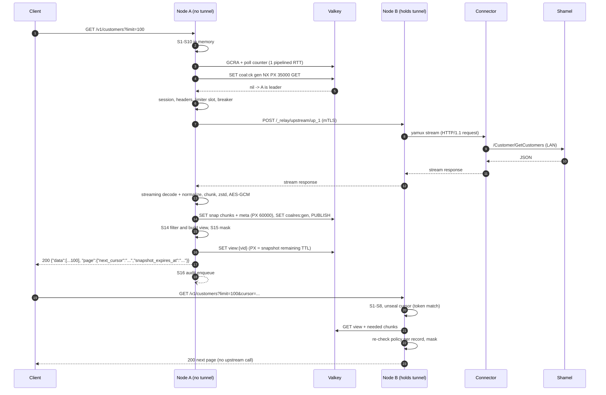

---

## 7. Upstream client

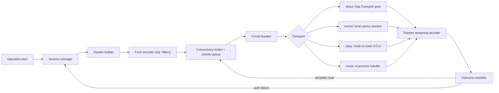

### 7.1 Session manager

Keyed by `(upstream_id, identity_id)`. Shamel's token lifetime and whether a new login invalidates older tokens
are **unknown** (ISCO questions), so the design assumes the worst: tokens may expire at any time and a new login
may kill the previous token. Therefore sessions are **shared cluster-wide** and logins are **serialized**.

- **Local cache:** `atomic.Pointer[session]{token, generation, obtained_at, shamel_user_id, salesman_code}`.
- **Shared cache:** `bwb:<t>:sess:<upstream>:<identity>` in Valkey, value AES-256-GCM-encrypted with the `sess`
  key, TTL = `session.max_age` if configured, else 12 h (refreshed on successful use, at most once per minute).
- **Login (single-flight):** local `singleflight` per identity → `SET bwb:<t>:sesslock:<upstream>:<identity>
  {node} NX PX 15000`. Holder re-checks the shared cache (someone may have just logged in), decrypts the
  credentials, `POST /Main/Login` (`application/x-www-form-urlencoded`: `username`, `password`), requires
  `success=true` and `userIsDisabled=false`, validates the returned token (`^[\x21-\x7E]{1,512}$`), writes the
  shared entry with `generation+1`, releases the lock (compare-and-delete script). Non-holders wait on the
  `bwb:events` `session_renewed` message or poll the shared key every 100 ms (max 10 s).
- **Auth failure handling:** the outcome classifier (§7.5) flags `auth_failed` for responses matching the
  upstream's auth-failure signatures. The client invalidates its session only if the failing request used the
  current generation (`CAS` on generation), runs the login flow requiring `generation > failed_generation`
  (adopting a newer shared session if one exists), and retries the request **once**. This retry is allowed for
  writes too, because an authentication rejection is a pre-execution failure — but only when the classifier
  match is definitive (signature match), never for unclassified 500s.
- **Login failures** (bad password, disabled user): negative cache with exponential backoff 30 s → 5 min (avoids
  locking the Shamel account), circuit for that identity, owner alert `shamel_login_failed`; clients get `502
  upstream_error`.
- **Credential decryption:** identity passwords are envelope-encrypted (per-record DEK, AES-256-GCM, AAD =
  `shamel_identity:{id}`; DEK wrapped by the `cred` KEK). Decrypted only inside the login function into a
  `[]byte` that is zeroed after the form body is written (best effort; Go GC caveat accepted); never logged,
  never in audit, never in errors.
- **Calibration:** because Shamel reports everything as HTTP 500, `bawaba upstream calibrate <upstream>` performs
  a deliberate invalid-token call and records the auth-failure signature (normalized body pattern) into the
  upstream's runtime settings. Defaults ship with conservative patterns; `bawaba-mock` reproduces the format.

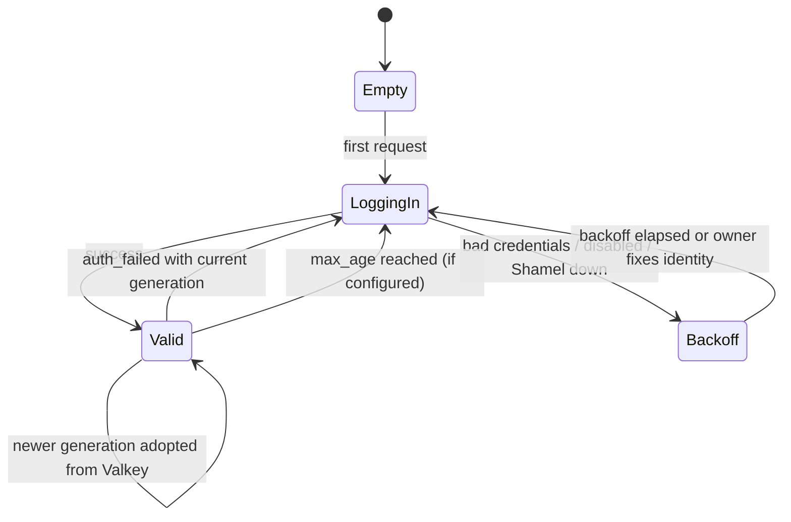

### 7.2 Header parameter builder

Shamel takes parameters in HTTP headers (`username`, `token`, `lastupdatedate`, `code`, `vatreg`, `getBalance`,
`getAll`, `itemCode`, `store`, `serial`, `filters`, `voucher_code`, `manual`, …).

- Header **names** come only from a constant table per Shamel call; client input never names a header.
- Header **values** come only from S7-validated typed fields: codes `^[A-Za-z0-9._/-]{1,64}$` (refined per field
  once real data is seen), dates strictly `YYYY-MM-DD` re-formatted from a parsed `civil.Date`, booleans emitted
  as `true`/`false`, JSON-valued headers (`filters`) marshalled from typed structs with **ASCII-only escaping**
  (`\uXXXX` for non-ASCII, so Arabic text is safe in a header).
- Final guard on every value: reject any byte outside `0x20–0x7E` (so CR, LF, NUL, DEL, obs-text can never
  appear), max 4 KiB per value, 16 KiB total. A guard violation is a bug → `500`-class internal error mapped to
  `502 upstream_error`, logged as `header_guard_violation`.
- `getAll=true` (bypasses Shamel salesman scoping) is sent only when the token's policy explicitly allows it
  *and* the identity is not a pinned salesman identity.

### 7.3 Form encoder (`obj` / `filters`)

Writes and some reports send JSON inside a form field (`obj=` for `/Customer/Post`, `/Item/Post`,
`/CostCenter/Post`, `/Voucher/Post2`, `/Report/GetAccountsheet`; `filters=` for
`/CostCenter/GetCostCenterAccountsheet`).

- Typed upstream DTOs with Shamel's exact field names (`Name`, `VatReg`, `customer_code`, …) and explicit JSON
  tags; marshalled once, then form-encoded (`application/x-www-form-urlencoded; charset=utf-8`).
- Decimals emitted from exact decimal text without exponent notation; strings validated UTF-8, control
  characters stripped/rejected in S7.
- The encoded body is kept (by reference) for the audit event and the write-ahead record.

### 7.4 Tolerant response decoder

Built on a streaming tokenizer (`jsontext`), driven by per-DTO field tables:

| Quirk (observed or plausible) | Handling |
|---|---|
| Inconsistent key casing (`Success` / `success`, `userId` / `UserId`) | Case-insensitive field matching. |
| Numbers as strings (`credit`, `debit`, `balance` in account sheets) | Lenient scalar coercion to exact decimal; `""` → null. |
| Booleans as `0/1`, `"true"`, `"True"` | Lenient bool coercion (e.g. item `stopped` is int, customer `stopped` is bool). |
| `ErrorMessage` as string or string[] | Normalized to `[]string`. |
| Double-encoded JSON (top-level string containing JSON) | Decode the inner document once (bounded). |
| UTF-8 BOM, wrong `Content-Type` (`text/html`) | Ignored; content sniffed as JSON. |
| Date variants (`yyyy-MM-dd`, `yyyy-MM-ddTHH:mm:ss`, `/Date(…)/`) | Ordered layout list in the upstream timezone; unparseable → null + drift metric. |
| `null` where a list is expected | Empty list. |
| Unknown fields | Skipped (no allocation), counted as schema drift. |

Hard limits: `upstream.max_response_bytes` (default 256 MiB) enforced on the raw stream; nesting depth 64.
Exceeding → `502 upstream_error`, audit keeps the first 1 MiB.

### 7.5 Outcome classifier

| Upstream observation | Class | Client result | Retry (reads) |
|---|---|---|---|
| 2xx, decodes | `ok` | normal | — |
| 2xx, `Success=false` on write | `rejected` | `422 upstream_rejected` (mapped message; raw → audit) | no |
| 500 matching auth signature | `auth_failed` | re-login + one retry, else `502 upstream_error` | yes, once |
| 500 other | `upstream_error` | `502 upstream_error` | no (application error) |
| Connect refused/reset before request written, connector offline | `unavailable` | `503 upstream_unavailable` | yes |
| Timeout before response headers | `timeout` | `504 upstream_timeout` | yes (reads only, within budget) |
| Body truncated/malformed | `bad_response` | `502 upstream_error` | yes (reads) |

Known Shamel validation messages can be mapped to specific Bawaba codes via a runtime mapping table (owner/ops
maintained); unmapped messages become `upstream_rejected` with a generic bilingual message.

### 7.6 Concurrency limiter and queue (protects Shamel)

Per upstream: `max_concurrency` (runtime setting, default **8** — conservative until ISCO answers / benchmarks).
Enforcement is layered so the common path has **no per-request network call**:

1. **Node share (always):** each node holds a local weighted semaphore of size
   `share = floor(cap / N) + (rank < cap mod N ? 1 : 0)`, with `N` and `rank` from the node registry
   (sorted node ids). Σ shares = cap exactly. Recomputed on membership change.
2. **Distributed lease mode (only when `cap < N`):** nodes acquire slots from a Valkey ZSET semaphore
   (`bwb:<t>:sem:<upstream>`, lease = 2 × timeout, Lua acquire/release); a releasing node hands its slot directly
   to a local waiter when one exists (no Valkey op).
3. **Connector hard cap (tunnel mode):** each connector receives its share of `cap` in the `welcome` message and
   enforces it with a FIFO queue — the exact global safety net that also absorbs share transitions.

Queueing: per-node priority queue with classes `interactive` (API reads), `write`, `background` (webhook change
detection, approved-write executor); `background` may use at most `background_max_share` (default 25 %) of the
share. `queue_timeout` (default 15 s, capped by the request deadline) and `max_queue` (default 256 per node per
upstream) → `503 upstream_busy` + `Retry-After: 2` + `Bawaba-Warning: upstream_saturated`. Metrics: queue depth,
wait time, slot utilization; owner alert when saturation persists > 5 min.

### 7.7 Timeouts

| Budget | Default | Key |
|---|---|---|
| Overall request deadline | 90 s (must stay < Cloudflare's 100 s origin timeout) | `server.request_timeout` |
| Direct dial / TLS handshake | 5 s / 5 s | `upstreams.*.dial_timeout` |
| Read operations | 30 s | `Operation.Timeout`, override per upstream |
| Reports (`GetAccountsheet`, cost-center sheet, last price) | 60 s | 〃 |
| Writes | 60 s | 〃 |
| Login | 15 s | `session.login_timeout` |
| Queue wait | 15 s | `upstreams.*.queue_timeout` |

Deadlines propagate via `context`; the tunnel preamble carries the absolute deadline so the connector cancels the
Shamel call when the gateway gives up.

### 7.8 Retries

Only for operations with `Idempotent: true` (all reads, including POST-shaped reads such as
`GetAccountsheet`), only for classes marked retryable in §7.5, at most **1 retry** (2 attempts), full-jitter
backoff 100–400 ms, only if ≥ 50 % of the remaining budget is left, and subject to a per-upstream **retry budget**
(retries ≤ 10 % of requests over a 10 s window) to prevent retry storms. A retry re-enters the limiter queue.
Writes are never retried by the gateway (§6.4).

### 7.9 Circuit breaker

Per (node, upstream), `sony/gobreaker/v2` semantics: trips when, over a rolling 30 s window with ≥ 20 requests, the
failure ratio ≥ 50 %, or after 5 consecutive `unavailable`/`timeout` outcomes. Only `unavailable`, `timeout`
and `bad_response` count — application errors (`upstream_error`, `rejected`) do not. Open duration 5 s, doubling
up to 60 s; half-open admits 3 probes. Open → `503 upstream_unavailable` immediately with `Retry-After`.
Breaker transitions are published (`bwb:events`) for the dashboard and alerting; they are not shared as state
(each node learns independently, which avoids a single bad node tripping the cluster).

### 7.10 Connection pooling

- **Direct mode:** one `http.Transport` per upstream: keep-alive on, `MaxConnsPerHost = node share + 2`,
  `MaxIdleConnsPerHost = node share`, `IdleConnTimeout 90s`, HTTP/1.1 (Shamel is presumed IIS/ASP.NET;
  HTTP/2 used if negotiated), redirects disabled, proxy env ignored unless configured.
- **Tunnel mode:** yamux streams are cheap (no handshake); the connector keeps its own keep-alive pool to Shamel.
- **Relay:** one HTTP/2 client per peer node (multiplexed, long-lived).

### 7.11 Combined endpoints

Combined operations (e.g. customer 360, stock across stores) have multi-call `UpstreamPlan`s executed by a plan
executor (`errgroup` with the request deadline). Every sub-call goes through coalescing and the limiter
individually, so a combined call never exceeds the upstream cap. A failed mandatory sub-call fails the request; a
sub-call marked `optional` yields `null` plus a `Bawaba-Warning: partial_result`.

---

## 8. Connector transport

### 8.1 Decision

**WebSocket (wss) → inner TLS 1.3 with mutual certificate authentication → yamux stream multiplexing; one
HTTP/1.1 exchange per yamux stream.**

| Option | Verdict |
|---|---|
| Raw mTLS over TCP | Rejected as default: cannot pass through the Cloudflare HTTP proxy (TCP needs Spectrum) and would expose the gateway IP; no corporate-proxy traversal. |
| HTTP/2 with role reversal (connector serves h2 over a conn it dialed) | Viable, but only gateway→connector requests; connector-initiated control/telemetry needs a second mechanism. More subtle library usage. |
| gRPC bidirectional streams | Heavier, adds protobuf framing for what is a byte pipe. |
| **WebSocket + inner mTLS + yamux (chosen)** | Traverses Cloudflare proxy *and* Cloudflare Tunnel (both support WebSockets), and office HTTP proxies (`HTTPS_PROXY`); inner TLS is end-to-end so Cloudflare sees only ciphertext and cannot impersonate either side; yamux gives bidirectional streams, per-stream flow control, keepalives and GoAway; HTTP/1.1 per stream keeps the connector a dumb, auditable pipe. Cost: double encryption (negligible at these rates). |

```
┌───────────────────────────── yamux streams (1 per Shamel request, stream 1 = control) ┐
│ inner TLS 1.3, mutual auth, Bawaba internal CA, ALPN "bawaba-tunnel/1"                 │
│ WebSocket binary messages (RFC 6455) via websocket.NetConn                             │
│ outer TLS (Cloudflare edge ↔ connector; Cloudflare ↔ origin with AOP)                  │
│ TCP 443 outbound from the office                                                       │
└────────────────────────────────────────────────────────────────────────────────────────┘
```

### 8.2 Enrollment and identity

1. Owner (server): `bawaba connector create --upstream up_1 --name office-1` → returns a one-time enrollment
   code (stored hashed, expires in 1 h, bound to the upstream).
2. Office: `bawaba-connector enroll --gateway wss://connect.example.com/_bawaba/connect --code …` generates an
   ECDSA P-256 key locally, sends a CSR over a temporary inner-TLS session (server-authenticated only; the
   connector pins the internal CA fingerprint printed by step 1).
3. Gateway verifies the code, signs a client certificate (SAN URI `urn:bawaba:connector:{id}`, extension with
   `upstream_id`), lifetime 30 days; the connector auto-renews over the tunnel at 2/3 of lifetime.
4. The internal CA private key is envelope-encrypted in PostgreSQL (`cred` KEK). Each node issues itself a
   24 h tunnel server certificate (`urn:bawaba:node:{id}`, DNS SAN `bawaba-tunnel`) at startup.

Revocation: connector status in compiled config; a revoked connector's sessions are closed within the config
propagation time, and handshakes check status.

### 8.3 Session lifecycle

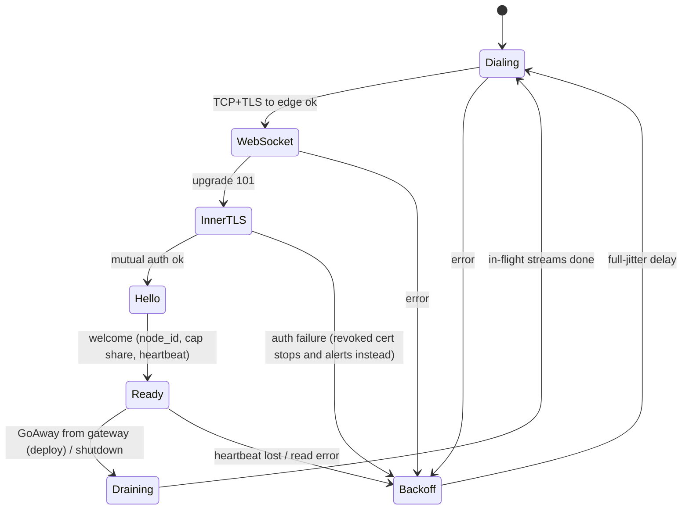

- **Hello/welcome** on yamux stream 1 (control stream, length-prefixed JSON): `hello{connector_id, version, os,
  session_index, shamel_probe: {reachable, rtt_ms}}` → `welcome{node_id, cap_share, heartbeat_s, min_version}`.
  The control stream also carries periodic `status` (Shamel reachability probe every 30 s: TCP connect +
  lightweight HTTP HEAD of the base URL, no credentials), `cap_share` updates and certificate renewal.
- **Heartbeats:** yamux keepalive every 15 s (well under Cloudflare's ~100 s WebSocket idle limit), 30 s
  connection-write timeout; missing 2 heartbeats → session dead on both sides.
- **Reconnect:** exponential backoff with full jitter, base 1 s, factor 2, cap 60 s; reset after 60 s healthy.
  Handshake timeout 10 s. Gateway enforces per-IP handshake rate limits and a cap on pending handshakes.
- **Version skew:** gateway rejects connectors below `min_version` with a specific close reason; connector logs
  and alerts locally.

### 8.4 Request streams and connector forwarding rules

Gateway opens a stream, writes a fixed binary preamble (`version`, `request_id`, absolute `deadline`, `priority`)
followed by an HTTP/1.1 request; the connector:

- forwards **only** to its single configured `shamel.base_url` (scheme, host, port, optional path prefix). The
  request target is joined to the base path; absolute-form targets, `Host` overrides, `CONNECT`, upgrades and
  methods other than `GET`/`POST` are rejected;
- enforces `allowed_path_prefixes` (default: `/Main/`, `/Files/`, `/Customer/`, `/Item/`, `/Report/`,
  `/Voucher/`, `/CostCenter/`), case-insensitive;
- forwards only allowlisted request headers (Shamel parameter names, `Content-Type`, `Content-Length`, `Accept`),
  strips hop-by-hop headers, never follows redirects, caps request body (10 MiB) and response (256 MiB);
- applies its hard concurrency cap (§7.6) and the preamble deadline;
- returns the raw Shamel response over the stream (sanitization happens in the gateway; the connector never logs
  bodies, only metadata: request id, path, status, duration, bytes).

Item images: if Shamel's `image_path` is relative or on the same origin as `base_url`, it is fetched through the
same rules (image content types only, 10 MiB cap); other origins are refused (ISCO question).

### 8.5 High availability

- Each connector opens `tunnel.sessions` parallel sessions (default 2); run ≥ 2 connector instances per upstream
  (different hosts where possible). All sessions are active.
- Gateway picks a session by least in-flight streams, preferring sessions whose last `shamel_probe` succeeded.
- A stream that fails before any response byte is retried on another session for idempotent reads (counts
  against the retry budget).

### 8.6 Reaching the tunnel from any node: registry + relay

Behind a load balancer a connector cannot choose its node, and connecting to every node is impossible behind
Cloudflare. **Decision:** tunnel registry in Valkey + node-to-node relay.

- On `Ready`, the holding node `ZADD bwb:tun:<upstream> <expiry_ms> <node_id>/<session_id>` (refreshed every
  5 s, expiry 15 s) and publishes `tunnel_up`/`tunnel_down`.
- S10 selection order: local session (least in-flight) → remote holder (least loaded per node registry) via the
  relay → `503 upstream_unavailable`.
- Relay: `POST /_relay/upstream/{upstream_id}` on the private `relay` listener, mTLS with internal-CA node
  certificates; body = the already-built, already-authorized upstream request (preamble + HTTP/1.1 bytes);
  response streamed back. The relay endpoint performs no policy (the caller already did) but verifies the peer is
  a registered node. Extra latency: one private-network hop (~0.2–1 ms).
- Valkey unavailable → registry unknown: nodes with a local session still serve; others return `503`.
- Optional: dedicate nodes to the `tunnel` role behind a separate hostname/LB pool (`connect.example.com`) for very
  large clusters; no code difference.
- Single-node topologies need none of this (relay disabled).

Rejected alternatives: routing request/response bodies through Valkey queues (adds latency and memory pressure
for large lists); requiring sticky "tunnel node" singletons (single point of failure).

### 8.7 Direct-URL mode

For sites where the connector cannot be installed. The gateway dials `upstreams.*.base_url` itself.

- `https://` required unless the host resolves to a private/loopback address (topology B LAN) or the owner sets
  `allow_plaintext: true` with an acknowledgement string; startup prints a warning in that case.
- Self-signed Shamel TLS: `tls.ca_file` or `tls.pin_sha256` (SPKI pin). Redirects disabled. DNS re-resolution
  each dial with a check that the resolved IP is the expected one when `pin_ip` is set.
- Shamel's firewall must allow only the gateway's egress IP (documented); site-to-site WireGuard recommended when
  Shamel has no HTTPS.
- Everything above the transport (sessions, limiter, breaker, decoder) is identical.

### 8.8 Connector configuration and service

`/etc/bawaba/connector.yaml` (Linux) or `%ProgramData%\Bawaba\connector.yaml` (Windows):

```yaml
gateway_url: wss://connect.example.com/_bawaba/connect
ca_fingerprint: sha256:…            # internal CA pin from enrollment
cert_file: connector.crt
key_file: connector.key             # Windows: ACL to the service SID only
shamel:
  base_url: http://shamel.lan:8080/  # the ONLY destination ever contacted
  allowed_path_prefixes: [/Main/, /Files/, /Customer/, /Item/, /Report/, /Voucher/, /CostCenter/]
sessions: 2
proxy_url: ""                       # optional office HTTP proxy
log: { level: info, file: connector.log, max_size_mb: 50, max_files: 5 }
```

Windows: runs as a virtual service account (`NT SERVICE\BawabaConnector`) via `golang.org/x/sys/windows/svc`,
logs to the Windows Event Log plus rotating file, `bawaba-connector service install|uninstall|status`. Linux:
systemd unit with `DynamicUser=yes`, `ProtectSystem=strict`, no capabilities.

---

## 9. Coalescing and pagination snapshots

### 9.1 Coalescing key

```
ck = base64url( HMAC-SHA256( coalesce_key,
       tenant_id ‖ upstream_id ‖ environment ‖ identity_id ‖
       upstream_call_signature ‖ normalizer_version ) )

upstream_call_signature = method ‖ canonical_path ‖ sorted(header_param=value…) ‖ canonical(form body)
```

- **Identity is in the key** because Shamel applies salesman scoping per identity: two tokens share a fetch
  only if they would receive byte-identical upstream data.
- **Pushdown filters are in the key** automatically (they are header parameters/body fields).
- **Token-specific policy is deliberately *not* in the key**: the shared object is the *unfiltered* upstream
  result, and S14/S15 apply each requester's data scope and field mask afterwards. Sharing therefore never widens
  what a token can see (see §9.7).
- `normalizer_version` prevents sharing across rolling-deploy code versions.
- Keyed HMAC so Valkey keys reveal nothing (e.g. customer codes).
- Session `username`/`token` headers are excluded (they vary by generation, not by data).

### 9.2 Local single-flight

A per-node map `ck → *flight` (sharded mutex map). The leader's fetch runs on a **detached context** whose
deadline is the latest deadline among current waiters; when every waiter has cancelled, the flight is cancelled
(reads only). Followers receive a pointer to the immutable normalized result (shared, read-only) plus the
snapshot id.

### 9.3 Distributed coordination (operations with `Snapshot: true`)

```
leader election:  SET bwb:<t>:coal:<ck> <gen_id> NX PX (op.timeout + 5s) GET
  -> nil         : this node is leader for gen_id
  -> <gen_id>    : follower of that generation
leader done:      write snapshot (§9.4); SET bwb:<t>:coalres:<gen_id> <snapshot_id|error_code> PX 5000;
                  PUBLISH bwb:coal <gen_id>; DEL coal:<ck> if value == gen_id (CAS script)
follower:         wait for PUBLISH or poll coalres:<gen_id> every 50 ms until op deadline;
                  if coal:<ck> expires without a result (leader died) -> retry election once
```

- **Freshness rule:** a follower only accepts the result of the generation that was *in flight when it
  arrived*. A request arriving after the leader finished starts a new live fetch. Coalescing never serves
  completed results to new page-1 requests — "always live" holds.
- Errors are shared too (`coalres` holds the error class) so a failing Shamel is not hit N times.
- Non-snapshot operations (single entity, status checks) coalesce **locally only** — cross-node waiting costs
  more than it saves for small, fast calls.

### 9.4 Snapshot storage

**Decision: snapshots live in Valkey, chunked, zstd-compressed and AES-256-GCM-encrypted at rest.** Snapshots
contain balances and prices; Valkey persistence files and replicas must be as useless to a thief as a stolen
database. AES-GCM with AES-NI runs at several GB/s per core, far below zstd cost.

| Key | Content | TTL |
|---|---|---|
| `bwb:<t>:snap:{<sid>}:m` | meta: `ck`, `created_at`, `expires_at`, record count, chunk count, chunk size, resource type, normalizer version, key id | 60 s absolute |
| `bwb:<t>:snap:{<sid>}:c:<n>` | chunk *n*: 512 normalized records (compact internal binary encoding) → zstd → AES-256-GCM (AAD = `sid‖n`) | same |

- `{<sid>}` is the Valkey hash tag, so all keys of one snapshot share a slot. Encryption key: HKDF(`snap`, day) with key id in meta.
- TTL is absolute from creation (`pagination.snapshot_ttl`, default 60 s) and reported as
  `snapshot_expires_at`; it is not extended by reads.
- **Memory limits:** `pagination.snapshot_max_bytes` (default 64 MiB compressed per snapshot; exceeded → the
  request fails with `422 result_too_large` advising narrower filters), `pagination.max_views_per_token` (default
  32 live views), and Valkey `maxmemory` with `volatile-ttl` eviction (all snapshot/view keys carry TTLs).
  Early eviction surfaces as `409 snapshot_expired`, never as wrong data. Metric `bawaba_snapshot_bytes`
  estimates resident bytes (written − expired by schedule).
- For `Snapshot` operations the leader always writes the snapshot (cross-node followers read it from there);
  a result that fits in one page simply carries no `next_cursor` and no view is created. Non-snapshot
  operations never touch Valkey for results.

### 9.5 Views

A view is created on page 1 per (token, query): `bwb:<t>:view:<vid>` = {`sid`, `token_id`, `query_hash`,
positions (delta-varint + zstd, encrypted)}, TTL = snapshot's remaining TTL. Positions are the snapshot record
indexes surviving the data-scope filter and client filters, in the requested sort order. A view for 50,000 rows is
~20–60 KiB.

### 9.6 Cursors

`next_cursor = base64url( AES-256-GCM_seal(cursor_key, {v, vid, offset, token_id, query_hash, expires_at}) )`

- Opaque and tamper-proof; unsealed in S7. Must match the calling token (`token_id`) and the request's
  normalized query (`query_hash`); otherwise `400 invalid_cursor`. A cursor used by a different token is rejected
  even if both tokens could see the data.
- `limit` may differ between pages; filters/sort may not.
- On each page read, every record is re-checked against the token's *current* policy and mask (S14/S15).

### 9.7 Safety argument

Data reaches a client only through S14+S15 of *that client's* request. The shared artifacts (in-memory flight
result, snapshot) contain exactly what Shamel returns to the identity configured for the token, so a token can
only coalesce with tokens that use the same identity on the same upstream and environment. Views and cursors are
token-bound. Therefore coalescing and snapshots never let a token see a record or field its own policy would hide.

---

## 10. Performance design

### 10.1 Targets and overhead budget

"Gateway overhead" = total server time − upstream time (incl. tunnel/relay) − limiter queue wait.

| Metric | Target (4 vCPU node, same-DC Valkey RTT < 0.5 ms) |
|---|---|
| Overhead p50 / p99 / p99.9, responses ≤ 64 KiB | ≤ 1 ms / ≤ 5 ms / ≤ 15 ms |
| Large lists: additional overhead | ≤ 8 ms per MiB of upstream JSON (streaming decode + normalize + snapshot write) |
| Throughput, small authenticated reads against embedded mock (0 ms latency), full audit on | ≥ 5,000 req/s per node |
| Cursor page reads (no upstream) | ≥ 10,000 req/s per node |
| Horizontal scaling efficiency to 8 nodes | ≥ 85 % of linear |
| Per-request heap for large lists | ≤ 2 × chunk + output buffer (independent of total list size) |

Indicative per-stage p99 budget (small request): S1–S5 ≤ 50 µs, S6 ≤ 1 ms (one RTT), S7–S10 ≤ 100 µs,
S11 ≤ 1 ms (distributed path) / ≤ 5 µs (local), S13–S15 ≤ 200 µs + size-proportional, S16 ≤ 20 µs.

### 10.2 Techniques

- **Stateless nodes** (§1): scale by adding nodes; no affinity required (cursors work on any node).
- **In-memory compiled config:** immutable structs behind `atomic.Pointer`; scopes as bitsets, data-scope as
  allow-sets, field masks precomputed per (token, operation); zero locks on the read path.
- **Streaming JSON:** the upstream body is tokenized element by element; each record is normalized and appended to
  the current snapshot chunk; the first page is assembled from the same pass. The full upstream body is never
  materialized as a Go object graph. The response is sent after the upstream body is fully consumed (so truncated
  upstream responses are never partially exposed).
- **Allocation discipline:** pooled `reqctx`, byte buffers (`sync.Pool`, size-classed), generated
  `AppendJSON` encoders with masks, no `map[string]any` on hot paths, no reflection in per-record code, string
  interning for repeated codes (currencies, stores) within a snapshot. CI runs `-benchmem` gates.
- **Connection pooling:** keep-alive pools (direct), yamux (tunnel), HTTP/2 (relay), `pgxpool`, `valkey-go`
  auto-pipelining (concurrent commands share round trips).
- **Async audit pipeline:** S16 enqueues into a bounded MPSC ring (default 65,536 events/node). Workers:
  canonicalize body → keyed content hash (`blobid` key) → dedupe check (local LRU of recent hashes, then
  `audit_blobs` existence) → zstd → AES-256-GCM → blob put → batched `COPY` of index rows into time-partitioned
  PostgreSQL tables every 250 ms or 1,000 rows. Back-pressure: ring full → append to the local encrypted spool
  (`audit.spool_dir`, default cap 10 GiB) and replay later. Details in the audit design document.
- **No per-request PostgreSQL** on reads; usage and audit are batched.
- **GC tuning:** `GOMEMLIMIT` set from the container limit (80 %), `GOGC` default; profile-guided optimization
  (PGO) profile from load tests committed under `cmd/bawaba-gateway/default.pgo`.

### 10.3 Observability

`log/slog` JSON logs (no bodies, no secrets; request id on every line), Prometheus metrics on the `ops` listener
(`bawaba_request_duration_seconds{op,status}`, `bawaba_overhead_seconds{op}`, `bawaba_stage_duration_seconds{stage}`,
`bawaba_upstream_duration_seconds{upstream,op,outcome}`, `bawaba_upstream_queue_wait_seconds`,
`bawaba_coalesce_total{result=leader|follower|local}`, `bawaba_snapshot_bytes`, `bawaba_tunnel_sessions`,
`bawaba_degraded{function}`, `bawaba_audit_queue_depth`), optional OpenTelemetry tracing (OTLP; spans per stage
and per upstream call, sampled). Sandbox tokens additionally receive a `Server-Timing` header to help agents
diagnose their own tools; live tokens do not.

### 10.4 Load-testing approach

- **Harness:** k6 scenarios in `test/load/`, run against a cluster wired to `bawaba-mock` with latency/size
  profiles (`--latency p50=80ms,p99=600ms`, `--customers 20000`, `--items 50000`) and to toxiproxy-wrapped
  Valkey/PostgreSQL for fault injection.
- **Scenarios:** (1) small-read baseline; (2) large-list pagination walk; (3) thundering herd of identical
  requests — assert upstream calls per generation = 1; (4) many tokens with different scopes on the same identity
  — assert no cross-token leakage (content assertions) and shared upstream calls; (5) mixed reads/writes with
  idempotency replays; (6) Valkey latency +5 ms and outage; (7) connector flapping and node kill during load;
  (8) 24 h soak: heap, goroutines (`goleak` in tests), file descriptors flat; (9) abusive patterns: invalid-token
  floods, slowloris, oversize bodies.
- **Gates:** microbenchmarks per stage with `benchstat` (fail CI on > 10 % regression in ns/op or allocs/op);
  nightly k6 on a fixed hardware profile with thresholds from §10.1; results published to the repo
  (`test/load/results/`).
- **Upstream capacity:** a separate, owner-approved, low-rate calibration run against the real Shamel (off-hours)
  to set `max_concurrency` (find the knee of Shamel's latency curve, then use ~70 % of it).

---

## 11. Sandbox

- **Routing:** `bwb_test_` / `bwb_pk_test_` tokens resolve (S9) to the tenant's virtual upstream `sandbox` of
  kind `mock`. Live upstreams can never be selected for a test token (invariant asserted in S9 and S10).
- **Embedded vs separate:** `sandbox.mode: embedded` (default) mounts the `bawaba-mock` handler in-process and
  calls it through an in-memory `http.RoundTripper` — no network, no extra service, and the **entire upstream
  client path** (sessions, headers, `obj` encoding, tolerant decoding, error classification) is exercised.
  `external` points at a `bawaba-mock` container (`sandbox.url`) for load tests or isolation; `disabled` turns the
  sandbox off.
- **Fidelity:** the mock reproduces Shamel's HTTP surface: header parameters, `obj`/`filters` forms, `/Main/Login`
  sessions with expiry, HTTP 500 with raw error text, casing/number quirks, `lastupdatedate` filtering, salesman
  scoping and `getAll`.
- **Deterministic dataset:** generated from `sandbox.seed` with a pinned generator version
  (`sandbox.dataset_version`) using `math/rand/v2` PCG: currencies (ILS, USD, JOD), cities (نابلس، رام الله، الخليل،
  جنين، طولكرم، بيت لحم…), stores, six price classes, salesmen, ~2,000 customers with Arabic names (e.g. "شركة
  النور للتجارة العامة"), ~5,000 items with Arabic and English names, groups, serials, stock per store, and
  24 months of vouchers of every type with consistent balances and account sheets. Same seed + version ⇒
  byte-identical data, so agents can write stable tests.
- **Writes in sandbox:** applied to an overlay per sandbox namespace (default: per token) stored in Valkey
  (`bwb:<t>:mock:<ns>:*`, 7-day TTL) so embedded mocks on different nodes agree; `bawaba sandbox reset
  [--token …]` clears it.
- **Fault scenarios:** test tokens may send `Bawaba-Mock-Scenario: slow | timeout | upstream_error |
  auth_expired | busy` to exercise their error handling; ignored (and stripped) for live tokens.
- Sandbox traffic is audited and rate-limited like live traffic, flagged `environment=sandbox`.

---

## 12. Multi-upstream and latent tenant model

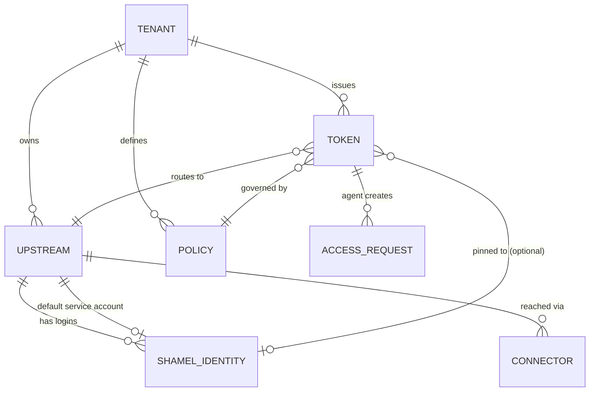

- **Tenant:** exactly one row (`ten_default`) in v1. Every table carries `tenant_id NOT NULL`; uniqueness
  constraints are tenant-scoped; every Valkey key carries the tenant segment `<t>`; compiled config is per
  tenant. No billing, plans, licensing or quota-for-billing fields exist.
- **Upstream:** `id`, `name`, `environment` (`live` | `sandbox`), `mode` (`tunnel` | `direct` | `mock`),
  `base_url` (direct only), `timezone` (default `Asia/Hebron`), `max_concurrency`, timeouts, auth-failure
  signatures, error-message mapping, `default_identity_id`.
- **Shamel identity:** `id`, `upstream_id`, `username`, `password_enc` (envelope), `salesman_code` (from login),
  `last_login_at`, `status`.
- **Connector:** `id`, `upstream_id`, cert serial/fingerprint, status, last seen, version.
- **Token:** bound to exactly one upstream in v1 (a test token to the sandbox upstream). Adding a second Shamel
  server = inserting an upstream + identities + connector and issuing tokens bound to it; no code change.
  Per-request upstream choice (one token, many upstreams) is a possible later extension (`Bawaba-Upstream`
  header), deliberately not in v1.

---

## 13. Failure modes

### 13.1 Summary

| Failure | Detection | Behaviour | Client sees | Owner alert |
|---|---|---|---|---|
| Shamel down | connect errors, connector probe, breaker | Breaker opens; webhook polling pauses; login attempts back off | `503 upstream_unavailable` + `Retry-After` | yes, after 60 s |
| Shamel slow | latency histograms, queue depth | Requests queue up to `queue_timeout`; timeouts trip breaker; background class throttled first | `503 upstream_busy` / `504 upstream_timeout`; `Bawaba-Warning: upstream_saturated` | yes, sustained > 5 min |
| Shamel session invalidated | auth signature | Single-flight cluster-wide re-login, one retry | transparent | only if login fails |
| Shamel credentials wrong / user disabled | login result | Identity backoff 30 s → 5 min | `502 upstream_error` | yes, immediately |
| Connector disconnected (all sessions) | registry empty, yamux keepalive | 2 s grace, then fast-fail; connectors reconnect with backoff | `503 upstream_unavailable` | yes, after 60 s |
| One connector/session lost | keepalive | Traffic shifts to remaining sessions | transparent (idempotent reads retried) | warning |
| Gateway node crash | LB health, registry TTL | LB removes node; its tunnels reconnect elsewhere; coalescing leases expire and followers re-elect | in-flight requests on that node fail | yes |
| Valkey down | client errors | Per function, §13.2 | mostly transparent; writes and multi-page lists `503` | yes |
| PostgreSQL down | pool errors | Reads continue on last compiled config for `config.max_staleness` (default 6 h), then fail closed; audit index rows spooled; writes, access requests, webhook subscription changes fail closed; control plane read-only/unavailable; emergency revocation via Valkey (§5.4). Startup without PostgreSQL is refused. | reads OK; writes `503` | yes |
| Blob store down | put errors | Audit bodies (already encrypted) spooled locally; when spool full → `503 audit_unavailable` (default) or metadata-only (if configured) | transparent until spool full | yes, at 50 % spool |
| Audit spool disk full | disk metrics | As above | `503 audit_unavailable` | yes |
| Cloudflare outage | external | No bypass is offered (it would expose the origin) | unreachable | — |
| Master key missing/unreadable/wrong permissions | startup check | Process refuses to start | — | systemd/Docker failure |
| Internal CA / connector cert near expiry | daily job | Auto-renew; alert at 7 days remaining | — | yes |
| Upstream schema drift | drift metrics | Unknown fields dropped; unparseable values null | normalized data | yes (first occurrence per field) |
| Clock skew | see §13.3 | | | yes |

### 13.2 Valkey unavailable — per function

| Function | Mode | Behaviour |
|---|---|---|
| Rate limits | degrade | Local GCRA at `limit / last_known_N`. |
| Polling warnings | degrade | Disabled. |
| Auth-failure counting / auto-ban | degrade | Node-local counters and bans; existing bans already mirrored in memory stay enforced; bans persisted to PostgreSQL and re-synced on recovery. |
| Config invalidation | degrade | PostgreSQL version poll every 2 s. |
| Emergency deny-set | degrade | Last known set kept in memory. |
| Coalescing | degrade | Local single-flight only. |
| Snapshots / views / cursors | **fail closed for multi-page** | Single-page results served normally; results needing a cursor → `503 pagination_unavailable`; cursor reads → `503`. Never silent truncation. |
| Idempotency records | **fail closed** | Writes `503`. |
| Shamel session sharing | degrade | Per-node sessions and logins (risk of token churn if Shamel allows one session per user — ISCO question). |
| Distributed concurrency lease (cap < N) | degrade | Local `floor(cap / last_known_N)`, min 1; connector hard cap still applies in tunnel mode. |
| Tunnel registry / relay | degrade | Only nodes holding a local session serve that upstream. |
| Queues (webhooks, approved writes, alerts) | pause | Producers write the PostgreSQL record (source of truth) and enqueue later; consumers resume on recovery. |
| Sandbox overlay | degrade | Sandbox writes `503`; reads use the deterministic base dataset. |

Valkey deployment requirement: AOF `appendfsync everysec` (idempotency records and queues must survive a Valkey
restart), `maxmemory-policy volatile-ttl`, TLS + ACL user per role.

### 13.3 Clock skew

- Single time source for distributed algorithms: GCRA and leases use Valkey `TIME` inside scripts; snapshot and
  view expiry are Valkey TTLs (server-side).
- Nodes compare local time with Valkey `TIME` at each heartbeat: skew > 2 s → warning metric/alert; > 30 s →
  node reports not-ready (cursor expiry, token expiry and certificate validation would become unreliable).
- Certificates issued with `NotBefore = now − 5 min`. Cursor `expires_at` checks allow 5 s tolerance.
- NTP (chrony/systemd-timesyncd; Windows Time for the connector) is a documented deployment requirement.

---

## 14. Repository layout and libraries

Single Go module (module path TBD, placeholder `github.com/<org>/bawaba`), Go ≥ 1.26 (track latest stable).

```
.
├── cmd/
│   ├── bawaba-gateway/        # main; roles data|tunnel|control|worker; default.pgo
│   ├── bawaba-connector/      # main; Linux daemon + Windows service
│   ├── bawaba/                # CLI (cobra); --json on every command
│   └── bawaba-mock/           # standalone mock Shamel server
├── internal/
│   ├── app/                   # wiring, role startup, graceful shutdown
│   ├── config/                # bootstrap config: file + env + *_file secrets, validation
│   ├── keyring/               # master key load/perm checks, HKDF purposes, envelope AES-GCM
│   ├── edge/                  # real-IP modes, Cloudflare ranges, listener wrapper
│   ├── pipeline/              # reqctx, stage runner, stages/s01..s17
│   ├── ops/                   # operation registry (descriptors)
│   ├── api/v1/                # /v1 routes, request schemas
│   ├── api/legacy/            # /legacy allowlist, legacy parsers/encoders
│   ├── docs/                  # /docs, OpenAPI, llms.txt serving
│   ├── auth/                  # token format, lookup, publishable/CORS
│   ├── firewall/              # CIDR tries, bans, auto-ban
│   ├── ratelimit/             # GCRA script, local fallback, poll detection
│   ├── policy/                # compiled policy, scopes, data scope, field masks
│   ├── upstream/
│   │   ├── shamel/            # DTOs, header builder, form encoder, tolerant decoder, classifier
│   │   ├── session/           # session manager
│   │   ├── limiter/           # node shares, distributed lease, priority queue
│   │   ├── breaker/
│   │   └── transport/         # direct, tunnel, relay, mock round-trippers
│   ├── tunnel/                # gateway side: ws accept, inner mTLS, yamux, registry; protocol types
│   ├── connector/             # connector side logic
│   ├── cluster/               # node registry, relay server/client
│   ├── coalesce/              # local single-flight, distributed election
│   ├── snapshot/              # snapshot store, views, cursors
│   ├── normalize/             # Shamel DTO -> v1 resources; generated AppendJSON encoders
│   ├── audit/                 # emitter, ring, workers, spool, CAS blobs
│   ├── blob/                  # fs + s3 backends
│   ├── idempotency/
│   ├── approvals/
│   ├── webhooks/              # change detection, delivery, signing
│   ├── alerts/                # rules, SMTP mailer
│   ├── workers/               # leases, stream consumers
│   ├── controlplane/          # admin API, owner auth, dashboard handlers, config compiler
│   ├── configsync/            # compiled config loader, invalidation subscriber
│   ├── store/postgres/        # sqlc queries, embedded goose migrations
│   ├── store/valkey/          # client, Lua scripts, key builders
│   ├── apierr/                # error code catalogue (en/ar), docs_url
│   ├── i18n/                  # message catalogs shared by API errors and dashboard
│   ├── mock/                  # mock Shamel handler + deterministic dataset generator
│   └── observability/         # slog, metrics, tracing
├── web/dashboard/             # html/template views, htmx (vendored), CSS (logical props for RTL), ar/en catalogs
├── api/openapi/               # bawaba-v1.yaml (source of truth), examples, llms.txt source
├── deploy/
│   ├── compose/               # single.yml, single-cloudflared.yml, connector.yml
│   ├── docker/                # Dockerfiles (distroless, non-root)
│   ├── systemd/               # units (LoadCredential for master key), nftables example
│   ├── windows/               # connector MSI (WiX) + service scripts
│   └── cloudflare/            # origin rules, tunnel config, AOP notes
├── docs/                      # design/, upstream/, user/ (ar + en)
├── test/
│   ├── e2e/                   # full-stack tests against bawaba-mock (testcontainers)
│   ├── load/                  # k6 scenarios, results
│   └── chaos/                 # toxiproxy scenarios
└── tools/                     # codegen (encoders from field catalog), archcheck, release
```

| Concern | Choice | Why |
|---|---|---|
| HTTP router | stdlib `net/http` `ServeMux` (method + wildcard patterns) | Zero dependency, fast enough (routing ≪ 1 µs), operations carry the real metadata. |
| PostgreSQL | `github.com/jackc/pgx/v5` + `pgxpool`, queries via `sqlc` | Fastest maintained driver, native types, `COPY` for audit batches; sqlc gives typed queries without an ORM. |
| Migrations | `github.com/pressly/goose/v3` with `embed.FS` | Migrations ship inside the binary; run by `bawaba migrate` with the migrate role. |
| Valkey | `github.com/valkey-io/valkey-go` | Official Valkey client; RESP3, automatic pipelining (cuts RTT cost under concurrency), cluster support. |
| JSON | `encoding/json/v2` + `jsontext` (via `github.com/go-json-experiment/json` while the stdlib package is experimental in the pinned toolchain) | Streaming tokenizer, case-insensitive matching option, much faster and fewer allocations than v1; generated encoders for hot resources. |
| Compression | `github.com/klauspost/compress` (zstd, gzip) | Fastest pure-Go zstd/gzip. |
| Tunnel | `github.com/coder/websocket` (`NetConn` adapter) + `github.com/hashicorp/yamux` | Small, maintained WebSocket lib; yamux is battle-tested multiplexing with keepalive and flow control. |
| Crypto | stdlib `crypto/aes`, `crypto/cipher` (GCM), `crypto/hkdf`, `crypto/ecdsa`, `crypto/x509`; `golang.org/x/crypto/argon2` (owner passwords) | Standard, audited, constant-time primitives. |
| Circuit breaker | `github.com/sony/gobreaker/v2` | Small, well-known, generic API. |
| Logging | `log/slog` (JSON handler) | Stdlib structured logging, low allocation. |
| Metrics / tracing | `github.com/prometheus/client_golang`; `go.opentelemetry.io/otel` (OTLP, optional) | De-facto standards; tracing off by default. |
| Config | `github.com/knadh/koanf/v2` (YAML + env + file providers) | Layered config with env overrides and file watching, small dependency tree. |
| CLI | `github.com/spf13/cobra` | Standard subcommand UX, shell completion. |
| Windows service | `golang.org/x/sys/windows/svc` (+ `eventlog`) | First-party, no wrapper dependency. |
| S3 blobs | `github.com/minio/minio-go/v7` | Works with any S3-compatible store; lighter than the AWS SDK. |
| IDs | `github.com/google/uuid` (UUIDv7) | Time-ordered ids → index locality; request ids derived from them. |
| Dashboard | `html/template` + vendored htmx, server-rendered | No npm toolchain/runtime dependency tree on a security-critical admin surface; strict CSP (`script-src 'self'`); RTL via `dir` + CSS logical properties; shares i18n catalogs with API errors. |
| Testing | `testcontainers-go`, `go.uber.org/goleak`, toxiproxy, k6 | Real PostgreSQL/Valkey in tests, leak detection, fault injection, load. |

---

## 15. Configuration model

### 15.1 Bootstrap vs runtime

| Kind | Where | Contents | Changed by |
|---|---|---|---|
| **Bootstrap** | `/etc/bawaba/bawaba.yaml` + env overrides + secret files | node id/roles, listeners, TLS files, edge mode, PostgreSQL/Valkey/blob connection, master key path, spool dirs, sandbox mode, logging, limits that require restart | Operator (file), restart or SIGHUP for reloadable keys |
| **Runtime** | PostgreSQL → compiled config | upstreams, identities, connectors, tokens, policies, firewall lists, rate defaults, CORS origins, alert rules, error mappings, auth signatures, webhook poll interval, snapshot TTL, retention | Owner via control plane (dashboard/CLI); versioned and audited; propagates in < 1 s |

### 15.2 File, environment, secrets

- Search order: `--config` flag → `BAWABA_CONFIG` → `/etc/bawaba/bawaba.yaml`.
- Env overrides: `BAWABA_` + upper-case path with `__` as separator, e.g. `BAWABA_LISTENERS__PUBLIC__ADDR`,
  `BAWABA_POSTGRES__DSN`.
- **Secrets only via files:** every secret key has a `*_file` form (`postgres.password_file`,
  `valkey.password_file`, `smtp.password_file`, `blob.s3.secret_key_file`), compatible with Docker/Compose
  secrets (`/run/secrets/...`) and systemd credentials. Plain secret values in the YAML or env are rejected at
  startup unless `dev_mode: true` (which also forbids `live` upstreams).
- Startup validation is strict: unknown keys are errors; the control listener must be loopback; `edge.mode:
  direct` on a non-private public bind requires `dev_mode`.

```yaml
node:
  id: ""                        # default: stable id persisted in /var/lib/bawaba/node-id
  roles: [data, tunnel, control, worker]
listeners:
  public:  { addr: "0.0.0.0:8443", tls: { cert_file: /etc/bawaba/tls/origin.pem, key_file: /etc/bawaba/tls/origin.key, client_ca_file: /etc/bawaba/tls/origin-pull-ca.pem } }
  tunnel:  { addr: "0.0.0.0:8444", path: /_bawaba/connect }
  relay:   { addr: "" }         # private IP:8445 in topology C
  control: { addr: "127.0.0.1:7443", socket: /run/bawaba/control.sock }
  ops:     { addr: "127.0.0.1:9090", pprof: false }
edge:
  mode: cloudflare              # cloudflare | cloudflare_tunnel | trusted_proxies | direct
  public_hosts: [api.example.com, connect.example.com]
security:
  master_key_file: /etc/bawaba/keys/master.key   # or $CREDENTIALS_DIRECTORY/master.key
postgres: { dsn: "postgres://bawaba_data@db:5432/bawaba?sslmode=verify-full", password_file: /run/secrets/pg_password, max_conns: 20 }
valkey:   { addrs: ["valkey:6379"], username: bawaba_data, password_file: /run/secrets/valkey_password, tls: true }
blob:     { backend: fs, fs: { root: /var/lib/bawaba/blobs } }
audit:    { spool_dir: /var/lib/bawaba/spool, spool_max_bytes: 10GiB, on_spool_full: reject }
server:   { request_timeout: 90s }
config:   { poll_interval: 5s, max_staleness: 6h }
sandbox:  { mode: embedded, seed: 1, dataset_version: 1 }
log:      { level: info, format: json }
```

### 15.3 Master key and key hierarchy

- **File:** `/etc/bawaba/keys/master.key`, owner `root:root`, mode `0400`, outside the database and outside
  backups of `/var/lib/bawaba`. Content: versioned key set (`kid` + 32 random bytes each, one marked active),
  created by `bawaba init` (or `bawaba key rotate`).
- **Delivery to the unprivileged `bawaba` process:** systemd `LoadCredential=master.key:/etc/bawaba/keys/master.key`
  (the gateway reads `$CREDENTIALS_DIRECTORY/master.key`); Docker: a Compose secret mounted at
  `/run/secrets/bawaba_master_key`. When reading a plain path, the gateway refuses to start if the file is
  group/world-accessible or not owned by root/itself.
- **Derivation:** `HKDF-SHA256(master[kid], salt = install_id, info = "bawaba/v1/" + purpose)` for purposes
  `cred` (KEK for identity passwords, internal CA key), `audit` (KEK for audit DEKs), `snap`, `cursor`,
  `coalesce`, `token_pepper`, `blobid`, `sess`, `config`. Envelope records store `kid`, so rotation re-wraps DEKs
  in the background without downtime. A stolen database, Valkey dump or blob bucket without the key file is
  useless. Full treatment (rotation procedure, backup of the key, future KMS/Vault) is in the security design.

### 15.4 Reload matrix

| Setting | Hot (no restart) | Mechanism |
|---|---|---|
| Tokens, policies, firewall, rate defaults, CORS, upstream settings, alert rules, error mappings | yes | Compiled config + `bwb:events` |
| Auto-bans | yes | Valkey + `bwb:events` |
| TLS certificate/key files (public, tunnel) | yes | File watch → `tls.Config.GetCertificate` swap |
| Cloudflare range list | yes | `bawaba edge refresh-ranges` or SIGHUP |
| Log level | yes | SIGHUP or control API |
| Sandbox seed/dataset version | yes (resets sandbox overlays) | Control API |
| Listener addresses, roles, edge mode | no | restart |
| PostgreSQL/Valkey/blob endpoints and credentials | no | restart (rolling in topology C) |
| Master key set | no (new active `kid` loaded on restart; old kids remain for decryption) | restart |

---

## 16. Assumptions and open questions

Assumptions made in this document (to be validated):

1. Shamel speaks HTTP/1.1 (likely IIS/ASP.NET); HTTPS availability unknown — the connector makes it irrelevant
   for the Internet path.
2. Shamel read endpoints are `GET` with header parameters except those documented as form posts; the exact
   method per path will be confirmed by `bawaba upstream calibrate` and ISCO.
3. Shamel's capacity is modest; default `max_concurrency = 8` until measured.
4. Item `image_path` values are relative to (or on the same origin as) the Shamel base URL.

Questions for ISCO that directly affect this architecture (to be merged into the consolidated ISCO list):

- Session token lifetime; does a new `/Main/Login` invalidate earlier tokens for the same user; is there a
  logout; exact error body when a token is invalid/expired.
- Account lockout policy after failed logins.
- Recommended maximum concurrent requests / requests per second; any server-side throttling.
- HTTP methods per endpoint; HTTPS support; gzip support; maximum response sizes for `GetItems`/`GetCustomers`.
- Format of `image_path` (relative path, absolute URL, file share path) and how images are served.
- Whether error responses can contain stack traces/SQL (assumed yes; never forwarded either way).
