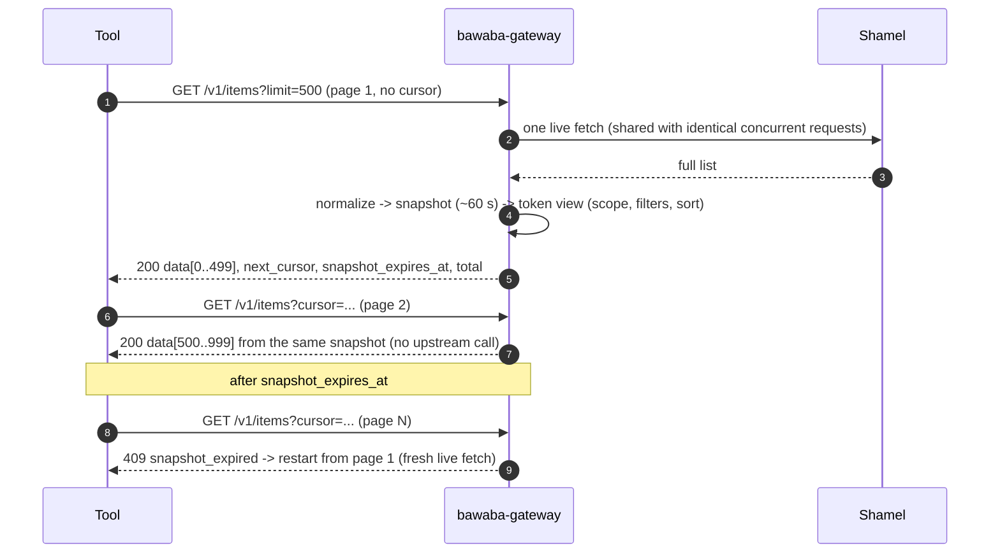
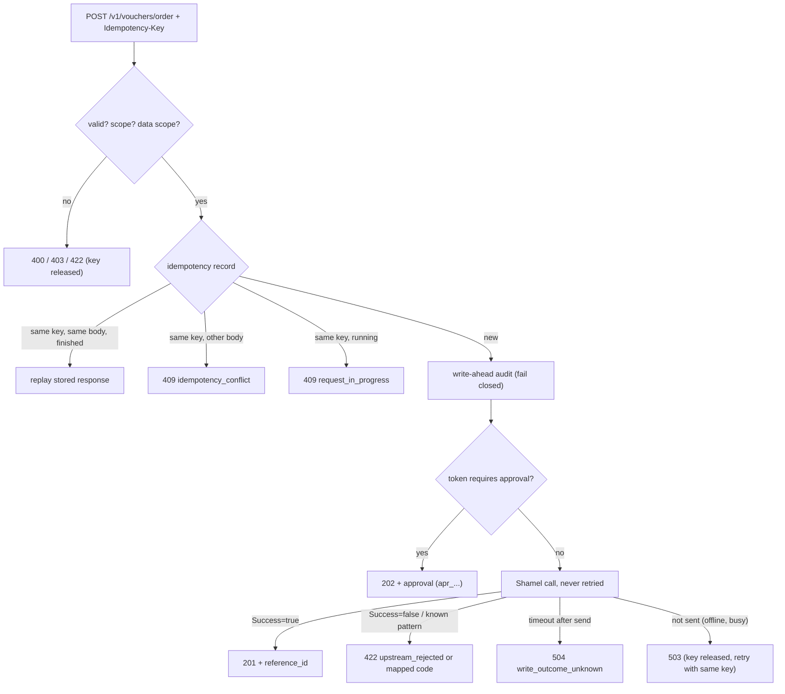
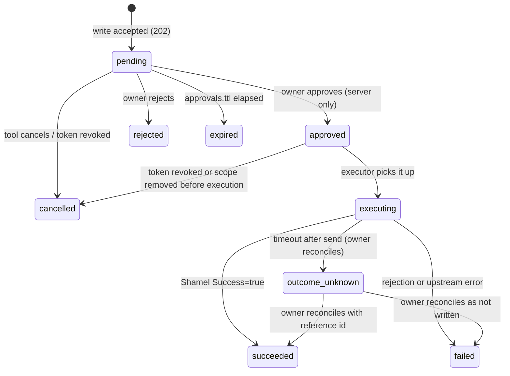

# 03 — Bawaba Public API (v1)

> Status: draft v1 · 2026-11-03 · Binding input: [`00-decisions.md`](00-decisions.md). Upstream reference:
> [`../upstream/shamel-api.md`](../upstream/shamel-api.md) (cited as "U §x" and "Qnn").
> Related: [`01-architecture.md`](01-architecture.md) (pipeline, coalescing, snapshots; cited "01 §x"),
> [`02-security.md`](02-security.md) (tokens, firewall, origin hiding; "02 §x"),
> [`04-permissions-and-tokens.md`](04-permissions-and-tokens.md) (scopes, data scoping, lineage, access requests,
> approvals; "04 §x"), [`05-operations.md`](05-operations.md) (webhooks engine, warnings, audit; "05 §x").
>
> This document owns the **public HTTP contract** of `bawaba-gateway`: the `/v1` resources and their query and
> response shapes, the field mapping from Shamel, the upstream translation of every operation, pagination and
> search semantics, write semantics (idempotency, approvals, batches), the webhooks API shapes, token self-service
> and agent endpoints, the `/legacy` contract, the sandbox contract, the error and warning catalogues, response
> headers and CORS, and the OpenAPI toolchain.
>
> The "Upstream translation" blocks below are **internal design material**. They are implemented as hand-written
> plans in `internal/ops/plans` and never appear in public documentation, OpenAPI or error messages (02 LV-13).

---

## 0. Terminology and notation

| Term | Meaning |
|---|---|
| Shamel name | An upstream wire name exactly as transcribed (U §0), typos included, e.g. `sale_parice1`. |
| `Hdr x` / `Form x` | Upstream request header `x` / upstream form field `x` (U §2.4). |
| Pushdown | A client filter that Bawaba translates into an upstream header or form value, so Shamel filters. Pushdowns are part of the coalescing key (01 §9.1). |
| Snapshot filter | A client filter that Bawaba evaluates over the normalized snapshot because Shamel cannot filter. |
| Operation | A registry entry such as `customers.list` (01 §6.1). Every route maps to exactly one operation id. |
| Business timezone | The upstream's `timezone` setting, default `Asia/Hebron` (01 §12). |
| M1 / M2 / M3 | Milestones: M1 = every read (00 §9); M2 = writes, batches, approvals, access requests; M3 = webhooks. M2/M3 grouping is a designer proposal; only "reads first" is binding. |
| *(provisional)* | A field whose upstream meaning is undocumented. Its name and type are frozen at M1 GA; before GA it may be renamed once ISCO answers (§3.4). Marked `x-bawaba-provisional: true` in OpenAPI. |

---

## 1. Principles

1. **Resources, not RPC.** Shamel's `/{Controller}/{Action}` calls become nouns under `/v1` with query parameters,
   JSON bodies and real status codes. One upstream call may serve several routes, and one route may fan out to
   several upstream calls (combined endpoints, §14).
2. **Bawaba types only.** Every response is built from Bawaba's own schema. Upstream bytes, headers, URLs, error text
   and internal identifiers (`system_id`, `update_date`, `userId`, session tokens) never reach a client (02 §5.1).
3. **Always live, and honest about it.** No business-data caching (00 §8). Page 1 of a list is one live upstream
   fetch; later pages reuse that fetch for about 60 s through an opaque cursor; identical concurrent requests share
   one live call. There is no `ETag`, no `Last-Modified` and `Cache-Control: no-store` everywhere: conditional
   requests would invite clients to cache what the owner decided must not be cached.
4. **Exact money.** Amounts, quantities, prices and rates are decimal strings (§4.6). Bawaba never round-trips money
   through binary floating point.
5. **Fail closed, quietly.** Data outside a token's data scope does not exist for that token: lists omit it, single
   lookups return `404 not_found`, filters naming it return empty results (§2.4). Hidden fields are omitted (§2.5).
6. **Explicit allowlists.** Every route declares its query parameters, filters, sort keys, search fields and body
   fields. Anything else is rejected (`unknown_parameter`, `invalid_request`), never ignored.
7. **Additive evolution.** Within `/v1`, things are only added (§3).
8. **Teach the client.** Every authenticated response carries `RateLimit-*`; misuse produces `Bawaba-Warning`;
   every error carries a stable `code`, English and Arabic messages and a `docs_url`; the OpenAPI document carries
   scopes, poll intervals, webhook alternatives and examples for AI agents (00 §6 "Inform the AI").
9. **One pipeline.** `/v1` and `/legacy` run the same authentication, permission, firewall and audit stages
   (01 §6.3); `/legacy` differs only in request parsing and response encoding (§20).

---

## 2. Authentication and authorization

### 2.1 Bearer tokens

Every `/v1` and `/legacy` request (except CORS preflight and presigned media URLs, §10.6) carries:

```http
Authorization: Bearer bwb_live_<43 base62 chars><6 char checksum>
```

| Prefix | Environment | Upstream | Kind |
|---|---|---|---|
| `bwb_live_` | `live` | the token's Shamel upstream | `tool` or `agent` |
| `bwb_test_` | `sandbox` | `bawaba-mock` (§21) | `tool` or `agent` |
| `bwb_pk_live_` | `live` | the token's Shamel upstream | `publishable` |
| `bwb_pk_test_` | `sandbox` | `bawaba-mock` | `publishable` |

Format, checksum and storage are defined in 02 §9.7. Rules visible to clients:

- The scheme is case-insensitive (`Bearer`/`bearer`); exactly one space; no other auth scheme is accepted.
- Tokens are never accepted in the URL (`400 token_in_url`), in cookies or in any other header. Shamel `username`,
  `token` or `password` headers are rejected on `/legacy` (`400 shamel_credentials_not_accepted`, §20.5).
- Missing header → `401 unauthenticated`; malformed, unknown, revoked or suspended → `401 invalid_token` (one code,
  one timing class); past `expires_at` → `401 token_expired`.
- Non-publishable tokens sent with an `Origin` header are refused (`403 secret_token_in_browser`) unless the owner
  disabled `reject_browser_origin` for that token (02 §10.7).

### 2.2 Token kinds

| Endpoint group | `tool` | `agent` | `publishable` |
|---|---|---|---|
| `/v1` reads (§8–§14) | yes, by scope | yes, by scope | yes: read scopes only, `GET` only, `Origin` must be in the token's list |
| Media (§10.6) | yes | yes | yes |
| `/v1` writes and batch (§15) | yes | yes | no (`403 token_kind_not_allowed`) |
| Approvals of own writes (own lineage, §16) | yes | yes | no |
| Webhooks (§17) | yes | yes | no |
| Access requests (§18.3) | no | yes, with `access_requests:write` | no |
| `GET /v1/me`, `GET /v1/event-types` | yes | yes | yes (reduced `/v1/me`, §18.1) |
| `GET /v1/me/requests` | yes | yes | no (a publishable token is public by nature) |
| `/legacy` (§20) and `GET /v1/docs/legacy` (§20.5) | if enabled for the token | if enabled | no |

A token **lineage** is a token plus its rotation successors (`lineage_id`, 04 §2.4.5). Idempotency keys (§15.2),
approval visibility (§16) and webhook ownership (§17.3) are keyed by lineage, so a rotated token keeps seeing and
replaying what its predecessor created; cursors stay bound to the individual token.

### 2.3 Scopes

Scopes are `<resource>:<action>`. A token holds a set of scope **atoms**; the permissions model expands presets and
shorthands into atoms at compile time (01 S8). The API rules are:

- `<resource>:write` never implies `<resource>:read` (this is what makes "write-only" presets possible, 00 §5).
- `vouchers:write` is shorthand for all 13 atoms `vouchers:write:<voucher_type>`. Voucher creation checks the atom.
- An operation lists its required scopes in `x-bawaba-scopes`; **all** listed scopes are required.
- Missing scope → `403 insufficient_scope` with the missing atoms in `error.details` (§22.1).

| Scope | Unlocks |
|---|---|
| `master_data:read` | §8: currencies, currency rates, banks, bank branches, cities, stores, price classes, salesmen |
| `customers:read` | §9: customers, customer balances, customer prices, customer overview (base section) |
| `customers:write` | `POST /v1/customers` (M2) |
| `items:read` | §10: items, item groups, item serials, item images, media, item overview (base section) |
| `items:write` | `POST /v1/items` (M2) |
| `stock:read` | §11: stock lists, item stock, `include=stock`, stock sections of overviews |
| `vouchers:read` | §12: vouchers, voucher summaries, prepared deliveries, order status, recent vouchers in the customer overview |
| `vouchers:write:<voucher_type>` | `POST /v1/vouchers/{voucher_type}` for that type (M2) |
| `reports:read` | §13: account statement, last-price report; statement summary in the customer overview |
| `cost_centers:read` | cost-center statement (together with `reports:read`) |
| `cost_centers:write` | `POST /v1/cost-centers` (M2) |
| `webhooks:read` | list and read own subscriptions, deliveries, pull events (M3) |
| `webhooks:write` | create, modify, delete, test, rotate, retry own subscriptions (M3) |
| `access_requests:write` | agent tokens only; never grantable to other kinds (02 §13) |

`master_data:write`, `stock:write` and `reports:write` are syntactically valid but unlock nothing in v1 (Shamel has
no such endpoints); the control plane refuses to grant them so that the subset rule (02 §13.2) stays meaningful.

Voucher types (path segment, scope suffix and `type` field), from U §6.1:

| `voucher_type` | Shamel value | Code prefix | Arabic |
|---|---|---|---|
| `order` | 0 | `O` | طلبية |
| `purchase_delivery` | 2 | none (Q40) | ارسالية مشتريات |
| `sales_return` | 4 | `S` | مردودات مبيعات |
| `returned_pending_sales_delivery` | 5 | `F` | مردود من ارسالية برسم البيع |
| `sales_invoice` | 9 | `I` | فاتورة مبيعات |
| `sales_delivery` | 10 | `V` | ارسالية مبيعات |
| `stockout` | 12 | `B` | اخراج بضاعة |
| `internal_delivery` | 16 | `N` | ارسالية داخلية |
| `credit_note` | 22 | `C` | اشعار دائن |
| `debit_note` | 23 | `D` | اشعار مدين |
| `receipt` | 24 | `R` | قبض |
| `payment` | 27 | `P` | صرف |
| `journal` | 28 | `J` | قيد |

### 2.4 Data scopes as seen through the API

A token may be restricted per **dimension**: stores, salesmen, customers, currencies, price classes (00 §5) and
voucher types (`voucher_types`, values from §2.3; added by 04 §4.1). The permissions model owns how restrictions are
configured and the authoritative per-operation enforcement matrix (04 §4.4); this section fixes their observable
behaviour.

**Rules**

| # | Rule |
|---|---|
| DS-1 | **Lists** silently omit records outside the scope. `page.total` counts visible records only. |
| DS-2 | **Single-resource lookups** of an out-of-scope record return `404 not_found`, indistinguishable from a missing record, after the same upstream fetch (02 LV-11). |
| DS-3 | **Filter values** naming an out-of-scope entity (`store_id=9` when store 9 is not allowed) produce an empty result, never an error, so scopes cannot be probed. |
| DS-4 | **Sub-collections** are filtered per row: item `prices[]` by price class and currency, stock rows by store, per-currency balance rows (including the customer overview's `balances`) by currency. Aggregates (`total_quantity`, statement totals) are computed over visible rows only. |
| DS-5 | **Vouchers are atomic.** A voucher is visible only if *every* dimension value it carries is allowed: `type`, `customer_code`, `salesman_code`, `currency_code` and every `cheques[].currency_code`, `order_store_id` and every `lines[].store_id`. For customer- or salesman-restricted tokens every `accounts[].account_code` must also be a visible customer, so vouchers with general-ledger account lines are invisible to them (04 §4.4 journal rule). Bawaba never returns a voucher with lines removed, because partial vouchers misstate totals. Unknown voucher types (`type: "other"`, §4.7) are visible only to tokens whose `voucher_types` is unrestricted. |
| DS-6 | **Derived salesman dimension.** For salesman-restricted tokens, records that carry a customer code but no salesman (balances, customer prices, voucher summaries, statements, last prices) are checked through the customer's `salesman_code`, resolved by one extra live `GetCustomers` call (coalesced, no `getBalance`) inside the same request. |
| DS-7 | **Unevaluable dimensions fail closed.** If a restricted dimension cannot be evaluated on an endpoint's records, the endpoint either requires a narrowing parameter (`403 data_scope_filter_required`, `details` names the parameter) or is unavailable to that token (`403 data_scope_unsupported`). |
| DS-8 | **Writes** referencing an out-of-scope entity fail with `422 reference_not_found` on that field, exactly as for a non-existent entity. |
| DS-9 | **Cursors** re-check every record against the token's *current* policy; a policy change invalidates outstanding cursors (`409 cursor_invalidated`, 02 §9.10). |
| DS-10 | **Null values.** A record whose dimension value is null or empty counts as the reserved member `@none`; it is visible only if the token's allow-set contains `@none` (e.g. `salesmen: ["S07", "@none"]` adds customers without a salesman). A voucher dimension with no value at all is `{@none}`, so a receipt (no store) is visible to a store-restricted token only with `@none` in its store set. `@none` cannot collide with a code (codes never contain `@`; 04 §4.2). |

**Dimension map** (field evaluated per resource; "–" = not scoped by that dimension; 04 §4.4 is authoritative):

| Resource | stores | salesmen | customers | currencies | price classes | voucher types |
|---|---|---|---|---|---|---|
| stores | `id` | – | – | – | – | – |
| salesmen | – | `code` | – | – | – | – |
| currencies / currency rates | – | – | – | `code` / `currency_code` | – | – |
| price classes | – | – | – | – | `id` | – |
| banks, bank branches, cities, item groups | – | – | – | – | – | – |
| customers | – | `salesman_code` | `code` | `currency_code` | `price_class_id` | – |
| customer balances | – | DS-6 | `customer_code` | `currency_code` (row) | – | – |
| customer prices | – | DS-6 | `customer_code` | `currency_code` | `price_class_name` → id via live `GetPriceClasses` | – |
| items | – | – | – | `prices[].currency_code` (DS-4); `units[].unit_price` omitted | `prices[].price_class_id` (DS-4); `units[].unit_price` omitted | – |
| stock, item serials | `store_id` | – | – | – | – | – |
| vouchers, prepared deliveries | DS-5 (`order_store_id`, `lines[].store_id`) | `salesman_code` | `customer_code`, `accounts[].account_code` (DS-5) | `currency_code`, `cheques[].currency_code` | – | `type` |
| voucher summaries | `data_scope_unsupported` for store-restricted tokens | DS-6 | `customer_code` | `currency_code` | – | `type` |
| account statement | `include_stock_lines=true` → `data_scope_unsupported` | DS-6 on `account_code` | `account_code` must be an allowed customer | `currency_code` parameter required and allowed (DS-7); `include_other_currencies=true` → `data_scope_unsupported` | – | `data_scope_unsupported` |
| last-price report | – | DS-6 on `customer` | row `customer` | row `currency_code` | – | `data_scope_unsupported` |
| cost-center statement | – | `data_scope_unsupported` | `data_scope_unsupported` | `currency_code` parameter required and allowed; `include_other_currencies=true` → `data_scope_unsupported` | – | `data_scope_unsupported` |
| order status | via the order: `order_code` required when store-, salesman-, customer- or currency-restricted (DS-7) | | | | – | `404 not_found` when `voucher_types` excludes `order` |

`units[].unit_price` cannot be attributed to a price class or currency *(provisional)*, so it is omitted for tokens
restricted on either. Statements carry running balances, so they are allowed whole or denied, never row-filtered.

### 2.5 Field hiding as seen through the API

- Hidden fields are **omitted** from responses, never nulled or zeroed (01 S15). Hiding applies to nested objects,
  sub-collections, combined endpoints, webhook payloads and `/legacy` alike.
- `GET /v1/me` lists the token's hidden fields per resource (§18.1), so tools can adapt.
- Asking for a hidden field explicitly (`fields=`, `include=`) is not an error: the field stays omitted and the
  response carries `Bawaba-Warning: fields_hidden;fields="purchase_price"` (§23.4).
- Hidden fields can be neither filtered, sorted nor searched on: such a parameter yields `422 validation_failed`
  with detail code `field_hidden`; `q` silently skips hidden search fields.
- When a hidden field is the only reason for an upstream flag (e.g. `include=balance` while `balance` is hidden),
  Bawaba does not send the flag upstream at all.

Fields flagged `x-bawaba-sensitive: true` in OpenAPI are candidates for default hiding presets: item
`purchase_price`, `credit_account_code`, `debit_account_code`, `units[].unit_price`; customer `credit_limit`,
`discount`, `balance`, `id_number`; customer balance `balance`; voucher `customer_balance` and
`customer_balance_before`; voucher summary `customer_balance_before`; customer price `price`, `discount`.

### 2.6 Shamel identity and salesman scoping

- Each token reaches Shamel as its upstream's default service account or as a pinned Shamel user (00 §5). The
  identity is never visible; `GET /v1/me` only reports `salesman_scoped` and the salesman code of a pinned
  salesman identity.
- Shamel's own salesman scoping (Q17) applies on top of Bawaba's data scope: a pinned salesman token can never see
  more than Shamel shows that salesman.
- `getAll=true` is sent upstream only when the token's policy allows it **and** the identity is not a pinned
  salesman (01 §7.2). There is no client parameter for it on `/v1`.

---

## 3. Versioning, compatibility and deprecation

### 3.1 Versions

- The major version is in the path: `/v1`. A breaking change requires `/v2`; both run side by side.
- The OpenAPI `info.version` is the **contract version** `1.<minor>.<patch>`: minor for additions, patch for
  documentation fixes. It is not the build version (02 LV-18).
- `/v1` is supported for at least **12 months** after `/v2` reaches GA.

### 3.2 Compatible (non-breaking) changes

New endpoints; new optional query parameters, filters, sort keys, `include` values; new response fields; new
optional request fields; new error codes, warning codes, event types and enum values; relaxed validation; new
response headers. Clients must therefore:

- ignore unknown response fields and headers;
- treat `error.code`, `Bawaba-Warning` codes, event `type` and voucher `type` as **open enums** (an unknown voucher
  type from Shamel is rendered as `"other"` with its integer `type_id`, §4.7);
- never depend on field order or on the order of unsorted lists.

### 3.3 Breaking changes (only in a new major version)

Removing or renaming a field, parameter or endpoint; changing a type or format; tightening validation; changing
default behaviour, a status code or an error code for an existing condition; changing pagination or authentication
semantics.

### 3.4 Pre-GA and provisional fields

Until M1 GA the contract is `1.0.0-beta.N`. Fields marked *(provisional)* map undocumented upstream values (U §6.4,
Q24–Q42). They ship with neutral names and raw types; ISCO answers may rename them **before GA only**. After GA, an
improved interpretation is added as a new field (for example a named `type` next to an integer `type_id`), never by
changing the old one.

### 3.5 Deprecation procedure

1. The operation, parameter or field is marked `deprecated: true` in OpenAPI with `x-bawaba-sunset` and a
   replacement; the changelog (`/docs/changelog`) records it.
2. Responses that use it carry `Deprecation: @<unix-seconds>` (RFC 9745), `Sunset: <HTTP-date>` (RFC 8594) and
   `Bawaba-Warning: deprecated;sunset="2027-12-31"`.
3. `GET /v1/me` lists deprecated operations the token used in the last 30 days; the owner receives a digest e-mail.
4. Minimum notice: 6 months before a deprecated item disappears, and within a major version it disappears only with
   that major version.

---

## 4. Conventions

### 4.1 URLs and naming

| Element | Rule | Example |
|---|---|---|
| Base | `https://<public-host>/v1` | `https://api.example.com/v1/customers` |
| Path segments | lower-case kebab-case nouns, plural collections | `/v1/customer-balances`, `/v1/item-groups/tree` |
| Query parameters | snake_case | `updated_since`, `store_id` |
| JSON fields | snake_case, Shamel typos fixed (§4.1.1) | `sale_price`, `organization_code` |
| References | `<entity>_code` for Shamel string codes, `<entity>_id` for Shamel integer ids | `customer_code`, `store_id` |
| Bawaba object ids | type prefix + opaque body; never parse | `apr_…`, `areq_…`, `whs_…`, `whd_…`, `evt_…`, `med_…`, `wrt_…`, `bat_…`, `tok_…`, `req_…` |

#### 4.1.1 Upstream name fixes

The six shared fixes are applied everywhere: `sale_parice→sale_price`, `orgnization→organization`,
`grantee→guarantee`, `refrenceId→reference_id`, `Classificaiton→classification`, `Branchs→branches`. Further
fixes chosen here: `orginal_code→original_code`, `notPayedCheqsBalance→unpaid_cheques`, `qnty→quantity`,
`itm/itmStores→item/stock`, `cheqs→cheques`, `cheq_num→cheque_number`, camelCase and PascalCase names to
snake_case (`nameEn→name_en`, `VATReg→vat_reg`, `parentCode→parent_code`).

### 4.2 Path identifiers

Shamel entities are addressed by their **business codes** (customer code, item code, voucher code) or integer ids
(store, city, price class). Bawaba adds no surrogate ids for Shamel data.

- A code matching `^[A-Za-z0-9._-]{1,64}$` (and not `.` or `..`) is used verbatim: `/v1/customers/C1001`.
- Any other code (containing `/`, spaces, Arabic letters, …) is written in the **escaped form** `~` + base64url
  (RFC 4648 §5, no padding) of its UTF-8 bytes: code `A/12` → `/v1/items/~QS8xMg`. Percent-encoded slashes are
  rejected by path hygiene (02 §11.3), which is why this form exists. The decoded value must be valid UTF-8,
  1–64 characters, without control or bidi characters.
- Codes that contain characters outside printable ASCII cannot be sent in upstream headers (Q48). For those, Bawaba
  performs the lookup as a full live list fetch plus an exact snapshot match; the result is identical, but the
  request costs the `list` class in the upstream-units bucket instead of `small` (§23.3) and carries
  `Bawaba-Warning: expensive_lookup;reason="non_ascii_code"` (§23.4), so N+1 loops over such codes are throttled and
  flagged instead of sending N full fetches to the upstream at single-lookup cost. Tools should list once and match
  locally.
- The OpenAPI path-parameter pattern is `^(~[A-Za-z0-9_-]{2,344}|[A-Za-z0-9._-]{1,64})$`.

### 4.3 Methods and status codes

| Method | Use | Body |
|---|---|---|
| `GET` | read | none (a body is rejected) |
| `POST` | create, actions (`/test`, `/cancel`, `/retry`, `/claim-secret`), batch | JSON |
| `PATCH` | partial update of Bawaba-owned objects (webhook subscriptions), JSON Merge Patch semantics (RFC 7396) sent as `application/json` | JSON |
| `DELETE` | delete Bawaba-owned objects | none |
| `OPTIONS` | CORS preflight only | none |

`HEAD`, `PUT` and every other method → `405 method_not_allowed` (02 §10.7). Shamel entities cannot be updated or
deleted (Q43), so no `PATCH`/`DELETE` exists for them.

| Status | Meaning in Bawaba |
|---|---|
| 200 | Success (reads, actions, batch envelope) |
| 201 | Created in Shamel (or in Bawaba for webhooks); `Location` points to the new resource |
| 202 | Accepted but not executed yet: write held for approval, access request pending, delivery re-queued |
| 204 | Deleted (webhook subscription) |
| 400 | Syntax: malformed JSON, unknown parameter, bad cursor, credentials in the wrong place |
| 401 | Missing, invalid or expired token |
| 403 | Authenticated but not allowed (scope, kind, IP, origin, data-scope limits) |
| 404 | Resource absent or outside the data scope; unknown route |
| 405 | Method not allowed on the route |
| 409 | State conflict: snapshot expired, idempotency conflict or in progress, approval no longer pending |
| 413 / 414 / 415 / 431 | Protocol limits enforced by the firewall layer (body, URL, content type, headers) |
| 422 | Semantically invalid request, or Shamel rejected the operation |
| 429 | Rate limit |
| 500 | Bawaba's own fault (`internal_error`, no detail) |
| 502 | Shamel failed or answered something unusable |
| 503 | Shamel unreachable or saturated; Bawaba dependency unavailable (fail closed) |
| 504 | Shamel timed out; write outcome unknown |

The application-level statuses are the shared set (400/401/403/404/409/422/429/502/503/504). 405, 413, 414, 415 and
431 are emitted only by protocol hygiene before or at routing (02 §10.1), and 500 only for Bawaba bugs.

### 4.4 Envelopes

| Response | Shape |
|---|---|
| Single resource | `{"data": {…}}` |
| List | `{"data": […], "page": {…}}` plus optional `summary` and `sync` objects (§5.1) |
| Combined resource | `{"data": {…}, "meta": {…}}` (§14) |
| Write result | `{"data": {…}}` (201) or `{"data": {"approval": {…}}}` (202) |
| Error | `{"error": {"code", "message", "message_ar", "request_id", "docs_url", "details"?}}` (§22) |

No response is a bare array or a bare scalar. Two routes return non-envelope success bodies: media bytes (§10.6) and
the legacy reference, which is the OpenAPI document itself so generators can consume it directly (§20.5). `/legacy`
responses use Shamel's shapes (§20.4).

### 4.5 Dates, times and timezone

- **Business dates** (voucher date, statement dates, guarantee dates) are `"YYYY-MM-DD"` with no timezone. They are
  dates in the business timezone, exactly as Shamel stores them.
- **Times of day** from Shamel (`VoucherHeader.time`, `hhmmss`, Q41) are rendered `"HH:MM:SS"` (24-hour assumed).
- **Timestamps** generated by Bawaba (`snapshot_expires_at`, `created_at` of approvals, events) are RFC 3339 with
  seconds and the business timezone's offset, e.g. `"2026-11-03T12:20:00+02:00"`. Inputs accept any offset.
- Query parameters `from` / `to` are business dates, **both inclusive** (assumed from Shamel's `fromDate`/`toDate`;
  ISCO question I-8).
- Upstream date strings that do not parse become `null` and increment the schema-drift metric (01 §7.4).

### 4.6 Decimal numbers (decision)

**Decision: every monetary amount, price, quantity, exchange rate, percentage and coordinate is a JSON string
holding a canonical decimal.** Integer identifiers and counts (`store_id`, `price_class_id`, `level`, `position`,
`page.total`) are JSON integers.

| Option | Pros | Cons |
|---|---|---|
| JSON numbers | Natural in JSON; easy arithmetic | JavaScript and many JSON libraries decode into IEEE-754 doubles: `0.1 + 0.2` artefacts, silent loss above 2^53, locale bugs; encourages float arithmetic in accounting tools built by AI agents |
| **Decimal strings (chosen)** | Exact; no client parser can lose precision; matches 01 S13 (exact decimal text) and 02 §10.5 (numbers decoded as decimal text); Shamel already sends statement amounts as strings (Q35) | Clients must parse explicitly (documented, with snippets for Go `shopspring/decimal`, JS `decimal.js`, Python `Decimal`, C# `decimal`) |

**Output grammar** (`format: decimal` in OpenAPI): `^-?(0|[1-9][0-9]*)(\.[0-9]*[1-9])?$` — no exponent, no `+`, no
thousands separators, `.` as decimal point, no trailing fractional zeros, `"0"` for zero (never `"-0"`).

**Normalization from Shamel:** the decoder keeps the upstream number's literal text (it never parses into
`float64`). Shamel stores doubles, so binary artefacts such as `0.30000000000000004` can appear; values with more
fractional digits than `normalization.decimal_max_scale` (`money` 6, `quantity` 6, `percent` 6, `rate` 10) are
rounded half-to-even to that scale, then trailing zeros are stripped. Statement amounts that arrive as strings
(Q35) are parsed with the same grammar extended by an optional thousands separator `,`; `""` becomes `null`; any
other format fails the whole response with `502 upstream_error` and a drift alert — Bawaba never guesses money.

**Input:** a decimal may be sent as a JSON string matching `^-?[0-9]{1,18}(\.[0-9]{1,10})?$` or as a JSON number
(decoded exactly from its literal, never through `float64`); exponents, `NaN` and `Infinity` are rejected. Each field
declares its own range (for example `quantity > 0`, `discount_percent` 0–100).

### 4.7 Booleans, integers and enums

- Shamel flags stored as integers (`Item.stopped`, `paused`, `has_*`, Q44) become JSON booleans (`0` → `false`,
  non-zero → `true`). Customer `stopped` (already bool) stays boolean.
- **Documented enums** become snake_case strings: voucher `type` (§2.3), order `status` (`not_ready`, `ready`,
  `closed`, `sent_partially`, `sent`). Each also carries its integer (`type_id`, `status_id`) so values Shamel adds
  later are not lost: unknown values render as `"other"` (voucher type) or `"unknown"` (order status).
- **Undocumented integer codes** (U §6.4: store type, item type, serial status, contact type, payment type, …) are
  exposed as `<name>_id` integers *(provisional)*. A future named enum will be added beside them (§3.4).

### 4.8 Null and absence

| State | Meaning |
|---|---|
| Field present with a value | Shamel returned that value. |
| Field present with `null` | Shamel returned no value: `null`, an empty string, an unparseable date, or a missing property. Bawaba does not distinguish these (Q46). |
| Field absent | Hidden by policy (§2.5), not selected by `fields`, or an `include`-gated part that was not requested. |
| Empty array `[]` | A collection that exists and is empty. Collections are never `null`. |

Values that Shamel returns only when asked (customer balances, `customer_balance` on vouchers, Q37) are **absent**
unless the matching `include` was sent; Bawaba never renders Shamel's "0 when not requested" as a balance.

### 4.9 Arabic text and UTF-8

- Bodies are UTF-8 JSON without BOM. Responses emit non-ASCII characters raw (not `\u` escaped), except U+2028 and
  U+2029. Invalid UTF-8 in requests is rejected (`400 invalid_request`), never replaced.
- Business text (names, notes, addresses) is returned **exactly as stored**: no Unicode normalization, no reshaping,
  no added bidi marks, no transliteration. Clients render Arabic with `dir="auto"` or per-field direction.
- Free-text inputs keep Arabic as entered (02 §10.5). Identifier fields reject bidi overrides and isolates
  (U+202A–U+202E, U+2066–U+2069) and control characters.
- Query parameters are percent-encoded UTF-8 (`q=%D8%A7%D9%84%D9%86%D9%88%D8%B1` for `النور`). Arabic values that
  would be pushdowns are evaluated as snapshot filters instead, because Arabic is never sent in upstream headers
  (Q48); JSON-in-header pushdowns (`filters`) use `\uXXXX` escaping (02 §11.1).
- Search normalizes Arabic for **matching only** (§5.6); responses are never normalized.
- Every error carries `message` (English) and `message_ar` (Arabic); clients choose. `Accept-Language` is ignored.

### 4.10 Request bodies and limits

| Rule | Value |
|---|---|
| Content type | `application/json` (optional `charset=utf-8`); anything else → `415 unsupported_media_type` |
| `Content-Encoding` on requests | refused (`415`) |
| Max body | 256 KiB (`http.max_body_bytes`); `/v1/batch` 2 MiB (`http.max_body_bytes_batch`) → `413 payload_too_large` |
| JSON strictness | one top-level object, unknown fields rejected, duplicate keys rejected, case-sensitive names, depth ≤ 32, strings ≤ 4096 bytes and arrays ≤ 1000 items unless the schema says otherwise (02 §10.5) |
| Query parameters | allowlisted per route; unknown or repeated → `400 unknown_parameter`; lists are comma-separated (`store_id=1,2,3`, at most 100 values) |
| Booleans in query | `true` or `false` only |

### 4.11 `include` and `fields`

- `include=<a>,<b>` adds optional parts that cost extra upstream work (e.g. customer `balance`, which sets Shamel's
  `getBalance`). Each route lists its `include` values; unknown values → `400 unknown_parameter`. An `include` that
  needs an extra scope the token lacks → `403 insufficient_scope`.
- `fields=<f1>,<f2.sub>` is a sparse fieldset applied after policy (01 S15): it can only remove fields. Dotted paths
  address nested objects and array element fields (`prices.price`). Unknown paths → `400 invalid_request`.
  `fields` never changes which upstream call is made and may differ between pages of one cursor walk.

### 4.12 Request headers recognized

| Header | Where | Rule |
|---|---|---|
| `Authorization` | all except preflight and presigned media | §2.1 |
| `Idempotency-Key` | required on Shamel writes (§15.2); honoured on other `POST`s | `^[A-Za-z0-9_-]{8,128}$` |
| `Content-Type` | requests with bodies | §4.10 |
| `Origin` | browsers | §23.5 |
| `Accept-Encoding` | optional | `gzip`, `zstd` (responses > 1 KiB) |
| `Bawaba-Client-Request-Id` | optional | client correlation id `^[\x21-\x7E]{1,128}$`; recorded in audit and shown in `/v1/me/requests`; never echoed, never trusted as the request id |
| `Bawaba-Mock-Scenario` | sandbox only | §21.3; stripped and ignored for live tokens |

All other request headers are ignored and never forwarded upstream (02 §10.5). `Accept` is ignored: responses are
always `application/json` (images on media routes).

---
## 5. Lists: pagination, snapshots, filtering, sorting, search

### 5.1 List envelope

```json
{
  "data": [ { "code": "C1001", "name": "شركة النور للتجارة العامة" } ],
  "page": {
    "next_cursor": "c1.kq3V0b2l…",
    "snapshot_expires_at": "2026-11-03T12:21:00+02:00",
    "total": 1834
  },
  "sync": { "next_updated_since": "2026-11-03T12:20:00+02:00" }
}
```

| Field | Rule |
|---|---|
| `page.next_cursor` | Opaque string (≤ 512 chars) for the next page; `null` on the last page. |
| `page.snapshot_expires_at` | Absolute expiry of the snapshot behind the cursor; non-null exactly when `next_cursor` is non-null. Not extended by reads. |
| `page.total` | Number of records in the token's view (after data scope, filters and search), counted over the whole snapshot. |
| `sync` | Only on routes that support `updated_since` (§5.7). |
| `summary` | Only on statement routes (§13): totals over the whole view, not just the page. |

Lists of Bawaba-owned objects (approvals, access requests, webhooks, deliveries, pull events, `/v1/me/requests`) are
served from PostgreSQL with durable keyset cursors, not snapshots: `snapshot_expires_at` is always `null`, `total` is
absent, and a cursor stays valid as long as the records it points past exist (pull events: §17.6).

### 5.2 Paging parameters

| Parameter | Rule |
|---|---|
| `limit` | 1 … `pagination.max_limit` (default **1000**); default `pagination.default_limit` (**100**). Routes may set a lower maximum. |
| `cursor` | From the previous page. With a cursor, the filter, sort, search, `include` and `updated_since` parameters may be omitted because the cursor carries them; if sent, they must equal the original values exactly, otherwise `400 invalid_cursor`. `limit` and `fields` may change between pages. |

Cursors are AEAD-sealed and bound to the token, the route and the normalized query (01 §9.6, 02 §9.10). A cursor
from another token, route or query → `400 invalid_cursor`.

### 5.3 Snapshot lifecycle



- **Page 1 is always live.** It never reuses a finished snapshot; only requests that arrive while an identical
  upstream call is in flight share it (01 §9.3). Each requester gets its own view.
- **Point-in-time walk.** All pages of one walk come from the same upstream fetch, so a walk is internally
  consistent; it reflects Shamel at the page-1 instant.
- **TTL.** `pagination.snapshot_ttl` (default 60 s), absolute from page 1. At 1000 records per page, a client that
  fetches pages back to back walks 50,000 records well within the TTL.
- **Expiry.** `409 snapshot_expired` (snapshot gone or evicted) and `409 cursor_invalidated` (token policy changed)
  both mean: start again from page 1. They are never answered with partial or stale data.
- **Limits.** At most `pagination.max_views_per_token` (32) live views per token; creating a 33rd evicts the oldest
  (its cursor then returns `snapshot_expired`).
- **Size caps and which error a client gets.** Two caps apply to page 1, in this order:
  1. The **raw upstream body** is limited while streaming by the operation's response cap (`Operation.MaxResponseBytes`:
     single record 4 MiB, master data 16 MiB, large lists and reports 256 MiB; 02 §10.6). Exceeding it →
     `502 upstream_response_too_large`.
  2. The **normalized snapshot** (compact binary records plus search and sort keys, zstd-compressed, 01 §9.4) is
     limited by `pagination.snapshot_max_bytes` (64 MiB compressed). Exceeding it → `422 result_too_large`.

  Normalized snapshots compress to a fraction of the raw JSON (typically 4–10×), so with the defaults the raw cap is
  reached first and `result_too_large` is a backstop for an owner-raised raw cap or unusually incompressible data.
  Both errors mean the same thing to a client: the **unfiltered upstream result** is too large. Snapshot filters,
  `q` and `limit` cannot help, because the snapshot is built before them; only **pushdown** filters
  (`x-bawaba-pushdown`, §5.4) shrink it. Routes without any pushdown cannot be narrowed by the client; the docs say
  so on those routes, and the owner must raise the cap. Tools must not retry either error unchanged.
- **Single-page results** carry `next_cursor: null` and `snapshot_expires_at: null`.

### 5.4 Filtering

Filters are explicit per-route query parameters, combined with AND. A generic filter language (`filter[x][op]=`)
was rejected: it is harder to validate, document and push down, and the routes need few operators.

| Form | Meaning | Example |
|---|---|---|
| `<field>=v` | equality (codes: exact, case-sensitive) | `salesman_code=S07` |
| `<field>=v1,v2` | any of (≤ 100 values) | `store_id=1,4` |
| `min_<field>` / `max_<field>` | inclusive numeric bounds (decimal or integer) | `min_quantity=0.5` |
| `from` / `to` | inclusive business-date range | `from=2026-10-01&to=2026-10-31` |
| `<flag>=true\|false` | boolean | `stopped=false` |
| `q` | text search (§5.6) | `q=النور` |

Each filter is either a **pushdown** (sent to Shamel; marked `x-bawaba-pushdown: true` in OpenAPI) or a **snapshot
filter** (Shamel returns the full list and Bawaba filters). Snapshot filters cost the same upstream work as an
unfiltered list; the docs say so on every route so that AI-built tools prefer pushdowns. A pushdown value that
cannot be sent in a header (non-ASCII, Q48) is silently evaluated as a snapshot filter instead.

**Pushdowns per list route** (the only parameters that reduce upstream work and the snapshot size, §5.3):

| Route | Pushdowns | Can a client narrow it? |
|---|---|---|
| master data (§8), `/v1/item-groups`, `/v1/item-images`, `/v1/deliveries/prepared` | none | no (small or identity-scoped lists) |
| `/v1/customer-prices`, `/v1/customers/{code}/prices` | none (Q25) | no |
| `/v1/customers` | `updated_since`, `code`, `vat_reg` (single values), `stopped=true` | yes |
| `/v1/customer-balances` | `customer_code` (single value), `vat_reg` | yes |
| `/v1/items` | `updated_since`, `item_code` (single value), `serial`, `store_id`, `model_id` | yes |
| `/v1/item-serials` | `serial`, `customer_code` | yes |
| `/v1/stock` | `updated_since`, `item_code` (single value) | yes |
| `/v1/vouchers`, `/v1/voucher-summaries` | `from`/`to` (required), `customer_code`, `currency_code` (single values) | yes |
| reports (§13) | every parameter (form body or headers) | yes |

### 5.5 Sorting

- `sort=<key>[,<key>…]`, at most 3 keys, `-` prefix for descending. Keys are allowlisted per route; each route has a
  documented default sort.
- Text and codes are compared with CLDR collation (`golang.org/x/text/collate`, `language.Arabic`, option
  `collate.Numeric` so that `C2` < `C10`) on the stored value. Decimals compare numerically, dates
  chronologically, booleans `false` < `true`. `null` sorts last in both directions. Ties keep upstream order
  (stable sort).
- Routes whose order carries meaning (account statements with running balances) do not accept `sort`.

**Implementation (precomputed sort keys).** Calling `Collator.CompareString` inside every comparison would cost
about n·log₂n ≈ 800,000 Arabic-aware comparisons for 50,000 records, repeated by every page-1 requester that shares
the snapshot (each builds its own view, 01 S14). Instead:

1. While normalizing (01 S13), the coalescing leader computes `Collator.KeyFromString(buf, s)` once per record for
   every text or code field in the route's sort allowlist and stores the byte keys with the snapshot record, beside
   the search keys of §5.6. They are never returned to clients and count toward `pagination.snapshot_max_bytes`.
2. View construction (S14) sorts record positions with `slices.SortStableFunc` comparing keys with `bytes.Compare`;
   decimals, dates and booleans compare on their typed values. `null` is handled before the key comparison.
3. A `collate.Collator` keeps internal buffers and is not safe for concurrent use, so collators come from a
   `sync.Pool` (one per goroutine at a time), never from a shared instance.
4. Records stay in upstream order (so ties keep upstream order); the leader additionally stores the position
   permutation for its route's default sort, so views in the default order, the most common case, only filter that
   permutation and need no sort; ranking for `q` (§5.6) is a stable partition of it.

### 5.6 Search and Arabic normalization

`q` performs case- and diacritic-insensitive substring search over a per-route set of fields (listed in each
resource section and in `x-bawaba-search-fields`). Search is a snapshot filter.

**Normalization `searchnorm.Key(s)`** — applied to the query and to each search field; used for matching only:

| Step | Operation | Characters |
|---|---|---|
| 1 | Unicode NFKC | folds Arabic presentation forms (U+FB50–U+FDFF, U+FE70–U+FEFF) to base letters and full-width Latin to ASCII |
| 2 | Remove tashkeel and Quranic marks | U+064B–U+065F (fathatan … hamza below), U+0670 (superscript alef), U+06D6–U+06DC, U+06DF–U+06E8, U+06EA–U+06ED |
| 3 | Remove tatweel | U+0640 |
| 4 | Remove invisible format characters | U+200B–U+200F, U+061C, U+FEFF, U+202A–U+202E, U+2066–U+2069 |
| 5 | Alef forms → bare alef `ا` (U+0627) | `أ` U+0623, `إ` U+0625, `آ` U+0622, `ٱ` U+0671, `ٲ` U+0672, `ٳ` U+0673 |
| 6 | Taa marbuta → haa | `ة` U+0629 → `ه` U+0647 |
| 7 | Alef maqsura and Persian yeh → yaa | `ى` U+0649, `ی` U+06CC → `ي` U+064A |
| 8 | Persian keheh → kaf | `ک` U+06A9 → `ك` U+0643 |
| 9 | Hamza carriers (optional, `search.fold_hamza_carriers`, default `false`) | `ؤ` U+0624 → `و`, `ئ` U+0626 → `ي` |
| 10 | Digits → ASCII | U+0660–U+0669 and U+06F0–U+06F9 → `0`–`9` |
| 11 | Case folding | Unicode simple case folding (`cases.Fold()`) |
| 12 | Whitespace | runs of Unicode whitespace (incl. U+00A0) → one space; trim |

Steps 5–8 follow the widely used Lucene Arabic normalizer; step 9 is off by default because it merges words that
differ in meaning more often than it helps.

| Stored text | Normalized key |
|---|---|
| `شَرِكَة النُّور للتِّجارة` | `شركه النور للتجاره` |
| `أحمد إبراهيم` | `احمد ابراهيم` |
| `مصطفى` | `مصطفي` |
| `مكتبة الـمـعـرفة` | `مكتبه المعرفه` |
| `فرع رقم ١٢` | `فرع رقم 12` |
| `Al-Noor TRADING` | `al-noor trading` |

**Matching.** The normalized query is split on spaces into at most 8 terms. A record matches when every term is a
substring of at least one of its normalized search fields. `q` must contain 2–100 characters after normalization
(otherwise `422 validation_failed`).

**Ranking.** With `q` and no explicit `sort`, results are ordered by rank, then by the route's default sort:
rank 0 = a search field equals the whole normalized query (e.g. an exact code); rank 1 = a field starts with it;
rank 2 = all other matches. With an explicit `sort`, no ranking is applied.

**Implementation.** The coalescing leader computes the search keys once per record while normalizing (01 S13) and
stores them in the snapshot beside the record; they are never returned. Matching is plain substring search over
pre-normalized strings, a few milliseconds for 50,000 records.

### 5.7 `updated_since` and `lastupdatedate`

Supported on `GET /v1/customers`, `GET /v1/items` and `GET /v1/stock`, the three routes whose Shamel calls accept
`Hdr lastupdatedate` (U §2.1). Value: a date (`2026-11-01`, meaning its start in the business timezone) or an RFC 3339
timestamp.

Shamel's parameter is date-only, possibly exclusive ("updated after"), in an undocumented timezone, and Shamel
records carry no last-modified field (Q18). Bawaba therefore sends a safe lower bound and documents a **superset**
contract:

```
t = updated_since                                  (date -> 00:00 of that date in the business timezone)
D = local_date(t − api.updated_since.overlap, business_timezone) − 1 day      overlap default 6h
Hdr lastupdatedate: D formatted YYYY-MM-DD
```

- **Guarantee:** every record that Shamel stamps as changed at or after `t` is returned, provided Shamel's clock
  and timezone are within `overlap` of Bawaba's. **Extra** records changed up to roughly two days before `t` may
  also appear; Bawaba cannot trim them. Clients must upsert idempotently by code.
- `sync.next_updated_since` is the instant the page-1 live fetch started; a client stores it and sends it as the
  next `updated_since`. It is present on every page of the walk, and on full (non-incremental) lists too.
- **Not covered:** deletions (use `*.removed` webhook events, §17, or a periodic full list) and probably balance
  changes (use `GET /v1/customer-balances` or `customer.balance_changed`).
- `updated_since` in the future → `422 validation_failed`.
- The same mapping is used by the webhooks detector (05 §2.4.1), so incremental lists and events agree.

---

## 6. Endpoint catalogue

"Upstream" uses the paths printed in U §1 (normalized with a leading slash). Scopes separated by `+` are all
required. Routes without a scope need only a valid token of an allowed kind (§2.2).

### 6.1 Reads (M1)

| Method | Path | Operation id | Scope | Upstream | §  |
|---|---|---|---|---|---|
| GET | `/v1/currencies` | `currencies.list` | `master_data:read` | `/Files/GetCurrencies` | 8.1 |
| GET | `/v1/currency-rates` | `currency_rates.list` | `master_data:read` | `/Files/GetCurrencyRates` | 8.2 |
| GET | `/v1/banks` | `banks.list` | `master_data:read` | `/Files/GetBanks` | 8.3 |
| GET | `/v1/bank-branches` | `bank_branches.list` | `master_data:read` | `/Files/GetBanksBranchs` | 8.4 |
| GET | `/v1/cities` | `cities.list` | `master_data:read` | `/Files/GetCities` | 8.5 |
| GET | `/v1/stores` | `stores.list` | `master_data:read` | `/Files/GetStores` | 8.6 |
| GET | `/v1/price-classes` | `price_classes.list` | `master_data:read` | `/Files/GetPriceClasses` | 8.7 |
| GET | `/v1/salesmen` | `salesmen.list` | `master_data:read` | `/Files/GetSalesmen` | 8.8 |
| GET | `/v1/customers` | `customers.list` | `customers:read` | `/Customer/GetCustomers` | 9.1 |
| GET | `/v1/customers/{code}` | `customers.get` | `customers:read` | `/Customer/GetCustomers` (`code`) | 9.2 |
| GET | `/v1/customer-balances` | `customer_balances.list` | `customers:read` | `/Customer/GetCustomerBalances` | 9.3 |
| GET | `/v1/customers/{code}/balances` | `customers.balances` | `customers:read` | `/Customer/GetCustomerBalances` (`customerCode`) | 9.3 |
| GET | `/v1/customer-prices` | `customer_prices.list` | `customers:read` | `/Customer/GetCustomerPricesAsRows` | 9.4 |
| GET | `/v1/customers/{code}/prices` | `customers.prices` | `customers:read` | `/Customer/GetCustomerPricesAsRows` | 9.4 |
| GET | `/v1/customers/{code}/overview` | `customers.overview` | `customers:read` (+ per section) | GetCustomers, GetCustomerBalances, GetExtraVouchers, GetAccountsheet | 14.1 |
| GET | `/v1/items` | `items.list` | `items:read` | `/Item/GetItems` | 10.1 |
| GET | `/v1/items/{code}` | `items.get` | `items:read` (+ `stock:read` for `include=stock`) | `/Item/GetItems` (`itemCode`) or `/Item/getItemDetails` | 10.2 |
| GET | `/v1/items/{code}/overview` | `items.overview` | `items:read` (+ per section) | getItemDetails, GetStores, GetPriceClasses, (GetCustomerPricesAsRows, GetItemsCatalog) | 14.3 |
| GET | `/v1/item-groups` | `item_groups.list` | `items:read` | `/Item/GetItemsGroups` | 10.3 |
| GET | `/v1/item-groups/tree` | `item_groups.tree` | `items:read` | `/Item/GetItemsGroups` | 10.3 |
| GET | `/v1/item-serials` | `item_serials.list` | `items:read` | `/Item/GetItemsSerials` | 10.4 |
| GET | `/v1/items/{code}/serials` | `items.serials` | `items:read` | `/Item/GetItemsSerials` | 10.4 |
| GET | `/v1/item-images` | `item_images.list` | `items:read` | `/Item/GetItemsCatalog` | 10.5 |
| GET | `/v1/items/{code}/images` | `items.images` | `items:read` | `/Item/GetItemsCatalog` | 10.5 |
| GET | `/v1/media/{media_id}` | `media.get` | `items:read` (presigned) | connector media fetch (02 §5.4) | 10.6 |
| GET | `/v1/stock` | `stock.list` | `stock:read` | `/Item/GetItemsStores` | 11.1 |
| GET | `/v1/items/{code}/stock` | `items.stock` | `stock:read` | `/Item/GetItemsStores` (`itemcode`), GetStores | 14.2 |
| GET | `/v1/vouchers` | `vouchers.list` | `vouchers:read` | `/Voucher/GetVouchers` | 12.2 |
| GET | `/v1/vouchers/{code}` | `vouchers.get` | `vouchers:read` | `/Voucher/GetVoucher` | 12.1 |
| GET | `/v1/voucher-summaries` | `voucher_summaries.list` | `vouchers:read` | `/Voucher/GetExtraVouchers` | 12.3 |
| GET | `/v1/deliveries/prepared` | `deliveries.prepared` | `vouchers:read` | `/Voucher/GetDelivery` | 12.4 |
| GET | `/v1/order-status` | `orders.status` | `vouchers:read` | `/Voucher/GetStatus` (+ GetVoucher) | 12.5 |
| GET | `/v1/reports/account-statement` | `reports.account_statement` | `reports:read` | `/Report/GetAccountsheet` | 13.1 |
| GET | `/v1/reports/last-prices` | `reports.last_prices` | `reports:read` | `/Report/GetLastPriceReport` | 13.2 |
| GET | `/v1/reports/cost-center-statement` | `reports.cost_center_statement` | `reports:read` + `cost_centers:read` | `/CostCenter/GetCostCenterAccountsheet` | 13.3 |

### 6.2 Self-service and discovery (M1 unless noted)

| Method | Path | Operation id | Scope / kind | Upstream | § |
|---|---|---|---|---|---|
| GET | `/v1/me` | `me.get` | any kind | none | 18.1 |
| GET | `/v1/me/requests` | `me.requests` | tool, agent | none (audit index) | 18.2 |
| GET | `/v1/event-types` | `event_types.list` | any kind | none | 17.2 |
| POST | `/v1/access-requests` | `access_requests.create` | agent + `access_requests:write` (M2) | none | 18.3 |
| GET | `/v1/access-requests` | `access_requests.list` | agent (M2) | none | 18.3 |
| GET | `/v1/access-requests/{id}` | `access_requests.get` | agent (M2) | none | 18.3 |
| POST | `/v1/access-requests/{id}/claim-secret` | `access_requests.claim_secret` | agent (M2) | none | 18.3 |
| POST | `/v1/access-requests/{id}/cancel` | `access_requests.cancel` | agent (M2) | none | 18.3 |
| GET | `/v1/docs/legacy` | `docs.legacy` | tool, agent with legacy enabled | none | 20.5 |

### 6.3 Writes, batches and approvals (M2)

| Method | Path | Operation id | Scope | Upstream | § |
|---|---|---|---|---|---|
| POST | `/v1/customers` | `customers.create` | `customers:write` | `/Customer/Post` (`obj`) | 15.4 |
| POST | `/v1/items` | `items.create` | `items:write` | `/Item/Post` (`obj`) | 15.5 |
| POST | `/v1/cost-centers` | `cost_centers.create` | `cost_centers:write` | `/CostCenter/Post` (`obj`) | 15.6 |
| POST | `/v1/vouchers/{voucher_type}` | `vouchers.create` | `vouchers:write:<voucher_type>` | `/Voucher/Post2` (`obj`) | 15.7 |
| POST | `/v1/batch` | `batch.create` | scopes of each operation | as per operation | 15.8 |
| GET | `/v1/approvals` | `approvals.list` | tool, agent (own) | none | 16 |
| GET | `/v1/approvals/{id}` | `approvals.get` | tool, agent (own) | none | 16 |
| POST | `/v1/approvals/{id}/cancel` | `approvals.cancel` | tool, agent (own) | none | 16 |

### 6.4 Webhooks (M3)

| Method | Path | Operation id | Scope |
|---|---|---|---|
| GET | `/v1/webhooks` | `webhooks.list` | `webhooks:read` |
| POST | `/v1/webhooks` | `webhooks.create` | `webhooks:write` + read scope of every event type |
| GET | `/v1/webhooks/{id}` | `webhooks.get` | `webhooks:read` |
| PATCH | `/v1/webhooks/{id}` | `webhooks.update` | `webhooks:write` |
| DELETE | `/v1/webhooks/{id}` | `webhooks.delete` | `webhooks:write` |
| POST | `/v1/webhooks/{id}/test` | `webhooks.test` | `webhooks:write` |
| POST | `/v1/webhooks/{id}/rotate-secret` | `webhooks.rotate_secret` | `webhooks:write` |
| GET | `/v1/webhooks/{id}/deliveries` | `webhooks.deliveries` | `webhooks:read` |
| GET | `/v1/webhooks/{id}/deliveries/{delivery_id}` | `webhooks.delivery` | `webhooks:read` |
| POST | `/v1/webhooks/{id}/deliveries/{delivery_id}/retry` | `webhooks.delivery_retry` | `webhooks:write` |
| GET | `/v1/webhooks/{id}/events` | `webhooks.events` | `webhooks:read` |

### 6.5 Legacy, docs and health

| Path | Purpose | § |
|---|---|---|
| `/legacy/<Controller>/<Action>` | Shamel-compatible passthrough, per-token opt-in, strict allowlist (reads M1, writes M2) | 20 |
| `/docs`, `/docs/…` | Bilingual HTML and Markdown docs, `openapi.{en,ar}.json`, error/warning/event pages (public, cacheable; never the legacy reference, which is `GET /v1/docs/legacy`) | 24.5 |
| `/llms.txt` | Alias of `/docs/llms.txt` | 24.5 |
| `/healthz` | Constant `{"status":"ok"}` (02 LV-17) | – |

**Public path list for the Cloudflare path-allowlist rule (02 §6.5 R2):** prefixes `/v1/`, `/legacy/`, `/docs`;
exact paths `/llms.txt`, `/healthz`. **Methods (R3):** `GET`, `POST`, `PATCH`, `DELETE`, `OPTIONS`. Rule R4 must keep
exempting `/v1/media/` (presigned URLs carry no `Authorization` header).

---

## 7. Upstream coverage matrix

Every Shamel endpoint in U §1 is either mapped or deliberately not exposed.

| # | Shamel endpoint | v1 mapping | Notes |
|---|---|---|---|
| 1 | `/Main/Login` | **Not exposed.** Used only by the session manager (01 §7.1). | Shamel credentials never cross the public API. `/legacy/Main/Login` is refused (§20.5). |
| 2 | `/Files/GetCurrencies` | `GET /v1/currencies` | |
| 3 | `/Files/GetCurrencyRates` | `GET /v1/currency-rates` | Shamel returns only the latest 10 rates (Q31); documented. |
| 4 | `/Files/GetBanks` | `GET /v1/banks` | |
| 5 | `/Files/GetBanksBranchs` | `GET /v1/bank-branches` | `bank_code` snapshot filter added. |
| 6 | `/Files/GetCities` | `GET /v1/cities` | |
| 7 | `/Files/GetStores` | `GET /v1/stores` | Also used to enrich store names in combined endpoints. |
| 8 | `/Files/GetPriceClasses` | `GET /v1/price-classes` | Also used to name price classes in item overviews and to map `price_class_name` for scoping. |
| 9 | `/Files/GetSalesmen` | `GET /v1/salesmen` *(provisional)* | Response undocumented (Q24); tolerant decoder (§8.8). |
| 10 | `/Customer/GetCustomers` | `GET /v1/customers`, `GET /v1/customers/{code}`, overview base section | Also DS-6 salesman resolution and write pre-checks. |
| 11 | `/Customer/GetCustomerBalances` | `GET /v1/customer-balances`, `GET /v1/customers/{code}/balances`, overview | |
| 12 | `/Customer/Post` | `POST /v1/customers` (M2) | |
| 13 | `Customer/GetCustomerPricesAsRows` | `GET /v1/customer-prices`, `GET /v1/customers/{code}/prices`, item overview (`include=customer_prices`) | No documented inputs (Q25): always a full fetch + snapshot filters. |
| 14 | `/Item/GetItems` | `GET /v1/items`, `GET /v1/items/{code}` | |
| 15 | `/Item/GetItemsStores` | `GET /v1/stock`, `GET /v1/items/{code}/stock` | |
| 16 | `/Item/getItemDetails` | `GET /v1/items/{code}?include=stock`, item overview | One call returns item + stock. |
| 17 | `/Item/GetItemsGroups` | `GET /v1/item-groups`, `GET /v1/item-groups/tree` | |
| 18 | `/Item/GetItemsCatalog` | `GET /v1/item-images`, `GET /v1/items/{code}/images`, `include=images`; bytes via `GET /v1/media/{media_id}` | `image_path` never exposed (Q26, 02 §5.4). |
| 19 | `/Item/GetItemsSerials` | `GET /v1/item-serials`, `GET /v1/items/{code}/serials` | |
| 20 | `/Item/Post` | `POST /v1/items` (M2) | |
| 21 | `/Report/GetLastPriceReport` | `GET /v1/reports/last-prices` | |
| 22 | `/Report/GetAccountsheet` | `GET /v1/reports/account-statement`, overview statement summary | A read: `GET` on `/v1` although Shamel takes a form `POST`. |
| 23 | `/Voucher/Post2` | `POST /v1/vouchers/{voucher_type}` (M2) | One route per type so scopes and validation are per type. |
| 24 | `/Voucher/GetDelivery` | `GET /v1/deliveries/prepared` | |
| 25 | `/Voucher/GetStatus` | `GET /v1/order-status` | |
| 26 | `Voucher/GetVoucher` | `GET /v1/vouchers/{code}` | Also used by `order-status?order_code=` and reconciliation. |
| 27 | `Voucher/GetVouchers` | `GET /v1/vouchers` | |
| 28 | `Voucher/GetExtraVouchers` | `GET /v1/voucher-summaries`, overview recent vouchers | |
| 29 | `/CostCenter/Post` | `POST /v1/cost-centers` (M2) | |
| 30 | `/CostCenter/GetCostCenterAccountsheet` | `GET /v1/reports/cost-center-statement` | |
| – | `/Voucher/Post` (implied by "Post2", Q22) | **Never** called, routed or allowlisted. | Undocumented. |

---
## 8. Master data (M1, `master_data:read`)

Common to all master-data routes:

- List envelope with `limit` and `cursor`; lists are small and normally fit in one page.
- Upstream call: the printed path with only the `username`/`token` headers (no parameters exist), method `GET`
  *(inferred, Q4; per-upstream configurable)*. Every filter is a snapshot filter.
- Recommended poll interval 10 min (`x-bawaba-poll-interval: 600`); tools should cache master data client-side.
- Data scope per §2.4 (stores, salesmen, currencies, price classes); banks, branches and cities are unscoped.

### 8.1 `GET /v1/currencies`

Filters: `code`. Sort: `code` (default), `name`. Search: `code`, `name`.

| v1 field | Type | Shamel (`Currency`) | Notes |
|---|---|---|---|
| `id` | integer | `id` | |
| `code` | string | `code` | The currency key used everywhere else (`currency_code`). Not necessarily ISO 4217 (`NIS`, `$`, Q36). |
| `name` | string | `currency_name` | |
| `unit_name` | string\|null | `units` | *(provisional)* main-unit name |
| `subunit_name` | string\|null | `division` | *(provisional)* sub-unit name |

### 8.2 `GET /v1/currency-rates`

Filters: `currency_code`, `is_base`, `from`, `to` (on `date`). Sort: `-date,currency_code` (default), `currency_code`.
Shamel returns only "the latest 10" rates (Q31); there is no history. Poll interval 5 min.

| v1 field | Type | Shamel (`CurrencyRate`) |
|---|---|---|
| `currency_code` | string | `currency_code` |
| `rate` | decimal | `rate` |
| `date` | date | `date` |
| `is_base` | boolean | `is_base` |

### 8.3 `GET /v1/banks`

Filters: `code`. Sort: `code` (default), `name`. Search: `code`, `name`. Fields: `code` ← `code`, `name` ← `name`.

### 8.4 `GET /v1/bank-branches`

Filters: `bank_code`, `code`. Sort: `bank_code,code` (default), `name`. Search: `code`, `name`.

| v1 field | Type | Shamel (`BankBranch`, path `GetBanksBranchs`) |
|---|---|---|
| `code` | string | `code` |
| `name` | string | `name` |
| `bank_code` | string | `bank_code` |

### 8.5 `GET /v1/cities`

Filters: `id`. Sort: `id` (default), `name`. Search: `name`. Fields: `id` (integer) ← `id`, `name` ← `name`.

### 8.6 `GET /v1/stores`

Filters: `id`, `type_id`. Sort: `id` (default), `name`. Search: `name`, `car_code`.

| v1 field | Type | Shamel (printed `class City`, Q27) | Notes |
|---|---|---|---|
| `id` | integer | `id` | Referenced as `store_id` everywhere. |
| `name` | string | `name` | |
| `type_id` | integer\|null | `type` | *(provisional)* |
| `car_code` | string\|null | `car_code` | *(provisional)* vehicle of a van store |
| `organization_code` | string\|null | `orgnization_code` | |

### 8.7 `GET /v1/price-classes`

Filters: `id`. Sort: `id` (default). Fields: `id` (integer 1–6) ← `id`, `name` ← `name`. Item `prices[]` entries
reference `price_class_id`.

### 8.8 `GET /v1/salesmen` *(provisional)*

The Shamel response is undocumented (Q24). Until a live capture fixes the model, the tolerant decoder accepts an
array of objects and takes `code` from the first non-empty of `code`, `Code`, `salesman_code`, `salesmanCode`,
`SalesmanCode`, `id`, and `name` from `name`, `Name`, `salesman_name`, `salesmanName`. Elements without a code are
dropped and counted (schema-drift metric); if no element decodes, the call fails with `502 upstream_error`. Further
fields will be added additively once the shape is known.

Filters: `code`. Sort: `code` (default), `name`. Search: `code`, `name`. Fields: `code` (string), `name`
(string\|null). Salesman-restricted tokens see only allowed codes.

---

## 9. Customers (M1, `customers:read`)

### 9.1 `GET /v1/customers`

| Parameter | Kind | Upstream | Notes |
|---|---|---|---|
| `updated_since` | pushdown | `Hdr lastupdatedate` | §5.7 |
| `code` | pushdown (single value) / snapshot (list) | `Hdr code` | |
| `vat_reg` | pushdown (single value) | `Hdr vatreg` | |
| `stopped` | `true`: pushdown; `false`: snapshot | `Hdr getStopped: true` | Without the parameter, Shamel's default set is returned; whether it includes stopped customers is unknown (Q34). |
| `salesman_code`, `city_id`, `currency_code`, `price_class_id` | snapshot | – | lists allowed |
| `include` | `balance`, `classifications`, `contacts` | `Hdr getBalance` / `getClassifications` / `getContacts: true` | not sent for hidden parts (§2.5) |
| `q` | snapshot | – | search fields: `code`, `name`, `phone`, `vat_reg`, `city_name`, `street`, `man_name` |
| `sort` | – | – | `code` (default), `name`, `city_name`, `salesman_code` |

Recommended poll interval 60 s; better: `customer.created` / `customer.updated` events or `updated_since`.

**Customer resource**

```json
{
  "code": "C1001",
  "name": "شركة النور للتجارة العامة",
  "phone": "<phone>",
  "street": "شارع فيصل",
  "street2": null,
  "city_id": 1,
  "city_name": "نابلس",
  "town_code": null,
  "salesman_code": "S07",
  "price_class_id": 2,
  "currency_code": "NIS",
  "credit_limit": "5000",
  "discount": "0",
  "level": 1,
  "vat_reg": "<vat-number>",
  "taxable": true,
  "stopped": false,
  "id_number": null,
  "payment_terms_code": null,
  "latitude": "32.2211",
  "longitude": "35.2544",
  "referee_1": null,
  "referee_2": null,
  "citizen_code": null,
  "attr": 0,
  "man_name": null,
  "trans_permissions": 0,
  "credit_type_id": 0,
  "balance": { "current": "1250.5", "unpaid_cheques": "300", "returned_cheques": "0" },
  "classifications": [ { "position": 1, "name": "جملة" } ],
  "contacts": [ { "position": 1, "name": "المحاسب", "value": "<phone>", "type_id": 1, "type_name": "هاتف" } ]
}
```

| v1 field | Type | Shamel (`Customer`, read) | Notes |
|---|---|---|---|
| `code` | string | `code` | |
| `name` | string | `name` | |
| `phone` | string\|null | `phone` | |
| `street` | string\|null | `street` | |
| `street2` | string\|null | `street2` | |
| `city_id` | integer\|null | `city` | → `/v1/cities` |
| `city_name` | string\|null | `city_name` | denormalized by Shamel |
| `town_code` | string\|null | `town` | no lookup exists (Q42) |
| `salesman_code` | string\|null | `salesman_code` | |
| `price_class_id` | integer\|null | `price_class` (double) | coerced to integer; values outside 1–6 → `null` + drift metric (Q33) |
| `currency_code` | string\|null | `currency` | |
| `credit_limit` | decimal\|null | `credit_limit` | sensitive |
| `discount` | decimal\|null | `discount` | sensitive; percent or amount undocumented |
| `level` | integer\|null | `level` | |
| `vat_reg` | string\|null | `VATReg` | |
| `taxable` | boolean | `taxable` | |
| `stopped` | boolean | `stopped` | |
| `id_number` | string\|null | `id_number` | sensitive (personal data) |
| `payment_terms_code` | string\|null | `paymentTermsCode` | |
| `latitude`, `longitude` | decimal\|null | `latitude`, `longitude` (strings) | unparseable → `null` |
| `referee_1`, `referee_2` | string\|null | `referee1`, `referee2` | *(provisional)* `referee_2` may be referee 1's phone (Q29) |
| `citizen_code` | string\|null | `citizen_code` | *(provisional)* |
| `attr` | integer\|null | `attr` | *(provisional)* |
| `man_name` | string\|null | `man_name` | *(provisional)* probably the responsible person |
| `trans_permissions` | integer\|null | `trans_permissions` | *(provisional)* |
| `credit_type_id` | integer\|null | `creditType` | *(provisional)* |
| `balance.current` | decimal | `balance` | only with `include=balance`; sensitive |
| `balance.unpaid_cheques` | decimal | `notPayedCheqsBalance` | only with `include=balance` |
| `balance.returned_cheques` | decimal | `returnedCheqsBalance` | only with `include=balance` |
| `classifications[].position` | integer | `CustomerClassificaiton.pos` | only with `include=classifications` |
| `classifications[].name` | string | `CustomerClassificaiton.name` | |
| `contacts[].position` | integer | `CustomerContact.pos` | only with `include=contacts` |
| `contacts[].name` | string\|null | `CustomerContact.name` | |
| `contacts[].value` | string\|null | `CustomerContact.detail` | |
| `contacts[].type_id` | integer\|null | `CustomerContact.type` | *(provisional)* |
| `contacts[].type_name` | string\|null | `CustomerContact.typeName` | |

`balance` is in the customer's account currency; per-currency balances come from §9.3.

**Upstream translation**

```
GET /Customer/GetCustomers
  Hdr lastupdatedate: <D>          if updated_since (§5.7)
  Hdr code: <code>                 if code= has exactly one printable-ASCII value
  Hdr vatreg: <vat_reg>            if vat_reg= has exactly one printable-ASCII value
  Hdr getStopped: true             if stopped=true
  Hdr getBalance: true             if include=balance and balance is visible
  Hdr getClassifications: true     if include=classifications and visible
  Hdr getContacts: true            if include=contacts and visible
  Hdr getAll: true                 if the policy allows and the identity is not a pinned salesman (§2.6)
```

### 9.2 `GET /v1/customers/{code}`

Same resource, same `include`. Upstream: as §9.1 with `Hdr code: <code>` (non-ASCII codes: full list + exact match,
§4.2). An empty upstream list or a record outside the data scope → `404 not_found`. If Shamel returns several
records (Q19), the one whose `code` equals the requested code exactly is used and an anomaly metric is incremented.
Poll interval 15 s.

**Customer resolution step.** Sub-resources keyed by a customer code (`/balances`, `/prices`, `/overview`) and the
account statement first run this lookup (no `include` flags) to return `404` for missing or out-of-scope customers
and to obtain the salesman for DS-6. It is one small, coalesced call.

### 9.3 Customer balances

`GET /v1/customer-balances` — filters `customer_code` (pushdown, single value), `vat_reg` (pushdown), `currency_code`
(snapshot); sort `customer_code,currency_code` (default), `-balance`.
`GET /v1/customers/{code}/balances` — customer resolution step, then the balances of that customer.
Poll interval 60 s; better: `customer.balance_changed`.

| v1 field | Type | Shamel (`CustomerBalance`) | Notes |
|---|---|---|---|
| `customer_code` | string | `code` | |
| `position` | integer | `pos` | |
| `currency_code` | string | `currency` | one row per currency |
| `balance` | decimal | `balance` | sensitive |
| `rate` | decimal\|null | `rate` | |
| `date` | date\|null | `date` | *(provisional)* balance or last-movement date |

```
GET /Customer/GetCustomerBalances
  Hdr customerCode: <code>         if customer_code= single printable-ASCII value, or the path code
  Hdr vatreg: <vat_reg>            if vat_reg=
```

Whether Shamel salesman-scopes this endpoint is unknown (Q17); Bawaba's own scope applies regardless (DS-6).

### 9.4 Customer prices

`GET /v1/customer-prices` — filters `customer_code`, `item_code`, `price_class_name`, `currency_code` (all snapshot);
search `customer_code`, `item_code`, `price_class_name`; sort `customer_code,item_code` (default).
`GET /v1/customers/{code}/prices` — customer resolution step, then rows of that customer; filters `item_code`,
`currency_code`.

Shamel documents no inputs (Q25): every request fetches the whole price table (coalesced), so both routes cost the
`list` class in the upstream-units bucket (§23.3) and cannot be narrowed by pushdowns (§5.4); tools should use the
per-customer route (smaller responses) and cache results. Poll interval 60 s.

| v1 field | Type | Shamel (unnamed row, U §5.37) | Notes |
|---|---|---|---|
| `code` | string\|null | `code` | *(provisional)* row or price-list code |
| `customer_code` | string\|null | `customer_code` | |
| `item_code` | string\|null | `stock_code` | |
| `price_class_name` | string\|null | `price_class_name` | |
| `price` | decimal\|null | `price` | sensitive |
| `currency_code` | string\|null | `currency_code` | |
| `discount` | decimal\|null | `discount` | sensitive |
| `discount_type_id` | integer\|null | `discount_type` | *(provisional)* |
| `main_unit` | string\|null | `main_unit` | |
| `organization_code` | string\|null | `orgnization_code` | |
| `tax` | decimal\|null | `tax` | *(provisional)* rate or amount |

```
GET /Customer/GetCustomerPricesAsRows        (printed without a leading slash; no parameters)
```

---

## 10. Items (M1, `items:read`)

### 10.1 `GET /v1/items`

| Parameter | Kind | Upstream | Notes |
|---|---|---|---|
| `updated_since` | pushdown | `Hdr lastupdatedate` | §5.7 |
| `item_code` | pushdown (single) / snapshot (list) | `Hdr itemCode` | |
| `serial` | pushdown (single) | `Hdr serial` | items having this serial |
| `store_id` | pushdown (single) | `Hdr store` | *(provisional semantics)* "items with this store only" |
| `model_id` | pushdown (single) | `Hdr model` | the read model has no model field (Q29) |
| `group_code`, `parent_group_code`, `barcode`, `type_id`, `stopped`, `paused`, `has_serial` | snapshot | – | |
| `include` | `images` | extra `GetItemsCatalog` call | adds `images[]` (§10.5) |
| `q` | snapshot | – | search fields: `code`, `name`, `name_en`, `barcode`, `factory_code`, `original_code`, `group_name` |
| `sort` | – | – | `code` (default), `name`, `name_en`, `group_code`, `barcode` |

Poll interval 60 s; better: `item.created` / `item.updated` events or `updated_since`.

**Item resource**

```json
{
  "code": "ITM-0001",
  "name": "زيت زيتون بكر ممتاز ١ لتر",
  "name_en": "Extra virgin olive oil 1 L",
  "barcode": "<barcode>",
  "factory_code": null,
  "original_code": null,
  "type_id": 1,
  "stopped": false,
  "paused": false,
  "has_serial": false,
  "has_measure": false,
  "has_color": false,
  "has_expiry": true,
  "eval_unit": 1,
  "group_code": "0102",
  "group_name": "زيوت",
  "parent_group_code": "01",
  "parent_group_name": "مواد غذائية",
  "units": [
    { "index": 1, "name": "عبوة", "factor": "1", "unit_price": "38" },
    { "index": 2, "name": "كرتونة", "factor": "12", "unit_price": "440" }
  ],
  "prices": [
    { "price_class_id": 1, "sale_price": "38", "currency_code": "NIS" },
    { "price_class_id": 2, "sale_price": "36.5", "currency_code": "NIS" }
  ],
  "purchase_price": "29.75",
  "credit_account_code": "<account>",
  "debit_account_code": "<account>",
  "organization_code": null
}
```

| v1 field | Type | Shamel (`Item`, read) | Notes |
|---|---|---|---|
| `code` | string | `code` | |
| `name` | string | `name` | |
| `name_en` | string\|null | `nameEn` | |
| `barcode` | string\|null | `barcode` | |
| `factory_code` | string\|null | `factory_code` | |
| `original_code` | string\|null | `orginal_code` | typo fixed |
| `type_id` | integer\|null | `type` | *(provisional)* |
| `stopped`, `paused` | boolean | `stopped`, `paused` (int) | |
| `has_serial`, `has_measure`, `has_color`, `has_expiry` | boolean | `has_serial`, `has_measure`, `has_color`, `has_expiry` (int) | |
| `eval_unit` | integer\|null | `eval_unit` | *(provisional)* valuation unit index |
| `group_code` | string\|null | `item_group_code` | → `/v1/item-groups` |
| `group_name` | string\|null | `item_group_name` | |
| `parent_group_code` | string\|null | `item_group_father_code` | |
| `parent_group_name` | string\|null | `item_group_father_name` | |
| `units[]` | array | `unit1`…`unit6`, `unit2_relation`…`unit6_relation`, `unit_price_1`…`unit_price_6` | one entry per non-empty `unitN`, ordered by index |
| `units[].index` | integer 1–6 | N | used as `unit_index` in voucher lines |
| `units[].name` | string | `unitN` | |
| `units[].factor` | decimal | `unitN_relation`; `"1"` for unit 1 | *(provisional)* conversion to the main unit |
| `units[].unit_price` | decimal\|null | `unit_price_N` | *(provisional)*; sensitive |
| `prices[]` | array | `sale_parice1`…`sale_parice6`, `curr1`…`curr6` | six entries (price classes 1–6), filtered by data scope (DS-4) |
| `prices[].price_class_id` | integer 1–6 | N | → `/v1/price-classes` |
| `prices[].sale_price` | decimal\|null | `sale_pariceN` | typo fixed |
| `prices[].currency_code` | string\|null | `currN` | *(provisional)* currency of price N |
| `purchase_price` | decimal\|null | `purchase_price` | sensitive |
| `credit_account_code` | string\|null | `credit_account` | sensitive |
| `debit_account_code` | string\|null | `debit_account` | sensitive |
| `organization_code` | string\|null | `orgnization_code` | typo fixed |
| `images[]` | array | from `GetItemsCatalog` | only with `include=images` (§10.5) |

All 51 Shamel fields are mapped.

```
GET /Item/GetItems
  Hdr lastupdatedate: <D>      if updated_since
  Hdr itemCode: <code>         if item_code= single printable-ASCII value (or items.get)
  Hdr serial: <serial>         if serial=
  Hdr store: <store_id>        if store_id=
  Hdr model: <model_id>        if model_id=
```

Whether Shamel salesman-scopes items is unknown (Q17).

### 10.2 `GET /v1/items/{code}`

`include`: `stock` (requires `stock:read`), `images`. Poll interval 15 s.

| Request | Upstream | Response |
|---|---|---|
| no `include=stock` | `GET /Item/GetItems` + `Hdr itemCode` | item resource |
| `include=stock` | `GET /Item/getItemDetails` + `Hdr itemCode` (one call returns item and stock) | item resource + `stock` |
| `include=images` | additionally `GET /Item/GetItemsCatalog` (coalesced full catalog) | + `images[]` |

`getItemDetails` returns `ItemDetails {itm, itmStores}`; the decoder accepts an object or a one-element array (Q32).
`itm` maps exactly as §10.1; `itmStores` becomes:

```json
{ "stock": {
    "total_quantity": "143",
    "main_unit": "عبوة",
    "stores": [ { "store_id": 1, "quantity": "120", "shelf": "A-3" }, { "store_id": 4, "quantity": "23", "shelf": null } ] } }
```

`stores[]` is filtered by store scope and `total_quantity` sums the visible rows (DS-4). Store names: §14.2.

### 10.3 Item groups

`GET /v1/item-groups` — filters `parent_code`, `level`, `roots_only` (`true` = groups without a known parent);
search `code`, `name`; sort `code` (default), `name`, `level`.
`GET /v1/item-groups/tree` — optional `root_code`; returns the forest without pagination.

| v1 field | Type | Shamel (`ItemGroup`) |
|---|---|---|
| `code` | string | `code` (referenced by item `group_code`, Q28) |
| `name` | string | `name` |
| `parent_code` | string\|null | `parentCode` |
| `level` | integer\|null | `level` |

```json
{ "data": [ { "code": "01", "name": "مواد غذائية", "level": 1,
              "children": [ { "code": "0102", "name": "زيوت", "level": 2, "children": [] } ] } ] }
```

Tree construction: a group whose `parent_code` is null, empty or unknown is a root; children are sorted by `code`
collation; a cycle is broken by attaching the node as a root (drift metric). Upstream: `GET /Item/GetItemsGroups`
(no parameters).

### 10.4 Item serials

`GET /v1/item-serials` — filters `serial` (pushdown `Hdr serial`), `customer_code` (pushdown only, single value,
`Hdr customer`: Shamel returns no customer field, so this filter cannot be evaluated on the snapshot), `item_code`,
`store_id`, `status_id` (snapshot); search `serial`, `item_code`, `item_name`; sort `serial` (default), `item_code`,
`end_guarantee_date`.
`GET /v1/items/{code}/serials` — the same, restricted to the item (snapshot filter).

| v1 field | Type | Shamel (`ItemSerial`) | Notes |
|---|---|---|---|
| `serial` | string | `serial` | |
| `item_code` | string | `itemCode` | |
| `item_name` | string\|null | `name` | |
| `status_id` | integer\|null | `status` | *(provisional)* |
| `store_id` | integer\|null | `store` | store-scoped |
| `start_guarantee_date` | date\|null | `start_grantee_date` | typo fixed |
| `end_guarantee_date` | date\|null | `end_grantee_date` | typo fixed |

```
GET /Item/GetItemsSerials
  Hdr serial: <serial>         if serial=
  Hdr customer: <code>         if customer_code=
```

### 10.5 Item images (catalog)

`GET /v1/item-images` — filter `item_code`; sort `item_code` (default).
`GET /v1/items/{code}/images` — catalog rows of one item (an item may have several).

| v1 field | Type | Source | Notes |
|---|---|---|---|
| `item_code` | string | `ItemCatalog.item_code` | |
| `available` | boolean | – | `false` while `media.enabled=false` or the reference could not be mapped |
| `media_id` | string\|null | opaque `med_…` derived from the connector's sealed reference (02 §5.4) | stable for the same image |
| `image_url` | string\|null | presigned `/v1/media/{media_id}?tok=…&exp=…&sig=…` | valid ≤ `media.url_ttl` (15 min), bound to the calling token |
| `image_url_expires_at` | timestamp\|null | – | |

`image_path` (Q26) is **never** exposed in any form: in connector mode the connector replaces it by a sealed
reference before the response leaves the Shamel site; in direct mode only HTTP URLs on the upstream host are
accepted and stored encrypted (02 §5.4). Upstream: `GET /Item/GetItemsCatalog` (no parameters).

### 10.6 Media bytes: `GET /v1/media/{media_id}`

Two ways to authenticate:

1. **Presigned** (for ``): `?tok=<token_id>&exp=<unix>&sig=<base64url(HMAC-SHA256(k_media_sign,
   media_id‖token_id‖exp)[:16])>` exactly as 02 §5.4. No `Authorization` header needed.
2. **Bearer**: `Authorization` header and no query parameters (server-side tools).

On every fetch Bawaba verifies the signature in constant time and the expiry, then that the token is still active
and holds `items:read`. Failures return the same `401 invalid_token` as any unauthenticated request; an unknown id
or disabled media returns `404 not_found`.

Success: `200`, `Content-Type: image/jpeg` or `image/png` (re-encoded, metadata stripped), `Cache-Control: private,
no-store`, `X-Content-Type-Options: nosniff`, `Cross-Origin-Resource-Policy: cross-origin`, `Bawaba-Request-Id`.
Errors on this route are JSON envelopes. Image URLs must not be stored; re-list images to obtain fresh URLs.

---

## 11. Stock (M1, `stock:read`)

### 11.1 `GET /v1/stock`

Stock rows per item per store.

| Parameter | Kind | Upstream | Notes |
|---|---|---|---|
| `updated_since` | pushdown | `Hdr lastupdatedate` | §5.7; semantics for stock are least documented (U §4.4), see note |
| `item_code` | pushdown (single) / snapshot (list) | `Hdr itemcode` (lower-case, Q5) | |
| `store_id` | snapshot (list) | – | Shamel has no store filter here |
| `min_quantity`, `max_quantity` | snapshot | – | inclusive |
| `shelf` | snapshot | – | |
| `sort` | – | – | `item_code,store_id` (default), `store_id`, `-quantity` |

| v1 field | Type | Shamel (`ItemStore`) |
|---|---|---|
| `item_code` | string | `item_code` |
| `store_id` | integer | `store` |
| `quantity` | decimal | `qnty` (main unit, *provisional*) |
| `shelf` | string\|null | `shelf` |
| `main_unit` | string\|null | `main_unit` |

```
GET /Item/GetItemsStores
  Hdr lastupdatedate: <D>      if updated_since
  Hdr itemcode: <code>         if item_code= single printable-ASCII value
```

Whether stock movements update `lastupdatedate` is unknown; `updated_since` on stock is documented as a hint and
the guide recommends `stock.changed` events (05 §2.4.2) or full lists. Poll interval 60 s.

---
## 12. Vouchers — read (M1, `vouchers:read`)

### 12.1 `GET /v1/vouchers/{code}`

`include`: `customer_balance`. Poll interval 15 s; better: `voucher.updated` events.

**Voucher resource**

```json
{
  "code": "I10023",
  "type": "sales_invoice",
  "type_id": 9,
  "date": "2026-11-02",
  "time": "10:15:00",
  "customer_code": "C1001",
  "salesman_code": "S07",
  "currency_code": "NIS",
  "rate": "1",
  "city_id": 1,
  "manual_code": "P-5512",
  "posted": true,
  "printed": false,
  "discount_amount": "0",
  "total": "456",
  "vat_amount": "66.26",
  "cheques_total": "0",
  "payment_type_id": 0,
  "order_store_id": 1,
  "delivery_code": null,
  "deliver_on_date": null,
  "deliver_on_time": null,
  "note": null,
  "note2": null,
  "customer_balance": "1250.5",
  "lines": [
    { "position": 0, "item_code": "ITM-0001", "item_name": "زيت زيتون بكر ممتاز ١ لتر", "unit_index": 1,
      "store_id": 1, "quantity": "12", "price": "38", "bonus_quantity": "0", "discount_percent": "0",
      "vat_per_unit": "5.52", "sold_quantity": "12", "delivery_line": null, "note": null, "cost_centers": [] }
  ],
  "cheques": [],
  "accounts": []
}
```

**Header mapping** (`VoucherHeader`)

| v1 field | Type | Shamel | Notes |
|---|---|---|---|
| `code` | string | `code` | starts with the type's prefix letter (U §6.2) |
| `type` | enum (§2.3) or `"other"` | `type` | |
| `type_id` | integer | `type` | |
| `date` | date | `date` | |
| `time` | string `HH:MM:SS`\|null | `time` (`hhmmss`) | 24-hour assumed (Q41) |
| `customer_code` | string\|null | `customer_code` | |
| `salesman_code` | string\|null | `salesman` | |
| `currency_code` | string | `currency` | |
| `rate` | decimal | `rate` | |
| `city_id` | integer\|null | `city` | |
| `manual_code` | string\|null | `manual_code` | paper reference; key for order status |
| `posted` | boolean | `is_posted` | |
| `printed` | boolean | `is_printed` | |
| `discount_amount` | decimal | `discount` | total invoice discount (amount) |
| `total` | decimal\|null | `balance` | *(provisional)* "invoice value with the invoice discount" (Q41) |
| `vat_amount` | decimal | `vat` | voucher tax total |
| `cheques_total` | decimal | `cheq_balance` | |
| `payment_type_id` | integer\|null | `payment_type` | *(provisional)* |
| `order_store_id` | integer\|null | `order_store` | store-scoped (DS-5) |
| `delivery_code` | string\|null | `delivery_id` | consignment delivery number |
| `deliver_on_date` | date\|null | `date_to_deliver` | |
| `deliver_on_time` | string\|null | `time_to_deliver` | `HH:MM:SS` when parseable, else `null` |
| `note`, `note2` | string\|null | `note`, `note2` | free text, returned as stored |
| `customer_balance` | decimal | `customer_balance` | only with `include=customer_balance` (`Hdr getCustomerBalance: true`): balance "at the invoice time" (Q37); sensitive |
| — | — | `system_id`, `update_date` | never exposed (02 LV-20) |

**Line mapping** (`VoucherItems` → `lines[]`)

| v1 field | Type | Shamel | Notes |
|---|---|---|---|
| `position` | integer | `pos` | 0-based |
| `item_code` | string | `code` | |
| `item_name` | string\|null | `name` | |
| `unit_index` | integer\|null | `unit` | → item `units[].index` *(provisional)* |
| `store_id` | integer\|null | `store` | store-scoped (DS-5) |
| `quantity` | decimal | `quantity` | |
| `price` | decimal | `price` | |
| `bonus_quantity` | decimal | `bonus` | |
| `discount_percent` | decimal | `discount` | 0–100 (line discount is a percentage, header discount an amount, Q41) |
| `vat_per_unit` | decimal | `vat` | tax for a quantity of 1 |
| `sold_quantity` | decimal\|null | `sold_qnty` | |
| `delivery_line` | integer\|null | `delivery_pos` (double) | integral values only, else `null` + drift metric |
| `note` | string\|null | `note` | |
| `cost_centers[]` | array of `{dimension, code}` | `costcenter1`…`costcenter6` | non-empty entries only, `dimension` 1–6 |
| — | — | `voucher_code`, `measure`, `color`, `serials` | dropped (redundant or "not used") |

**Cheque mapping** (`VoucherCheqs` → `cheques[]`): `cheque_number` ← `cheq_num`, `account_number` ← `account_num`,
`bank_code` ← `bank_code`, `branch_code` ← `branch_code`, `due_date` ← `due_date` (date), `currency_code` ←
`currency`, `rate` ← `rate` (decimal), `amount` ← `amount` (decimal).

**Account mapping** (`VoucherAccounts` → `accounts[]`): `position` ← `position`, `account_code` ← `account_code`,
`amount` ← `amount` (decimal), `debit_credit_id` ← `debit_credit` (integer, *provisional*), `side` (`"debit"`,
`"credit"`, or `null` until the per-upstream mapping `upstreams[].enums.debit_credit` is configured), `cost_centers[]`
← `costcenter1…6`, `note` ← `note`.

```
GET /Voucher/GetVoucher                    (printed without a leading slash)
  Hdr voucher_code: <code>                 (header name contains an underscore: proxies must allow it, Q7)
  Hdr getCustomerBalance: true             if include=customer_balance and visible
```

An empty or `null` response, or a voucher failing DS-5, → `404 not_found`.

### 12.2 `GET /v1/vouchers`

| Parameter | Kind | Upstream | Notes |
|---|---|---|---|
| `from`, `to` | required, pushdown | `filters.fromDate`, `filters.toDate` | range ≤ `api.vouchers.max_range_days` (31) else `422 date_range_too_large`; ranges longer than `api.vouchers.slice_days` (7) use the range-split plan (below) |
| `customer_code` | pushdown (single) / snapshot (list) | `filters.customerCode` | |
| `currency_code` | pushdown (single) / snapshot (list) | `filters.currencyCode` | |
| `type` | snapshot (list of voucher types) | – | Shamel has no type filter |
| `salesman_code`, `manual_code`, `store_id`, `posted` | snapshot | – | `store_id` matches `order_store_id` or any line store |
| `include` | `lines`, `cheques`, `accounts`, `customer_balance` | `Hdr getCustomerBalance: true` for the last | collections are omitted from list items unless included |
| `q` | snapshot | – | search fields: `code`, `manual_code`, `customer_code`, `note`, `note2` |
| `sort` | – | – | `date,code` (default), `-date`, `code`, `customer_code` |

List items are voucher resources (§12.1). With `include=customer_balance` the field is named
`customer_balance_before`, because for lists Shamel defines it as the balance "excluding the invoice itself" (Q37).
DS-5 is always evaluated on the full voucher, including lines that were not requested.

```
GET /Voucher/GetVouchers                   (printed without a leading slash)
  Hdr filters: {"customerCode":"C1001","fromDate":"2026-10-01","toDate":"2026-10-31"}
               compact JSON, keys omitted when unset, non-ASCII escaped as \uXXXX (02 §11.1)
  Hdr getCustomerBalance: true             if include=customer_balance and visible
```

Shamel does not say which `Voucher` class this returns (Q23); the decoder accepts the full variant and tolerates
missing collections. Poll interval 60 s; better: `voucher.created` / `voucher.updated` events.

**Range-split plan (decision).** `GetVouchers` returns full vouchers (26 header fields, lines of 23 fields, cheques,
accounts), roughly 3–5 KB of JSON each, and has no paging. At 200 vouchers per day a 366-day range would be about
73,000 vouchers or 220–370 MB in one upstream response: above every response cap (02 §10.6) and every timeout. So:

- The default maximum range is 31 days (`api.vouchers.max_range_days`; the owner may raise it to at most 366).
- A range of up to `api.vouchers.slice_days` (7) days is one upstream call. A longer range becomes consecutive
  slices `[from, from+6]`, `[from+7, from+13]`, …, `[…, to]`, fetched **sequentially**, each as its own
  `GetVouchers` call that is admitted by the upstream concurrency limiter and coalesced on its own key (01 §9.1), so
  two tools asking for overlapping months share slices. Pushdowns (`customerCode`, `currencyCode`) apply to every
  slice.
- The normalized slices are appended, in slice order, into **one** snapshot; the client sees an ordinary list with
  one cursor walk. A voucher appears once (its date falls into exactly one slice).
- The whole plan must finish within the page-1 deadline (`server.request_timeout`, 90 s, minus the queue budget);
  otherwise the request fails with `504 upstream_timeout` and no partial snapshot is kept. Each slice keeps the
  read budget of 01 §7.7.
- Cost: one `report`-class charge per slice in the upstream-units bucket (§23.3); `x-bawaba-cost` documents
  "5 units × number of slices". Tools that need a year should page by month, add `customer_code`, or use webhooks.

Rejected alternative: one call per request with a low cap (31 days) and no slicing; it keeps single upstream
responses of up to about 30 MB for a busy month and still exceeds the single-call timeout on slow links.

### 12.3 `GET /v1/voucher-summaries`

Shamel's `GetExtraVouchers` returns light rows (type, amount, direction, customer balance) for customer-affecting
vouchers. Its meaning beyond the field list is undocumented (Q23); Bawaba exposes it as a cheap feed for statements
and dashboards.

Parameters: `from`, `to` (required; range ≤ `api.voucher_summaries.max_range_days` (366), split into slices of
`api.voucher_summaries.slice_days` (31) with the range-split plan of §12.2, because rows are light, about 0.25 KB
each), `customer_code`, `currency_code` (pushdowns), `type`,
`direction_id`, `min_amount`, `max_amount` (snapshot), `include=customer_balance`, sort `date,code` (default),
`-date`, `-amount`. Store-restricted tokens → `403 data_scope_unsupported` (rows carry no store).

| v1 field | Type | Shamel (`ExtraVoucher`, printed `public class Voucher`) | Notes |
|---|---|---|---|
| `code` | string | `code` | |
| `type` / `type_id` | enum / integer | `type` | |
| `date` | date | `date` | |
| `customer_code` | string\|null | `customer_code` | |
| `amount` | decimal | `amount` | |
| `currency_code` | string | `currency` | |
| `rate` | decimal | `rate` | |
| `direction_id` | integer\|null | `cr_dr` | *(provisional)* |
| `direction` | `"debit"`\|`"credit"`\|null | `cr_dr` via `upstreams[].enums.cr_dr` | `null` until configured |
| `customer_balance_before` | decimal | `customer_balance_at_voucher_date` | only with `include=customer_balance`; sensitive |

```
GET /Voucher/GetExtraVouchers              (printed without a leading slash)
  Hdr filters: {"customerCode":…,"currencyCode":…,"fromDate":…,"toDate":…}
  Hdr getCustomerBalance: true             if include=customer_balance and visible
```

### 12.4 `GET /v1/deliveries/prepared`

"The delivery that is prepared to the salesman" of the token's Shamel identity. Meaningful for tokens pinned to a
salesman identity (§2.6). No parameters besides `fields`.

Response: list envelope of delivery vouchers (voucher resource without `accounts`). Because the behaviour with zero
or several prepared deliveries is undocumented (Q23), the decoder maps `null`/empty → `[]`, an object → one element,
an array → its elements. DS-5 applies. Poll interval 60 s.

```
GET /Voucher/GetDelivery                   (no parameters; scoped by Shamel to the identity's salesman)
```

### 12.5 `GET /v1/order-status`

Exactly one of:

| Parameter | Flow | Upstream |
|---|---|---|
| `manual_code` | direct status lookup by the order's paper reference | `GET /Voucher/GetStatus` + `Hdr manual: <manual_code>` |
| `order_code` | `GetVoucher` first (404 if missing, out of scope or not an `order`; `422 validation_failed` with detail `missing_manual_code` if the order has none), then the status lookup with its `manual_code` | `Voucher/GetVoucher`, then `/Voucher/GetStatus` |

Customer- or salesman-restricted tokens must use `order_code` (`403 data_scope_filter_required`, DS-7), because a
status reply carries nothing to check the scope against.

```json
{ "data": { "order_code": "O20412", "manual_code": "P-7781", "status": "sent_partially", "status_id": 3 } }
```

`status`: `not_ready` (0), `ready` (1), `closed` (2), `sent_partially` (3), `sent` (4), `unknown` (other values,
`status_id` kept). The upstream representation is undocumented; the decoder accepts a bare integer, a numeric string
or an object whose first integer property is `status`, `Status` or `value`. An empty reply → `404 not_found`.
Poll interval 30 s; better: `order.status_changed`.

---

## 13. Reports (M1)

Statement routes return a list envelope plus `summary`, computed over the whole view. Their line order is Shamel's
order (running balances depend on it), so they accept no `sort`, no `q` and no snapshot filters. All dates are
inclusive (§4.5); ranges are limited to `api.reports.max_range_days` (default 1096).

**Statement line**

| v1 field | Type | Shamel (`AccountsheetColumns`) | Notes |
|---|---|---|---|
| `line_number` | integer | – | 1-based position in Shamel's order |
| `date` | date\|null | `date` | |
| `voucher_code` | string\|null | `code` | *(provisional)* |
| `voucher_type_name` | string\|null | `type` (string) | label as given by Shamel, not the `type` enum |
| `debit` | decimal\|null | `debit` (string) | parsed per §4.6 (Q35) |
| `credit` | decimal\|null | `credit` (string) | |
| `balance` | decimal\|null | `balance` (string) | running balance *(provisional)* |
| `start_date` | date\|null | `start_date` | *(provisional)* |
| `note` | string\|null | `note` | |

**Summary**: `line_count`, `total_debit`, `total_credit` (sums, `null` lines count as zero), `closing_balance`
(balance of the last line, `null` without lines), `last_movement_date`, plus the request's echo fields
(`account_code` or cost-center range, `from`, `to`, `currency_code`).

### 13.1 `GET /v1/reports/account-statement` (`reports:read`)

| Parameter | Required | → `obj` field (`AccountsheetFilters`, customer variant) |
|---|---|---|
| `account_code` | yes | `customerCode` (a customer code; other account codes work if Shamel accepts them, ISCO I-12) |
| `from`, `to` | yes | `fromDate`, `toDate` |
| `currency_code` | no (yes for currency-restricted tokens, DS-7) | `currencyCode` (omitted when absent) |
| `include_other_currencies` | no, default `false` | `showOtherCurrencies` |
| `include_stock_lines` | no, default `false` | `showStocks` |
| `include_cheques` | no, default `false` | `showCheqs` |
| `include_unpaid_cheques` | no, default `false` | `showNotPayedCheqs` |
| `include_returned_cheques` | no, default `false` | `showReturnedCheq` |

Customer- or salesman-restricted tokens first run the customer resolution step (§9.2) on `account_code`; accounts
that are not allowed customers return `404 not_found`.

```
POST /Report/GetAccountsheet
  Content-Type: application/x-www-form-urlencoded; charset=utf-8
  obj={"customerCode":"C1001","currencyCode":"NIS","fromDate":"2026-01-01","toDate":"2026-11-03",
       "showOtherCurrencies":false,"showStocks":false,"showCheqs":false,"showNotPayedCheqs":false,
       "showReturnedCheq":false}                    (JSON, then form-encoded; booleans always explicit)
```

Retried like any read (idempotent). Poll interval 60 s.

### 13.2 `GET /v1/reports/last-prices` (`reports:read`)

Parameters: `item_code` (required, `Hdr ItemCode`), `barcode` (optional pushdown, `Hdr barcode`), snapshot filters
`customer`, `currency_code`, `from`, `to`; sort `-date` (default), `date`, `price`.

| v1 field | Type | Shamel (`LastPriceRepColumn`) | Notes |
|---|---|---|---|
| `date` | date\|null | `date` | |
| `voucher_code` | string\|null | `code` | *(provisional)* |
| `customer` | string\|null | `customer` | *(provisional)* code or name (Q21); customer scope compares it to allowed codes, so a name never matches (fail closed) |
| `price` | decimal | `price` | |
| `currency_code` | string\|null | `currency` | currency-scoped |
| `quantity` | decimal | `quantity` | |
| `bonus_quantity` | decimal | `bonus` | |
| `unit` | string\|null | `unit` | |

```
GET /Report/GetLastPriceReport
  Hdr ItemCode: <item_code>        (capitalized as printed, Q5; "mandatory")
  Hdr barcode: <barcode>           if barcode=
```

### 13.3 `GET /v1/reports/cost-center-statement` (`reports:read` + `cost_centers:read`)

| Parameter | Required | → `filters` field (`AccountsheetFilters`, cost-center variant) |
|---|---|---|
| `from_cost_center` | yes | `fromCostcenter` |
| `to_cost_center` | no, default = `from_cost_center` | `toCostcenter` |
| `account_code` | no | `account` |
| `type_id` | no *(provisional)* | `type` (integer; omitted when absent) |
| `currency_code` | no (yes for currency-restricted tokens) | `currencyCode` |
| `from`, `to` | yes | `fromDate`, `toDate` |
| `include_other_currencies` | no, default `false` | `showOtherCurrencies` |

Customer- or salesman-restricted tokens → `403 data_scope_unsupported` (cost-center lines are not customer data).

```
POST /CostCenter/GetCostCenterAccountsheet
  Content-Type: application/x-www-form-urlencoded; charset=utf-8
  filters={"fromCostcenter":"100","toCostcenter":"199","fromDate":"2026-01-01","toDate":"2026-10-31",
           "showOtherCurrencies":false}            (form field is "filters", not "obj", Q6)
```

---

## 14. Combined endpoints (M1)

Combined endpoints replace the N+1 request loops that AI-built dashboards tend to produce. Common semantics:

| Topic | Rule |
|---|---|
| Fan-out | Executed by the plan executor (01 §7.11). Every sub-call is individually coalesced, admitted by the upstream concurrency limiter and audited, so a combined call never exceeds the upstream cap. |
| Ordering | The **base** sub-call runs first: it performs the existence and data-scope check (`404` early, no other upstream contact for invisible records). The remaining sub-calls run in parallel. |
| Consistency | Each section is live but fetched at a slightly different instant; there is no cross-call transaction in Shamel. `meta.fetched_at` gives the start time. |
| Failure | Base sub-call failure fails the request with its error. An optional sub-call failure sets the section to `null`, `meta.sections.<name> = "failed"` and adds `Bawaba-Warning: partial_result;missing="<name>"`. |
| Scope | A section whose scope the token lacks is **absent** and marked `omitted_scope`; a section whose fields are all hidden is absent and marked `omitted_hidden`. Combined endpoints never return `403` for an optional section. |
| Cost | Each upstream sub-call actually made counts as one unit against the rate limit (`x-bawaba-cost` documents the maximum). |
| Size | Not paginated; every list section is bounded by parameters. No snapshot or cursor is created. |

`meta.sections` values: `ok`, `failed`, `omitted_scope`, `omitted_hidden`, `not_requested`.

### 14.1 Customer 360: `GET /v1/customers/{code}/overview`

| Parameter | Default | Range |
|---|---|---|
| `recent_days` | 30 | 1–366 |
| `recent_limit` | 10 | 1–50 |
| `statement_from` / `statement_to` | today − `api.combined.statement_days` (90) / today | ≤ `api.reports.max_range_days` |
| `currency_code` | the customer's `currency_code` | statement currency |

| Section | Scope | Upstream sub-call | Role |
|---|---|---|---|
| `customer` | `customers:read` | `GetCustomers` (`Hdr code`, `getBalance`, `getClassifications`, `getContacts`, each only if visible) | base |
| `balances` | `customers:read` | `GetCustomerBalances` (`Hdr customerCode`) | optional |
| `recent_vouchers` | `vouchers:read` | `GetExtraVouchers` (`filters {customerCode, fromDate: today − recent_days, toDate: today + 1}`, `getCustomerBalance`) → newest first, first `recent_limit` | optional |
| `statement_summary` | `reports:read` | `GetAccountsheet` (`obj {customerCode, currencyCode, fromDate, toDate, show*: false}`) → §13 summary | optional |

```json
{
  "data": {
    "customer": { "code": "C1001", "name": "شركة النور للتجارة العامة", "currency_code": "NIS",
                  "credit_limit": "5000", "balance": { "current": "1250.5", "unpaid_cheques": "300", "returned_cheques": "0" },
                  "classifications": [], "contacts": [] },
    "balances": [ { "customer_code": "C1001", "position": 1, "currency_code": "NIS", "balance": "1250.5", "rate": "1", "date": "2026-11-02" } ],
    "recent_vouchers": [ { "code": "R30077", "type": "receipt", "type_id": 24, "date": "2026-11-01", "customer_code": "C1001",
                           "amount": "500", "currency_code": "NIS", "rate": "1", "direction_id": 1, "direction": null,
                           "customer_balance_before": "1750.5" } ],
    "statement_summary": { "account_code": "C1001", "from": "2026-08-05", "to": "2026-11-03", "currency_code": "NIS",
                           "line_count": 37, "total_debit": "8420", "total_credit": "7169.5", "closing_balance": "1250.5",
                           "last_movement_date": "2026-11-02" }
  },
  "meta": { "fetched_at": "2026-11-03T12:20:00+02:00",
            "sections": { "customer": "ok", "balances": "ok", "recent_vouchers": "ok", "statement_summary": "ok" } }
}
```

### 14.2 Stock across stores: `GET /v1/items/{code}/stock` (`stock:read`)

Parameter: `include_empty_stores` (default `false`): add every visible store without a stock row with quantity `"0"`.

| Section | Scope | Upstream sub-call | Role |
|---|---|---|---|
| stock rows | `stock:read` | `GetItemsStores` (`Hdr itemcode`) | base; if it returns no rows, `GetItems` (`Hdr itemCode`) distinguishes "no stock" (200, empty) from "no item" (404) |
| `store_names` | `master_data:read` | `GetStores` | optional; without it `store_name` is absent |

```json
{
  "data": { "item_code": "ITM-0001", "main_unit": "عبوة", "total_quantity": "143",
            "stores": [ { "store_id": 1, "store_name": "المستودع الرئيسي", "quantity": "120", "shelf": "A-3" },
                        { "store_id": 4, "store_name": "سيارة التوزيع ٢", "quantity": "23", "shelf": null } ] },
  "meta": { "fetched_at": "2026-11-03T12:20:00+02:00", "sections": { "store_names": "ok" } }
}
```

Stores are ordered by `store_id`; rows and the total respect the store scope (DS-4).

### 14.3 Item with stores and price list: `GET /v1/items/{code}/overview` (`items:read`)

`include`: `customer_prices` (heavy: the whole Shamel price table is fetched, then filtered by item), `images`.

| Section | Scope | Upstream sub-call | Role |
|---|---|---|---|
| `item` | `items:read` | `getItemDetails` (`Hdr itemCode`) | base; item resource **without** `prices[]` (moved to `price_list`) |
| `stock` | `stock:read` | from the same `getItemDetails` reply; names from `GetStores` if `master_data:read` | no extra call for quantities |
| `price_list` | `items:read` | item `prices[]`; names from `GetPriceClasses` if `master_data:read` | names optional |
| `customer_prices` | `customers:read` | `GetCustomerPricesAsRows`, filtered `item_code` | only with `include=customer_prices` |
| `images` | `items:read` | `GetItemsCatalog`, filtered `item_code` | only with `include=images` |

```json
{
  "data": {
    "item": { "code": "ITM-0001", "name": "زيت زيتون بكر ممتاز ١ لتر", "units": [ { "index": 1, "name": "عبوة", "factor": "1" } ] },
    "stock": { "total_quantity": "143", "main_unit": "عبوة",
               "stores": [ { "store_id": 1, "store_name": "المستودع الرئيسي", "quantity": "120", "shelf": "A-3" } ] },
    "price_list": [ { "price_class_id": 1, "price_class_name": "مفرق", "sale_price": "38", "currency_code": "NIS" },
                    { "price_class_id": 2, "price_class_name": "جملة", "sale_price": "36.5", "currency_code": "NIS" } ]
  },
  "meta": { "fetched_at": "2026-11-03T12:20:00+02:00",
            "sections": { "stock": "ok", "price_list": "ok", "customer_prices": "not_requested", "images": "not_requested" } }
}
```

(The example token hides `purchase_price`, accounts and `units[].unit_price`, so they are absent.)

---
## 15. Writes (specified now, implemented in M2)

Shamel writes are **insert-only** (Q43): customers, items, cost centers and vouchers can be created, never updated,
deleted or voided through the API. Corrections are compensating vouchers (credit note, sales return) or manual work
in Shamel. Every write is recorded with its full payload and the Shamel reference id (00 §6, 01 §6.4).

### 15.1 Write flow (client view)



Write rate limits are separate from read limits (§23.3). Publishable tokens cannot write.

### 15.2 `Idempotency-Key` semantics

| Aspect | Rule |
|---|---|
| Required on | `POST /v1/customers`, `/v1/items`, `/v1/cost-centers`, `/v1/vouchers/{voucher_type}`; missing → `400 idempotency_key_required`. `/v1/batch` uses per-operation keys (§15.8). Other `POST`s honour the header if sent. |
| Format | `^[A-Za-z0-9_-]{8,128}$`; a UUID or ULID per logical operation is recommended. |
| Namespace | Per token: the same key used by two tokens never collides (02 §9.10). |
| Fingerprint | `SHA-256(method ‖ route template ‖ path parameters ‖ canonical JSON body)`; canonical JSON sorts object keys, removes insignificant whitespace and writes decimals in canonical form (§4.6), so `38`, `"38"` and `"38.0"` are equal. Strings are compared exactly (Arabic is not normalized). |
| Primary store | Valkey `bwb:<t>:idem:<token_id>:<sha256(key)>`, value encrypted (02 §9.10): `{state, fingerprint, created_at, write_id, approval_id?, http_status, body_enc, reference_id}`. |
| Durable backstop | PostgreSQL `idempotency_keys(tenant_id, token_id, key_hash, fingerprint, state, write_id, created_at)`, primary key `(tenant_id, token_id, key_hash)`, inserted in the write-ahead transaction and consulted when the Valkey record is missing (for example after a Valkey restart without persistence). Purged after TTL + 1 day. |
| TTL | `api.idempotency.ttl` (default **24 h**) after the record becomes final. Records of approval-held writes live until the approval is final, plus the TTL. |
| Store unavailable | `503 idempotency_unavailable`; nothing is sent to Shamel (fail closed). |

| Existing record | Same fingerprint | Different fingerprint |
|---|---|---|
| none | reserve `in_progress`, execute | – |
| `in_progress` | `409 request_in_progress` + `Retry-After: 1` | `409 idempotency_conflict` |
| `pending_approval` | `202` with the approval as it is now; once the approval is final, the final response | `409 idempotency_conflict` |
| `completed` | replay the stored status and body with `Bawaba-Idempotent-Replay: true` | `409 idempotency_conflict` |
| `outcome_unknown` | replay `504 write_outcome_unknown`; after the owner reconciles, the reconciled result | `409 idempotency_conflict` |

What becomes `completed`: `201` results and deterministic Shamel rejections (`422 upstream_rejected` or a mapped code,
`409 duplicate_code`, `502 upstream_error` from an unclassified Shamel 500 on a write). What **releases** the key
(the record is deleted, the same key can be reused with a corrected body): every failure before the request was
written to Shamel (`400`, `401`, `403`, `404`, `413`, `415`, `422` validation codes, `429`, `503`).

### 15.3 Approval-held writes

Tokens with `writes_require_approval` (the default for tokens born from agent access requests, 02 §13.2) get the
whole pipeline (validation, scopes, data scope, idempotency, write-ahead audit), then the prepared upstream request
is stored encrypted and bound to its payload hash, and the response is:

```http
HTTP/1.1 202 Accepted
Location: /v1/approvals/apr_01JC2Q7Y8R1M0F4N6V3D9K5T2B
Bawaba-Request-Id: req_01JC2Q7Y5ZK1Q8W3E2R4T6Y8U0

{"data":{"approval":{"id":"apr_01JC2Q7Y8R1M0F4N6V3D9K5T2B","kind":"write","status":"pending",
 "operation":"vouchers.create","method":"POST","path":"/v1/vouchers/order","voucher_type":"order",
 "payload_sha256":"<hex>","created_at":"2026-11-03T12:20:00+02:00","expires_at":"2026-11-10T12:20:00+02:00",
 "decided_at":null,"executed_at":null,"reason":null,"owner_note":null,"result":null,"poll_after_seconds":30}}}
```

The owner approves or rejects on the server only (00 §6). A `202` is **not** a success: tools must track the
approval (§16) and treat only `succeeded` as done.

### 15.4 `POST /v1/customers` (`customers:write`)

| v1 field | Type / rule | Required | Shamel (`Customer`, write) |
|---|---|---|---|
| `name` | string 1–200 | yes | `Name` |
| `vat_reg` | `^[A-Za-z0-9-]{1,32}$` | no | `VatReg` |
| `street` | string ≤ 200 | no | `Address` (commented "street", Q30) |
| `street2` | string ≤ 200 | no | `Street` (commented "street 2") |
| `phone` | `^[0-9+() -]{3,32}$` | no | `PhoneNumber` |
| `fax` | `^[0-9+() -]{3,32}$` | no | `MobileNumber` (commented "fax", Q30) *(provisional)* |
| `salesman_code` | code; must be in salesman scope | no | `Salesman`; defaults to the pinned salesman, else omitted |
| `city_id` | integer ≥ 1; must exist | no | `City` |
| `town_code` | code | no | `Town` |
| `referee_1` | string ≤ 100 | no | `Referee` |
| `referee_1_phone` | `^[0-9+() -]{3,32}$` | no | `RefereeMobile` |
| `level` | integer ≥ 0 | no | `CustomerLevel` |
| `price_class_id` | integer 1–6; must be in price-class scope | no | `PriceClass` |

Unset optional fields are omitted from `obj` so Shamel applies its defaults. Shamel assigns the customer code.

```
POST /Customer/Post
  obj={"Name":"…","VatReg":"…","PhoneNumber":"…","City":1,"PriceClass":2}      (PascalCase as printed)
→ PostResponse {Success, ErrorMessage (string), value = inserted customer code}
```

`201 {"data":{"code":"C2044","write_id":"wrt_…"}}`, `Location: /v1/customers/C2044`.

### 15.5 `POST /v1/items` (`items:write`)

| v1 field | Type / rule | Required | Shamel (`Item`, write) |
|---|---|---|---|
| `code` | code pattern | yes | `code` (client-assigned) |
| `name` | string 1–200 | yes | `name` |
| `main_unit` | string 1–32 | yes | `unit1` |
| `type_id` | integer ≥ 0 *(provisional)* | no | `type` |
| `price` | decimal ≥ 0 | no | `price1` (main-unit price) |
| `currency_code` | code; required with `price`; currency scope | conditional | `currency` |
| `group_code` | code | no | `group` |
| `barcode` | `^[A-Za-z0-9-]{1,64}$` | no | `barcode` |
| `original_code`, `factory_code` | code | no | `original_code`, `factory_code` |
| `trademark_id`, `producing_company_id`, `style_id`, `model_id` | integer ≥ 0 *(provisional; no lookup lists, Q42)* | no | `trademark`, `producing_company`, `style`, `model` |
| `note` | string ≤ 1000 | no | `note` |

```
POST /Item/Post
  obj={"code":"ITM-0420","name":"…","unit1":"حبة","price1":2.5,"currency":"NIS","group":"0102"}
→ PostResponse {Success, ErrorMessage, value}
```

`201 {"data":{"code":"ITM-0420","write_id":"wrt_…"}}` (`code` = `value` if non-empty, else the requested code).
Decimals are emitted into `obj` from exact decimal text, never via `float64` (01 §7.3).

### 15.6 `POST /v1/cost-centers` (`cost_centers:write`)

| v1 field | Type / rule | Required | Shamel (`CostCenterDTO`) |
|---|---|---|---|
| `code` | code pattern | yes | `code` |
| `name` | string 1–200 | yes | `name` |
| `name_en` | string ≤ 200 | no | `name_en` |
| `parent_code` | code | no | `father` |
| `type` | string ≤ 32 *(provisional)* | no | `type` |
| `date` | date; default today (business timezone) | no | `date` |

```
POST /CostCenter/Post
  obj={"code":"150","name":"فرع جنين","father":"100","date":"2026-11-03"}
→ Result {Success, ErrorMessage (string)}        (no identifier returned, Q3)
```

`201 {"data":{"code":"150","write_id":"wrt_…"}}` (the requested code). There is no read endpoint for cost centers,
so `Location` is omitted.

### 15.7 `POST /v1/vouchers/{voucher_type}` (`vouchers:write:<voucher_type>`)

One route per type: the path selects `header.type`, the scope atom and the validation rules. Unknown type →
`404 route_not_found`.

**Request body**

```json
{
  "code": "O20412",
  "date": "2026-11-03",
  "time": "10:15:00",
  "currency_code": "NIS",
  "rate": "1",
  "customer_code": "C1001",
  "salesman_code": "S07",
  "city_id": 1,
  "manual_code": "P-7781",
  "posted": false,
  "printed": false,
  "discount_amount": "0",
  "total": "456",
  "vat_amount": "66.26",
  "note": "طلبية من تطبيق المبيعات",
  "note2": null,
  "payment_type_id": 0,
  "order_store_id": 1,
  "delivery_code": null,
  "deliver_on_date": "2026-11-05",
  "deliver_on_time": "09:00:00",
  "lines": [
    { "item_code": "ITM-0001", "unit_index": 1, "store_id": 1, "quantity": "12", "price": "38",
      "bonus_quantity": "0", "discount_percent": "0", "vat_per_unit": "5.52", "note": null,
      "delivery_line": null, "cost_centers": [ { "dimension": 1, "code": "150" } ] }
  ],
  "cheques": [],
  "accounts": []
}
```

**Mapping to `obj`** — header fields map as the reverse of §12.1 (`currency_code`→`currency`,
`salesman_code`→`salesman`, `posted`→`is_posted`, `discount_amount`→`discount`, `total`→`balance`,
`vat_amount`→`vat`, `delivery_code`→`delivery_id`, `deliver_on_date`→`date_to_deliver`,
`deliver_on_time`→`time_to_deliver` (`HHMMSS`), `order_store_id`→`order_store`, `time`→`time` (`HHMMSS`)); lines map
to `items[]` (`item_code`→`code`, `unit_index`→`unit`, `store_id`→`store`, `bonus_quantity`→`bonus`,
`discount_percent`→`discount`, `vat_per_unit`→`vat`, `delivery_line`→`delivery_pos`,
`cost_centers[d]`→`costcenter<d>`); cheques to `cheqs[]` (`cheque_number`→`cheq_num`,
`account_number`→`account_num`); accounts to `accounts[]` (`side`→`debit_credit` through
`upstreams[].enums.debit_credit`).

**Fields owned by Bawaba** (clients cannot send them; the strict decoder rejects them as unknown):

| Shamel field | Value |
|---|---|
| `header.type` | from the path (§2.3) |
| `header.system_id` | `upstreams[].writes.system_id`, validated `1000 ≤ v ≤ 2000` when the config is compiled (manual: "between 1000 and 2000"; default 1500 keeps clear of both bounds while inclusivity is unknown, Q38) |
| `header.cheq_balance` | Σ `cheques[].amount`, exact |
| `header.salesman` | `salesman_code`, else the pinned salesman, else omitted |
| `header.date` / `header.time` | request values, defaults: today / now in the business timezone |
| `items[].pos` | the line's array index, starting at 0 (manual: "starts from zero") |
| `items[].voucher_code`, `items[].name` | never sent (manual: "must not be filled on insert") |
| `items[].measure`, `items[].color`, `items[].serials` | never sent ("not used") |
| `header.customer_balance`, `header.update_date`, `items[].sold_qnty` | never sent (output fields) |

**Validation rules**

| Field | Rule | Error (422 unless noted) |
|---|---|---|
| `code` | optional; `^<P>[A-Za-z0-9-]{1,31}$` where `<P>` is the type's prefix letter (§2.3) | `voucher_code_prefix_invalid` |
| `code` on `purchase_delivery` | not allowed (no prefix is documented, Q40) | `voucher_code_not_allowed` |
| `date` | `YYYY-MM-DD`, at most `writes.max_future_days` (31) ahead | `validation_failed` |
| `time`, `deliver_on_time` | `HH:MM:SS` 24-hour | `validation_failed` |
| `currency_code` | required; allowed by currency scope; exists | `reference_not_found` |
| `rate` | required decimal > 0 | `validation_failed` |
| `customer_code` | per type matrix; exists and in scope (pre-check, below) | `reference_not_found` |
| `manual_code` | optional `^[A-Za-z0-9._/-]{1,64}$` (ASCII so that order status can be queried by header) | `validation_failed` |
| `lines` | 1–`writes.max_voucher_lines` (500) entries when required | `validation_failed` |
| `lines[].quantity` | decimal > 0 | `validation_failed` |
| `lines[].price` | decimal ≥ 0; required except for `stockout` and `internal_delivery` | `validation_failed` |
| `lines[].unit_index` | 1–6, default 1 | `validation_failed` |
| `lines[].store_id` | required; exists; in store scope | `reference_not_found` |
| `lines[].discount_percent` | 0–100, default 0 (manual: percentage 0–100) | `validation_failed` |
| `lines[].vat_per_unit` | ≥ 0, default 0 (manual: tax for quantity 1) | `validation_failed` |
| `lines[].bonus_quantity` | ≥ 0, default 0 | `validation_failed` |
| `lines[].cost_centers` | ≤ 6 entries, unique `dimension` 1–6 | `validation_failed` |
| `cheques[]` | ≤ 100; `cheque_number` (≤ 32), `due_date`, `amount` > 0, `currency_code`, `rate` > 0 required; `bank_code`/`branch_code` exist | `validation_failed` / `reference_not_found` |
| `accounts[]` | `account_code`, `amount` > 0, `side` required | `validation_failed` |
| `accounts` on `journal` | required (manual: "mandatory in journal vouchers only"), ≥ 2 lines, Σ debit = Σ credit exactly | `journal_not_balanced` |
| `side` mapping | `upstreams[].enums.debit_credit` must be configured | `voucher_feature_unavailable` |
| `discount_amount`, `total`, `vat_amount` | decimal ≥ 0 | `validation_failed` |
| `order_store_id` | exists; in store scope | `reference_not_found` |

**Per-type matrix** (initial runtime defaults in `writes.voucher_rules`; derived from the manual plus conservative
assumptions, to be verified against a live capture before M2 GA; "–" = must be empty):

| `voucher_type` | `customer_code` | `lines` | `cheques` | `accounts` | Extra |
|---|---|---|---|---|---|
| `order` | required | required | – | – | `deliver_on_*`, `order_store_id` optional |
| `purchase_delivery` | required (supplier account) | required | – | – | `code` not allowed |
| `sales_return` | required | required | optional | – | |
| `returned_pending_sales_delivery` | required | required | – | – | `delivery_code` and `lines[].delivery_line` required |
| `sales_invoice` | required | required | optional | – | invoice from a delivery: `delivery_code` + `lines[].delivery_line` (Q40) |
| `sales_delivery` | required | required | – | – | |
| `stockout` | optional | required | – | – | `price` optional |
| `internal_delivery` | optional | required | – | – | `price` optional; destination-store semantics unknown (I-14) |
| `credit_note`, `debit_note` | required | optional | – | – | `total` required when there are no lines |
| `receipt`, `payment` | required | – | optional | – | `total` > 0 or at least one cheque |
| `journal` | optional | – | – | required | balanced; `side` mapping configured |

**Reference pre-checks** (`writes.precheck_references`, default `true`): before the write-ahead audit, Bawaba
verifies `customer_code` with one live `GetCustomers` lookup and `currency_code`, `store_id`s, `city_id`,
`bank_code`/`branch_code` against live master-data lists (coalesced). This turns Shamel's opaque failures into
field-level `reference_not_found` errors. Item codes are not pre-checked (one call per line would be too costly);
Shamel remains the authority (Q42).

```
POST /Voucher/Post2
  Content-Type: application/x-www-form-urlencoded; charset=utf-8
  obj={"header":{"type":0,"code":"O20412","date":"2026-11-03","time":"101500","currency":"NIS","rate":1,
       "customer_code":"C1001","salesman":"S07","manual_code":"P-7781","is_posted":false,"is_printed":false,
       "order_store":1,"system_id":1500,"cheq_balance":0, …},
       "items":[{"pos":0,"code":"ITM-0001","unit":1,"store":1,"quantity":12,"price":38,"bonus":0,
                 "discount":0,"vat":5.52,"costcenter1":"150"}],
       "cheqs":[],"accounts":[]}
→ Result {Success, ErrorMessage (string[]), refrenceId = inserted voucher code}
```

**Responses**: `201 {"data":{"voucher_type":"order","code":"O20412","reference_id":"O20412","write_id":"wrt_…"}}`
with `Location: /v1/vouchers/O20412`; or `202` (§15.3). `reference_id` ← `refrenceId`. `Success=false` →
`422 upstream_rejected` or a mapped code (§22.2); Shamel's text never reaches the client. Recommendation: put a
unique reference in `manual_code` so an `outcome_unknown` write can be reconciled by searching vouchers.

### 15.8 `POST /v1/batch`

Posts up to `api.batch.max_operations` (100) writes in one request. Shamel has no transactions, so a batch is
**not atomic**: operations run **sequentially in array order**, one at a time (deterministic, protects Shamel).

```json
{
  "stop_on_error": true,
  "operations": [
    { "id": "op-1", "method": "POST", "path": "/v1/customers", "idempotency_key": "b7f0c2a4-cust-1",
      "body": { "name": "مؤسسة الأمل", "city_id": 2 } },
    { "id": "op-2", "method": "POST", "path": "/v1/vouchers/order", "idempotency_key": "b7f0c2a4-ord-1",
      "body": { "customer_code": "C1001", "currency_code": "NIS", "rate": "1",
                "lines": [ { "item_code": "ITM-0001", "store_id": 1, "quantity": "6", "price": "38" } ] } }
  ]
}
```

| Rule | Detail |
|---|---|
| Allowed operations | `POST` to the four write routes only; anything else → `422 validation_failed` (detail `not_allowed`) for the whole batch. |
| Idempotency | Each operation **must** carry `idempotency_key` (same semantics as §15.2, same per-token namespace as the header). The batch request takes no `Idempotency-Key` header: resending a batch replays finished operations and executes the rest. |
| Validation | All operations are validated (schema, scopes, data scope) before any executes; any failure → `422 validation_failed` with `details[].field` = `/operations/<i>/…`; nothing runs. Reference pre-checks (§15.7) run per operation at execution time, because an earlier operation may create the referenced record. |
| Execution | Sequential; `stop_on_error=true` (default) marks the remaining operations `not_attempted` after the first failure. |
| Deadline | If the request deadline would be exceeded, remaining operations are `not_attempted` with code `batch_deadline_exceeded`; resend the batch. |
| Approval | For approval-required tokens the whole batch becomes **one** approval (`kind: "batch"`), answered `202`; on approval the executor runs it with the same rules and the approval `result` holds the per-operation results. |
| Size | ≤ 2 MiB body, ≤ 100 operations (`422 batch_too_large`); rate-limit cost = number of operations. |

Response `200` (the batch was processed; individual outcomes inside):

```json
{
  "data": {
    "batch_id": "bat_01JC2R0M5W8E3N1K7H2P4Q6S9T",
    "results": [
      { "id": "op-1", "outcome": "completed", "status": 201, "body": { "data": { "code": "C2045", "write_id": "wrt_…" } } },
      { "id": "op-2", "outcome": "completed", "status": 422, "body": { "error": { "code": "reference_not_found", "message": "The request refers to a record that does not exist.",
        "message_ar": "يشير الطلب إلى سجل غير موجود.", "request_id": "req_01JC2R0N…", "docs_url": "https://api.example.com/docs/errors/reference_not_found",
        "details": [ { "field": "/lines/0/store_id", "code": "reference_not_found", "message": "Unknown record.", "message_ar": "سجل غير معروف." } ] } } }
    ]
  }
}
```

`outcome`: `completed` (with `status` and `body` exactly as the single route would return), `replayed` (finished
earlier under the same key), `not_attempted` (with `code`), `outcome_unknown` (with the `504` body).

---

## 16. Approvals (M2)

Approvals are visible to the token that created them; only the owner decides (control plane, localhost or CLI).

| Route | Behaviour |
|---|---|
| `GET /v1/approvals` | Own approvals, newest first; filters `status` (list), `operation`; durable keyset cursor. |
| `GET /v1/approvals/{id}` | One approval. Recommended poll interval: `poll_after_seconds` (30 s); faster → `polling_too_frequent`. |
| `POST /v1/approvals/{id}/cancel` | Withdraw a `pending` approval → `200` with status `cancelled`; otherwise `409 approval_not_pending`. |

**Approval resource**

| Field | Type | Notes |
|---|---|---|
| `id` | string `apr_…` | |
| `kind` | `write` \| `batch` | |
| `status` | enum below | |
| `operation`, `method`, `path` | strings | e.g. `vouchers.create`, `POST`, `/v1/vouchers/order` |
| `voucher_type` | string\|null | for voucher writes |
| `operations_count` | integer | batches only |
| `payload_sha256` | hex | of the canonical request; the executor refuses a payload with another hash (02 §9.10) |
| `created_at`, `expires_at`, `decided_at`, `executed_at` | timestamp\|null | `expires_at` = `created_at` + `approvals.ttl` (168 h) |
| `reason` | string\|null | `rejected_by_owner`, `expired`, `cancelled_by_client`, `token_revoked`, `scope_revoked` |
| `owner_note` | string\|null | optional note from the owner to the tool (data, never instructions) |
| `result` | object\|null | when final: `{"status": 201, "body": {…}}` exactly as the direct route would have answered, or the error body |
| `poll_after_seconds` | integer | |



At execution the executor re-checks that the token is active and still holds the required scope atoms (otherwise
`cancelled` with `token_revoked` / `scope_revoked`), then runs the stored request through S10–S13 with the stored
identity (01 §6.4). Final states also finalize the idempotency record, so replays of the original key return the
final result. With webhooks (M3) the token can subscribe to `approval.resolved` instead of polling (§17.2).

---
## 17. Webhooks API (M3)

The engine (detection, ledger, fan-out, delivery workers) is specified in 05 §2; this section fixes the contract.
Shamel has no change feed, so Bawaba **polls Shamel every `webhooks.poll_interval` (default 5 min, minimum 1 min),
only for detectors that have at least one active subscription** (00 §9). An event's `created_at` is the detection
time, not the business change time; worst-case latency is one poll interval plus delivery time.

### 17.1 Delivery modes

| Mode | How the tool receives events | When to use |
|---|---|---|
| `push` | Bawaba `POST`s each event to the subscription `url`, signed (§17.4) | the tool has a public HTTPS endpoint on an owner-allowlisted host |
| `pull` | the tool reads `GET /v1/webhooks/{id}/events` with a durable cursor (§17.6); no Shamel call involved | dashboards behind NAT; the cheapest replacement for tight polling |

### 17.2 Event catalogue and `GET /v1/event-types`

| Event type | Required read scope | `data` |
|---|---|---|
| `customer.created` | `customers:read` | `object` (customer resource as §9.1 with `classifications` and `contacts`, without `balance`) |
| `customer.updated` | `customers:read` | `object`, `changed_fields`, `previous` (visible changed fields only) |
| `customer.removed` | `customers:read` | `object` (last known state), `reason: "not_returned_by_upstream"` |
| `customer.balance_changed` | `customers:read` (balance visible) | `customer_code`, `currency_code`, `balance`, `previous_balance`, `delta`, `as_of` |
| `item.created` / `item.updated` / `item.removed` | `items:read` | as for customers (item resource §10.1) |
| `stock.changed` | `stock:read` | `item_code`, `store_id`, `quantity`, `previous_quantity`, `delta`, `shelf`, `row_removed` |
| `stock.bulk_changed` | `stock:read` | `changed_rows`, `store_ids`, `resync_hint` (sent instead of more than `max_events_per_cycle` single events) |
| `voucher.created` / `voucher.updated` / `voucher.removed` | `vouchers:read` | `object` (voucher resource §12.1 with `lines`, `cheques`, `accounts`), `changed_fields`, `previous` |
| `order.status_changed` | `vouchers:read` | `order_code`, `manual_code`, `customer_code`, `status`, `status_id`, `previous_status` |
| `approval.resolved` | none (own approvals) | approval resource (§16) when it reaches a final state *(proposed addition to 05 §2.2; generated by Bawaba, not detected from Shamel)* |
| `webhook.test` | none | `{"message": "test"}` |

`data` objects use the `/v1` encoders, so names, typo fixes, dates and decimals match the API exactly (05 §2.2).
Subscriptions may narrow events with `filters`: `voucher_types`, `store_ids`, `customer_codes`, `item_codes`.

`GET /v1/event-types` (any token kind) returns the catalogue with `type`, `required_scopes`,
`description`, `description_ar` and `eligible` (whether the calling token holds the scopes).

**Envelope**

```json
{
  "id": "evt_01JBX3V5M6S9QK2T7D8R4F1HZW",
  "type": "customer.updated",
  "sequence": 18342,
  "created_at": "2026-11-03T12:20:00+02:00",
  "environment": "live",
  "api_version": "v1",
  "data": { "object": { "code": "C1001", "credit_limit": "5000" }, "changed_fields": ["credit_limit"],
            "previous": { "credit_limit": "3000" } }
}
```

`sequence` increases per detection stream; ordering across events is not guaranteed. Receivers de-duplicate by `id`
(delivery is at-least-once) and apply "highest `sequence` wins" per resource (05 §2.7.2).

### 17.3 Subscriptions

`POST /v1/webhooks` (`webhooks:write`), optional `Idempotency-Key`:

```json
{
  "description": "sales dashboard",
  "delivery_mode": "push",
  "url": "https://tools.example.com/hooks/bawaba",
  "event_types": ["customer.created", "customer.updated", "voucher.created", "order.status_changed"],
  "filters": { "voucher_types": ["order", "sales_invoice"], "store_ids": [1] }
}
```

| Rule | Error |
|---|---|
| `event_types`: 1–20 known types; the token must hold each type's read scope | `422 validation_failed` / `403 insufficient_scope` (details list the missing atoms) |
| `url`: required for `push`, forbidden for `pull`; `https://`, no userinfo, ≤ 2048 chars, port in `webhooks.allowed_ports`; with `webhooks.egress.mode=direct` the host must match `webhooks.allowed_target_hosts` (05 §2.7.4). Sandbox subscriptions may use `http://` only for allowlisted hosts. | `422 webhook_target_not_allowed` |
| At most `webhooks.max_subscriptions_per_token` (20) | `422 subscription_limit_reached` |
| Publishable tokens | `403 token_kind_not_allowed` |

`201` with `Location: /v1/webhooks/whs_…` and the subscription resource, including `secret` (`whsec_…`) **this one
time only**:

| Field | Type | Notes |
|---|---|---|
| `id` | `whs_…` | |
| `description` | string\|null | ≤ 200 chars |
| `delivery_mode` | `push` \| `pull` | immutable |
| `url` | string\|null | shown to the owning token; stored encrypted (02 §5.5) |
| `event_types`, `filters` | as created | |
| `status` | `active`, `paused`, `failing`, `disabled_failing`, `disabled`, `suspended` | `disabled` = receiver answered 410 or owner action; `suspended` = token inactive |
| `environment` | `live` \| `sandbox` | from the token |
| `health` | object | `consecutive_failures`, `failing_since`, `last_attempt_at`, `last_success_at` |
| `secret_rotation` | object\|null | `previous_expires_at` during a rotation |
| `created_at`, `updated_at` | timestamps | |

| Route | Behaviour |
|---|---|
| `GET /v1/webhooks` | the token's own subscriptions (owner sees all in the dashboard) |
| `GET /v1/webhooks/{id}` | one subscription (`404` if not owned by the token) |
| `PATCH /v1/webhooks/{id}` | merge patch of `description`, `url`, `event_types`, `filters`, `status` (`active` or `paused`; setting `active` on a failing subscription resets its counters). Same validation as create. |
| `DELETE /v1/webhooks/{id}` | `204`; pending deliveries become `cancelled` |
| `POST /v1/webhooks/{id}/test` | `202 {"data":{"event_id":"evt_…","delivery_id":"whd_…"}}`; sends `webhook.test` immediately |
| `POST /v1/webhooks/{id}/rotate-secret` | `200 {"data":{"secret":"whsec_…","previous_secret_expires_at":"…"}}`; both secrets sign for 24 h |

### 17.4 Push request and `Bawaba-Signature`

```http
POST /hooks/bawaba HTTP/1.1
Host: tools.example.com
Content-Type: application/json
User-Agent: Bawaba-Webhooks/1
Bawaba-Event-Id: evt_01JBX3V5M6S9QK2T7D8R4F1HZW
Bawaba-Event-Type: webhook.test
Bawaba-Delivery-Id: whd_01JBX3V5Q0B2N7C4K9P6M3A8TE
Bawaba-Delivery-Attempt: 1
Bawaba-Signature: t=1793701200,v1=c051b7672d95079998bac6a35d6a4d3ec2fae7059ad1f6e37e85c86c67568128

{"id":"evt_01JBX3V5M6S9QK2T7D8R4F1HZW","type":"webhook.test","sequence":1,"created_at":"2026-11-03T12:20:00+02:00","environment":"sandbox","api_version":"v1","data":{"object":{"message":"test"}}}
```

- `v1 = hex(HMAC-SHA256(key = UTF-8 bytes of the whole secret string incl. "whsec_", msg = t + "." + raw_body))`,
  `t` = Unix seconds at signing, fresh on every attempt (02 §9.9, 05 §2.7.1).
- During a rotation the header carries two `v1=` values (new first); accept if any matches.
- **Receiver algorithm:** (1) parse `t` and all `v1`; (2) reject if `|now − t| > 300 s` (replay window);
  (3) compute the HMAC over the **raw** body bytes, before any JSON parsing; (4) constant-time compare against each
  `v1`; (5) de-duplicate by `id` (keep ids for at least 72 h); (6) answer `2xx` within 10 s and process
  asynchronously.
- **Test vector** (fake secret, for receiver unit tests): secret `whsec_TestVectorOnlyDoNotUse0000000000000000000`,
  `t=1793701200` (2026-11-03T10:20:00Z), body exactly as in the request above (195 bytes, no trailing newline) →
  `v1=c051b7672d95079998bac6a35d6a4d3ec2fae7059ad1f6e37e85c86c67568128`.
- The docs ship verification snippets for Go, Node.js, Python, C# and PHP (05 §2.7.1).

### 17.5 Retries, dead letters and delivery logs

Schedule (05 §2.7.2): attempt 1 immediately; then `min(6 h, 30 s × 2^(n−1)) × uniform(0.5, 1.0)`; at most 16 attempts
or 72 h, whichever comes first, then `dead`.

| Receiver result | Handling |
|---|---|
| `2xx` within 10 s | `delivered` |
| `410 Gone` | `dead`, subscription `disabled` |
| `429` / `503` with `Retry-After` | next attempt at `max(schedule, Retry-After)`, capped at 6 h |
| `3xx`, other `4xx`/`5xx`, timeout, TLS/DNS failure, blocked target | retry per schedule |

After 10 consecutive failures a subscription becomes `failing` (owner alerted); after 24 h of continuous failure,
`disabled_failing`. Its undelivered events stay as `dead` deliveries for replay.

| Route | Behaviour |
|---|---|
| `GET /v1/webhooks/{id}/deliveries` | filters `state` (`pending`, `in_flight`, `retry_scheduled`, `delivered`, `dead`, `suppressed`, `cancelled`), `event_type`; newest first; durable cursor; retention 30 d |
| `GET /v1/webhooks/{id}/deliveries/{delivery_id}` | adds `attempts[]` |
| `POST /v1/webhooks/{id}/deliveries/{delivery_id}/retry` | `dead` or `delivered` → `202`, a new attempt with a fresh signature; other states → `409 delivery_not_retryable` |

Delivery item: `id`, `event_id`, `event_type`, `state`, `attempts`, `created_at`, `next_attempt_at`,
`delivered_at`, `suppressed_reason` (`token_inactive`, `insufficient_scope`, `outside_data_scope`,
`hidden_fields_only`), `last_attempt {at, outcome, http_status, duration_ms}`. `outcome` ∈ `delivered`,
`http_status`, `connect_failed`, `tls_failed`, `timeout`, `blocked_target`. Receiver bodies and error strings are
never shown (02 §5.5), so webhooks cannot be used as a port scanner.

### 17.6 Pull mode: `GET /v1/webhooks/{id}/events`

Parameters: `cursor`, `limit` (1–500, default 100), `types` (subset of the subscription's types), `since` (RFC 3339,
first call only, within retention; default = subscription creation). Response: list envelope of event envelopes in
commit order. `page.next_cursor` is **always** present (the resume point, even when no newer events exist yet);
`snapshot_expires_at` is `null`; `total` is absent. Cursors stay valid for `webhooks.event_retention` (30 d); older →
`409 cursor_expired`. Served from the event store, never from Shamel, so the recommended poll interval is 60 s and
cheap. Events not visible to the token (§17.7) are skipped.

### 17.7 Permission filtering

Evaluated **at send or read time** with the subscribing token's **current** policy (05 §2.6): token active → event
type's read scope held → data scope (vouchers atomic, DS-5) → field mask on `object` and `previous`, hidden fields
removed from `changed_fields`; an event whose only changes are hidden is suppressed (`hidden_fields_only`) so a token
cannot learn that, say, `purchase_price` changed. Revocation or narrowing applies to queued retries too.

---

## 18. Token self-service and agent endpoints

### 18.1 `GET /v1/me`

Introspection for every token kind. Parameter: `usage_window` = `24h` (default), `7d`, `30d`. No upstream call.

```json
{
  "data": {
    "token": { "id": "tok_01JB8M2Q4R6T8V0X2Z4B6D8F0H", "name": "sales-dashboard", "kind": "tool", "environment": "live",
               "status": "active", "display_hint": "bwb_live_AbC4eF…", "created_at": "2026-10-01T09:00:00+03:00",
               "expires_at": null, "last_used_at": "2026-11-03T12:19:58+02:00" },
    "scopes": ["customers:read", "items:read", "stock:read", "vouchers:write:order"],
    "data_scopes": { "stores": "all", "salesmen": { "values": ["S07"], "count": 1, "truncated": false },
                     "customers": "all", "currencies": { "values": ["NIS", "USD"], "count": 2, "truncated": false },
                     "price_classes": { "values": [1, 2], "count": 2, "truncated": false } },
    "hidden_fields": { "items": ["purchase_price", "credit_account_code", "debit_account_code", "units.unit_price"],
                       "customers": ["credit_limit", "balance"] },
    "identity": { "salesman_scoped": true, "salesman_code": "S07" },
    "writes": { "approval_required": true },
    "legacy": { "enabled": false, "endpoints": [] },
    "network": { "ip_restricted": true },
    "rate_limit": { "limit": 1200, "window_seconds": 60, "remaining": 1187, "reset_seconds": 3,
                    "writes": { "limit": 60, "window_seconds": 60, "remaining": 60, "reset_seconds": 0 } },
    "usage": { "window": "24h", "requests": 18234, "errors": { "rate_limited": 12, "snapshot_expired": 3 },
               "p95_ms": 420, "top_operations": [ { "operation": "customers.list", "requests": 9120 } ] },
    "advice": { "score": 64, "flags": ["buggy_pattern"], "hints": [ { "code": "use_webhooks", "operation": "customers.list",
                "message": "…", "message_ar": "…", "evidence": { "requests": 9120, "median_interval_s": 9,
                "recommended_interval_s": 60, "sample_request_ids": ["req_…"] },
                "docs_url": "https://api.example.com/docs/warnings/use_webhooks" } ], "owner_notified": false },
    "deprecations": [],
    "docs": { "llms_txt": "https://api.example.com/llms.txt", "openapi": "https://api.example.com/docs/v1/openapi.en.json" }
  }
}
```

- Data-scope dimensions are `"all"` or `{values, count, truncated}` (at most 1000 values listed).
- `scopes` lists atoms (shorthands expanded).
- Publishable tokens receive `token`, `scopes`, `data_scopes`, `hidden_fields`, `browser.allowed_origins` and
  `rate_limit` only (a publishable token is public, so its usage is not exposed).
- Test tokens add `sandbox: {dataset_version, overlay_namespace}` (§21).
- Content contract and advice semantics: 05 §4.4. Recommended poll interval 60 s.

### 18.2 `GET /v1/me/requests`

The token's own recent requests, for agents debugging their tools. Only the fields allowed by 02 LV-14:

| Field | Notes |
|---|---|
| `request_id`, `client_request_id` | `Bawaba-Request-Id`, `Bawaba-Client-Request-Id` |
| `timestamp`, `method`, `route`, `operation` | route template, e.g. `/v1/customers/{code}` |
| `status`, `error_code`, `warnings` | warning codes only |
| `duration_ms`, `response_bytes` | total latency (no upstream breakdown) |

Filters: `status` (e.g. `4xx`, `429`), `error_code`, `operation`, `since`; window `api.me.requests_window` (7 d);
`limit` ≤ 200; durable cursor. Served from the audit index (PostgreSQL), so entries appear after a few seconds. No
bodies, no upstream details.

### 18.3 Access requests (agent tokens, M2)

The "request, you approve" model (00 §6, 02 §13). Only `agent` tokens holding `access_requests:write` may create
requests; an agent can never approve, and can never request more than it holds (subset rule, 02 §13.2), checked at
creation and again at approval.

`POST /v1/access-requests`:

```json
{
  "type": "create_token",
  "target_token_id": null,
  "reason": "Stock dashboard for the warehouse team",
  "spec": {
    "name": "warehouse-stock-dashboard",
    "kind": "publishable",
    "environment": "test",
    "scopes": ["items:read", "stock:read", "master_data:read"],
    "data_scopes": { "stores": [1, 4] },
    "hidden_fields": { "items": ["purchase_price"] },
    "allowed_origins": ["https://warehouse.example.com"],
    "ip_allowlist": [],
    "expires_at": "2027-11-03T00:00:00+02:00",
    "legacy_endpoints": [],
    "writes_require_approval": true,
    "rate_limit": { "requests_per_minute": 300 }
  },
  "delivery_public_key": "<base64url X25519 public key, 32 bytes>"
}
```

| Field | Rule |
|---|---|
| `type` | `create_token`, or `modify_token` with `target_token_id` = a token born from this agent's own requests |
| `reason` | 1–1000 chars; shown to the owner as untrusted text |
| `spec.kind` | `tool` or `publishable` (never `agent`) |
| `spec.environment` | `test` or `live`, not above the agent's own |
| `spec.data_scopes` | an omitted dimension **inherits the agent's restriction**; the agent's hidden fields are added to `spec.hidden_fields` automatically, so a minimal request passes the subset rule |
| `spec` publishable | read scopes only, 1–10 exact origins (02 §10.7) |
| `delivery_public_key` | optional; enables sealed delivery (recommended) |

Responses: `202` + `Location` and the access-request resource; `403 exceeds_own_grant` with one `details` entry per
violation (`field` = JSON pointer, `code` ∈ `scope_not_held`, `environment_higher`, `dimension_wider`,
`hidden_fields_missing`, `ip_wider`, `expiry_later`, `legacy_wider`, `approval_weaker`, `rate_higher`,
`kind_not_allowed`, `credential_differs`); `429 access_request_limit_reached` (20 pending, 50 per day,
02 §13.2); `403 token_kind_not_allowed` for non-agent tokens.

**Access-request resource**: `id` (`areq_…`), `type`, `status` (`pending`, `approved`, `rejected`, `expired`,
`cancelled`), `reason`, `spec` (as submitted, after auto-fill), `created_at`, `expires_at` (pending requests expire
after `agents.request_ttl`, 14 d), `decided_at`, `decision` (`{outcome, narrowed, granted_spec, owner_note,
token_id}`, where `granted_spec` may be narrower than requested, never wider), `secret` (`{status: none |
available | claimed | expired | delivered_to_owner, delivery: sealed | plain, claim_before}`),
`poll_after_seconds` (10).

| Route | Behaviour |
|---|---|
| `GET /v1/access-requests` | own requests; filter `status`; durable cursor |
| `GET /v1/access-requests/{id}` | status polling (≥ 10 s; faster → `polling_too_frequent`). Never contains the secret. |
| `POST /v1/access-requests/{id}/claim-secret` | **one-time retrieval** of the approved token (below) |
| `POST /v1/access-requests/{id}/cancel` | `pending` → `cancelled`; else `409 approval_not_pending` |

**One-time secret retrieval.** Retrieval is a `POST` because it changes state (a `GET` must stay safe to repeat;
this refines the `GET` shown in 02 §13.3). `Idempotency-Key` is required. Only the requesting agent token may claim,
within `agents.secret_pickup_window` (72 h).

```json
{ "data": { "token_id": "tok_01JC3…", "delivery": "sealed",
            "sealed_token": { "suite": "DHKEM(X25519,HKDF-SHA256)/HKDF-SHA256/AES-256-GCM",
                              "info": "bawaba/token-delivery/v1", "aad": "areq_01JC2…",
                              "enc": "<base64url>", "ciphertext": "<base64url>" } } }
```

- `sealed`: HPKE (RFC 9180, base mode) to the agent's `delivery_public_key`; only the agent can open it.
  `plain` (no key supplied): `"token": "bwb_test_…"` instead of `sealed_token`.
- After the first successful claim the stored secret is deleted. A replay with the **same** `Idempotency-Key` within
  `agents.secret_claim_replay_window` (10 min) returns the same body (safe: sealed tokens only open with the agent's
  key, and the replay goes to the same authenticated agent). Any other later claim → `409 secret_already_claimed`.
- Responses carry `Cache-Control: no-store`; claims are audited; a claim from a different IP than the request
  raises an owner alert (02 §13.3). The CLI `bawaba request-token --wait` performs the whole flow.

---

## 19. Client guidance (normative for docs and examples)

**Retry matrix**

| Response | Retry? | How |
|---|---|---|
| `429 rate_limited` | yes | after `Retry-After`; then honour `RateLimit-Remaining` |
| `503 upstream_unavailable`, `upstream_busy`, `service_unavailable`, `pagination_unavailable`, `audit_unavailable`, `idempotency_unavailable` | yes | after `Retry-After` (else exponential backoff 1–30 s with jitter); writes with the **same** `Idempotency-Key` |
| `504 upstream_timeout` | reads: yes, once | backoff ≥ 2 s |
| `502 upstream_error` | reads: once after ≥ 5 s; writes: no | a write's result is stored under its key |
| `504 write_outcome_unknown` | **never with a new key** | replay the same key later, or search by `manual_code`; the owner reconciles |
| `409 snapshot_expired`, `cursor_invalidated` | restart | from page 1 |
| `409 request_in_progress` | yes | after `Retry-After` with the same key |
| other `4xx` | no | fix the request (repeating produces `repeated_error`) |

**Recommended poll intervals** (published per operation as `x-bawaba-poll-interval`; they drive warnings, not
limits, 05 §4.2): master data 10 min; currency rates 5 min; customer, item and voucher lists 60 s; single customer,
item or voucher 15 s; balances, stock and reports 60 s; order status 30 s; approvals 30 s; access requests 10 s;
`/v1/me` 60 s; pull events 60 s. Prefer, in order: webhooks or pull events → `updated_since` → combined endpoints →
single lookups by code → full lists.

---
## 20. Legacy passthrough

### 20.1 Model

`/legacy/<Controller>/<Action>` accepts Shamel-style requests at Shamel's original paths, so an existing
integration can migrate by changing its base URL and its authentication (00 §9). It is **opt-in per token**
(`legacy.enabled` plus an endpoint allowlist on the token) and runs the same pipeline as `/v1` (01 §6.5): Bawaba
token auth, scopes, data scope, field hiding, firewall, rate limits, coalescing and full audit. Responses are
**rebuilt** from Bawaba's typed upstream structs, never relayed (02 OH-2). There is no pagination: a legacy list
returns the whole (scoped) list, as Shamel does, bounded by `http.max_response_bytes`.

### 20.2 Allowlist

Matching is case-insensitive on the path; the canonical printed spelling (U §1) is used upstream. Methods follow the
upstream method table, which is per-upstream configurable until verified live (Q4).

| Legacy path | Method | Operation (§6) | Inputs read from the client | Scope | M |
|---|---|---|---|---|---|
| `/legacy/Files/GetCurrencies` | GET | `currencies.list` | – | `master_data:read` | M1 |
| `/legacy/Files/GetCurrencyRates` | GET | `currency_rates.list` | – | `master_data:read` | M1 |
| `/legacy/Files/GetBanks` | GET | `banks.list` | – | `master_data:read` | M1 |
| `/legacy/Files/GetBanksBranchs` | GET | `bank_branches.list` | – | `master_data:read` | M1 |
| `/legacy/Files/GetCities` | GET | `cities.list` | – | `master_data:read` | M1 |
| `/legacy/Files/GetStores` | GET | `stores.list` | – | `master_data:read` | M1 |
| `/legacy/Files/GetPriceClasses` | GET | `price_classes.list` | – | `master_data:read` | M1 |
| `/legacy/Files/GetSalesmen` | GET | `salesmen.list` | – | `master_data:read` | M1 |
| `/legacy/Customer/GetCustomers` | GET | `customers.list` | hdr `lastupdatedate`, `code`, `vatreg`, `getBalance`, `getStopped`, `getClassifications`, `getContacts`, `getAll` | `customers:read` | M1 |
| `/legacy/Customer/GetCustomerBalances` | GET | `customer_balances.list` | hdr `customerCode`, `vatreg` | `customers:read` | M1 |
| `/legacy/Customer/GetCustomerPricesAsRows` | GET | `customer_prices.list` | – | `customers:read` | M1 |
| `/legacy/Item/GetItems` | GET | `items.list` | hdr `lastupdatedate`, `serial`, `itemCode`, `store`, `model` | `items:read` | M1 |
| `/legacy/Item/GetItemsStores` | GET | `stock.list` | hdr `lastupdatedate`, `itemcode` | `stock:read` | M1 |
| `/legacy/Item/getItemDetails` | GET | `items.get` (+ stock) | hdr `itemCode` | `items:read` + `stock:read` | M1 |
| `/legacy/Item/GetItemsGroups` | GET | `item_groups.list` | – | `items:read` | M1 |
| `/legacy/Item/GetItemsCatalog` | GET | `item_images.list` | – | `items:read` | M1 |
| `/legacy/Item/GetItemsSerials` | GET | `item_serials.list` | hdr `customer`, `serial` | `items:read` | M1 |
| `/legacy/Report/GetLastPriceReport` | GET | `reports.last_prices` | hdr `ItemCode`, `barcode` | `reports:read` | M1 |
| `/legacy/Report/GetAccountsheet` | POST | `reports.account_statement` | form `obj` | `reports:read` | M1 |
| `/legacy/Voucher/GetDelivery` | GET | `deliveries.prepared` | – | `vouchers:read` | M1 |
| `/legacy/Voucher/GetStatus` | GET | `orders.status` | hdr `manual` | `vouchers:read` | M1 |
| `/legacy/Voucher/GetVoucher` | GET | `vouchers.get` | hdr `voucher_code`, `getCustomerBalance` | `vouchers:read` | M1 |
| `/legacy/Voucher/GetVouchers` | GET | `vouchers.list` | hdr `filters` (JSON), `getCustomerBalance` | `vouchers:read` | M1 |
| `/legacy/Voucher/GetExtraVouchers` | GET | `voucher_summaries.list` | hdr `filters` (JSON), `getCustomerBalance` | `vouchers:read` | M1 |
| `/legacy/CostCenter/GetCostCenterAccountsheet` | POST | `reports.cost_center_statement` | form `filters` | `reports:read` + `cost_centers:read` | M1 |
| `/legacy/Customer/Post` | POST | `customers.create` | form `obj` | `customers:write` | M2 |
| `/legacy/Item/Post` | POST | `items.create` | form `obj` | `items:write` | M2 |
| `/legacy/Voucher/Post2` | POST | `vouchers.create` | form `obj`; type from `obj.header.type` | `vouchers:write:<type>` | M2 |
| `/legacy/CostCenter/Post` | POST | `cost_centers.create` | form `obj` | `cost_centers:write` | M2 |
| `/legacy/Main/Login` | – | never | – | – | `400 shamel_credentials_not_accepted` (§20.5) |
| `/legacy/Voucher/Post` and anything else | – | never | – | – | `404 route_not_found` |

### 20.3 Request handling

- Path canonicalization, character class and no-query-string rule: 02 §11.3. Token not entitled → `403
  legacy_not_enabled`.
- Only the documented parameters of the endpoint are read; every value is validated by kind and re-emitted by the
  header builder (02 §11.1). Booleans accept `true`/`false` case-insensitively; omitted means false.
- `filters` (JSON header) and `obj`/`filters` (form) are decoded strictly into the upstream structs: names
  case-insensitive (Shamel compatibility), unknown fields and duplicate keys rejected (02 §11.2). Form posts must be
  `application/x-www-form-urlencoded` with exactly the one documented field.
- `getAll` is forwarded only if the client sent it **and** the policy allows it (§2.6); otherwise it is dropped and
  the response carries `Bawaba-Warning: parameter_ignored;name="getAll"`. A `getBalance` for hidden balances is
  dropped with `fields_hidden`.
- **Writes (M2):** the decoded struct gets the same voucher-type scope check (the type is read from
  `obj.header.type`), code-prefix rule, per-type matrix and data-scope checks as `/v1`; Bawaba-owned fields are
  overwritten (`system_id`, `voucher_code`/`name` cleared, `pos` must be `0…n−1` in order), and the struct is
  re-serialized with the exact printed names. `Idempotency-Key` is optional on legacy writes (honoured with §15.2
  semantics when sent); a token can make it mandatory with `legacy.require_idempotency_key`.
- Tokens whose writes require approval cannot write through `/legacy` (`403 approval_not_supported_in_legacy`): a
  Shamel-shaped client cannot represent a pending approval, and a silent `Success=false` would invite duplicates.

### 20.4 Response encoding

- Shamel shapes: bare JSON arrays or objects, Shamel field names and casing (as confirmed by live capture, Q46),
  Shamel types (doubles as JSON numbers written from the exact decimal text, integer flags as integers, dates as
  strings). `GetStatus` returns the status integer in the representation Shamel uses.
- Data scope removes rows; hidden fields are omitted; upstream fields Bawaba does not know never appear.
- The decoder records presence, so `null`, `""` and absent properties are re-emitted as Shamel sent them (unlike
  `/v1`, which folds them into `null`, §4.8).
- `ItemCatalog.image_path` is replaced by the absolute presigned media URL (§10.6) or `null` when media is disabled.
- Bawaba headers apply: `Bawaba-Request-Id`, `Bawaba-Environment`, `RateLimit-*`, `Bawaba-Warning`.
- Legacy and `/v1` requests that produce the same upstream call for the same identity share coalesced fetches.

### 20.5 Errors and `/Main/Login`

| Situation | Legacy response |
|---|---|
| Authentication, authorization, firewall, rate limit, validation of reads, upstream unavailable/busy/timeout/error | the real status with the **Bawaba error envelope** (Shamel's clients already treat any non-200 as failure) |
| Write rejected for business reasons (`validation_failed`, `reference_not_found`, `voucher_code_*`, `journal_not_balanced`, `upstream_rejected`, `duplicate_code`) | `200` with **Shamel's result shape** and `Success: false`, so clients that check `Success` keep working. `ErrorMessage` (string or string array, per endpoint, Q3) = `"bawaba:<code> <English catalogue message> (<request_id>)"`; `value` / `refrenceId` = `null`. Never Shamel's text. |
| Write succeeded | `200` with Shamel's result shape (`Success: true`, `value` or `refrenceId`) |
| `/legacy/Main/Login` | `400 shamel_credentials_not_accepted`; the body is neither parsed nor stored (audit keeps metadata with `body_redacted`); owner alerted that Shamel credentials may be exposed |
| Shamel `username`, `token` or `password` headers on any legacy route | `400 shamel_credentials_not_accepted` + owner alert (02 §11.3, LV-28) |

**Login decision: reject, do not stub.** A stub returning a dummy token would keep old clients running unchanged,
but it would also keep them sending Shamel passwords across the internet to an endpoint that accepts them, and it
would hide the migration. Rejecting is explicit and the error message tells the integrator what to do: delete the
login call and send `Authorization: Bearer bwb_…`.

```http
# before (direct to Shamel)                      # after (through Bawaba)
GET /Item/GetItemsStores HTTP/1.1                 GET /legacy/Item/GetItemsStores HTTP/1.1
Host: <shamel-host>                               Host: api.example.com
username: <shamel-user>                           Authorization: Bearer bwb_live_<token>
token: <session-token from /Main/Login>           itemcode: ITM-0001
itemcode: ITM-0001
```

The legacy reference (`api/openapi/bawaba.legacy.yaml`) is served at `/docs/legacy/openapi.json` only to bearer
tokens with legacy enabled (02 LV-13).

---

## 21. Sandbox

### 21.1 Routing and contract

`bwb_test_` and `bwb_pk_test_` tokens are routed to `bawaba-mock` (embedded by default, 01 §11); a test token can
never reach a live upstream (01 S9). The **contract is identical**: same routes, schemas, validation, scopes, data
scopes, field hiding, idempotency, approvals, webhooks, errors, rate limits and audit. Every authenticated response
carries `Bawaba-Environment: sandbox` (live tokens: `Bawaba-Environment: live`), and webhook envelopes carry
`"environment": "sandbox"`. If the owner disabled the sandbox, test tokens get `503 sandbox_disabled`.

### 21.2 Data and writes

- Deterministic synthetic data from `sandbox.seed` and `sandbox.dataset_version` (Arabic names, realistic codes,
  24 months of vouchers of every type, consistent balances and statements, 01 §11). Same version ⇒ same data, so
  agents can write stable assertions. `GET /v1/me` reports `sandbox.dataset_version`.
- Writes are applied to an overlay namespace (default: per token, 7-day TTL) and are visible to that namespace's
  later reads; the owner resets it with `bawaba sandbox reset --token tok_…`.
- Media returns synthetic placeholder images; webhooks receive generated activity (05 §2.8).

### 21.3 Fault injection: `Bawaba-Mock-Scenario`

Honoured only for test tokens (stripped for live tokens). One value per request:

| Value | Effect seen by the client |
|---|---|
| `slow` | +3 s upstream latency |
| `timeout` | reads: `504 upstream_timeout`; writes: `504 write_outcome_unknown` |
| `upstream_error` | `502 upstream_error` |
| `unavailable` | `503 upstream_unavailable` |
| `busy` | `503 upstream_busy` + `Bawaba-Warning: upstream_saturated` |
| `auth_expired` | the mock expires the session; Bawaba re-logs in transparently (the client sees success) |
| `rejected` | writes: `422 upstream_rejected` |
| `outcome_unknown` | writes: `504 write_outcome_unknown` while the overlay records the write, to practise reconciliation |
| `approve_after_10s`, `reject_after_10s` | approval-held writes resolve automatically (sandbox approvals only) |
| `snapshot_expire` | the next cursor read of this view returns `409 snapshot_expired` |

(This extends the list in 01 §11 with `unavailable`, `rejected`, `outcome_unknown`, the approval and snapshot
values.)

### 21.4 Exhaustive differences from live

Data source and overlay; `Bawaba-Environment: sandbox`; `Server-Timing` stage timings on responses (live tokens
never get it, 01 §10.3); `Bawaba-Mock-Scenario`; placeholder media; generated webhook activity; `http://` webhook
targets for allowlisted hosts; the `sandbox` object in `/v1/me`. Promotion to production is a token swap
(`bwb_test_` → `bwb_live_` with the same policy); no code change.

---

## 22. Errors

### 22.1 Envelope

```json
{
  "error": {
    "code": "validation_failed",
    "message": "The request failed validation. See details.",
    "message_ar": "فشل التحقق من صحة الطلب. راجع التفاصيل.",
    "request_id": "req_01JC2S4B6N8M0K2J4H6G8F0D2S",
    "docs_url": "https://api.example.com/docs/errors/validation_failed",
    "details": [
      { "field": "/lines/0/quantity", "code": "out_of_range",
        "message": "Must be greater than 0.", "message_ar": "يجب أن تكون القيمة أكبر من صفر." }
    ]
  }
}
```

| Field | Rule |
|---|---|
| `code` | stable snake_case catalogue code (open enum, §3.2) |
| `message`, `message_ar` | static catalogue text; never contain client values (02 LV-19) or upstream text (02 OH-3) |
| `request_id` | equals `Bawaba-Request-Id` |
| `docs_url` | `https://<public-host>/docs/errors/<code>` (bilingual page) |
| `details` | optional array. `field` is a JSON Pointer into the body, or `query:<name>`, `path:<name>`, `header:<name>`; `code` is a detail code; optional `scope` (missing atom) or `param`. |

**Several problems.** Bawaba reports every problem it finds in one response. Body decoding problems (`unknown_field`,
`duplicate_key`, `invalid_type`) are reported first as `400 invalid_request`; semantic problems as `422`. A specific
top-level code (`voucher_code_prefix_invalid`, `journal_not_balanced`, `reference_not_found`, …) is used only when it
is the sole problem; otherwise the top-level code is `validation_failed` and each problem is a `details` entry.

Detail codes: `required`, `unknown_field`, `duplicate_key`, `invalid_type`, `invalid_format`, `invalid_enum`,
`out_of_range`, `too_long`, `too_many_items`, `not_allowed`, `must_match_prefix`, `mismatch`, `unbalanced`,
`missing_scope`, `field_hidden`, `missing_manual_code`, `not_an_order`, `reference_not_found`, plus the
`exceeds_own_grant` violation codes (§18.3).

### 22.2 Catalogue

"Retry" refers to §19.

| Code | HTTP | English message | Arabic message | When | Retry |
|---|---|---|---|---|---|
| `invalid_request` | 400 | The request is malformed. | الطلب غير صالح من حيث الصياغة. | bad JSON, unknown body field, duplicate key, bad header value, unclean path | no |
| `unknown_parameter` | 400 | Unknown or repeated query parameter. | معامل استعلام غير معروف أو مكرر. | parameter not allowlisted for the route, or repeated | no |
| `invalid_cursor` | 400 | The cursor is not valid for this request. | مؤشر الصفحات غير صالح لهذا الطلب. | tampered cursor, other token/route/query | no |
| `token_in_url` | 400 | Access tokens must not be sent in the URL. | يجب عدم إرسال رمز الوصول ضمن عنوان URL. | token-shaped string in path or query | no |
| `shamel_credentials_not_accepted` | 400 | Accounting-system credentials are not accepted. Authenticate with a Bawaba token in the Authorization header. | لا تُقبل بيانات اعتماد النظام المحاسبي. استخدم رمز وصول Bawaba في ترويسة Authorization. | `/legacy/Main/Login`; Shamel credential headers on `/legacy` | no |
| `idempotency_key_required` | 400 | This write requires an Idempotency-Key header. | عملية الكتابة هذه تتطلب ترويسة Idempotency-Key. | Shamel write without the header | no |
| `unauthenticated` | 401 | Authentication required. Send the access token in the Authorization header. | المصادقة مطلوبة. أرسل رمز الوصول في ترويسة Authorization. | no `Authorization` header | no |
| `invalid_token` | 401 | The access token is invalid. | رمز الوصول غير صالح. | malformed, unknown, revoked, suspended; bad media signature | no |
| `token_expired` | 401 | The access token has expired. | انتهت صلاحية رمز الوصول. | past `expires_at` | no |
| `ip_blocked` | 403 | Requests from this address are not allowed. | الطلبات من هذا العنوان غير مسموح بها. | ban, global or token IP rule | no |
| `origin_not_allowed` | 403 | This origin is not allowed to use this token. | هذا المصدر (Origin) غير مسموح له باستخدام رمز الوصول هذا. | publishable token from an unlisted origin | no |
| `secret_token_in_browser` | 403 | Secret tokens must not be used from a browser. Use a publishable token. | لا يجوز استخدام رمز وصول سري من المتصفح. استخدم رمزًا قابلًا للنشر. | non-publishable token with `Origin` | no |
| `insufficient_scope` | 403 | The token lacks a permission required for this operation. | رمز الوصول لا يملك صلاحية مطلوبة لهذه العملية. | missing scope atom (`details[].scope`) | no |
| `token_kind_not_allowed` | 403 | This kind of token cannot perform this operation. | لا يمكن لهذا النوع من رموز الوصول تنفيذ هذه العملية. | publishable writing or using webhooks; non-agent access request | no |
| `legacy_not_enabled` | 403 | Legacy access is not enabled for this token or endpoint. | الوصول القديم (legacy) غير مفعّل لهذا الرمز أو لهذه النقطة. | §20 | no |
| `exceeds_own_grant` | 403 | The request asks for more than this agent token holds. | الطلب يتجاوز الصلاحيات التي يملكها رمز الوكيل نفسه. | subset rule (§18.3) | no |
| `data_scope_filter_required` | 403 | Your token's data scope requires an additional filter on this endpoint. | نطاق بيانات رمز الوصول يتطلب عامل تصفية إضافيًا لهذه النقطة. | DS-7 (`details[].param`) | no |
| `data_scope_unsupported` | 403 | This endpoint is not available under your token's data scope. | هذه النقطة غير متاحة ضمن نطاق بيانات رمز الوصول الخاص بك. | DS-7 | no |
| `approval_not_supported_in_legacy` | 403 | Writes that require approval are not available on the legacy interface. Use /v1. | عمليات الكتابة التي تتطلب موافقة غير متاحة عبر الواجهة القديمة. استخدم ‎/v1. | §20.3 | no |
| `not_found` | 404 | The resource was not found. | المورد غير موجود. | missing or outside the data scope | no |
| `route_not_found` | 404 | No such route. | المسار غير موجود. | unknown route (after authentication) | no |
| `method_not_allowed` | 405 | This HTTP method is not allowed on this route. | طريقة HTTP هذه غير مسموح بها على هذا المسار. | §4.3 | no |
| `snapshot_expired` | 409 | The data snapshot for this cursor has expired. Start again from the first page. | انتهت صلاحية لقطة البيانات الخاصة بهذا المؤشر. ابدأ من الصفحة الأولى. | cursor after TTL or eviction | restart |
| `cursor_invalidated` | 409 | The token's permissions changed and this cursor is no longer valid. Start again from the first page. | تغيّرت صلاحيات رمز الوصول ولم يعد هذا المؤشر صالحًا. ابدأ من الصفحة الأولى. | policy version changed (DS-9) | restart |
| `cursor_expired` | 409 | This cursor is older than the retention period. | هذا المؤشر أقدم من مدة الاحتفاظ بالبيانات. | pull-events cursor beyond retention | restart |
| `idempotency_conflict` | 409 | This Idempotency-Key was already used with a different request. | استُخدم مفتاح Idempotency-Key هذا من قبل مع طلب مختلف. | §15.2 | no |
| `request_in_progress` | 409 | A request with this Idempotency-Key is still being processed. | ما زال طلب بمفتاح Idempotency-Key نفسه قيد المعالجة. | §15.2 | yes, same key |
| `approval_not_pending` | 409 | This request is no longer pending. | هذا الطلب لم يعد قيد الانتظار. | cancel of a non-pending approval or access request | no |
| `secret_already_claimed` | 409 | The secret was already retrieved or the retrieval period has ended. | تم استلام السر مسبقًا أو انتهت مدة استلامه. | §18.3 | no |
| `delivery_not_retryable` | 409 | This delivery cannot be retried in its current state. | لا يمكن إعادة محاولة هذا التسليم في حالته الحالية. | §17.5 | no |
| `duplicate_code` | 409 | The code already exists in the accounting system. | الرمز موجود مسبقًا في النظام المحاسبي. | mapped Shamel rejection (§22.3) | no |
| `payload_too_large` | 413 | The request body is too large. | حجم جسم الطلب أكبر من المسموح. | §4.10 | no |
| `uri_too_long` | 414 | The request URL is too long. | عنوان URL للطلب أطول من المسموح. | 02 §10.6 | no |
| `unsupported_media_type` | 415 | Unsupported content type. Use application/json. | نوع المحتوى غير مدعوم. استخدم application/json. | §4.10 | no |
| `headers_too_large` | 431 | The request headers are too large. | ترويسات الطلب أكبر من المسموح. | 02 §10.6 | no |
| `validation_failed` | 422 | The request failed validation. See details. | فشل التحقق من صحة الطلب. راجع التفاصيل. | semantic validation (`details`) | no |
| `upstream_rejected` | 422 | The accounting system rejected the operation. | رفض النظام المحاسبي العملية. | `Success=false` or rejection without a mapped code | no |
| `result_too_large` | 422 | The result is too large. Narrow it with filters. | النتيجة كبيرة جدًا. ضيّقها باستخدام عوامل التصفية. | snapshot above `pagination.snapshot_max_bytes` | no |
| `date_range_too_large` | 422 | The date range exceeds the allowed maximum. | نطاق التاريخ يتجاوز الحد المسموح. | §12.2, §13 | no |
| `reference_not_found` | 422 | The request refers to a record that does not exist. | يشير الطلب إلى سجل غير موجود. | write references a missing or out-of-scope entity (DS-8) | no |
| `voucher_code_prefix_invalid` | 422 | The voucher code must start with the letter assigned to this voucher type. | يجب أن يبدأ رقم السند بالحرف المخصص لنوع السند. | §15.7 | no |
| `voucher_code_not_allowed` | 422 | A voucher code cannot be supplied for this voucher type. | لا يمكن تحديد رقم السند لهذا النوع من السندات. | `purchase_delivery` | no |
| `journal_not_balanced` | 422 | Total debits must equal total credits in a journal voucher. | يجب أن يساوي مجموع المدين مجموع الدائن في سند القيد. | §15.7 | no |
| `voucher_feature_unavailable` | 422 | This voucher feature is not configured on this server. | هذه الميزة من ميزات السندات غير مهيأة على هذا الخادم. | `accounts[].side` without a configured mapping | no |
| `webhook_target_not_allowed` | 422 | This webhook URL is not allowed. | عنوان استقبال الإشعارات (webhook) هذا غير مسموح به. | §17.3 | no |
| `subscription_limit_reached` | 422 | The maximum number of webhook subscriptions for this token has been reached. | تم بلوغ الحد الأقصى لاشتراكات الإشعارات (webhook) لهذا الرمز. | §17.3 | no |
| `batch_too_large` | 422 | The batch contains too many operations. | تحتوي الدفعة على عدد عمليات أكبر من المسموح. | §15.8 | no |
| `rate_limited` | 429 | Rate limit exceeded. Retry after the time given in Retry-After. | تم تجاوز حد معدل الطلبات. أعد المحاولة بعد المدة المحددة في Retry-After. | per-token or pre-auth limit | yes |
| `access_request_limit_reached` | 429 | Too many access requests. Wait for pending requests to be decided. | طلبات الوصول كثيرة جدًا. انتظر البت في الطلبات المعلّقة. | 20 pending / 50 per day | later |
| `internal_error` | 500 | An internal error occurred in Bawaba. | حدث خطأ داخلي في Bawaba. | Bawaba bug (no detail) | once |
| `upstream_error` | 502 | The accounting system could not complete the request. | تعذّر على النظام المحاسبي إتمام الطلب. | unclassified upstream failure, bad response, credential problem (02 §5.6) | reads once |
| `upstream_response_too_large` | 502 | The accounting system's response exceeded the size limit. | تجاوزت استجابة النظام المحاسبي الحد المسموح للحجم. | above `upstream.max_response_bytes` | no |
| `upstream_unavailable` | 503 | The accounting system is currently unreachable. | يتعذّر الوصول إلى النظام المحاسبي حاليًا. | no tunnel, breaker open, connect failure | yes |
| `upstream_busy` | 503 | The accounting system is busy. Retry shortly. | النظام المحاسبي مشغول. أعد المحاولة بعد قليل. | upstream queue full or timed out | yes |
| `service_unavailable` | 503 | The service is temporarily unavailable. | الخدمة غير متاحة مؤقتًا. | lockdown, stale policy (02 §16) | yes |
| `pagination_unavailable` | 503 | Paged results are temporarily unavailable. | النتائج المجزأة إلى صفحات غير متاحة مؤقتًا. | view could not be stored (01 S14) | yes |
| `audit_unavailable` | 503 | The audit log is unavailable, so the request was not executed. | سجل التدقيق غير متاح، لذلك لم يُنفَّذ الطلب. | audit fail-closed (01 S16, §6.4) | yes |
| `idempotency_unavailable` | 503 | Idempotency records are temporarily unavailable. The write was not executed. | سجلات منع التكرار غير متاحة مؤقتًا. لم تُنفَّذ عملية الكتابة. | §15.2 | yes, same key |
| `sandbox_disabled` | 503 | The sandbox is disabled on this server. | بيئة التجربة معطّلة على هذا الخادم. | test token while `sandbox.mode=disabled` | no |
| `upstream_timeout` | 504 | The accounting system did not respond in time. | لم يستجب النظام المحاسبي في الوقت المحدد. | read deadline exceeded | reads once |
| `write_outcome_unknown` | 504 | The write was sent but no reply arrived in time; its outcome is unknown. Do not resend with a new Idempotency-Key. | أُرسلت عملية الكتابة ولم يصل رد في الوقت المحدد؛ نتيجتها غير معروفة. لا تُعِد الإرسال بمفتاح Idempotency-Key جديد. | timeout after send (01 §6.4) | same key only |

Batch-only result code (inside `results[]`, not an HTTP error): `batch_deadline_exceeded` — "Not attempted: the batch
ran out of time. Resend the batch." / "لم تُنفَّذ: انتهى وقت الدفعة. أعد إرسال الدفعة."

The catalogue lives in `api/openapi/errors.yaml` (code, status, messages, retry class) and generates the Go `apierr`
constants, the OpenAPI error responses and the `/docs/errors/<code>` pages, so the three can never drift.

### 22.3 Mapping Shamel rejections

Shamel reports failures as HTTP 500 or `Success=false` with free text (Q1–Q3). The upstream classifier (02 §5.6)
matches curated, fixture-tested patterns and may return only catalogue codes, initially: `duplicate_code` (409),
`reference_not_found` (422, with `details[].field` when the pattern identifies the field) and `validation_failed`
(422). Everything unmatched becomes `upstream_rejected` (writes) or `upstream_error` (reads). Shamel's text goes to
the encrypted audit log only.

---

## 23. Response headers, rate limits, warnings and CORS

### 23.1 Response headers

| Header | When | Value |
|---|---|---|
| `Bawaba-Request-Id` | every response, including errors, preflight and media | `req_…`, opaque; quote it in support requests |
| `Bawaba-Environment` | every authenticated response | `live` or `sandbox` |
| `RateLimit-Limit`, `RateLimit-Remaining`, `RateLimit-Reset` | every authenticated response | §23.3 |
| `Retry-After` | `429`, `503`, `409 request_in_progress` | seconds |
| `Bawaba-Warning` | advisory conditions | §23.4 |
| `Bawaba-Idempotent-Replay` | replayed write responses | `true` |
| `Location` | `201`, `202` | relative URL of the created resource or approval |
| `Deprecation`, `Sunset` | deprecated operations or parameters used | §3.5 |
| `Server-Timing` | sandbox only | stage timings |
| `Content-Type` | always | `application/json; charset=utf-8` (images on media) |
| `Cache-Control` | always | `no-store` (`private, no-store` on media) |
| `Content-Encoding`, `Vary` | compressed responses, CORS | `gzip`/`zstd`; `Accept-Encoding`, `Origin` |
| Security headers | always | as 02 §10.7 (`X-Content-Type-Options`, CSP, `Referrer-Policy`, CORP, HSTS) |
| CORS headers | publishable tokens from an allowed origin | §23.5 |

No `Server`, `ETag`, `Last-Modified` or upstream-derived header is ever sent. `Bawaba-Environment`,
`Bawaba-Idempotent-Replay`, `Location`, `Deprecation`, `Sunset` and `Server-Timing` must be added to the response
header allowlist (`internal/httpx/respheaders.go`, 02 §10.7).

### 23.2 Request ids

`Bawaba-Request-Id` is generated by Bawaba for every request, appears in the error body and in `/v1/me/requests`, and
links to the full audit record for the owner. Client-supplied ids go in `Bawaba-Client-Request-Id` and are recorded,
never used as the request id.

### 23.3 Rate limits

Per-token GCRA limits evaluated in one Valkey round trip (01 S6). Defaults are generous and adjustable per token
(00 §8); they are runtime settings (`limits.defaults.<kind>`):

| Bucket | `tool` | `agent` | `publishable` |
|---|---|---|---|
| reads (requests per 60 s, burst) | 1200, 300 | 600, 150 | 600, 150 per token and 120 per token per client IP |
| writes (requests per 60 s, burst) | 60, 20 | 60, 20 | – |

- **Cost:** 1 unit per request, including cursor pages; combined endpoints cost the number of upstream sub-calls
  actually made (maximum in `x-bawaba-cost`); a batch costs its number of operations in the writes bucket.
- **Headers** describe the bucket the route consumes: `RateLimit-Limit` = units per 60 s window,
  `RateLimit-Remaining` = units available now (floor), `RateLimit-Reset` = seconds until the bucket is full again
  (ceil). They never describe the global upstream cap (02 LV-22).
- **Exceeded:** `429 rate_limited` with `Retry-After`. Ignoring `Retry-After` produces `retry_too_fast` warnings and
  can lead to an IP ban (02 §10.3).
- **Upstream saturation is not a rate limit:** it surfaces as `503 upstream_busy` + `Bawaba-Warning:
  upstream_saturated`.
- The pre-authentication per-IP limiter (02 §10.4) answers `429` without `RateLimit-*` headers.

### 23.4 `Bawaba-Warning`

An RFC 9651 structured-field **List** of tokens with parameters, at most 3 per response (most important first). The
request is still served. Each code is documented at `/docs/warnings/<code>`. Warnings never contain client or
upstream text, so agents can trust them as platform signals (02 §13.4).

```http
Bawaba-Warning: polling_too_frequent;observed=8;recommended=60, use_webhooks;events="customer.created customer.updated"
```

| Code | Emitted when | Parameters |
|---|---|---|
| `polling_too_frequent` | same token + operation + query repeated faster than `x-bawaba-poll-interval` ≥ 5 times | `observed`, `recommended` (s) |
| `use_webhooks` | with tight polling or repeated full-list walks on a resource that has events | `events` |
| `use_updated_since` | repeated full customer/item/stock lists | `param` |
| `use_cursor_snapshot` | page 1 re-requested within the TTL while the previous `next_cursor` was unused | `ttl` |
| `large_unfiltered_request` | snapshot > 5,000 records without any filter | `records` |
| `duplicate_request` | ≥ 3 identical requests within 2 s | `count`, `window` |
| `retry_too_fast` | request before a previous `Retry-After` elapsed | `retry_after` |
| `repeated_error` | the same request produced the same `4xx` ≥ 20 times in a minute | `count` |
| `upstream_saturated` | upstream queue saturated | – |
| `partial_result` | an optional section of a combined endpoint failed | `missing` |
| `deprecated` | deprecated operation or parameter used | `sunset` |
| `token_expiring` | token expires within 7 days | `expires_at` |
| `fields_hidden` | `fields=` or `include=` asked for fields hidden by policy | `fields` |
| `parameter_ignored` | a legacy parameter was not forwarded by policy (§20.3) | `name` |

Detection heuristics, scoring and owner escalation are owned by 05 §4.3; `fields_hidden` and `parameter_ignored` are
API additions to the 05 §4.2 list.

### 23.5 CORS (publishable tokens only)

- **Preflight** (`OPTIONS`, no token by nature): allowed only if `Origin` is in the union of all active publishable
  tokens' origins; answered `204` with `Access-Control-Allow-Origin: <that origin>`, `Vary: Origin`,
  `Access-Control-Allow-Methods: GET`, `Access-Control-Allow-Headers: Authorization, Content-Type,
  Bawaba-Client-Request-Id`, `Access-Control-Max-Age: 600`. Other origins: `403` without CORS headers.
- **Actual request:** `Origin` must be in **this** token's list (1–10 exact origins), else `403 origin_not_allowed`.
  Responses (errors included) carry `Access-Control-Allow-Origin: <origin>`, `Vary: Origin` and
  `Access-Control-Expose-Headers: Bawaba-Request-Id, Bawaba-Environment, Bawaba-Warning, RateLimit-Limit,
  RateLimit-Remaining, RateLimit-Reset, Retry-After`.
- Never `*`, never `Access-Control-Allow-Credentials`, no cookies. Non-publishable tokens with `Origin` →
  `403 secret_token_in_browser`.
- Presigned media URLs work in `` without CORS (`Cross-Origin-Resource-Policy: cross-origin`).
- An origin lock does not stop non-browser clients that forge `Origin`; publishable tokens are public by design
  (02 §10.7) and must carry only data the owner accepts as public.

---
## 24. OpenAPI 3.1, code generation and documentation

### 24.1 Design-first

The OpenAPI document is the **source of truth** for the public contract. Every API change starts as a spec change
in review; handlers, decoders, encoders, the error catalogue, the client and the docs are generated from it. The
upstream translation (§8–§15 "Upstream" blocks) is deliberately **not** in the spec: it lives in hand-written plans
(`internal/ops/plans`) so the public document cannot leak upstream names (02 LV-13).

### 24.2 Repository layout

```
api/openapi/
  bawaba.v1.yaml            root: info, servers, security, tags, paths, webhooks
  components/
    schemas/                one file per resource (customer.yaml, item.yaml, voucher.yaml, approval.yaml, …)
    parameters.yaml         limit, cursor, sort, q, fields, include, updated_since, code path parameter
    headers.yaml            RateLimit-*, Bawaba-Request-Id, Bawaba-Environment, Bawaba-Warning, Idempotency-Key
    responses.yaml          error responses (generated from errors.yaml)
  errors.yaml               error catalogue (§22.2): code, status, en, ar, retry class
  warnings.yaml             warning catalogue (§23.4)
  events.yaml               event catalogue (§17.2)
  i18n/ar.yaml              Arabic summaries and descriptions keyed by operationId and schema pointer
  examples/                 generated request/response pairs (§24.6), never hand-written, never real captures
  released/                 frozen copies of released contract versions (breaking-change baseline)
  bawaba.legacy.yaml        legacy reference (served only to legacy-enabled tokens)
  .spectral.yaml            lint ruleset
```

### 24.3 Spec conventions

- `openapi: 3.1.0` (JSON Schema 2020-12); nullable fields as `type: [string, "null"]`.
- `servers: [{url: "https://{host}/v1", variables: {host: {default: "api.example.com"}}}]` — never a real host.
- `components.securitySchemes.bearer`: `{type: http, scheme: bearer, bearerFormat: "bwb_…"}`, applied globally;
  presigned media is documented with an alternative `apiKey`-in-query scheme for `sig`.
- `operationId` = operation id (§6); tags: `master-data`, `customers`, `items`, `stock`, `vouchers`, `reports`,
  `writes`, `approvals`, `webhooks`, `self-service`.
- Decimals: `type: string`, `format: decimal`, the §4.6 pattern, `x-bawaba-decimal-kind: money|quantity|rate|percent`.
  Dates `format: date`, timestamps `format: date-time`.
- Event payloads in the top-level 3.1 `webhooks:` section, one entry per event type, with the `Bawaba-Signature`
  header documented.
- Bawaba extensions:

| Extension | On | Purpose |
|---|---|---|
| `x-bawaba-scopes`, `x-bawaba-kinds` | operation | required scope atoms, allowed token kinds |
| `x-bawaba-milestone` | operation | `M1`/`M2`/`M3` |
| `x-bawaba-snapshot`, `x-bawaba-poll-interval`, `x-bawaba-webhook-events` | operation | AI guidance (05 §4.6) |
| `x-bawaba-cost` | operation | maximum rate-limit units |
| `x-bawaba-errors`, `x-bawaba-warnings` | operation | codes the operation can return |
| `x-bawaba-filters`, `x-bawaba-sort`, `x-bawaba-search-fields`, `x-bawaba-include` | operation | allowlists |
| `x-bawaba-pushdown` | parameter | filter evaluated by the upstream (cheaper) |
| `x-bawaba-sensitive`, `x-bawaba-hideable`, `x-bawaba-provisional`, `x-bawaba-dimension` | schema property | field hiding catalogue, provisional status, data-scope dimension (`store`, `salesman`, `customer`, `currency`, `price_class`) |
| `x-bawaba-open-enum` | schema | enum may grow (§3.2) |

### 24.4 Code generation in Go

**Decision: an in-house generator, `cmd/bawaba-apigen`, built on `github.com/pb33f/libopenapi` (OpenAPI 3.1
parsing) and `text/template`.**

| Option | Assessment |
|---|---|
| `oapi-codegen` | Mature, but its generated code relies on reflection-based JSON, has no notion of field masks, scopes or data-scope dimensions, and its 3.1 support is partial. |
| `ogen` | Fast generated encoders, but it owns routing and validation and would have to be bent around the fixed pipeline (01 §6.3). |
| **In-house generator (chosen)** | Emits exactly what the pipeline needs (route table, strict decoders, masked encoders, metadata) with no runtime reflection (01 §10.2). Cost: a few thousand lines of generator code, covered by golden-file tests. |

Generated into `internal/api/gen/` (committed, `// Code generated … DO NOT EDIT.`):

1. **Routes** — method + `ServeMux` pattern → operation id.
2. **Operation metadata** — scopes, kinds, snapshot flag, poll interval, cost, allowlists; merged with
   `internal/ops/plans` into the registry (01 §6.1). A test asserts a 1:1 match between spec operations and plans.
3. **Request types and strict decoders** — typed query structs with pattern, range and enum validation; JSON bodies
   with `encoding/json/v2` semantics (02 §10.5); decimals into an exact decimal type.
4. **Resource types and encoders** — `AppendJSON(dst []byte, mask FieldMask) []byte` per schema, field catalogues
   (mask bit positions) and dimension maps.
5. **Catalogues** — `apierr` constants from `errors.yaml`, warning codes, event types.
6. **Go client** — `pkg/bawabaclient`, used by the `bawaba` CLI's agent-mode commands and by integration tests.
7. **Docs inputs** — reference pages and the reference part of `llms-full.txt`.

`go generate ./...` runs the generator; CI fails if the working tree differs afterwards. External tool authors can
use any OpenAPI 3.1 generator (the docs recommend `openapi-typescript` for TypeScript types), because the spec uses
only standard constructs plus `x-` extensions.

### 24.5 Documentation rendering

- `cmd/bawaba-docs` builds a static site at release time from `docs/product/{en,ar}/` (guides in Markdown) and the
  bundled spec; it is embedded in the binary (`embed.FS`) and served under `/docs` with no runtime CDN. Arabic pages
  use `lang="ar" dir="rtl"`; every HTML page has a Markdown twin (05 §4.6).
- The interactive reference is a vendored, version-pinned copy of Scalar API Reference reading
  `/docs/v1/openapi.en.json` or `/docs/v1/openapi.ar.json` (the Arabic file overlays `i18n/ar.yaml`). Its "try it"
  feature is **disabled**: a secret token used from the docs page would be refused (`secret_token_in_browser`) and
  should not be pasted into a browser anyway; every operation shows `curl` examples instead.
- Paths: `/docs/en/…`, `/docs/ar/…`, `/docs/v1/openapi.{en,ar}.json`, `/docs/llms.txt` (alias `/llms.txt`),
  `/docs/llms-full.txt`, `/docs/errors/<code>`, `/docs/warnings/<code>`, `/docs/events/<type>`, `/docs/changelog`,
  `/docs/legacy/openapi.json` (bearer token with legacy enabled).
- `docs.public` (default `true`); when `false`, `/docs` requires any valid token. The upstream is always called
  `docs.backend_display_name` (default "accounting system"), never by product name (02 LV-13).

### 24.6 Examples, linting and contract tests

- **Examples** are produced by `make examples`: a Go test boots the gateway with the embedded mock (fixed seed, fake
  clock, deterministic id generator), performs every documented request with test tokens and writes the pairs to
  `api/openapi/examples/`. Every operation has at least one success and one error example.
- **Lint** (Spectral, `.spectral.yaml`): snake_case properties and parameters, kebab-case path segments, required
  Bawaba extensions present, Arabic summary present, decimals declared as `format: decimal`, list operations use the
  list envelope, writes declare `Idempotency-Key`, and a forbidden-marker scan (upstream paths, Shamel field
  spellings such as `parice`/`orgnization`/`refrenceId`, the product name, private IP patterns).
- **Contract tests**: every response in the integration suite is validated against the spec with
  `pb33f/libopenapi-validator`; fuzzers (02 §18.2) derive inputs from the spec.
- **Breaking-change gate**: `oasdiff breaking` between the latest file in `released/` and HEAD fails CI on any
  breaking change under `/v1` (§3.3).

---

## 25. Full examples

Values come from the sandbox dataset; tokens are placeholders.

### 25.1 Arabic search with cursor pagination

```http
GET /v1/customers?q=%D9%86%D9%88%D8%B1&include=balance&limit=2&fields=code,name,city_name,salesman_code,balance HTTP/1.1
Host: api.example.com
Authorization: Bearer bwb_test_<token>
Accept-Encoding: gzip
```

`q` is `نور`; after normalization it matches `شركة النور للتجارة العامة` and `مؤسسة نور الهدى` alike.

```http
HTTP/1.1 200 OK
Content-Type: application/json; charset=utf-8
Cache-Control: no-store
Bawaba-Request-Id: req_01JC2T0A4C6E8G0J2L4N6Q8S0U
Bawaba-Environment: sandbox
RateLimit-Limit: 1200
RateLimit-Remaining: 1198
RateLimit-Reset: 1

{"data":[
  {"code":"C1001","name":"شركة النور للتجارة العامة","city_name":"نابلس","salesman_code":"S07",
   "balance":{"current":"1250.5","unpaid_cheques":"300","returned_cheques":"0"}},
  {"code":"C1088","name":"مؤسسة نور الهدى","city_name":"جنين","salesman_code":"S03",
   "balance":{"current":"0","unpaid_cheques":"0","returned_cheques":"0"}}],
 "page":{"next_cursor":"c1.eyJmYWtlIjoiZXhhbXBsZSJ9","snapshot_expires_at":"2026-11-03T12:21:00+02:00","total":5},
 "sync":{"next_updated_since":"2026-11-03T12:20:00+02:00"}}
```

Page 2 needs only the cursor (the filters travel inside it):

```http
GET /v1/customers?cursor=c1.eyJmYWtlIjoiZXhhbXBsZSJ9&limit=3 HTTP/1.1
Host: api.example.com
Authorization: Bearer bwb_test_<token>
```

```http
HTTP/1.1 200 OK
Bawaba-Request-Id: req_01JC2T0D8F0H2K4M6P8R0T2V4X
Bawaba-Environment: sandbox
RateLimit-Limit: 1200
RateLimit-Remaining: 1197
RateLimit-Reset: 2

{"data":[{"code":"C1204","name":"مكتبة النور","city_name":"رام الله","salesman_code":"S07","balance":{"current":"88","unpaid_cheques":"0","returned_cheques":"0"}},
         {"code":"C1530","name":"صيدلية نور الشفاء","city_name":"الخليل","salesman_code":"S11","balance":{"current":"412.75","unpaid_cheques":"0","returned_cheques":"0"}},
         {"code":"C1977","name":"معرض النور للأثاث","city_name":"طولكرم","salesman_code":"S03","balance":{"current":"0","unpaid_cheques":"0","returned_cheques":"0"}}],
 "page":{"next_cursor":null,"snapshot_expires_at":null,"total":5},
 "sync":{"next_updated_since":"2026-11-03T12:20:00+02:00"}}
```

Had the second request arrived after `12:21:00`, the answer would have been:

```json
{"error":{"code":"snapshot_expired","message":"The data snapshot for this cursor has expired. Start again from the first page.",
 "message_ar":"انتهت صلاحية لقطة البيانات الخاصة بهذا المؤشر. ابدأ من الصفحة الأولى.",
 "request_id":"req_01JC2T1F…","docs_url":"https://api.example.com/docs/errors/snapshot_expired"}}
```

### 25.2 Creating an order through the approval queue

```http
POST /v1/vouchers/order HTTP/1.1
Host: api.example.com
Authorization: Bearer bwb_live_<token>
Content-Type: application/json
Idempotency-Key: 01JC2V8T3M5Q7R9S1U3W5Y7A9C

{"date":"2026-11-03","time":"10:15:00","currency_code":"NIS","rate":"1","customer_code":"C1001",
 "manual_code":"APP-000731","order_store_id":1,"note":"طلبية من تطبيق المندوب",
 "lines":[{"item_code":"ITM-0001","unit_index":1,"store_id":1,"quantity":"12","price":"38","vat_per_unit":"5.52"},
          {"item_code":"ITM-0107","unit_index":2,"store_id":1,"quantity":"1","price":"440"}]}
```

The token holds `vouchers:write:order` and has `writes_require_approval`:

```http
HTTP/1.1 202 Accepted
Content-Type: application/json; charset=utf-8
Location: /v1/approvals/apr_01JC2V8V0B2D4F6H8K0M2P4R6T
Bawaba-Request-Id: req_01JC2V8T9X1Z3B5D7F9H1K3M5P
Bawaba-Environment: live
RateLimit-Limit: 60
RateLimit-Remaining: 59
RateLimit-Reset: 1

{"data":{"approval":{"id":"apr_01JC2V8V0B2D4F6H8K0M2P4R6T","kind":"write","status":"pending",
 "operation":"vouchers.create","method":"POST","path":"/v1/vouchers/order","voucher_type":"order",
 "payload_sha256":"3b1f…","created_at":"2026-11-03T10:15:02+02:00","expires_at":"2026-11-10T10:15:02+02:00",
 "decided_at":null,"executed_at":null,"reason":null,"owner_note":null,"result":null,"poll_after_seconds":30}}}
```

After the owner approves on the server and the executor posts to Shamel:

```http
GET /v1/approvals/apr_01JC2V8V0B2D4F6H8K0M2P4R6T HTTP/1.1
Host: api.example.com
Authorization: Bearer bwb_live_<token>
```

```json
{"data":{"id":"apr_01JC2V8V0B2D4F6H8K0M2P4R6T","kind":"write","status":"succeeded","operation":"vouchers.create",
 "method":"POST","path":"/v1/vouchers/order","voucher_type":"order","payload_sha256":"3b1f…",
 "created_at":"2026-11-03T10:15:02+02:00","expires_at":"2026-11-10T10:15:02+02:00",
 "decided_at":"2026-11-03T10:41:10+02:00","executed_at":"2026-11-03T10:41:11+02:00","reason":null,"owner_note":null,
 "result":{"status":201,"body":{"data":{"voucher_type":"order","code":"O20412","reference_id":"O20412",
           "write_id":"wrt_01JC2WQ3A5C7E9G1J3L5N7Q9S1"}}},"poll_after_seconds":30}}
```

Re-sending the original `POST` with the same key and body now returns the stored result
(`201`, `Bawaba-Idempotent-Replay: true`, `Location: /v1/vouchers/O20412`); the same key with a different body
returns `409 idempotency_conflict`.

### 25.3 Validation failure with several problems

```http
POST /v1/vouchers/sales_invoice HTTP/1.1
Host: api.example.com
Authorization: Bearer bwb_test_<token>
Content-Type: application/json
Idempotency-Key: 01JC2X1Q3S5U7W9Y1A3C5E7G9J

{"code":"S5001","currency_code":"NIS","rate":"1","customer_code":"C1001",
 "lines":[{"item_code":"ITM-0001","store_id":1,"quantity":"0","price":"38"}]}
```

```http
HTTP/1.1 422 Unprocessable Content
Content-Type: application/json; charset=utf-8
Bawaba-Request-Id: req_01JC2X1R5V7X9Z1B3D5F7H9K1M
Bawaba-Environment: sandbox

{"error":{"code":"validation_failed","message":"The request failed validation. See details.",
 "message_ar":"فشل التحقق من صحة الطلب. راجع التفاصيل.","request_id":"req_01JC2X1R5V7X9Z1B3D5F7H9K1M",
 "docs_url":"https://api.example.com/docs/errors/validation_failed",
 "details":[
  {"field":"/code","code":"must_match_prefix","message":"Must start with the prefix letter of this voucher type.",
   "message_ar":"يجب أن يبدأ بالحرف المخصص لنوع السند."},
  {"field":"/lines/0/quantity","code":"out_of_range","message":"Must be greater than 0.",
   "message_ar":"يجب أن تكون القيمة أكبر من صفر."}]}}
```

`S5001` belongs to `sales_return` (prefix `S`); a sales invoice needs prefix `I`. Had the body also contained a
Bawaba-owned field such as `system_id`, the strict decoder would have answered `400 invalid_request` (detail
`unknown_field`) before semantic validation. Nothing reached Shamel and the idempotency key was released, so the
corrected request may reuse it.

### 25.4 Legacy call with a Bawaba token

```http
GET /legacy/Customer/GetCustomers HTTP/1.1
Host: api.example.com
Authorization: Bearer bwb_live_<token>
code: C1001
getBalance: true
```

The token has legacy enabled for this endpoint and hides `credit_limit`:

```http
HTTP/1.1 200 OK
Content-Type: application/json; charset=utf-8
Bawaba-Request-Id: req_01JC2Y4D6F8H0K2M4P6R8T0V2X
Bawaba-Environment: live
RateLimit-Limit: 1200
RateLimit-Remaining: 1143
RateLimit-Reset: 48

[{"code":"C1001","name":"شركة النور للتجارة العامة","phone":"<phone>","street":"شارع فيصل","street2":"",
  "referee1":"","referee2":"","salesman_code":"S07","price_class":2,"discount":0,"city":1,"currency":"NIS",
  "level":1,"town":"","city_name":"نابلس","citizen_code":"","attr":0,"man_name":"","trans_permissions":0,
  "VATReg":"<vat-number>","creditType":0,"balance":1250.5,"notPayedCheqsBalance":300,"returnedCheqsBalance":0,
  "stopped":false,"latitude":"32.2211","longitude":"35.2544","id_number":"","taxable":true,"paymentTermsCode":"",
  "classifications":null,"contacts":null}]
```

Shamel's names, types and bare-array shape are kept; `credit_limit` is omitted by policy; Shamel's own `username`
and `token` headers are neither needed nor accepted.

---

## 26. Configuration reference (API-owned keys)

Keys marked "(01)", "(02)" or "(05)" are owned by those documents and listed for convenience. All are runtime
settings distributed through the compiled config unless noted.

| Key | Default | § |
|---|---|---|
| `api.public_base_url` | required (bootstrap) | `docs_url`, absolute media URLs in `/legacy` |
| `pagination.default_limit` / `pagination.max_limit` | `100` / `1000` | 5.2 |
| `pagination.snapshot_ttl` / `snapshot_max_bytes` / `max_views_per_token` (01) | `60s` / `64MiB` / `32` | 5.3 |
| `search.fold_hamza_carriers` | `false` | 5.6 |
| `search.min_query_chars` / `max_query_chars` / `max_terms` | `2` / `100` / `8` | 5.6 |
| `api.updated_since.overlap` | `6h` | 5.7 |
| `normalization.decimal_max_scale` | `{money: 6, quantity: 6, percent: 6, rate: 10}` | 4.6 |
| `api.vouchers.max_range_days` | `366` | 12.2 |
| `api.reports.max_range_days` | `1096` | 13 |
| `api.combined.statement_days` | `90` | 14.1 |
| `api.idempotency.ttl` | `24h` | 15.2 |
| `api.batch.max_operations` | `100` | 15.8 |
| `api.me.requests_window` | `7d` | 18.2 |
| `approvals.ttl` / `approvals.poll_after` | `168h` / `30s` | 16 |
| `writes.precheck_references` | `true` | 15.7 |
| `writes.max_future_days` / `writes.max_voucher_lines` | `31` / `500` | 15.7 |
| `writes.voucher_rules` | matrix of §15.7 | 15.7 |
| `upstreams[].writes.system_id` | `1500` (must be 1000–2000) | 15.7 |
| `upstreams[].enums.debit_credit` / `upstreams[].enums.cr_dr` | unset | 12.1, 12.3, 15.7 |
| `upstreams[].timezone` (01) | `Asia/Hebron` | 4.5 |
| `limits.defaults.{tool,agent,publishable}.{reads,writes}` | §23.3 | 23.3 |
| `agents.request_ttl` / `agents.secret_claim_replay_window` | `336h` / `10m` | 18.3 |
| `agents.secret_pickup_window`, `agents.max_pending_requests`, `agents.max_requests_per_day` (02) | `72h`, `20`, `50` | 18.3 |
| `media.enabled` / `media.url_ttl` (02) | `false` / `15m` | 10.5 |
| `http.max_body_bytes` / `http.max_body_bytes_batch` (02) | `256KiB` / `2MiB` | 4.10 |
| `webhooks.*` (05 §2.9) | – | 17 |
| `sandbox.mode` / `sandbox.seed` / `sandbox.dataset_version` (01) | `embedded` / – / – | 21 |
| `docs.public` / `docs.backend_display_name` (02) | `true` / `"accounting system"` | 24.5 |

---

## 27. Cross-document notes, assumptions and open questions

### 27.1 Reconciliations with other design documents

| # | Topic | Decision here | Affects |
|---|---|---|---|
| 1 | Access-request paths | kebab-case `/v1/access-requests`; the secret is retrieved with `POST …/claim-secret`, never on `GET` | 02 §13.3 (`/v1/access_requests`, secret on `GET`) |
| 2 | Catalog image URLs | presigned `/v1/media/{media_id}` as in 02 §5.4 | 01 S13 (`/v1/items/{code}/image`) |
| 3 | Oversized body | `413 payload_too_large` (02 §10.9); 405/413/414/415/431 are protocol-level statuses | 01 S7 (`400 request_too_large`) |
| 4 | `/legacy/Main/Login` | `400 shamel_credentials_not_accepted` instead of `404` for this one never-allowlisted path; `/Voucher/Post` stays `404` | 02 §11.3 |
| 5 | `HEAD` | not supported | 01 S5 mentions `GET`/`HEAD` for publishable tokens |
| 6 | Response headers | add `Bawaba-Environment`, `Bawaba-Idempotent-Replay`, `Location`, `Deprecation`, `Sunset`, `Server-Timing` to the allowlist; CORS also exposes `Bawaba-Environment` | 02 §10.7 |
| 7 | Warnings and events | canonical `polling_too_frequent`; new `fields_hidden`, `parameter_ignored`; new event `approval.resolved`; event fields use v1 names (`store_id`, `store_ids`, `currency_code`, `status_id`) | 01 S6, 05 §2.2, §4.2 |
| 8 | Sandbox scenarios | extended list (§21.3) | 01 §11 |
| 9 | Error codes | codes added here beyond 02 §10.9: `token_kind_not_allowed`, `data_scope_filter_required`, `data_scope_unsupported`, `approval_not_supported_in_legacy`, `idempotency_key_required`, `cursor_invalidated`, `cursor_expired`, `idempotency_unavailable`, `sandbox_disabled`, write and webhook codes | 02 §10.9 |
| 10 | Open between other documents | webhook `allowed_ports` (02 §19 `[443]` vs 05 §2.9 `[443, 8443]`); report deadline (02 §10.6 120 s vs 01 §7.7 90 s; the edge's 100 s limit favours ≤ 90 s); request-id format (01 S2 vs 02 LV-24). The API treats ports as configuration and request ids as opaque. | 01, 02, 05 |

### 27.2 Assumptions made in this document

- Money, quantities and rates are decimal strings; Shamel double artefacts are rounded at the configured scale.
- Item units and the six price classes are restructured into `units[]` and `prices[]` arrays.
- The per-type voucher rules (§15.7) are conservative initial defaults, adjustable at runtime, to be verified
  against a live capture before M2.
- `system_id` defaults to 1500 per upstream.
- The account statement accepts customer codes; other account codes work only if Shamel accepts them.
- `customer_code` on item serials can only be a pushdown (Shamel returns no customer field).
- Milestone grouping beyond "reads first" (M2 writes/approvals/access requests, M3 webhooks) is a proposal.

### 27.3 Questions for ISCO (API-specific; to merge into the ISCO list of 00 §11)

| Id | Question | Ref |
|---|---|---|
| I-1 | What does `/Files/GetSalesmen` return (fields, types)? | Q24 |
| I-2 | Does `GetCustomerPricesAsRows` accept filters (customer, item)? Does it return all customers' rows? What are `code`, `discount_type` and `tax`? | Q25 |
| I-3 | What are the values of `VoucherAccounts.debit_credit` and `ExtraVoucher.cr_dr`? | U §6.4 |
| I-4 | Are `accounts` allowed in non-journal vouchers? How is the cash amount of a receipt or payment expressed (`balance`?) | Q41 |
| I-5 | Code prefix for `PurchaseDelivery`; allowed format after the prefix (length, digits only?) | Q40 |
| I-6 | Are duplicate `code` or `manual_code` values rejected? Exact rejection message formats, for mapping. | Q39 |
| I-7 | Is `VoucherHeader.balance` net of the invoice discount? Does it include VAT? | Q41 |
| I-8 | Are `fromDate`/`toDate` inclusive? Any maximum range? Which timezone? | – |
| I-9 | `GetStatus`: response representation; behaviour for unknown `manual`; are manual codes unique? | U §4.6 |
| I-10 | `GetDelivery` with zero or several prepared deliveries? | Q23 |
| I-11 | `lastupdatedate`: date or datetime, exclusive or inclusive, timezone, which changes update it (stock movements, balances)? | Q18 |
| I-12 | Does `GetAccountsheet` accept any account code or only customers? | – |
| I-13 | `LastPriceRepColumn.customer`: code or name? Is the report global or per customer? | Q21 |
| I-14 | `InternalDelivery`: how is the destination store specified? | – |
| I-15 | Number format of `AccountsheetColumns` amounts; meaning of `start_date`. | Q35 |
| I-16 | Semantics of the `store` header on `GetItems`; which endpoints apply salesman scoping? | Q17 |
| I-17 | Meaning and inclusive bounds of `system_id`. | Q38 |
| I-18 | `Customer.MobileNumber`: fax or mobile? Meaning of `referee2`, `man_name`, `citizen_code`, `attr`. | Q29, Q30 |
| I-19 | Wire JSON property casing; `null` vs empty-string conventions. | Q46 |
| I-20 | Values and labels of every undocumented enum in U §6.4. | U §6.4 |
| I-21 | Meaning of `Currency.units` / `division`; is `Currency.code` stable as a key? | Q36 |
| I-22 | `GetCurrencyRates`: latest 10 in total or per currency? | Q31 |
