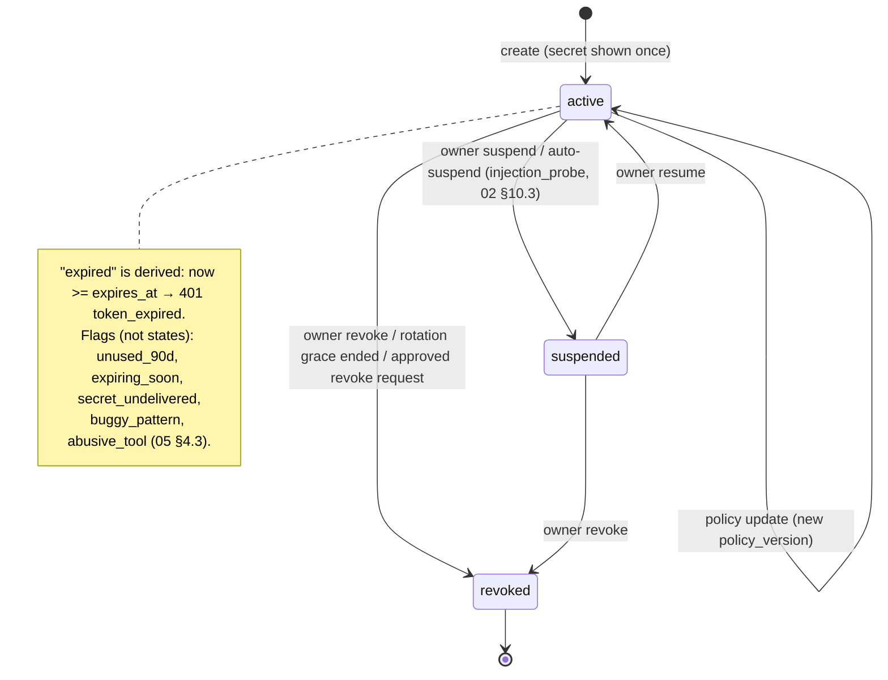
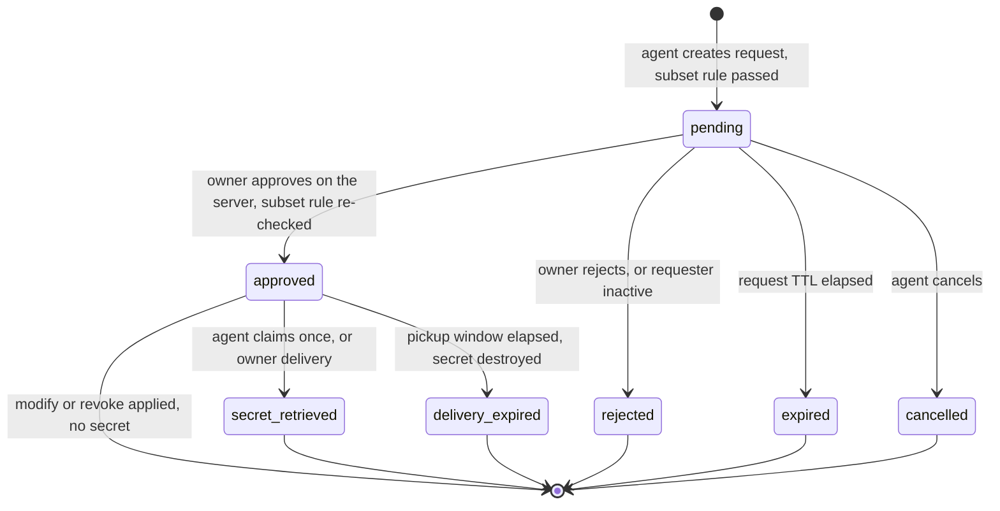
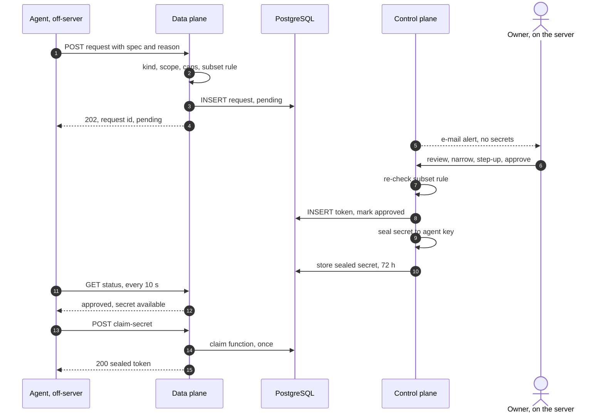
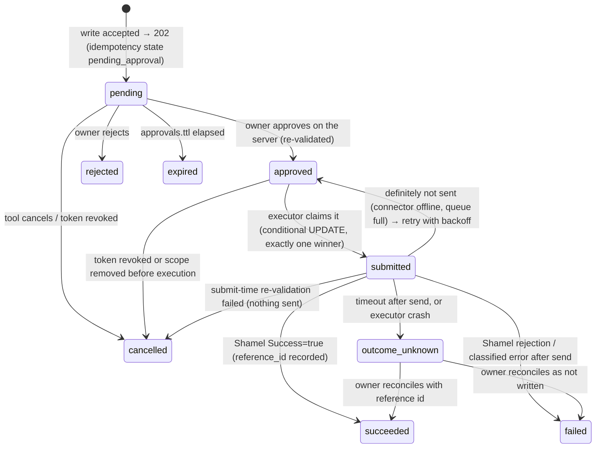

# 04 — Tokens, Permissions, AI Agents and Approvals

> Status: draft v1.1 (revised after review, aligned with the revised 02) · 2026-11-03 · Binding input: [`00-decisions.md`](00-decisions.md). Upstream reference:
> [`../upstream/shamel-api.md`](../upstream/shamel-api.md) (cited "U §x", "Qnn").
> Related: [`01-architecture.md`](01-architecture.md) (pipeline S1–S17, compiled config; "01 §x"),
> [`02-security.md`](02-security.md) (token format, crypto, agent containment; "02 §x"),
> [`03-api.md`](03-api.md) (public contract, DS-1…DS-9, error catalogue; "03 §x"),
> [`05-operations.md`](05-operations.md) (webhooks engine, warnings, usage rollups, CLI; "05 §x").
>
> This document owns the **authorization model**: the token record and its lifecycle, the scope catalogue and
> presets, data-scope dimensions and the per-operation enforcement matrix, field hiding, Shamel identity binding,
> per-token network rules, usage analytics semantics, policy compilation and evaluation, the AI-agent access-request
> model (including the precise subset rule), the write approval queue, sandbox/live and publishable token rules, and
> per-token rate limits. Where 02 §13 and 03 §2/§16/§18 summarise these topics, this document is the detailed
> source; observable API behaviour stays as fixed in 03.

---

## 0. Terminology

| Term | Meaning |
|---|---|
| **Token** | A bearer credential (`tok_…` record + secret). Kinds `tool`, `agent`, `publishable`; environments `live`, `test`. |
| **Policy spec** | The owner-editable, versioned JSON description of what a token may do (§2.3). Stored in `token_policies`. |
| **Compiled policy** | Immutable in-memory object derived from a token + its spec, used on the hot path (§9.1). |
| **Atom** | One concrete scope, e.g. `customers:read`, `vouchers:write:receipt`. Shorthands expand to atoms. |
| **Dimension** | A data-scope axis: `stores`, `salesmen`, `customers`, `currencies`, `price_classes`, `voucher_types`. |
| **Allow-set** | Per dimension: `all` or an explicit finite set of values. |
| **Field path** | `<resource>.<field>[.<field>…]` on the normalized `/v1` model, e.g. `items.purchase_price` (§5.1). |
| **Field group** | Named set of field paths, written `@name`, e.g. `@cost` (§5.3). |
| **Lineage** | The chain of tokens connected by rotation; `lineage_id` = id of the first token (§2.4.5). |
| **Credential** | A Shamel username/password registered on an upstream (`cred_…`; 01 calls it "identity"). |
| **Access request** | An agent's request for a new token or a change (`areq_…`, §10). |
| **Approval** | A write held for owner approval (`apr_…`, §11). |
| **Owner** | The single human administrator (00 §7). Owner actions exist only on the control plane (127.0.0.1 / socket). |

---

## 1. Principles

1. **Deny by default.** A token can do exactly what its compiled policy lists. No implicit grants, no wildcard that
   grows with new releases: shorthands and presets are expanded to explicit atoms when applied (§3.5).
2. **Everything is compiled.** The hot path reads only immutable compiled policies (01 principle 4); no
   PostgreSQL or Valkey access is needed to authorize a read.
3. **Narrowing is always safe; widening is always an owner act on the server.** Agents may only request subsets of
   their own grant (§10.3); owner edits to a request may only narrow it (§10.5).
4. **Invisible means non-existent.** Out-of-scope rows are omitted, out-of-scope single lookups are `404`,
   hidden fields are omitted, counts and aggregates are computed over visible data only (03 DS-1…DS-9).
5. **Fail closed when a dimension cannot be evaluated.** Require a narrowing parameter or deny the operation
   (`data_scope_filter_required` / `data_scope_unsupported`); never return data that might be out of scope.
6. **Never trust Shamel to have filtered.** Pushdowns reduce upstream work; Bawaba's own post-filter always runs.
7. **Every permission change is versioned and audited** (§9.6).

---

## 2. Tokens

### 2.1 Kinds and environments

| Kind | Environments | Secret prefix | Created by | Purpose |
|---|---|---|---|---|
| `tool` | `live`, `test` | `bwb_live_` / `bwb_test_` | owner; agent access request (§10) | Tools, dashboards, automation (server-side). |
| `agent` | `test` (default), `live` (owner, `--confirm-live`) | `bwb_live_` / `bwb_test_` | **owner only** | AI agents: normal API use within scopes + access requests (`access_requests:write`). |
| `publishable` | `live`, `test` | `bwb_pk_live_` / `bwb_pk_test_` | owner; agent access request | Browser apps: read-only, origin-locked, forced field hiding (§13). |

Kind is stored server-side (02 §9.7); only environment and `pk` are visible in the prefix. A token's kind,
environment and upstream are immutable; changing them means issuing a new token.

### 2.2 Data model

PostgreSQL (DDL sketch; the data model document finalises types and indexes). Every row carries `tenant_id`
(latent tenant, 01 §12).

```sql
CREATE TABLE tokens (
  id                       text PRIMARY KEY,           -- 'tok_' + 26-char Crockford base32 UUIDv7
  tenant_id                text NOT NULL,
  lineage_id               text NOT NULL,              -- = id, or the lineage of the token this one rotated
  name                     text NOT NULL,              -- ^[a-z0-9][a-z0-9._-]{0,63}$; unique per tenant among non-revoked
                                                       -- tokens of other lineages (a rotation successor keeps the name)
  description              text,                       -- ≤ 500 chars, owner text
  kind                     text NOT NULL CHECK (kind IN ('tool','agent','publishable')),
  environment              text NOT NULL CHECK (environment IN ('live','test')),
  status                   text NOT NULL DEFAULT 'active' CHECK (status IN ('active','suspended','revoked')),
  token_prefix             text NOT NULL,              -- 'bwb_live_' | 'bwb_test_' | 'bwb_pk_live_' | 'bwb_pk_test_'
  display_hint             text NOT NULL,              -- prefix + first 6 body chars, e.g. 'bwb_live_AbC4eF' (02 §9.7)
  last4                    text NOT NULL,              -- last 4 chars; they lie inside the CRC checksum, so reveal no entropy
  token_hash               bytea NOT NULL UNIQUE,      -- HMAC-SHA256(token_pepper[v], token) (02 §9.7)
  pepper_version           smallint NOT NULL,
  upstream_id              text NOT NULL,              -- live upstream, or the tenant's sandbox upstream for test tokens
  credential_id            text NULL REFERENCES shamel_credentials ON DELETE RESTRICT,  -- NULL = upstream default (§6)
  policy_version           bigint NOT NULL,            -- current row in token_policies
  writes_require_approval  boolean NOT NULL,           -- denormalised from the spec for listing (§11.1)
  legacy_enabled           boolean NOT NULL DEFAULT false,  -- denormalised from the spec
  expires_at               timestamptz NULL,           -- optional; NULL = never (00 §5)
  created_by               text NOT NULL,              -- 'owner' | 'access_request:areq_…'
  created_via              text NOT NULL,              -- cli | dashboard | access_request | rotation | mirror
  origin_access_request_id text NULL,
  requested_by_token_id    text NULL,                  -- the agent whose request produced this token
  rotated_from_token_id    text NULL,
  mirrored_from_token_id   text NULL,                  -- test token whose grants were copied (§12)
  template_id              text NULL, template_version int NULL,   -- provenance only (§3.5)
  created_at               timestamptz NOT NULL,
  updated_at               timestamptz NOT NULL,
  last_used_at             timestamptz NULL,           -- batched, at most 60 s stale (02 §9.7)
  last_used_ip             inet NULL,                  -- owner-only display
  suspended_at             timestamptz NULL, suspended_reason text NULL,   -- e.g. 'injection_probe', 'owner'
  revoked_at               timestamptz NULL, revoked_by text NULL, revoked_reason text NULL,
  metadata                 jsonb NOT NULL DEFAULT '{}' -- ≤ 16 keys ^[a-z][a-z0-9_]{0,31}$, string values ≤ 256 chars
);

CREATE TABLE token_policies (                          -- append-only; one row per permission change
  tenant_id    text NOT NULL,
  token_id     text NOT NULL REFERENCES tokens,
  version      bigint NOT NULL,                        -- monotonic per tenant (also used as policy_version in cursors)
  spec         jsonb NOT NULL,                         -- canonical policy spec (§2.3)
  spec_sha256  bytea NOT NULL,
  created_at   timestamptz NOT NULL,
  created_by   text NOT NULL,                          -- owner / access_request:areq_… / system
  change_reason text NULL,
  PRIMARY KEY (token_id, version)
);
```

- `metadata` is descriptive only (e.g. `{"repo":"…","built_by":"agent"}`); it never influences authorization.
- `token_policies` rows are immutable; the compiled config references `(token_id, version)`. Reverting a change is a
  new version.
- **Per-token IP rules live in the policy spec** (versioned with the rest so diffs and the subset rule cover them);
  the compiler materialises them into the firewall tries (02 §10.2). The `firewall_rules` table keeps only global
  rules; `bawaba firewall allow add <cidr> --token <id>` is a policy update.

### 2.3 Policy spec (canonical JSON)

The same shape is used by the CLI (`--spec file.json`), the dashboard, templates, `token_policies.spec` and agent
access requests (03 §18.3 `spec`, which adds `name`, `kind`, `environment`, `expires_at`).

```json
{
  "spec_version": 1,
  "scopes": ["master_data:read", "customers:read", "vouchers:read", "vouchers:write:order"],
  "data_scopes": {
    "stores": [1, 4],
    "salesmen": ["S07"],
    "customers": "all",
    "currencies": ["NIS", "USD"],
    "price_classes": [1, 2],
    "voucher_types": ["order", "sales_invoice", "receipt"]
  },
  "hidden_fields": ["@cost", "@gl_accounts", "customers.id_number"],
  "ip_allowlist": ["198.51.100.0/24", "2001:db8:10::/48"],
  "ip_denylist": [],
  "allowed_origins": [],
  "reject_browser_origin": true,
  "legacy_enabled": false,
  "legacy_endpoints": [],
  "legacy_require_idempotency_key": false,
  "writes_require_approval": true,
  "get_all": false,
  "rate_limit": { "requests_per_minute": 1200, "burst": 300, "writes_per_minute": 60, "writes_burst": 20,
                  "per_ip_per_minute": null, "mode": "enforce" }
}
```

| Key | Rule |
|---|---|
| `scopes` | Atoms or shorthands (§3.1); stored expanded and sorted. |
| `data_scopes` | Per dimension `"all"` or a JSON array (values typed per dimension, §4.1). An omitted dimension means `"all"` for owner specs; in agent requests it means "inherit the agent's restriction" (03 §18.3). Max `policy.max_dimension_values` (5000) per dimension. |
| `hidden_fields` | Field paths and `@groups` (§5). The API also accepts 03's map form `{"items": ["purchase_price"]}`; both normalise to the list. |
| `ip_allowlist` / `ip_denylist` | CIDRs, ≤ `tokens.max_ip_rules` (32) each; host addresses allowed (`/32`, `/128`). |
| `allowed_origins`, `reject_browser_origin` | §13 and 02 §10.7. Origins only for publishable tokens. |
| `legacy_enabled`, `legacy_endpoints` | `legacy_endpoints` must be non-empty iff `legacy_enabled`; entries are legacy endpoint ids (§3.2), each also requires its scopes. |
| `writes_require_approval` | §11.1. (The requirements brief calls this field `requires_write_approval`; the design set uses `writes_require_approval`, 02 §13.2, 03 §15.3.) |
| `get_all` | Permission to send Shamel's `getAll=true` (§6.3). Default `false`. |
| `rate_limit` | §14. `null` fields take the kind default (`limits.defaults.<kind>`, 03 §23.3). |

`credential_id` and `expires_at` are token columns, but every change to them is versioned and audited exactly like a
spec change (they are inputs to the subset rule).

### 2.4 Lifecycle



#### 2.4.1 Create

1. Owner (CLI over the root socket, or dashboard with step-up for live tokens, 02 §12.5) submits name, kind,
   environment, spec (directly or from a preset, §3.5), optional `credential_id`, `expires_at`, metadata.
2. Control plane validates and **compiles** the spec (§9.2); compile errors abort (e.g. `vouchers:write:payment`
   while `voucher_types` excludes `payment`, `get_all` on a salesman-bound credential, origins on a non-publishable
   token).
3. Secret generated per 02 §9.7; only `token_hash`, `display_hint`, `last4` are stored.
4. One transaction: insert `tokens`, `token_policies` v1, `admin_events` (`token.create`), new `compiled_config`.
5. Plaintext returned **once** (CLI `--json` field `token`, or `--out <file>` mode 0600; dashboard modal with copy
   button), `Cache-Control: no-store`, never logged. Lost secret ⇒ rotate.

Defaults when not specified: tool → `writes_require_approval=false`, hidden `@cost @gl_accounts @national_id`;
agent → `environment=test`, `writes_require_approval=true`, same hidden fields, scopes include
`access_requests:write`; publishable → §13 forced/default hides.

#### 2.4.2 Revoke

- `bawaba token revoke <id> [--reason …]` or dashboard. Sets `status=revoked`, `revoked_at/by/reason`, compiles a
  new config version and publishes `token_revoked` on `bwb:events` (01 §5.4).
- **Propagation bound N = `config.poll_interval` (default 5 s; 2 s while Valkey is unavailable, 02 §9.7)**: every
  node adds the id to its in-memory deny-set on the pub/sub message (typically < 1 s) and, if the message is lost, at
  the next version poll. With PostgreSQL down no normal revocation can be committed; `bawaba token revoke --emergency
  <id>` publishes a signed deny entry on `bwb:events` and stores it in `bwb:deny`, which every node applies regardless
  of config age (01 §5.4, 02 §9.7, §16).
- Effects (applied by every component on the next touch): requests → `401 invalid_token`; cursors refused
  (02 §9.10); webhook subscriptions → `suspended`, queued deliveries `cancelled` (05 §2.6); pending approvals →
  `cancelled` with reason `token_revoked` (03 §16); pending access requests of a revoked agent → `rejected` with
  reason `requester_inactive`; idempotency and audit records are kept.
- Tokens that were born from a revoked agent's requests are **not** revoked automatically (they are independent
  tools); `--cascade` revokes them too and lists them first.
- `bawaba token revoke --kind agent --all` is the emergency switch for all agents (02 §13.4).

#### 2.4.3 Expiry (optional)

- `expires_at` NULL by default (00 §5). When set: ≥ now + 1 h, ≤ now + 10 years.
- Within 7 days of expiry every response carries `Bawaba-Warning: token_expiring;expires_at=…` (03 §23.4) and the
  owner receives e-mails at 7 d and 1 d (alert `token_expiring`). After expiry: `401 token_expired`.
- Extending an expiry is a policy change (versioned, audited). Expired tokens remain listed (status `active`,
  derived `expired`) until revoked; `bawaba token list --expired` shows them.

#### 2.4.4 Unused flag (90 days)

The stale-token job (01 §5.6, daily) sets flag `unused_90d` in `token_flags` (05 §4.3) when
`coalesce(last_used_at, created_at) < now() − tokens.unused_flag_after` (default `90d`) and the token is active. The
flag shows in the dashboard token list and the daily digest; it is cleared on the next use. Tokens are **never**
auto-revoked (decision: "flagged"). `bawaba token list --flag unused --json | …` supports bulk review.

#### 2.4.5 Rotation (manual)

`bawaba token rotate <id> [--grace 0s..7d]` (default `0s`):

1. Create a new token with the same kind, environment, upstream, credential, spec (new `token_policies` v1 copied),
   expiry and metadata; `rotated_from_token_id` = old id, **same `lineage_id`**. Secret shown once.
2. Old token: `--grace 0s` → revoked now; otherwise `expires_at = now + grace` and flag `rotating`, revoked by the
   stale-token job at the end of the grace.
3. In the same transaction, webhook subscriptions and pending approvals are re-pointed to the new token id.

**Lineage-scoped namespaces (decision).** Idempotency keys, approval visibility (`GET /v1/approvals`) and webhook
ownership are keyed by `lineage_id`, not by token id. Otherwise a tool that timed out on a write with the old token
and resends the same `Idempotency-Key` with the new one would create a duplicate voucher (Shamel has no idempotency,
Q39). Cursors stay token-bound (they live ~60 s). This refines 03 §15.2 "per token" to "per lineage".

#### 2.4.6 Suspend / resume

Reversible block (`status=suspended` → `401 invalid_token`, same as revoked to the client). Used by the owner
(investigation) and by auto-suspension on injection probes, under the token-containment rule of 02 §10.3:

- **Publishable tokens are never auto-suspended** (they are public; suspending them would hand any page visitor an
  off switch). Probes through them ban the IP only.
- A secret token (`tool`, `agent`) is auto-suspended for `injection_probe` only when its policy spec has a non-empty
  `ip_allowlist` and the probing IP is inside it (`firewall.autosuspend.injection_probe = allowlisted_source`,
  default), or when the owner opted in for its kind (`firewall.autosuspend.any_source_kinds`). Otherwise the IP is
  banned and the owner receives `token_probe_suspected` (rotate the token or add an IP allowlist, §7).
- Bans and throttles are keyed by IP or (token, IP), never by token alone (02 §10.3).

Resume restores the token unchanged (`bawaba token resume <id>`).

---

## 3. Scopes

### 3.1 Grammar and atoms

```
scope      = resource ":" action [ ":" qualifier ]
resource   = "master_data" / "customers" / "items" / "stock" / "vouchers" / "reports" / "cost_centers" / "webhooks"
             / "access_requests"
action     = "read" / "write"
qualifier  = voucher_type                    ; only for vouchers:write
```

**Atom registry (v1, 26 atoms, fits one `uint64` bitset):** 7 read atoms (`master_data`, `customers`, `items`,
`stock`, `vouchers`, `reports`, `cost_centers`), `customers:write`, `items:write`, `cost_centers:write`, 13
`vouchers:write:<voucher_type>` atoms, `webhooks:read`, `webhooks:write`, `access_requests:write`.

| Input form | Expands to | Notes |
|---|---|---|
| `vouchers:write` | all 13 `vouchers:write:<type>` atoms | expansion at apply time; a future 14th type is not granted implicitly |
| `*:read` | the 7 business read atoms | not `webhooks:read` |
| `*:write` | `customers:write`, `items:write`, `cost_centers:write`, 13 voucher atoms | not `webhooks:write` |
| `vouchers:write:<type>` | itself | `<type>` ∈ the 13 names of 03 §2.3 |

Rules:

- `<resource>:write` never implies `<resource>:read` (write-only presets, 00 §5; 03 §2.3).
- `master_data:write`, `stock:write`, `reports:write` are syntactically valid but **refused** by the compiler
  (`scope_not_grantable`): Shamel has no such endpoints (03 §2.3).
- `access_requests:write` is grantable **only** to `kind=agent`, never via a request (02 §13.1).
- Publishable tokens accept only the 7 business read atoms (§13).

### 3.2 Catalogue: atom → operations → legacy endpoints

Operation ids and routes are those of 03 §6; legacy endpoint ids are the printed Shamel paths of 03 §20.2. An
operation requiring several atoms needs all of them.

| Atom | `/v1` operations (route) | Legacy endpoints | Optional parts gated by this atom elsewhere |
|---|---|---|---|
| `master_data:read` | `currencies.list` (`GET /v1/currencies`), `currency_rates.list` (`/v1/currency-rates`), `banks.list` (`/v1/banks`), `bank_branches.list` (`/v1/bank-branches`), `cities.list` (`/v1/cities`), `stores.list` (`/v1/stores`), `price_classes.list` (`/v1/price-classes`), `salesmen.list` (`/v1/salesmen`) | `/Files/GetCurrencies`, `/Files/GetCurrencyRates`, `/Files/GetBanks`, `/Files/GetBanksBranchs`, `/Files/GetCities`, `/Files/GetStores`, `/Files/GetPriceClasses`, `/Files/GetSalesmen` | store names in `items.stock` and `items.overview`, price-class names in `items.overview` (03 §14) |
| `customers:read` | `customers.list`, `customers.get`, `customer_balances.list`, `customers.balances`, `customer_prices.list`, `customers.prices`, `customers.overview` (base + `balances`) | `/Customer/GetCustomers`, `/Customer/GetCustomerBalances`, `/Customer/GetCustomerPricesAsRows` | `items.overview` `customer_prices` section; events `customer.*` |
| `customers:write` | `customers.create` (`POST /v1/customers`) | `/Customer/Post` | – |
| `items:read` | `items.list`, `items.get`, `items.overview` (base, `price_list`, `images`), `item_groups.list`, `item_groups.tree`, `item_serials.list`, `items.serials`, `item_images.list`, `items.images`, `media.get` | `/Item/GetItems`, `/Item/GetItemsGroups`, `/Item/GetItemsCatalog`, `/Item/GetItemsSerials`, `/Item/getItemDetails` (+ `stock:read`) | events `item.*` |
| `items:write` | `items.create` (`POST /v1/items`) | `/Item/Post` | – |
| `stock:read` | `stock.list`, `items.stock` | `/Item/GetItemsStores`, `/Item/getItemDetails` (+ `items:read`) | `items.get?include=stock`, `items.overview` `stock` section; events `stock.*` |
| `vouchers:read` | `vouchers.list`, `vouchers.get`, `voucher_summaries.list`, `deliveries.prepared`, `orders.status` | `/Voucher/GetVoucher`, `/Voucher/GetVouchers`, `/Voucher/GetExtraVouchers`, `/Voucher/GetDelivery`, `/Voucher/GetStatus` | `customers.overview` `recent_vouchers`; events `voucher.*`, `order.status_changed` |
| `vouchers:write:<t>` | `vouchers.create` (`POST /v1/vouchers/<t>`); batch items for `<t>` | `/Voucher/Post2` with `obj.header.type` = value of `<t>` | – |
| `reports:read` | `reports.account_statement`, `reports.last_prices`; with `cost_centers:read`: `reports.cost_center_statement` | `/Report/GetAccountsheet`, `/Report/GetLastPriceReport`; with `cost_centers:read`: `/CostCenter/GetCostCenterAccountsheet` | `customers.overview` `statement_summary` |
| `cost_centers:read` | only together with `reports:read`: `reports.cost_center_statement` | with `reports:read`: `/CostCenter/GetCostCenterAccountsheet` | – |
| `cost_centers:write` | `cost_centers.create` (`POST /v1/cost-centers`) | `/CostCenter/Post` | – |
| `webhooks:read` | `webhooks.list`, `webhooks.get`, `webhooks.deliveries`, `webhooks.delivery`, `webhooks.events` | – | – |
| `webhooks:write` | `webhooks.create` (+ each event type's read atom), `webhooks.update`, `webhooks.delete`, `webhooks.test`, `webhooks.rotate_secret`, `webhooks.delivery_retry` | – | – |
| `access_requests:write` (agent only) | `access_requests.create` | – | – |

**Never reachable by any atom:** `/legacy/Main/Login` (`400 shamel_credentials_not_accepted`), `/Voucher/Post`
(Q22), any path outside 03 §20.2.

**Operations gated by kind only** (no atom; 03 §2.2): `me.get`, `event_types.list` (all kinds); `me.requests`,
`approvals.list/get/cancel` (tool, agent; own lineage only); `access_requests.list/get/claim_secret/cancel` (agent;
own requests only). `batch.create` requires, per item, the atoms of that item's operation.

### 3.3 Voucher-type write permissions

- One atom per type: `vouchers:write:order`, `…:purchase_delivery`, `…:sales_return`,
  `…:returned_pending_sales_delivery`, `…:sales_invoice`, `…:sales_delivery`, `…:stockout`, `…:internal_delivery`,
  `…:credit_note`, `…:debit_note`, `…:receipt`, `…:payment`, `…:journal` (values 0, 2, 4, 5, 9, 10, 12, 16, 22, 23,
  24, 27, 28).
- `/v1`: the atom is fixed by the route (`POST /v1/vouchers/{voucher_type}`), so it is known in S8 before the body is
  parsed. `/legacy/Voucher/Post2`: the atom is derived from the strictly decoded `obj.header.type`; an integer
  outside the 13 values → `422 validation_failed`.
- **Consistency rule (compile time):** holding `vouchers:write:<t>` requires `voucher_types` = `all` or containing
  `<t>` (a token must be able to see what it creates, 03 DS-5). Violations are compile errors, so S8 checks only the
  atom.
- "Invoice from a delivery" (U §3) is `sales_invoice` with `delivery_code` (Q40); it needs `vouchers:write:sales_invoice`
  plus visibility of the referenced delivery (§4.6).

### 3.4 Scope-dependent `include` and sections

| Request part | Extra atom | Without it |
|---|---|---|
| `items.get?include=stock` | `stock:read` | `403 insufficient_scope` (03 §4.11) |
| `customers.overview` `recent_vouchers` / `statement_summary` | `vouchers:read` / `reports:read` | section absent, `meta.sections.<s> = "omitted_scope"` (03 §14) |
| `items.overview` `stock` / `customer_prices` | `stock:read` / `customers:read` | section absent, `omitted_scope` |
| store / price-class names in combined endpoints | `master_data:read` | names absent, ids present |
| webhook event type subscription | event's read atom (03 §17.2) | `403 insufficient_scope` |

### 3.5 Presets (policy templates)

Presets are **templates** stored in PostgreSQL; applying one **expands it into an explicit spec** that is stored on
the token. Editing a template never changes existing tokens; the dashboard shows "derived from preset X v3 (modified)"
and offers *re-apply* with a diff (an ordinary, audited policy update).

```sql
CREATE TABLE policy_templates (
  id text PRIMARY KEY,                 -- 'tpl_…'; built-ins use stable ids 'tpl_read_only', …
  tenant_id text NOT NULL, name text NOT NULL,          -- snake_case, unique per tenant
  title_en text, title_ar text, description_en text, description_ar text,
  builtin boolean NOT NULL, version int NOT NULL,
  kinds text[] NOT NULL,               -- kinds it may be applied to
  spec_template jsonb NOT NULL,        -- policy spec with {{param}} placeholders
  params jsonb NOT NULL,               -- {"stores": {"type":"dimension","dimension":"stores","required":false}, …}
  updated_at timestamptz NOT NULL, updated_by text NOT NULL
);
```

Expansion is a pure function `expand(template, params) → spec`: placeholders are substituted, shorthands expanded to
atoms, field groups **kept by name** (a release that adds a field to `@pii` hides it automatically, which can only
narrow), and kind defaults merged (§2.4.1, §13). One base preset may be combined with add-on presets (scope union,
hidden-field union, dimension intersection, stricter flags win).

| Preset (built-in) | Kinds | Scopes | Hidden fields | Other / parameters |
|---|---|---|---|---|
| `read_only` | tool, agent | `*:read` (7 business read atoms) | kind defaults | – |
| `write_only` | tool, agent | `*:write` (16 atoms) | – | `writes_require_approval: true` (recommended, owner may change) |
| `full_access` | tool | `*:read`, `*:write`, `webhooks:read`, `webhooks:write` | kind defaults | – |
| `sales_dashboard` | tool, agent | `master_data:read`, `customers:read`, `items:read`, `stock:read`, `vouchers:read`, `reports:read` | `@cost`, `@gl_accounts`, `@national_id` | params `stores`, `salesmen`, `currencies` (optional) |
| `stock_monitor` | tool, agent, publishable | `master_data:read`, `items:read`, `stock:read` | `@cost`, `@gl_accounts`, `@sales_prices` | param `stores` |
| `accountant_reports` | tool | `master_data:read`, `customers:read`, `vouchers:read`, `reports:read`, `cost_centers:read` | `@national_id` | param `currencies` |
| `salesman_app` | tool | `master_data:read`, `customers:read`, `items:read`, `stock:read`, `vouchers:read`, `vouchers:write:order`, `vouchers:write:receipt` | `@cost`, `@gl_accounts`, `@national_id` | param `credential` (required, a salesman-bound credential, §6.2); `voucher_types: [order, receipt, sales_invoice, sales_delivery, sales_return]` |
| `catalog_site` | publishable | `master_data:read`, `items:read`, `stock:read` | forced publishable set + `@pii` | params `allowed_origins` (required), `price_classes` |
| `webhook_consumer` (add-on) | tool, agent | `webhooks:read`, `webhooks:write` | – | – |

Built-in templates are versioned with the release; owners may clone and edit them (`bawaba preset create --from
sales_dashboard …`). CLI: `bawaba token create --preset sales_dashboard --param stores=1,4 --preset webhook_consumer`.

---

## 4. Data scoping

### 4.1 Dimensions (decision)

| Dimension | Value type | Supported in v1 | Why |
|---|---|---|---|
| `stores` | integer store id (`Store.id`) | **yes** | Requested (00 §5). Carried by stock, serials, voucher lines/order store. |
| `salesmen` | string salesman code | **yes** | Requested. Carried by customers and vouchers; derivable for customer-keyed rows via the customer resolution step (03 DS-6). |
| `customers` | string customer code | **yes** | Requested. Carried by most customer, voucher and report rows. |
| `currencies` | string Shamel currency code (`Currency.code`, Q36) | **yes** | Requested. Carried by rates, customers, balances, prices, vouchers, statements. |
| `price_classes` | integer 1–6 | **yes** | Requested. Carried by item price entries, customers, customer price rows (by name → id). |
| `voucher_types` | voucher type name (03 §2.3) | **yes (added here)** | Cheap and exact: every voucher and voucher summary carries its type. Lets the owner give an order-tracking tool orders without invoices, receipts or journals; mirrors the write atoms. |
| `item_groups` | – | **no (name reserved)** | Not requested. Only items carry a group; stock rows, serials, voucher lines, price rows and last-price rows carry only an item code, so every such request would need an extra live **full** `GetItems` fetch (the largest upstream call) to map item → group, roughly doubling upstream load, and vouchers would vanish whenever one line falls outside the group. Item→group mappings may not be cached (00 §8 "always live"). Revisit if ISCO adds a group filter to `GetItemsStores`. |

Shamel exposes no other scoping axis worth adding (cities, cost centers and banks are labels, not ownership).

### 4.2 Semantics

- **Per dimension:** `all` (unrestricted) or an allow-set. Values are matched exactly (codes case-sensitive, as
  Shamel stores them).
- **Within a dimension: OR.** A record is visible on dimension *d* if its value is in the allow-set.
- **Across dimensions: AND.** A record is visible if it passes every restricted dimension that applies to its
  resource (§4.4); dimensions that do not apply to a resource are ignored for it.
- **Null values:** a record whose dimension value is null or empty is represented as the reserved member `@none`;
  it is visible only if the allow-set explicitly contains `@none` (e.g. `salesmen: ["S07", "@none"]` adds
  customers without a salesman). `@none` cannot collide with a code (codes never contain `@`).
- **Multi-valued records (atomic, 03 DS-5):** for a voucher, V_d = the set of non-null values of *d* across the
  voucher (`order_store_id` and every `lines[].store_id` for stores; header `currency_code` and every
  `cheques[].currency_code` for currencies); V_d = {`@none`} if no value exists. Visible iff V_d ⊆ allow-set. A
  receipt (no stores) is therefore visible to a store-restricted token only with `@none` in its store set.
- **Sub-collections (03 DS-4):** element-wise filtering of `items.prices[]`, stock rows inside items, customer
  `balances[]`; aggregates over the remaining elements only.
- **Empty allow-set** `[]` is legal (nothing in that dimension is visible); the compiler warns.
- **Pinned salesman credential (§6.2):** the effective `salesmen` set is `configured ∩ {credential.salesman_code}`
  (or exactly that code when configured is `all`).
- **Values that do not exist** are accepted (no oracle); the dashboard flags them against live master data.

### 4.3 Enforcement techniques

| Code | Technique | Where it runs | Cost |
|---|---|---|---|
| `P` | **Policy pushdown**: when a dimension has exactly one allowed value and the upstream call accepts a matching single-value parameter, send it upstream (§4.5) | S8 → S12 (part of the coalescing key, 01 §9.1) | reduces upstream volume |
| `F` | **Row post-filter** on a record field | S14 | O(1) per record per dimension |
| `A` | **Atomic** post-filter over all values a record carries | S14 | O(values) per record |
| `S` | **Sub-collection** element filter (+ recompute aggregates) | S14 | O(elements) |
| `D` | **Derived**: resolve customer → salesman (and customer visibility) through the customer resolution step (one coalesced live `GetCustomers`, 03 §9.2 / DS-6), then `F` | S12/S14 | one extra coalesced call per request |
| `Q` | **Query-value check**: a client filter or path value naming an out-of-scope entity yields an empty list / `404` (03 DS-2, DS-3) | S8 | O(values) |
| `R:<param>` | **Narrowing parameter required**, else `403 data_scope_filter_required` (`details[].param`) | S8 | – |
| `X` | **Deny**: `403 data_scope_unsupported` | S8 | – |
| `M` | **Mask**: a sub-field whose dimension cannot be evaluated is hidden for restricted tokens | S15 | – |
| – | dimension does not apply to this resource | – | – |

`P` never replaces `F`/`A`: the post-filter always runs on pushed-down results. `Q` may short-circuit **without** an
upstream call when the decision depends only on the token's own allow-set (the token can read its allow-set in
`/v1/me`, so nothing is revealed). When the decision depends on data the token cannot see (`D`: "is customer C1001
one of salesman S07's?"), the upstream fetch always runs and the answer is the same `404`/empty result either way, so
timing reveals nothing (02 LV-11).

### 4.4 Enforcement matrix (reads)

Columns are dimensions; "Notes" lists narrowing rules and forced behaviour. Every list also applies `Q` to its
filters on the same field (e.g. `store_id=9` for a token without store 9 → empty result).

| Operation(s) | stores | salesmen | customers | currencies | price_classes | voucher_types | Notes |
|---|---|---|---|---|---|---|---|
| `currencies.list` | – | – | – | `F code` | – | – | |
| `currency_rates.list` | – | – | – | `F currency_code` | – | – | |
| `banks.list`, `bank_branches.list`, `cities.list` | – | – | – | – | – | – | unscoped reference data |
| `stores.list` | `F id` | – | – | – | – | – | |
| `price_classes.list` | – | – | – | – | `F id` | – | |
| `salesmen.list` | – | `F code` | – | – | – | – | provisional decoder (03 §8.8) |
| `customers.list`, `customers.get` | – | `F salesman_code` (+ Shamel-side for pinned salesmen) | `F code`, `P Hdr code` | `F currency_code` | `F price_class_id` | – | `get_all` per §6.3 |
| `customer_balances.list`, `customers.balances` | – | `D` | `F customer_code`, `P Hdr customerCode` | `F currency_code` (row) | – | – | `customers.balances` runs the resolution step first (404 if not visible) |
| `customer_prices.list`, `customers.prices` | – | `D`; null/empty `customer_code` → `@none` | `F customer_code`; null/empty → `@none` | `F currency_code` | `F price_class_name→id` (live `GetPriceClasses`, coalesced; unmapped name → hidden) | – | rows without a customer follow the `@none` rule (see below the table); `customers.prices` returns only rows of the path customer |
| `customers.overview` | base as `customers.get` | sections as their operations | | | | | a section that would be `X` is absent with `meta.sections.<s> = "omitted_data_scope"` (proposed addition to 03 §14) |
| `items.list`, `items.get` | `Q store_id` | – | – | `S prices[].currency_code`; `M units[].unit_price` | `S prices[].price_class_id`; `M units[].unit_price` | – | `unit_price` cannot be attributed to a class/currency (provisional, 03 §10.1), so it is masked for tokens restricted on either |
| `items.get?include=stock`, `items.stock` | `S stock.stores[].store_id`, `total_quantity` over visible rows | – | – | – | – | – | store names filtered by the same set |
| `items.overview` | `stock` as above | `customer_prices` as that op | | `price_list` as items | `price_list` as items | – | |
| `item_groups.*`, `item_images.list`, `items.images`, `media.get` | – | – | – | – | – | – | unscoped |
| `item_serials.list`, `items.serials` | `F store_id` | `Q customer_code` via `D` | `Q customer_code` | – | – | – | Shamel returns no customer field; the customer filter is pushdown-only (03 §10.4), so it is checked as a query value |
| `stock.list` | `F store_id` | – | – | – | – | – | |
| `vouchers.list`, `vouchers.get`, `deliveries.prepared` | `A` (`order_store_id`, `lines[].store_id`) | `F salesman_code` | `F customer_code`, `P filters.customerCode`; `A accounts[].account_code` | `A` (header + cheques), `P filters.currencyCode` | – | `F type` | see journal rule below; list DS-5 is evaluated on the full voucher even when `lines` are not included |
| `voucher_summaries.list` | `X` | `D` | `F customer_code`, `P` | `F currency_code`, `P` | – | `F type` | rows carry no store (03 §12.3) |
| `orders.status` | `R:order_code` | `R:order_code` | `R:order_code` | `R:order_code` | – | `type` must be `order` | with `order_code` the voucher is fetched and checked as `vouchers.get`; a token whose `voucher_types` excludes `order` gets `404` |
| `reports.account_statement` | `include_stock_lines=true` → `X` | `D` on `account_code` | `account_code` must be a visible customer (else `404`) | `R:currency_code` (allowed); `include_other_currencies=true` → `X` | – | `X` | running balances make row filtering impossible; the whole statement is either allowed or denied |
| `reports.last_prices` | – | `D` on row `customer` | `F customer` (code comparison; a name never matches, fail closed) | `F currency_code` | – | `X` | `customer` may be a name (Q21); if live capture confirms it is a name, the registry marks the op `X` for customer/salesman-restricted tokens |
| `reports.cost_center_statement` | – | `X` | `X` | `R:currency_code`; `include_other_currencies=true` → `X` | – | `X` | cost-center lines are not customer data (03 §13.3) |
| webhook events (05 §2.6, 03 §17.7) | as the read op of the event object | | | | | | `customer.*`→`customers.get`; `customer.balance_changed`→`customer_balances.list`; `item.*`→`items.get`; `stock.*`→`stock.list`; `voucher.*`→`vouchers.get`; `order.status_changed`→`vouchers.get` of the order; `approval.resolved`→own lineage only |
| `me.*`, `event_types.list`, `approvals.*`, `access_requests.*` | – | – | – | – | – | – | own objects only |

**Journal and account-line rule.** `accounts[].account_code` may be a customer account (customers are accounts in
Shamel) or a GL account; Bawaba cannot list GL accounts (Q42). For customer- or salesman-restricted tokens, a voucher
with a non-empty `accounts[]` is visible only if every `account_code` is a visible customer (`D` for salesmen). GL
lines therefore make such vouchers invisible to restricted tokens (fail closed).

**Unknown voucher types** (`type: "other"`, 03 §3.2) are visible only to tokens whose `voucher_types` is `all`.

**Customer-price rows without a customer (decision: `@none`, fail closed).** The `GetCustomerPricesAsRows` row model
and its nullability are unverified (Q25, Q46), so a row whose `customer_code` is null or empty cannot be assumed to be
a general price-class row: it may be a customer-specific negotiated price whose customer field came back empty. Such
a row therefore carries `customers = {@none}` and, having no customer to resolve, `salesmen = {@none}`. For a token
restricted on `customers` or `salesmen` it is visible only if the restricted dimension's allow-set contains `@none`
(§4.2); unrestricted tokens see it, subject to `currencies` and `price_classes`. Tradeoff: a customer- or
salesman-restricted tool sees no customer-less price rows unless the owner adds `@none` deliberately. The rejected
alternative (treat rows with a non-empty, mappable `price_class_name` as price-class rows) would rest on an unverified
shape. If ISCO or a live capture confirms the row model (§17.3 question 8), the registry may switch these rows to a
verified price-class classification in a later release, which is a documented widening.

### 4.5 Policy pushdowns and forced upstream behaviour

| Condition | Upstream effect |
|---|---|
| `customers` restricted to exactly one value and the request has no `code`/`customer_code` | `GetCustomers` `Hdr code`; `GetCustomerBalances` `Hdr customerCode`; `GetVouchers`/`GetExtraVouchers` `filters.customerCode` |
| `currencies` restricted to exactly one value, no client value | `filters.currencyCode` on `GetVouchers`/`GetExtraVouchers` |
| client pushdown value outside the allow-set | no upstream call; empty result / `404` (`Q`) |
| balance-type field hidden (`customers.balance`, `vouchers.customer_balance`, `voucher_summaries.customer_balance_before`) | `getBalance` / `getCustomerBalance` not sent (03 §2.5) |
| `get_all=false` | `getAll` never sent; legacy `getAll` dropped with `parameter_ignored` (03 §20.3) |

Pushdowns are applied only for single-value sets. Tradeoff: multi-value pushdown is impossible (Shamel takes one
value) and per-token pushdowns fragment coalescing; restricting it to single values bounds fragmentation to tokens
whose own calls are small anyway. Bawaba never *forces* a flag that changes report semantics silently: incompatible
report flags are refused (`X`) instead (§4.4).

### 4.6 Write validation

Every reference in a write payload must be **visible to the token** under the corresponding read rules, so that a
token can never create data it could not read back (and cannot probe hidden data through write errors). Checks run in
S8 after S7 validation, reuse 03 §15.7's reference pre-checks (live, coalesced lookups), run again at approval and at
execution (§11.5), and apply identically to `/legacy` writes after `obj` is decoded and to each batch item.

| Operation | Field | Rule (failure → `422 reference_not_found` at the JSON pointer, unless noted) |
|---|---|---|
| `customers.create` | `salesman_code` | salesmen restricted: required (defaults to the pinned salesman, 03 §15.4), must be allowed; else `422 validation_failed` detail `required_by_data_scope` |
| | `price_class_id` | price classes restricted: required and allowed |
| | – | `customers` restricted to an explicit list → `403 data_scope_unsupported` (a new code cannot be in the list) |
| `items.create` | `currency_code` | allowed (required with `price`, 03 §15.5) |
| | `price` | price classes restricted: class 1 must be allowed (`price` maps to `price1`) |
| `cost_centers.create` | – | no dimension applies |
| `vouchers.create` | path type | atom held (§3.3; `voucher_types` consistency is guaranteed at compile time) |
| | `customer_code` | must be visible under `customers.get` rules (resolution step: exists, salesman, currency, price class, explicit list) |
| | `salesman_code` | allowed; null with salesmen restricted → pinned salesman, else `422 validation_failed` `required_by_data_scope` |
| | `currency_code`, `cheques[].currency_code` | allowed |
| | `order_store_id`, `lines[].store_id` | allowed (atomic rule of §4.2, including `@none` when no store is given) |
| | `accounts[].account_code` | customer/salesman-restricted tokens: each must be a visible customer (journal rule, §4.4) |
| | `delivery_code` | the referenced delivery voucher must be visible under `vouchers.get` rules |

Because an out-of-scope reference and a non-existent one produce the same `reference_not_found` (03 DS-8), and the
derived checks always perform their lookup, write errors are not an existence oracle.

### 4.7 Leakage controls

| Vector | Rule |
|---|---|
| Counts | `page.total` and every `summary`/aggregate are computed over the token's view (03 §5.1, DS-4). The snapshot's raw record count is never exposed (audit only). |
| Warnings | `large_unfiltered_request;records=N` must report the **visible** record count (requirement on 05 §4.2/§4.3). `stock.bulk_changed.changed_rows` and `store_ids` must be computed per token over visible rows; zero visible rows → suppressed (requirement on 05 §2.6). |
| Search | `q` matches only visible fields of visible records; hidden fields are skipped silently, and filtering or sorting on hidden fields is `422 validation_failed` detail `field_hidden` (03 §2.5). |
| Filters on dimension fields | Out-of-scope values give empty results, never errors (03 DS-3). |
| Single lookups | Out-of-scope → `404 not_found`, same body as missing (03 DS-2); derived checks run the same upstream calls. |
| Combined endpoints | Each section evaluated as its own operation; base section first (no other upstream contact for invisible records, 03 §14); unavailable sections absent with a status, never partial. |
| Vouchers | Atomic visibility (no voucher with lines removed, totals never misstated). |
| Statements | Allowed wholly or denied (`X`); no row filtering under a running balance. |
| Webhooks | Evaluated at send/read time with the current policy; hidden-only changes suppressed (05 §2.6). **Scope transitions** are rendered from the token's view: a record entering the token's scope is delivered as `*.created`, one leaving it as `*.removed`. The `removed` reason must be one value for both "deleted upstream" and "left scope" (`no_longer_visible`), so a receiver cannot tell that, e.g., a customer was reassigned to another salesman (requirement on 05 §2.2/§2.6 and 03 §17.2, which currently use `not_returned_by_upstream`). |
| Subscription filters | `store_ids`, `customer_codes`, … naming out-of-scope values are accepted and match nothing. |
| Errors | Bawaba messages are static catalogue text; `details` name parameters and atoms, never data values (02 LV-19). |
| Idempotent replays | A replayed stored response is re-masked with the **current** field mask before sending. |
| Snapshots | One **unfiltered**, encrypted snapshot per coalesced fetch, shared by every requester of that fetch (01 §9.4, 02 §9.10). It may hold fields and rows the reader may not see, so it is never exposed: snapshot ids never leave the gateway, no API accepts one, and it is read only through a view. Every page, page 1 included, runs S14 (data scope) and S15 (mask, fused into the encoder) with the requesting token's **current** policy. |
| Views / cursors | A view (01 §9.5) holds the positions that passed this token's data scope and filters; it is AAD-bound to `view/<vid>/<token_id>/<policy_version>` (02 §9.3), so another token or a changed policy cannot open it. Cursors are sealed to the token and route and carry `view_id`, `query_hash` and `policy_version` (01 §9.6, 02 §9.10). A cursor is honoured only while the token is active and its `policy_version` is unchanged (`409 cursor_invalidated`), and every cursor page still re-checks rows against the current policy. |
| Coalescing | The coalescing key covers (tenant, upstream, environment, credential, upstream call signature, normalizer version) under a keyed HMAC (01 §9.1); token policy is deliberately not in the key, and policy is applied per requester afterwards (01 §9.7). Tokens bound to different Shamel credentials never share a fetch or a snapshot. A follower's shorter latency reveals only that another tool of the same tenant made the same call (accepted). |
| `result_too_large` | Reveals coarsely that the unfiltered upstream result exceeds `pagination.snapshot_max_bytes` (accepted; no counts). |

---

## 5. Field hiding

### 5.1 Path syntax

```
hidden-entry = path / group
path         = resource "." segment *( "." segment )       ; e.g. items.purchase_price, customers.balance.current
resource     = "*" / resource-name                          ; "*" = every resource having this relative path
segment      = 1*( %x61-7A / DIGIT / "_" )                  ; snake_case v1 field names
group        = "@" 1*( %x61-7A / "_" )                      ; e.g. @cost
```

- Paths address the **normalized `/v1` model** (03 §8–§13), never Shamel names.
- Arrays are traversed implicitly: `items.prices.sale_price` hides `sale_price` in every `prices[]` element;
  `vouchers.lines.price` in every line.
- Hiding an object or array hides it entirely (`customers.balance` hides `current`, `unpaid_cheques`,
  `returned_cheques`; `customers.contacts` omits the array).
- `*.balance` expands at compile time to every resource with a top-level `balance` path; an entry matching nothing is
  a compile error (`unknown_field_path`), so typos never silently hide nothing.
- **Not hideable** (`field_not_hideable`): record keys needed for upserts, cursors and events — `currencies.code`,
  `stores.id`, `price_classes.id`, `salesmen.code`, `customers.code`, `customer_balances.customer_code`,
  `customer_balances.currency_code`, `items.code`, `item_groups.code`, `item_serials.serial`, `stock.item_code`,
  `stock.store_id`, `vouchers.code`, `vouchers.type`, `voucher_summaries.code`, `voucher_summaries.type`,
  `account_statement.line_number`, `cost_center_statement.line_number`.
- Dimension fields (`salesman_code`, `currency_code`, …) **may** be hidden; data scoping still uses them server-side.

### 5.2 Resources and occurrences

Field-catalogue resources: `currencies`, `currency_rates`, `banks`, `bank_branches`, `cities`, `stores`,
`price_classes`, `salesmen`, `customers`, `customer_balances`, `customer_prices`, `items`, `item_groups`,
`item_serials`, `item_images`, `stock`, `vouchers`, `voucher_summaries`, `order_status`, `account_statement`,
`last_prices`, `cost_center_statement`. Approvals, access requests, webhooks and `/v1/me` are Bawaba objects and are
not maskable.

A value can appear in several shapes. Each catalogue entry lists its **occurrences**; hiding the canonical path hides
every occurrence (the operation registry's `FieldCatalog` holds the bit for each occurrence, 01 §6.1):

| Canonical path | Also hides |
|---|---|
| `customers.<f>` | `customers.overview` → `data.customer.<f>`; event `customer.*` `object`/`previous` |
| `customer_balances.balance` | `customers.overview` `balances[].balance`; event `customer.balance_changed` `balance`, `previous_balance`, `delta` |
| `items.<f>` | `items.overview` `item.<f>`; event `item.*` |
| `items.prices.sale_price` | `items.overview` `price_list[].sale_price` |
| `stock.quantity` | `items.get` `stock.stores[].quantity` and `stock.total_quantity`; `items.stock` and `items.overview` `stock.*quantity`; event `stock.changed` `quantity`, `previous_quantity`, `delta` |
| `vouchers.customer_balance` | list name `customer_balance_before` (03 §12.2) |
| `vouchers.<f>` | event `voucher.*`; `deliveries.prepared` items |
| `voucher_summaries.<f>` | `customers.overview` `recent_vouchers[].<f>` |
| `account_statement.debit` / `.credit` / `.balance` | `summary.total_debit` / `.total_credit` / `.closing_balance`; `customers.overview` `statement_summary.*` |
| `cost_center_statement.debit` / `.credit` / `.balance` | its `summary` totals |
| `customer_prices.<f>` | `items.overview` `customer_prices[].<f>` |

### 5.3 Sensitive-field catalogue and groups

Defaults: **T** = hidden by default for new `tool` and `agent` tokens (owner may untick); **PF** = forced hidden for
publishable tokens (cannot be unhidden); **PD** = hidden by default for publishable tokens (unhide requires
`--acknowledge-public`); blank = visible by default.

| Path | Why sensitive | Groups | Default |
|---|---|---|---|
| `items.purchase_price` | cost / margin | `@cost` | T, PF |
| `items.units.unit_price` | meaning undocumented (provisional, may be cost) | `@cost` | T, PF |
| `items.credit_account_code`, `items.debit_account_code` | chart of accounts | `@gl_accounts` | T, PF |
| `vouchers.accounts` | GL lines of journals/notes | `@gl_accounts` | T, PF |
| `customers.balance` | receivables | `@customer_balances` | PF |
| `customer_balances.balance` | receivables | `@customer_balances` | PF |
| `vouchers.customer_balance` | balance at voucher time | `@customer_balances` | PF |
| `voucher_summaries.customer_balance_before` | balance history | `@customer_balances` | PF |
| `account_statement.balance` | running balance | `@customer_balances` | PF |
| `customers.credit_limit`, `customers.discount`, `customers.credit_type_id`, `customers.payment_terms_code` | credit terms | `@credit_terms` | PF |
| `customer_prices.price`, `customer_prices.discount` | negotiated prices | `@special_prices` | PF |
| `customers.id_number`, `customers.citizen_code` | national identity data | `@national_id`, `@pii` | T, PF |
| `customers.phone`, `customers.street`, `customers.street2`, `customers.referee_1`, `customers.referee_2`, `customers.man_name`, `customers.contacts` | personal contact data | `@pii` | PD |
| `customers.latitude`, `customers.longitude` | location | `@geo`, `@pii` | PD |
| `vouchers.cheques` (whole array: numbers, account numbers, banks) | payment instrument data | `@cheques` | PF |
| `items.prices.sale_price`, `vouchers.lines.price`, `vouchers.lines.discount_percent`, `last_prices.price` | selling prices | `@sales_prices` | |
| `vouchers.total`, `vouchers.discount_amount`, `vouchers.vat_amount`, `vouchers.cheques_total`, `vouchers.lines.vat_per_unit`, `voucher_summaries.amount`, `account_statement.debit`, `account_statement.credit`, `cost_center_statement.debit`, `cost_center_statement.credit`, `cost_center_statement.balance` | transaction amounts | `@voucher_amounts` | |
| `vouchers.note`, `vouchers.note2`, `vouchers.lines.note` | free text (may contain anything; untrusted) | `@free_text` | PD |

Groups: `@cost`, `@gl_accounts`, `@customer_balances`, `@credit_terms`, `@special_prices`, `@national_id`, `@pii`
(⊇ `@national_id`, `@geo`), `@geo`, `@cheques`, `@sales_prices`, `@voucher_amounts`, `@free_text`.

**Derivation warnings.** Hiding a price but not the amounts it can be derived from (e.g. `vouchers.lines.price` with
`vouchers.total`, `quantity` visible on single-line vouchers) leaves it computable. The compiler does not auto-hide
(surprising), but the dashboard and `bawaba token show` print `partial_group_hidden` warnings with the group to hide
instead. Groups are the recommended unit of hiding.

### 5.4 Application rules

1. Order in the pipeline: S13 normalize → S14 data scope (rows, sub-collections, aggregates over visible rows) →
   S15 mask = policy mask ∧ client `fields=` (01 S15) → encode. Fields are **omitted**, never nulled.
2. A hidden field cannot be filtered, sorted or searched (03 §2.5); an `include` or upstream flag whose only purpose
   is a hidden field is not sent (§4.5).
3. Asking for a hidden field via `fields=`/`include=` is not an error: `Bawaba-Warning: fields_hidden` (03 §23.4).
4. `GET /v1/me` lists the token's effective hidden fields per resource (expanded groups), so tools can adapt.
5. Kind-forced hides (publishable **PF**) are added at compile time and cannot be removed by the spec.
6. A combined-endpoint section whose fields are all hidden is absent with `omitted_hidden` (03 §14).

### 5.5 Legacy passthrough mapping

The legacy encoder rebuilds Shamel shapes (03 §20.4) and omits the Shamel properties mapped from hidden v1 paths.
Omission (not `null`/`0`) is chosen because Shamel clients deserialise into C# classes: a missing property keeps the
default without a parse error, whereas `null` into a `double` would fail, and a fabricated `0` would be read as a
real value.

| v1 path | Legacy class.property (endpoint) |
|---|---|
| `items.purchase_price` | `Item.purchase_price` (GetItems, getItemDetails `itm`) |
| `items.units.unit_price` (unit N) | `Item.unit_price_N` |
| `items.prices.sale_price` (class N) | `Item.sale_pariceN` (and `currN` when the element is removed by data scope) |
| `items.credit_account_code` / `debit_account_code` | `Item.credit_account` / `Item.debit_account` |
| `customers.balance` | `Customer.balance`, `notPayedCheqsBalance`, `returnedCheqsBalance` |
| `customers.<pii fields>` | `Customer.phone`, `street`, `street2`, `referee1`, `referee2`, `man_name`, `id_number`, `citizen_code`, `latitude`, `longitude`, `contacts` |
| `customers.credit_limit`, `discount`, `credit_type_id`, `payment_terms_code` | `Customer.credit_limit`, `discount`, `creditType`, `paymentTermsCode` |
| `customer_balances.balance` | `CustomerBalance.balance` |
| `customer_prices.price` / `discount` | unnamed row `price` / `discount` |
| `vouchers.customer_balance` | `VoucherHeader.customer_balance` |
| `voucher_summaries.customer_balance_before` | `ExtraVoucher.customer_balance_at_voucher_date` |
| `vouchers.accounts` / `vouchers.cheques` | `Voucher.accounts` / `Voucher.cheqs` |
| `account_statement.balance` / `debit` / `credit` | `AccountsheetColumns.balance` / `debit` / `credit` |
| `last_prices.price` | `LastPriceRepColumn.price` |

Data scoping in legacy: rows removed as in `/v1`; item price class N removed → `sale_pariceN`, `currN` omitted;
stock rows inside `getItemDetails.itmStores` filtered. The mapping table is generated from the same field catalogue
as the `/v1` encoders, and a test asserts every hideable v1 path that has a Shamel source has a legacy mapping.

### 5.6 Webhook payloads

Event `object` and `previous` are rendered by the `/v1` encoder with the mask of the event's read operation (§4.4
"webhook events"); hidden fields are removed from `changed_fields`; if no visible field changed, the delivery is
`suppressed` (`hidden_fields_only`) (05 §2.6). The mask is evaluated at send time, so narrowing applies to retries.

---

## 6. Upstream identity binding

### 6.1 Model

| Mode | `tokens.credential_id` | Shamel identity used | Typical use |
|---|---|---|---|
| Default service account | `NULL` | the upstream's `default_credential_id` (01 §12) | most tools; Bawaba data scope does the narrowing |
| Pinned credential | `cred_…` on the same upstream | that Shamel user | a salesman app that must keep Shamel's own salesman scoping (00 §5) |

- Credentials are owned by the upstream (`shamel_credentials(id, tenant_id, upstream_id, label, salesman_code,
  status, …)`). Storage and custody follow 02 §7.5:
  - **Connector mode:** the gateway stores only HPKE ciphertexts sealed to each connector instance's sealing key
    (one ciphertext per connector) and learns only `cred_id`, the owner's label and the non-secret login result
    (success, `salesman_code`, §6.2). The connector logs in and holds
    the Shamel session. With several connectors per upstream, the session-holder protocol
    (`upstreams[].credential_session_mode`, default `single_holder`) decides which connector instance logs in for a
    given `cred_id`.
  - **Direct mode:** the gateway stores the credential under envelope encryption (AES-256-GCM, purpose
    `shamel_credential`) and holds the session (purpose `upstream_session` when shared across nodes).
  - **Sandbox:** no real credential (bawaba-mock); mock salesman identities (§12) are synthetic and hold no secret.
- The token row holds only `credential_id`. **Authorization binds a token to a `cred_id`, never to a connector**:
  which connector holds the session, a holder handover, a sealing-key rotation or a connector re-enrolment (which
  requires the owner to re-enter the password, 02 §7.5) changes neither the token's binding nor its compiled policy,
  and the coalescing key uses `cred_id` (01 §9.1). Agents and tools never see credentials, connector ids or the
  upstream address (00 §4, 02 §13.1).
- A credential with bound tokens cannot be deleted (`ON DELETE RESTRICT`); the owner rebinds or revokes first. A
  disabled credential makes its tokens fail with `502 upstream_error` (01 §7.1) and alerts the owner.
- Changing a token's credential is a permission change (versioned, audited) and is never allowed through an agent
  request (`credential_differs`).

### 6.2 Salesman-bound credentials

- A credential becomes usable only after a successful **registration test login** (`bawaba upstream credential add`
  / `test-login`, 05 §7.3; in connector mode the connector that holds the credential performs it and reports only
  the non-secret result, i.e. success and `salesmanCode`), which
  records `salesman_code` from `AuthResult.salesmanCode` before any token can bind to it. The owner may also declare
  the expected code. Every later login (connector-reported in connector mode) is compared: a mismatch disables the
  credential and raises `credential_salesman_mismatch`, so the compiled intersection below can never be stale.
- For a token pinned to a salesman-bound credential, the compiler sets the effective `salesmen` allow-set to
  `configured ∩ {salesman_code}` (§4.2). Bawaba thus enforces salesman scoping on **every** endpoint, including those
  where Shamel's own scoping is unknown (balances, vouchers, items, Q17); Shamel's scoping applies on top.
- `deliveries.prepared` (03 §12.4) is meaningful only for salesman-bound credentials.
- Writes: the pinned salesman fills `salesman_code` defaults (03 §15.4, §15.7).

### 6.3 `getAll`

- Shamel's `getAll=true` header bypasses salesman scoping on `GetCustomers` (U §4.3). It is sent **only** when the
  token's spec has `get_all: true` **and** the effective credential is not salesman-bound (01 §7.2, 03 §2.6).
  `get_all: true` with a salesman-bound credential is a compile error.
- Default `false`. Without it, a default-service-account token whose credential is itself salesman-bound sees only
  that salesman's customers (Shamel ∩ Bawaba); the compiler emits hint `service_account_salesman_bound`.
- `/v1` has no client parameter for it; on `/legacy` a client `getAll` without permission is dropped with
  `Bawaba-Warning: parameter_ignored;name="getAll"` (03 §20.3).
- `getAll` is a header, so it is part of the coalescing key (01 §9.1): tokens with and without it never share a
  fetch. The derived customer resolution step (`D`) uses the same credential and `getAll` setting as the request.
- Agents can request `get_all` only if they hold it (§10.3).

---

## 7. Per-token IP rules

- **Storage (decision, adopted by 02 §10.2):** per-token rules live only in the token's versioned policy spec, keys
  `ip_allowlist` and `ip_denylist` (§2.3), so they are diffed, audited (§9.6) and covered by the subset rule
  (`ip_wider`, §10.3) like every other grant. `firewall_rules` holds global rules only;
  `bawaba firewall allow|deny add <cidr> --token <id>` is a policy update that creates a new `policy_version`.
  Both kinds change only through the control plane.
- IPv4 and IPv6 CIDRs; IPv4-mapped IPv6 is unmapped first.
- Evaluation order (02 §10.2): global deny → global allow (if any) → token deny → token allow (if non-empty, the
  client IP must match). The client IP is the edge-derived IP (01 S1, `CF-Connecting-IP`).
- Failure: `403 ip_blocked` (02 §10.9; the message never says which rule matched; 01 S5's `ip_not_allowed_for_token`
  is superseded by 02's code).
- Compiled into per-token `netip.Prefix` tries (lookup O(prefix bits)), swapped atomically with the policy.
- Publishable tokens may carry IP rules (office-only internal dashboards), but origins are their main control.
- A secret token's `ip_allowlist` also decides auto-suspension: only probes from inside a non-empty allowlist suspend
  it (§2.4.6, 02 §10.3). The owner is therefore advised to give live write-capable tokens an allowlist; without one,
  probes ban the IP and raise `token_probe_suspected`.
- `bawaba firewall explain <ip> --token <id>` shows which rule decides (05 §7.3).

---

## 8. Usage analytics

**What is counted** (per-node lock-free aggregator, flushed every 10 s, 01 S6/§5.6):

| Measure | Granularity |
|---|---|
| Requests | (token, operation, status class, error code, environment, minute) |
| Errors | same; error code from the closed catalogue (proposed `error_code` column in `usage_1m`, 05 §5.6) |
| Latency | 35 exponential buckets 1 ms–120 s, total request latency (mergeable `int4[]`) |
| Bytes out | sum |
| Warnings | count per warning code |
| Coalesced followers, cursor pages served without upstream, writes held for approval | counts |
| Rate-limit outcomes | 429 count, minimum `RateLimit-Remaining` ratio per minute |
| Last use | `last_used_at`, `last_used_ip`, last operation (batched every 60 s) |

401s before a token is identified are counted per IP in security metrics, not per token.

**Rollups and retention** (05 §5.6): `usage_1m` 14 d, `usage_1h` 400 d, `usage_1d` 5 y. Per-token and per-operation
views are GROUP BYs over these; percentiles (p50/p95/p99) come from merged histograms; error rate =
errors / requests per window.

**Where shown:**

| Surface | Content |
|---|---|
| Dashboard → Tokens list | last used, 24 h requests, error rate, p95, flags (`unused_90d`, `buggy_pattern`, …) |
| Dashboard → Token detail | charts per operation (requests, errors by code, latency percentiles, 429s, warnings), behaviour tab (05 §4.5), recent requests (audit) |
| `bawaba usage [--token] [--op] [--window] [--by op\|status\|hour] --json` | same data, machine-readable |
| `GET /v1/me`, `GET /v1/me/requests` | the token's own usage, only LV-14 fields (no upstream latency split, 02 LV-14; publishable tokens get no usage, 03 §18.1) |
| E-mail | `abusive_tool`, `rate_limited_sustained`, unused-token digest (05 §3.3) |

---

## 9. Policy compilation and evaluation

### 9.1 Compiled policy object

```go
type Policy struct {
    TokenID, LineageID string
    Version       uint64             // policy_version (cursors, approvals, audit decision trace)
    Kind          Kind
    Env           Env
    UpstreamID    string
    CredentialID  string             // resolved: pinned or upstream default
    SalesmanBound string             // "" if the credential is not salesman-bound
    Atoms         AtomSet            // uint64 bitset over the atom registry (§3.1)
    Ops           []*OpGrant         // indexed by operation ordinal; entries interned (shared between tokens)
    Dims          [NumDims]DimRule   // effective allow-sets (pinned salesman already intersected)
    Hidden        FieldSet           // bitset over the global field catalogue (groups, wildcards, occurrences expanded)
    IPAllow, IPDeny *PrefixTrie
    Origins       map[string]struct{}
    Legacy        LegacySet          // bitset over legacy endpoint ids, already ANDed with Atoms
    ApprovalReq   bool
    GetAll        bool
    Limits        RateLimits
    ExpiresAt     int64              // unix seconds, 0 = never
}

type DimRule struct {
    All    bool
    Ints   *roaring.Bitmap           // stores, price classes
    Strs   map[string]struct{}       // salesmen, customers, currencies, voucher types (interned)
    None   bool                      // allow-set contains @none
    Single string                    // non-empty when exactly one value (policy pushdown, §4.5)
}

type OpGrant struct {                // precomputed per (token, operation)
    Allowed      bool
    Missing      AtomSet             // for insufficient_scope details
    KindDenied   bool                // token_kind_not_allowed
    Unsupported  DimSet              // non-empty → data_scope_unsupported
    Required     []ParamRule         // R:<param> rules
    Pushdowns    []Pushdown          // P rules
    RowFilter    *RowFilter          // nil when no restricted dimension applies
    Mask         FieldMask           // per resource type in the response, incl. occurrences and M rules
    Approval     bool                // write held for approval
}
```

All structures are immutable after construction; requests hold a pointer to the policy for their whole lifetime.

### 9.2 Compilation

Input: token row, current spec, credential record, field catalogue, operation registry, kind defaults. Steps:

1. Expand scope shorthands → atoms; reject non-grantable atoms and kind violations.
2. Normalize data scopes; intersect `salesmen` with the pinned salesman; check the voucher-type consistency rule
   (§3.3).
3. Expand hidden fields: groups → paths → wildcards → occurrences → bitset; add kind-forced hides; reject
   `field_not_hideable`/`unknown_field_path`.
4. Validate network/browser/legacy/approval/`get_all`/rate-limit fields against kind rules.
5. For each operation ordinal *o*: compute `OpGrant` from `o.Scopes ⊆ Atoms`, `o.Kinds`, and for each restricted
   dimension *d* the operation's enforcement entry (§4.4: `F/A/S/D/P/R/X/M`), plus the masks of the resource types
   `o` returns. `OpGrant`s are hash-consed: identical grants are shared across tokens.
6. Emit warnings (empty allow-sets, `partial_group_hidden`, unknown dimension values, `service_account_salesman_bound`).

Complexity per token: O(|ops| · |dims| + |catalogue| + |atoms|) ≈ 60 × 6 + 300 + 26 operations — microseconds. A
full compile of 10,000 tokens is well under a second; in practice only changed tokens are recompiled and unchanged
`Policy` pointers are reused. Interning keeps memory at roughly the number of *distinct* grants, not tokens × ops.

The operation registry declares per operation and dimension the enforcement code and the field accessor
(generated, no reflection). A registry test fails the build if an operation lacks a scope, if a resource carrying a
dimension field has no enforcement entry for it, or if a hideable path has no legacy mapping. A fixture test feeds
every dimension-carrying field a null and an empty value and asserts the record is treated as `@none` (visible to a
restricted token only with `@none` in its allow-set); it includes customer-price rows without `customer_code` (§4.4)
and a voucher without stores (§4.2).

### 9.3 Request-time evaluation (S8)

```
evaluate(req, pol):                                         # pol from the compiled config, req typed by S7
  g := pol.Ops[req.op.ordinal]                               # O(1)
  if g.KindDenied            -> 403 token_kind_not_allowed
  if req.op.dynamicAtom != 0 && !pol.Atoms.has(req.op.dynamicAtom)      # vouchers:write:<t> from path or obj
                             -> 403 insufficient_scope (details: atom)
  if !g.Allowed              -> 403 insufficient_scope (details: g.Missing)
  if req.legacy && !pol.Legacy.has(req.legacyID) -> 403 legacy_not_enabled
  if g.Unsupported != 0 || req.flags ∩ unsupportedFlags(g) != ∅ -> 403 data_scope_unsupported
  for r in g.Required: if !req.has(r.param) -> 403 data_scope_filter_required (details: param)
  for v in req.dimensionValues():                            # path ids, pushdown filters, write references
      if pol.Dims[v.dim] decides v alone and v ∉ allow-set:
           reads  -> short-circuit: empty list / 404 (Q)
           writes -> 422 reference_not_found (pointer)
      if v needs D -> schedule derived check (runs with the upstream plan)
  plan := req.op.plan ⊕ client pushdowns ⊕ g.Pushdowns ⊖ flags for hidden fields
  return Decision{plan, g.RowFilter, g.Mask ∧ req.fields, approval: g.Approval && req.op.Write, trace}
```

Costs: scope, kind and legacy checks are bit operations; the IP check (S5) is O(prefix bits); dimension checks are
O(k) hash/bitmap lookups for k request values; the row filter in S14 is O(n · d) over the n snapshot records with
d ≤ 6 restricted dimensions (O(values) for atomic records); masks cost nothing extra because they are fused into the
generated encoder (01 S15). The S8 stage itself allocates nothing.

### 9.4 Distribution, caching and invalidation

- Compiled policies are part of the `tokens`/`policies` sections of the compiled config (01 §5.4): built by the
  control plane after every committed change, distributed by `bwb:events` + version poll, swapped atomically
  (`atomic.Pointer`), readers lock-free. Propagation p99 < 1 s, bound `config.poll_interval`.
- Nothing per-request is cached across requests: derived lookups (`D`) and reference pre-checks are live, coalesced
  only with concurrent identical calls (00 §8).
- `policy_version` ties dependent state to the policy it was created under: views and cursors (AAD and cursor
  binding; `409 cursor_invalidated` on change, 03 DS-9, 02 §9.10), approvals (re-validation, §11.5), webhook
  deliveries (evaluated at send time), access requests (subset rule re-checked at approval, §10.3).
- When PostgreSQL is unavailable (02 §16, 01 §13.1), nodes serve reads with the last compiled config for
  `config.max_staleness` (6 h), then return `503 service_unavailable` on authenticated routes. Writes, access requests
  and webhook subscription changes fail closed at once (they need PostgreSQL). Emergency revocation still works
  through the signed `bwb:deny` entry in Valkey (01 §5.4). A node that reaches neither PostgreSQL nor Valkey can
  receive no revocation by any path, so after `config.blind_staleness` (5 min) in that state it also returns `503`
  on authenticated routes until either recovers.

### 9.5 Deny-by-default guarantees

| Guarantee | Mechanism |
|---|---|
| Unknown route / operation | `404 route_not_found`; an operation cannot be registered without scopes and kinds (registry test). |
| New operation in a release | Reachable only by tokens holding its atoms; presets were expanded at apply time, so no token gains a new atom. |
| New resource field from Shamel | Dropped by the decoder (02 §5.2); a new `/v1` field must be added to the catalogue with a sensitivity decision (review checklist + test that every field has an entry). |
| New dimension-carrying field | Registry test fails until the enforcement matrix covers it. |
| Missing policy for a token | Token not in the compiled index → `401 invalid_token`. |
| Policy compile failure | Change is rejected; the previous version stays in force. |

### 9.6 Audit of permission changes

- Every create, spec change, credential change, expiry change, suspend/resume, revoke, rotate, mirror, template
  change, access-request decision (incl. owner narrowing) and approval decision writes an `admin_events` row
  (02 §12.5: HMAC-chained) with `action` (`token.create`, `token.policy_update`, `token.credential_update`,
  `token.expiry_update`, `token.suspend`, `token.resume`, `token.revoke`, `token.rotate`, `token.mirror`,
  `template.update`, `access_request.approve`, `access_request.reject`, `approval.approve`, `approval.reject`,
  `approval.resolve`), the actor (owner via socket: uid, pid, loginuid; dashboard: session id hash; system job), the
  target, an RFC 6902 JSON Patch between the canonical specs, and `spec_sha256` before/after.
- `token_policies` keeps every version; `bawaba token diff <id> --from <v> --to <v>` renders the change.
- Each data-plane audit event records `policy_version` and a decision trace (operation, atoms checked, dimensions
  applied, pushdowns, rows before/after filtering, masked field count, outcome). Rows-before counts exist only in the
  owner's audit.

### 9.7 Policy explain (owner tool)

`bawaba token explain <id> --op customers.list [--param customer_code=C1001] --json` and the dashboard
"Effective permissions" view evaluate §9.3 offline and print the decision (allowed / missing atoms / required
parameter / pushdowns / dimensions applied / mask per resource). It never contacts Shamel and is not a write dry-run
(dry-run was not selected, 00 §6).

---

## 10. AI agents and access requests

### 10.1 Agent tokens

- `kind=agent`, created only by the owner on the server; default `environment=test` (bawaba-mock), live only with
  `bawaba token create --kind agent --env live --confirm-live` and step-up (02 §13.1).
- Holds ordinary atoms (used like a tool token) plus `access_requests:write`. Default
  `writes_require_approval=true`; default hidden `@cost @gl_accounts @national_id`.
- Can: call `/v1` within its policy; create, list, poll, cancel its own access requests; claim secrets of its own
  approved requests; read docs and `/v1/me`. Cannot: approve anything (no approval route exists on the data plane;
  the `bawaba_data` role cannot set decision columns), create agent tokens, grant `access_requests:write`, change
  its own token, see other tokens or any credential (02 §13.1).

### 10.2 Request types

| `type` | Target | Effect on approval |
|---|---|---|
| `create_token` | – | New `tool` or `publishable` token with the granted spec; secret delivered (§10.7). |
| `modify_token` | `target_token_id` = a non-revoked token whose `requested_by_token_id` belongs to this agent's lineage | New policy version for the target (kind, environment, upstream immutable). No secret. |
| `revoke_token` | same target rule | Target revoked. (Revocation narrows access, but 00 §6 says nothing an agent requests takes effect before approval, so it is approval-gated too; owner may batch-approve revocations.) |

Request body and resource shapes: 03 §18.3 (adds `revoke_token` to its `type` list). Limits: 20 pending, 50 per day
per agent (`agents.max_pending_requests`, `agents.max_requests_per_day`; `429 access_request_limit_reached`);
`reason` ≤ 1000 chars, untrusted.

### 10.3 The subset rule (precise)

Let **A** be the requesting agent's *current compiled* policy (§9.1) and **R** the *resulting* token as it would be
compiled from the request: for `create_token` the request spec after auto-fill; for `modify_token` the target's
current spec merged with the requested changes (no auto-fill). Auto-fill (03 §18.3, extended here) makes a minimal
request pass: omitted dimensions inherit A's restriction; A's hidden fields are added; omitted
`writes_require_approval` → `true`; omitted `expires_at` → A's expiry (if any); omitted `rate_limit` fields →
min(kind default, A's value); omitted `get_all` → `false`. IP lists are deliberately **not** auto-filled (the tool
usually runs somewhere other than the agent), so an IP-restricted agent must state the tool's addresses.

**Publishable requests.** For `R.kind = publishable` the kind-forced hides (**PF**, §5.3) are added at compile time as
for any publishable token, and auto-fill **always** adds the publishable default hides (**PD**: `@pii`,
`@free_text`, `tokens.publishable.default_hidden`). A request has no way to un-hide a field. A `modify_token` whose
merged spec would drop a PD hide is a violation (`public_fields_exposed`), unless the owner had already un-hidden
that path on the target (an owner act with `--acknowledge-public`, §13). So an agent can never make PD data public;
only the owner can, by an ordinary audited update. A publishable R that holds `customers:read`, `vouchers:read` or
`reports:read` is not a violation (an agent may hold these atoms), but it carries the review flag `public_exposure`,
and approving it needs an explicit acknowledgement (§10.5).

The rule compares effective (compiled) forms, never raw input, so groups, wildcards, occurrences, kind-forced hides
and the pinned-salesman intersection are all accounted for. `covers(X, Y)` below denotes the comparisons of
`violations` from `R.kind` onwards with Y as grantor and X as grantee; §10.5 reuses it for owner edits.

Definitions: `env_rank(test)=0 < env_rank(live)=1`; `eff(X,d)` = effective allow-set of dimension *d* (⊤ = `all`);
`H(X)` = effective hidden-field bitset; for prefixes, `p ⊑ q` ⇔ same family ∧ `q.Bits() ≤ p.Bits()` ∧
`q.Contains(p.Addr())`.

```
violations(R, A) -> list
  if A.kind != agent or A inactive (revoked, suspended, expired) -> [requester_inactive]          # stop
  V = []
  R.kind ∉ {tool, publishable}                                   -> kind_not_allowed
  env_rank(R.env) > env_rank(A.env)                              -> environment_higher
  if R.env == A.env:          # credential = resolved cred_id (pinned or upstream default), never a connector (§6.1)
      R.upstream ≠ A.upstream or R.credential ≠ A.credential     -> credential_differs
  else:  # R.env = test, A.env = live: R binds to the tenant's sandbox upstream; credential check skipped
         # (synthetic data); dimensions and every other rule still apply
  for a in R.Atoms \ A.Atoms                                     -> scope_not_held(a)
  access_requests:write ∈ R.Atoms                                -> scope_not_held(access_requests:write)
  for d in DIMS:
      eff(A,d) ≠ ⊤ and (eff(R,d) = ⊤ or eff(R,d) ⊄ eff(A,d))   -> dimension_wider(d, extra values ≤ 20 listed)
  H(A) \ H(R) ≠ ∅                                                -> hidden_fields_missing(paths)
  A.ip_allowlist ≠ ∅ and (R.ip_allowlist = ∅ or ∃p∈R.ip_allowlist ∀q∈A.ip_allowlist: p ⋢ q)
                                                                 -> ip_wider
  ∃q∈A.ip_denylist ∀p∈R.ip_denylist: q ⋢ p                       -> ip_wider
  A.expires_at ≠ ∅ and (R.expires_at = ∅ or R.expires_at > A.expires_at)
                                                                 -> expiry_later
  R.legacy_enabled and (¬A.legacy_enabled or R.legacy_endpoints ⊄ A.legacy_endpoints)
                                                                 -> legacy_wider
  ¬R.writes_require_approval and (type = create_token or target.writes_require_approval)
                                                                 -> approval_weaker
      # stricter than "not weaker than A": agent-born tokens always start with approval on; only the
      # owner turns it off, after approval, by an ordinary update (02 §13.2, §11.1); a modify_token may
      # keep an owner's earlier "off" but never set it
  A.legacy_require_idempotency_key and R.legacy_enabled and ¬R.legacy_require_idempotency_key
                                                                 -> approval_weaker
  R.get_all and ¬A.get_all                                       -> get_all_not_held
  A.reject_browser_origin and ¬R.reject_browser_origin and R.kind ≠ publishable
                                                                 -> browser_weaker
  R.rpm > A.rpm or R.burst > A.burst or R.wpm > A.wpm or R.writes_burst > A.writes_burst
     or (A.mode = enforce and R.mode = warn_only)                -> rate_higher
  R.kind = publishable: R.Atoms ⊄ business read atoms or origins ∉ 1..10 valid   -> kind_not_allowed
  R.kind = publishable and (PD \ H(R)) \ U ≠ ∅                   -> public_fields_exposed(paths)
      # PD = expanded publishable default hides; U = PD paths the owner already un-hid on the
      # modify_token target (∅ for create_token, where auto-fill adds PD anyway)
  return V
```

- Rate limits compare effective values (kind defaults resolved); a publishable request's per-IP limit is not
  compared (agents have none).
- Origins are not compared (an agent has none); they are validated per 02 §10.7.
- **Targets (`modify_token` and `revoke_token`):** the target must exist, not be revoked, and belong to the agent's
  lineage (`requested_by_token_id` ∈ lineage of A); otherwise `404 not_found` (the same body as a non-existent id).
  For `modify_token` the merged result R must pass `violations(R, A)`. A `revoke_token` produces no grant, so only
  the requester check (`requester_inactive`) and the target rule apply.
- The rule runs (1) at creation (`403 exceeds_own_grant`, one `details` entry per violation, 03 §18.3), (2) when the
  owner opens/edits the request (live result shown), and (3) **at approval**, against A's policy at that moment. If
  A was narrowed and R no longer fits, approval is blocked until the owner narrows R; if A is inactive, the request
  becomes `rejected` with reason `requester_inactive`.
- Complexity: O(|atoms|/64 + Σ_d |eff(R,d)| + |catalogue|/64 + |R.ip|·|A.ip|): microseconds.
- New violation codes beyond 03 §18.3: `get_all_not_held`, `browser_weaker`, `requester_inactive`,
  `public_fields_exposed`. Review flag (not a violation): `public_exposure`.
- **Test (02 §18.1):** property-based; for random (A, R) pairs with `violations(R, A) = ∅`, every request R allows
  is allowed by A, and every record and field visible to R is visible to A, across all six dimensions.

**Conformance with 02 §13.2.** 02 §13.2 points here for the definition and fixes the security properties the rule
must keep; any change to this section must keep every row of this table.

| 02 §13.2 property | Where it is enforced here |
|---|---|
| Checked at creation, when the owner opens or edits, and again at approval against A's *current* policy; an inactive agent's requests become `rejected` | the three evaluation points above; `requester_inactive` |
| Effective (compiled) forms, never raw input | comparison of compiled policies (groups, presets, wildcards, kind-forced hides, pinned-salesman intersection resolved) |
| Kind `tool` or `publishable` only | `kind_not_allowed` |
| Environment test < live | `environment_higher` |
| Same upstream and Shamel credential (pinning another Shamel user is a violation) | `credential_differs` |
| Scope atoms, voucher-type atoms expanded; `access_requests:write` never grantable | `scope_not_held` |
| Every dimension, `voucher_types` included | `dimension_wider` |
| R hides at least what A hides | `hidden_fields_missing` |
| R's allowlist inside A's; R's denylist covers A's | `ip_wider` |
| Expiry, legacy endpoints, `writes_require_approval`, `legacy_require_idempotency_key`, `get_all`, `reject_browser_origin`, rate limits and `mode` | `expiry_later`, `legacy_wider`, `approval_weaker`, `get_all_not_held`, `browser_weaker`, `rate_higher` |
| Publishable constraints (business read atoms, 1–10 valid origins) | `kind_not_allowed`; plus `public_fields_exposed` and the `public_exposure` approval gate (§10.5) |
| Targets only from the agent's lineage | target rule above (`404 not_found`) |
| Agent-born tokens default to `writes_require_approval=true`; only the owner turns it off | auto-fill; `approval_weaker` |
| Caps 20 pending / 50 per day | §10.2 |
| No bulk approval of widening requests; owner may narrow, never widen | §10.5 (`covers(G, R)`) |

### 10.4 State machine



Transitions in detail: creation is `POST /v1/access-requests` after the subset rule passed (§10.3); approval needs
step-up and re-runs the subset rule; the system rejects with reason `requester_inactive`; the request TTL is
`agents.request_ttl` (14 d); `secret_retrieved` is the agent's one-time claim (`create_token`) or the owner's
reveal (owner delivery); the pickup window is `agents.secret_pickup_window` (72 h); `modify_token` and
`revoke_token` end at approval because no secret exists.

API mapping (03 §18.3): `status` ∈ `pending | approved | rejected | expired | cancelled`; the post-approval states are
`secret.status` = `available` → `claimed` (`secret_retrieved`) | `expired` (`delivery_expired`) |
`delivered_to_owner`.

```sql
CREATE TABLE access_requests (
  id text PRIMARY KEY,                    -- 'areq_…'
  tenant_id text NOT NULL, agent_token_id text NOT NULL, agent_policy_version bigint NOT NULL,
  type text NOT NULL, target_token_id text NULL,
  reason text NOT NULL,                   -- untrusted agent text, ≤ 1000
  requested_spec jsonb NOT NULL,          -- after auto-fill (name, kind, environment, expires_at + policy spec)
  status text NOT NULL DEFAULT 'pending', created_at timestamptz, expires_at timestamptz, created_ip inet,
  decided_at timestamptz, decided_by text, decision_reason text, owner_note text,
  granted_spec jsonb, narrowing_patch jsonb,   -- RFC 6902 patch requested → granted
  resulting_token_id text NULL,
  delivery text NOT NULL,                 -- sealed | plain | owner
  delivery_public_key bytea NULL,         -- X25519, 32 bytes
  secret_status text NOT NULL DEFAULT 'none', claim_before timestamptz, claimed_at timestamptz, claimed_ip inet
);
CREATE TABLE access_request_secrets (     -- one row between approval and claim/expiry
  request_id text PRIMARY KEY, sealed bytea NOT NULL, created_at timestamptz, expires_at timestamptz
);
```

Data-plane privileges (refining 02 §12.4): `INSERT` on `access_requests` (status forced `pending` by default and
trigger), `SELECT` own rows, and `EXECUTE` on two `SECURITY DEFINER` functions only:
`cancel_access_request(id, agent_token_id)` (pending → cancelled) and
`claim_access_request_secret(id, agent_token_id, ip)` (deletes and returns the secret row in one statement, sets
`secret_status='claimed'`). Decision columns are writable only by `bawaba_control`.

### 10.5 Owner review and editing

- Surfaces: dashboard **Access requests** page (05 §6.4) and `sudo bawaba access-request list|show|approve|reject`
  (05 §7.3). Approval requires step-up (02 §12.5). No approval route exists on the public listener, and e-mail links
  only open the localhost page (they cannot approve).
- The review screen shows the **machine-generated diff** the decision is based on (02 §12.2): requested atoms,
  dimensions, hidden fields, network/legacy/approval/rate settings, each side by side with the agent's own grant and
  with the live subset-rule result; the agent's `reason` and metadata are shown separately, labelled as untrusted
  text written by an agent.
- **Editing before approval:** the owner may change any field of the granted spec, name, description, metadata and
  expiry, subject to: `violations(G, A) = ∅` **and** `covers(G, R)` yields no violation (R as grantor, §10.3, i.e.
  G may only narrow the request). Examples: drop atoms, add stores restrictions, add hidden fields, add an IP allowlist, set an
  expiry, turn approval on. Granting more than requested is done after approval as an ordinary owner update of the
  token (separately audited). `bawaba access-request approve areq_… --narrow '{"data_scopes":{"stores":[1]}}'`.
- The narrowing patch and `owner_note` are visible to the agent in the request resource (`decision.granted_spec`,
  `decision.narrowed`).
- **Public exposure gate.** A request whose granted spec G is a publishable token holding `customers:read`,
  `vouchers:read` or `reports:read` (review flag `public_exposure`, §10.3) shows a distinct banner above the diff:
  "Publicly readable data: anyone who can load the page can read these resources" (Arabic and English), listing the
  atoms, the effective visible fields per resource and the origins. Approval then requires an explicit
  acknowledgement: `--acknowledge-public` on `bawaba access-request approve` (refused with exit code 2 and the
  flagged atoms otherwise), or a separate, unticked-by-default checkbox in the dashboard. The acknowledgement is
  recorded in the `access_request.approve` admin event. Narrowing the request (dropping those atoms) removes the flag.
  The same gate applies to a `modify_token` that adds those atoms to a publishable target.
- Requests that widen anything relative to existing tokens, and requests flagged `public_exposure`, cannot be
  bulk-approved; bulk reject is available (02 §13.2). Revocation requests may be bulk-approved.

### 10.6 Notification

- New request → alert `access_request_pending` (05 §3.3, severity high), reminder after 24 h. E-mail content: request
  id, agent token name and id, type, environment, a one-line machine summary (e.g. "tool token, test, 3 read
  scopes, stores=[1,4]"; publishable requests flagged `public_exposure` start with "PUBLIC:"), the agent's reason
  truncated to 200 chars and labelled untrusted, the localhost URL and the CLI command. No secrets, no approve link.
- The agent learns the outcome by polling `GET /v1/access-requests/{id}` (`poll_after_seconds` 10;
  `polling_too_frequent` if faster) or with `bawaba request-token --wait` / `bawaba access-request wait`.

### 10.7 Secret delivery



Message details: (1) `POST /v1/access-requests` with body `{type, spec, reason, delivery_public_key?}`; (2) the
token must be `kind=agent` and hold `access_requests:write`, then caps (§10.2) and the subset rule (§10.3);
(3) `INSERT access_requests` with `status = pending`; (5) alert `access_request_pending` (§10.6); (7) against the
agent's *current* compiled policy; (8) one transaction: `tokens`, `token_policies`, request `approved`,
`admin_events`; (9) `HPKE.Seal(agent key, aad = request id)` or AES-256-GCM under a per-record `pending_secret` DEK;
(10) `INSERT access_request_secrets` with `expires_at = now + 72 h`, plaintext zeroized; (11)
`GET /v1/access-requests/{id}`, no faster than every 10 s; (13) `POST /v1/access-requests/{id}/claim-secret` with an
`Idempotency-Key`; (14) `claim_access_request_secret()`, a single `DELETE … RETURNING`; (15) `sealed_token` (or
`token` for plain delivery) with `Cache-Control: no-store`.

- **Methods** (02 §13.3, 03 §18.3): `sealed` (preferred; HPKE to the agent's X25519 key, only the agent can open it,
  plaintext exists only in control-plane memory during creation); `plain` (no key: encrypted at rest with purpose
  `pending_secret`, per-record DEK, AAD = `request_id ‖ agent_token_id`, returned in clear over TLS once); `owner`
  (owner chooses "deliver to me": the secret is shown once in the dashboard/CLI and nothing is stored).
- **Rules:** only the requesting agent token (same token id; a rotated agent's lineage successor is accepted), at most
  once (replay of the same `Idempotency-Key` within 10 min returns the same body, 03 §18.3), within
  `agents.secret_pickup_window` (72 h from approval). After claim or expiry the row (and with it the DEK) is deleted:
  the secret is cryptographically unrecoverable. Claims are audited; a claim from a different IP than the request
  raises `token_pickup_anomaly` (05 §3.3).
- **Undelivered:** on window expiry the token stays valid but unusable by anyone (nobody holds the secret); it is
  flagged `secret_undelivered` and the owner may rotate it with owner delivery or revoke it (02 §13.3).

### 10.8 Prompt-injection and approval-fatigue controls

The controls of 02 §13.4 apply. Specific to this model: caps (§10.2); untrusted text separated from the diff;
no bulk approval of widening requests; the public-exposure gate for publishable requests (§10.5); agent-born tokens
start with `writes_require_approval=true` (only the owner can turn it off); caps on pending write approvals and a
separate sandbox queue, so live approvals cannot be buried (§11.1, §11.9); agents default to the sandbox; and every
agent-born token is traceable (`requested_by_token_id`, `origin_access_request_id`) for one-command cascade
revocation.

---

## 11. Write approval queue

### 11.1 Which writes are held

- A write is held iff the calling token's compiled policy has `writes_require_approval=true` and the operation is a
  Shamel write (`customers.create`, `items.create`, `cost_centers.create`, `vouchers.create`, or a batch containing
  them; 03 §15).
- Defaults: `true` for agent tokens and for every token born from an access request (owner may turn it off later);
  `false` for owner-created tool tokens (the creation wizard recommends `true` for live tokens with write atoms);
  publishable tokens cannot write.
- Held writes are not available on `/legacy` (`403 approval_not_supported_in_legacy`, 03 §20.3).
- A batch from an approval-required token becomes **one** approval (`kind: batch`, 03 §15.8).
- **Caps (decision).** Like access requests (§10.2), approvals are bounded per lineage (a lineage has one
  environment, which selects the default), so a buggy or prompt-injected tool cannot bury the owner's queue:

  | Key | `live` | `test` | On excess |
  |---|---|---|---|
  | `approvals.max_pending_per_lineage` | 50 | 20 | `429 approval_limit_reached`, `details[].reason = "pending"`, no `Retry-After` (it clears when the owner decides) |
  | `approvals.max_new_per_day_per_lineage` | 200 | 100 | `429 approval_limit_reached`, `details[].reason = "daily"`, `Retry-After` = seconds until the oldest counted item leaves the rolling 24 h window |

  The live defaults leave room for a field app whose orders wait between two owner reviews a day. The check runs in
  the transaction that inserts the approval, serialized per lineage (`pg_advisory_xact_lock(hash(lineage_id))`, then
  counts over the index `(lineage_id, status, created_at)`), so concurrent submissions cannot overshoot.
  A refused write stores nothing: no approval and no final idempotency state, so the client may resend the same
  `Idempotency-Key` once the queue has room. Reaching the live pending cap raises the owner alert
  `approval_queue_full` (warning, per lineage; requirement on 05 §3.3).

### 11.2 Pending-write record

```sql
CREATE TABLE approval_items (
  id text PRIMARY KEY,                       -- 'apr_…'
  tenant_id text NOT NULL, token_id text NOT NULL, lineage_id text NOT NULL,
  token_policy_version bigint NOT NULL,      -- at submission
  environment text NOT NULL, upstream_id text NOT NULL, credential_id text NULL,
  kind text NOT NULL,                        -- write | batch
  operation text NOT NULL, voucher_type text NULL, scope_atoms text[] NOT NULL,
  idempotency_key_hash bytea NOT NULL,       -- SHA-256(key); key namespace = lineage (§2.4.5)
  idempotency_key_enc bytea NOT NULL,        -- shown to the owner
  request_fingerprint bytea NOT NULL,        -- 03 §15.2 fingerprint
  payload_enc bytea NOT NULL,                -- frozen normalized /v1 request; every *_enc column: purpose approval_payload,
                                             -- binding approval/<id> (02 §9.3) plus the column name (requirement on 02)
  payload_sha256 bytea NOT NULL,             -- canonical JSON (03 §15.2)
  upstream_request_enc bytea NOT NULL,       -- prepared Shamel call(s): path, method, form body (exact bytes)
  upstream_request_sha256 bytea NOT NULL,
  summary_enc bytea NOT NULL,                -- listing data: type, customer, currency, line count, totals
  status text NOT NULL DEFAULT 'pending',    -- §11.3
  reason text NULL,                          -- rejected_by_owner | expired | cancelled_by_client | token_revoked | scope_revoked
  owner_note text NULL,
  created_at timestamptz NOT NULL, expires_at timestamptz NOT NULL,     -- + approvals.ttl (168 h, 03 §16); test: approvals.sandbox_ttl (24 h)
  decided_at timestamptz NULL, decided_by text NULL,
  approved_upstream_sha256 bytea NULL,       -- executor refuses any other payload (02 §9.10)
  approved_credential_id text NULL,          -- identity bound at approval
  revalidation jsonb NULL,                   -- result shown at approval time
  submitted_at timestamptz NULL, executor_node text NULL, next_attempt_at timestamptz NULL,
  completed_at timestamptz NULL,
  outcome text NULL,                         -- succeeded | failed | outcome_unknown
  http_status int NULL, error_code text NULL, reference_id text NULL,
  write_id text NULL,                        -- audit_writes row (01 §6.4)
  result_enc bytea NULL,                     -- final client response body
  resolved_by text NULL, resolution_note text NULL,   -- owner reconciliation of outcome_unknown
  request_id text NOT NULL, execution_request_id text NULL
);
```

The frozen payload is the S7-validated, normalized request; the prepared upstream request is built at submission
from it (Bawaba-owned fields included, e.g. `system_id`, 03 §15.7), so the owner approves the exact bytes Shamel
will receive. Raw Shamel responses go to the audit store only.

### 11.3 State machine



`submitted` is the internal name of 03 §16's `executing` state (same meaning: the executor holds the item and may
have contacted Shamel); the API may keep the public name `executing`.

### 11.4 What the owner sees

Dashboard **Write approvals** (05 §6.4) and `sudo bawaba approval show apr_… --json`:

| Area | Content |
|---|---|
| Document | Voucher type (Arabic + English label), code (if supplied), date/time, customer code **and live name**, salesman, currency + rate, order store, delivery date, notes (escaped, labelled untrusted) |
| Lines | item code + live item name, unit, store (+ name), quantity, price, discount %, VAT per unit, line amount computed by Bawaba with exact decimals |
| Totals | Bawaba-computed subtotal, discount, VAT, total, cheque total, journal debit/credit; **mismatch markers** where the client's `total`/`vat_amount` differ |
| Cheques / accounts | as rendered tables (cheque account numbers masked to last 4 by default, click to reveal) |
| Live context (fetched now, marked as such) | customer balance and credit limit, `stopped` flag, over-limit marker |
| Origin | token name/kind/environment, whether born from an agent request, client IP, `Bawaba-Client-Request-Id`, idempotency key, created and expiry times |
| Risk flags | first write from this token; amount > 3× the token's 30-day p95; duplicate payload (same `payload_sha256` in the lineage within `approvals.duplicate_window`, 24 h); date far in past/future; customer stopped or over limit |
| Raw | the normalized JSON and the exact upstream form body (text in `<pre>`) |
| Re-validation | blocking problems (approve disabled) and advisories (§11.5) |

Actions: approve (step-up), reject with optional note (visible to the tool as `owner_note`, data not instructions).
Batches render each operation and are approved or rejected as a whole.

### 11.5 Re-validation

Run when the approval page is opened, **at approve** (inside the approve transaction's pre-check) and again **by the
executor right before sending**:

1. Item `pending` (approve) / `submitted` by this executor (send), not expired.
2. Token active, not expired; same lineage.
3. Current compiled policy holds every `scope_atoms` entry and `writes_require_approval` semantics unchanged.
4. Data-scope write validation (§4.6) re-run with live lookups (customer exists and visible, stores, currencies,
   delivery visibility, account lines).
5. `sha256(decrypt(payload_enc)) = payload_sha256` and `sha256(upstream_request) = upstream_request_sha256`
   (at send: `= approved_upstream_sha256`).
6. Credential resolvable and healthy; at send the credential must equal `approved_credential_id`.

Failure of 2–3 → `cancelled` with `token_revoked` / `scope_revoked`; failure of 4 → `cancelled` with
`scope_revoked` (data scope narrowed or reference gone); failure of 5 → `security_invariant_violation` alert, item
frozen for investigation. Advisory checks (credit limit, stopped customer, duplicates) never block.

### 11.6 Submission without double-posting

1. **Approve** (control plane, one transaction): `UPDATE approval_items SET status='approved', decided_at=now(),
   decided_by=$owner, approved_upstream_sha256=upstream_request_sha256, approved_credential_id=$cred WHERE id=$1 AND
   status='pending' AND expires_at > now()`; 0 rows → `409 approval_not_pending`; insert `admin_events`; commit;
   then `XADD bwb:q:approved_writes {id}` (01 §5.6). A reconciler re-enqueues `approved` items not claimed within
   30 s (crash between commit and `XADD`).
2. **Claim** (executor, data role via `SECURITY DEFINER` function `claim_approval_for_execution(id, node)`):
   `UPDATE … SET status='submitted', submitted_at=now(), executor_node=$node WHERE id=$1 AND status='approved'
   AND (next_attempt_at IS NULL OR next_attempt_at <= now()) RETURNING …`. Exactly one executor wins; a redelivered
   queue message finds `submitted` and stops.
3. Submit-time re-validation (§11.5); failure → `cancelled` (nothing sent).
4. Send the stored upstream request through S10–S13 in the `write` priority class; **never retried** after the
   request may have been written (01 §6.4). Definitive pre-send failures (`upstream_unavailable`, `upstream_busy` before
   dispatch) → back to `approved` with `next_attempt_at` (30 s doubling, until `expires_at` + 24 h, then `failed`
   with `upstream_unavailable`).
5. Outcome: `Success=true` → `succeeded` + `reference_id`; `Success=false` or classified rejection → `failed` with
   the mapped code; timeout after send → `outcome_unknown`. An item left in `submitted` longer than the operation
   timeout + 60 s (executor crash) is moved to `outcome_unknown` by the reconciler, never resent.
6. Finalisation in one transaction: `approval_items` outcome, `audit_writes` status + `reference_id`, idempotency
   backstop row (03 §15.2) to the final state; then the Valkey idempotency record and the `approval.resolved` event.

`outcome_unknown` raises `write_outcome_unknown` (05 §3.3). The owner reconciles with
`sudo bawaba approval resolve apr_… --succeeded --reference-id I10023` or `--failed --note …`; the dashboard lists
candidate vouchers (live `GetVouchers` for the date ± 1 day and customer, matched on `manual_code` and total).

### 11.7 Outcome record and undo

- `reference_id` (Shamel `refrenceId` / `value`, or the client code for cost centers, 03 §15.4–§15.7), the full
  frozen payload, the exact upstream body and the raw upstream response (audit) are retained with the write
  (`write_bodies` retention class, 05 §1.6).
- Shamel writes are insert-only (Q43), so "undo" is guidance: the approval detail shows the reference id and a
  suggested compensating document (sales invoice → sales return or credit note; receipt → payment; debit note →
  credit note; order/customer/item/cost center → manual correction in Shamel). Bawaba never generates compensating
  writes automatically.

### 11.8 Notifying the tool

| Mechanism | Behaviour |
|---|---|
| `202` response | Approval resource with `id`, `status`, `expires_at`, `poll_after_seconds` (03 §15.3). |
| `GET /v1/approvals/{id}`, `GET /v1/approvals?status=…` | Own lineage only; poll every 30 s (`polling_too_frequent` if faster). |
| Idempotent replay | Resending the original request with the same key returns `202` with the current state while pending, then the final result: `201` body on `succeeded`; the mapped error on `failed`; `504 write_outcome_unknown` while unknown. For `rejected` / `expired` / `cancelled` this document proposes `409 approval_rejected` / `409 approval_expired` / `409 approval_cancelled` (additions to 03 §22.2). |
| Webhook / pull event | `approval.resolved` (03 §17.2) for final states, delivered only to subscriptions of the same lineage; no read atom required (own data); generated by the executor/control plane directly into `webhook_events`, not by a poll stream (requirement on 05 §2.2). |

### 11.9 Sandbox approvals

Test-token writes follow the same flow against bawaba-mock, so agents can build approval handling end to end. Agent
tokens default to the sandbox and to `writes_require_approval=true`, so sandbox approvals can be numerous; they are
kept **apart from live approvals** so that they never dilute the owner's attention:

- **Separate queue.** The dashboard shows them on their own **Sandbox approvals** page and the CLI only with
  `bawaba approval list --env test`. They never appear in the live list, live badge counts or risk views
  (requirement on 05 §6.4, §7.3).
- **No high-severity alerts.** `write_approval_pending` is raised for live items only; sandbox items appear only as a
  count in the daily digest (requirement on 05 §3.3).
- **Short life.** Sandbox items expire after `approvals.sandbox_ttl` (24 h) instead of `approvals.ttl` (168 h), and
  are capped per lineage (§11.1, `test` column).
- **Self-service resolution.** Agents may resolve their own sandbox approvals automatically with
  `Bawaba-Mock-Scenario: approve_after_10s | reject_after_10s` (03 §21.3); this exists only for the sandbox and never
  for access requests or live writes.
- **Bulk actions.** The owner can bulk-reject or bulk-approve sandbox approvals (all, per token, or older than a
  given age); bulk approval exists only for sandbox items, which cannot reach Shamel (S9 environment invariant, §12).

---

## 12. Sandbox vs live tokens

| Aspect | `test` | `live` |
|---|---|---|
| Prefix | `bwb_test_`, `bwb_pk_test_` | `bwb_live_`, `bwb_pk_live_` |
| Upstream | tenant's sandbox upstream (`mode: mock`, 01 §11) | a live upstream |
| Credentials | none, or a mock salesman identity (`cred_sbx_<salesman>`, auto-created from the mock dataset, synthetic, no secret stored, 02 §7.5) to exercise salesman scoping | default service account or pinned credential (custody per §6.1) |
| Who may create | owner; agents (request) | owner on the server only (step-up; `--confirm-live` for agent kind); agents only if they are live themselves (subset rule) |
| Policy model | identical (scopes, data scopes, hidden fields, approvals, rate limits) | identical |

Invariants (01 S9, 02 LV-23): prefix environment = record environment = upstream environment; violations are
`401 invalid_token` + security alert.

**Switching a tool to live** (00 §6) is issuing a live token; the test token keeps working against the sandbox:

```
sudo bawaba token create --mirror tok_test_… --env live --name sales-dashboard-live [--credential cred_…] --json
```

`--mirror` copies the spec (scopes, data scopes, hidden fields, IP rules, legacy, `writes_require_approval`, rate
limits), expiry and metadata, records `mirrored_from_token_id`, and validates dimension values against the live
upstream's master data (stores, salesmen, currencies, price classes; customers via a live lookup). Values unknown on
live (mock codes) block issuance until edited or dropped (`--drop-unknown`). Not copied: the secret, the credential
(default service account unless given), webhook subscriptions (the tool re-creates them; secrets differ). The
dashboard offers the same as **Promote to live** with the diff preview. A test agent cannot request a live token
(`environment_higher`); it asks the owner out of band or through the request's `reason` for a *test* token.

---

## 13. Publishable (browser) tokens

| Rule | Value |
|---|---|
| Atoms | Only the 7 business read atoms; never `webhooks:*`, writes or `access_requests:write` (02 §10.7). `customers:read`, `vouchers:read`, `reports:read` additionally require `--acknowledge-public` (dashboard warning: anyone who can load the page can read this data). The acknowledgement is required on **every** path that creates or widens a publishable token: owner create, owner update, `--mirror`, and approval of an agent request (§10.5). |
| Methods | `GET` only; no `/legacy`, no webhooks, no approvals, no `/v1/me/requests` (03 §2.2). |
| Origins | 1–10 exact origins `https://host[:port]`; `http://localhost[:port]` only for `bwb_pk_test_`; no wildcards, no `null` (02 §10.7, 03 §23.5). |
| Field hiding | Forced (**PF**): `@cost`, `@gl_accounts`, `@customer_balances`, `@credit_terms`, `@special_prices`, `@national_id`, `@cheques`. Default (**PD**, unhide with `--acknowledge-public`): rest of `@pii`, `@free_text` (§5.3). PF and PD are always applied to agent-requested publishable specs; only the owner can un-hide a PD field, by a later update (§10.3). |
| Rate limits | 600/min (burst 150) per token **and** 120/min per (token, client IP) (03 §23.3), so one visitor cannot exhaust the page's budget. |
| IP rules | Optional. |
| `/v1/me` | Reduced view (03 §18.1). |
| Trust | Treated as public: the origin lock stops other websites, not forged `Origin` headers (02 §10.7). |

---

## 14. Per-token rate limits

### 14.1 Model

GCRA per token in one pipelined Valkey call (01 S6), keys `bwb:<t>:rl:<token_id>:r` (reads), `:w` (writes),
`:ip:<ip>` (publishable per-IP). Defaults are generous and adjustable (00 §8); they are runtime settings
`limits.defaults.<kind>` (03 §23.3):

| Bucket | `tool` | `agent` | `publishable` |
|---|---|---|---|
| reads (per 60 s, burst) | 1200, 300 | 600, 150 | 600, 150 per token; 120 per token per client IP |
| writes (per 60 s, burst) | 60, 20 | 60, 20 | – |

Cost: 1 unit per request (cursor pages included); combined endpoints cost their upstream sub-calls; batches cost
their operation count in the writes bucket (03 §23.3). Owner overrides: `bawaba token update <id> --rate 3000/m
--burst 600 --writes 120/m`. `mode: warn_only` (owner-only, never via agent requests unless the agent has it) turns
the token's 429s into warnings for trusted internal automation; the global upstream concurrency cap (01 §7.6) still
protects Shamel.

### 14.2 Inform first

1. Every authenticated response carries `RateLimit-Limit`, `RateLimit-Remaining`, `RateLimit-Reset` for the bucket
   the route consumes (03 §23.3).
2. When `RateLimit-Remaining` falls below `limits.warn_ratio` (20 %) of the limit, the response adds
   `Bawaba-Warning: rate_limit_approaching;remaining=<n>;reset=<s>` (new code, proposed for 03 §23.4 / 05 §4.2).
3. Behavioural warnings (`polling_too_frequent`, `use_webhooks`, `duplicate_request`, …) and `/v1/me` hints explain
   *why* a tool is consuming its budget (05 §4).
4. Only when the bucket is empty: `429 rate_limited` + `Retry-After`. Ignoring `Retry-After` adds `retry_too_fast`
   and can lead to an IP ban (02 §10.3).
5. The owner is told: `rate_limited_sustained` and `abusive_tool` e-mails, dashboard flags (05 §3.3, §4.3), and can
   raise, lower or suspend.

---

## 15. Configuration reference (runtime unless noted)

| Key | Default | Meaning |
|---|---|---|
| `tokens.unused_flag_after` | `90d` | §2.4.4 |
| `tokens.max_ip_rules` | `32` | per list per token |
| `tokens.metadata_max_keys` | `16` | |
| `tokens.max_rotation_grace` | `7d` | §2.4.5 |
| `tokens.expiry_warn_before` | `7d` | `token_expiring` warning and e-mails (7 d, 1 d) |
| `tokens.default_hidden.tool` / `.agent` | `["@cost","@gl_accounts","@national_id"]` | §5.3 |
| `tokens.publishable.forced_hidden` | §13 list | not reducible below the built-in set |
| `tokens.publishable.default_hidden` | `["@pii","@free_text"]` | |
| `tokens.publishable.max_origins` | `10` | |
| `policy.max_dimension_values` | `5000` | per dimension |
| `limits.defaults.<kind>.*` | §14.1 | |
| `limits.warn_ratio` | `0.2` | §14.2 |
| `agents.max_pending_requests` | `20` | |
| `agents.max_requests_per_day` | `50` | |
| `agents.request_ttl` | `14d` | 03 §18.3 |
| `agents.secret_pickup_window` | `72h` | 02 §13.3 |
| `agents.secret_claim_replay_window` | `10m` | 03 §18.3 |
| `agents.poll_min_interval` | `10s` | warnings only |
| `approvals.ttl` | `168h` | 03 §16 |
| `approvals.sandbox_ttl` | `24h` | §11.9 |
| `approvals.max_pending_per_lineage` | `{live: 50, test: 20}` | §11.1 |
| `approvals.max_new_per_day_per_lineage` | `{live: 200, test: 100}` | §11.1, rolling 24 h |
| `approvals.duplicate_window` | `24h` | risk flag |
| `approvals.claim_reenqueue_after` | `30s` | §11.6 |
| `approvals.retry_after_unsent` | `30s` doubling | §11.6 step 4 |
| `config.poll_interval` (bootstrap, 01 §15.2) | `5s` | revocation propagation bound (2 s while Valkey is unavailable, 02 §9.7) |
| `config.max_staleness` / `config.blind_staleness` (bootstrap, 02 §16) | `6h` / `5m` | §9.4 |
| `firewall.autosuspend.injection_probe` / `.any_source_kinds` (02 §19) | `allowlisted_source` / `[]` | §2.4.6; `publishable` is rejected in `any_source_kinds` |

---

## 16. Error and warning codes used here

Existing catalogue codes (03 §22.2): `invalid_token`, `token_expired`, `ip_blocked`, `origin_not_allowed`,
`secret_token_in_browser`, `insufficient_scope`, `token_kind_not_allowed`, `legacy_not_enabled`,
`exceeds_own_grant`, `data_scope_filter_required`, `data_scope_unsupported`, `approval_not_supported_in_legacy`,
`not_found`, `cursor_invalidated`, `approval_not_pending`, `secret_already_claimed`, `reference_not_found`,
`validation_failed` (details `required_by_data_scope`, `field_hidden`), `rate_limited`,
`access_request_limit_reached`, `write_outcome_unknown`.

Proposed additions:

| Code | Status | When |
|---|---|---|
| `approval_rejected` | 409 | idempotent replay of a write whose approval was rejected |
| `approval_expired` | 409 | replay after the approval expired |
| `approval_cancelled` | 409 | replay after cancellation (`cancelled_by_client`, `token_revoked`, `scope_revoked`) |
| `secret_delivery_expired` | 409 | claim after the pickup window (03 currently folds this into `secret_already_claimed`; a distinct code helps agents tell "too late" from "already taken") |
| `approval_limit_reached` | 429 | a held write would exceed the lineage's pending or daily approval cap (§11.1); `details[].reason` = `pending` \| `daily` |

Subset-rule `details` codes added: `get_all_not_held`, `browser_weaker`, `requester_inactive`,
`public_fields_exposed`. Review flag (control plane, shown to the owner, not an error): `public_exposure`. Owner
alerts proposed for 05 §3.3: `approval_queue_full`. Compile-time (control plane only): `scope_not_grantable`, `field_not_hideable`, `unknown_field_path`, `voucher_type_scope_inconsistent`,
`get_all_with_salesman_credential`. Warnings: `rate_limit_approaching` (new), `token_expiring`, `fields_hidden`,
`parameter_ignored`, `polling_too_frequent` (existing). Combined-endpoint section status `omitted_data_scope` (new).

---

## 17. Cross-document requirements, reconciliation and open questions

### 17.1 Requirements on other documents

| To | Requirement |
|---|---|
| 01 Architecture | `Operation.Dimensions` gains `voucher_type`; the registry carries the §4.4 enforcement code per (operation, dimension) and occurrence bits per field. S8 short-circuit rule of §4.3/§9.3 (allow-set-only decisions may skip the upstream call; derived decisions must not). Executor claim/finalise as §11.6. |
| 01 / 03 | Idempotency namespace, approval visibility and webhook ownership keyed by `lineage_id` (§2.4.5) instead of token id. |
| 02 Security | **Already adopted in the revised 02:** §10.3 here is the authoritative subset rule (02 §13.2); data-role privileges via the `SECURITY DEFINER` functions of §10.4 and §11.6 (02 §12.4); per-token IP rules in the policy spec (02 §10.2); token containment for auto-suspension (02 §10.3, mirrored in §2.4.6). **Also adopted (second pass):** lineage-keyed idempotency record and AAD `idem/<lineage_id>/<sha256(key)>` (02 §9.3, §9.10); `approval/<approval_id>/<column>` AAD (02 §9.3); hash names `payload_sha256` / `upstream_request_sha256` / `approved_upstream_sha256` (02 §9.10); `public_fields_exposed`, the `public_exposure` gate and "agents never set `writes_require_approval=false`" in 02 §13.2. Nothing open. |
| 03 API | Add `voucher_types` to the DS map (§4.4) and `/v1/me` `data_scopes`; `@none` member semantics, including customer-price rows without `customer_code` (§4.4; 03 §2.4 and §9.4); `omitted_data_scope` section status; `revoke_token` request type and its target rule (§10.3); the §18.3 field table: publishable requests always get the PD hides, and `writes_require_approval: false` in a request is `approval_weaker`; violation codes `get_all_not_held`, `browser_weaker`, `requester_inactive`, `public_fields_exposed`; error codes of §16 (incl. `429 approval_limit_reached` on held writes, 03 §15.3/§16); `orders.status` requires `order_code` for store- and currency-restricted tokens too (03 §12.5 lists customer and salesman only); webhook `*.removed` reason `no_longer_visible` (§4.7); I-2 gains §17.3 question 8. |
| 05 Operations | `large_unfiltered_request.records` and `stock.bulk_changed.changed_rows`/`store_ids` per token over visible rows; scope-transition rendering (§4.7); `approval.resolved` events generated outside poll streams; `rate_limit_approaching` warning; `error_code` dimension in usage rollups; **sandbox approvals** on a separate dashboard page and CLI filter, excluded from `write_approval_pending` (live only) and from live badge counts, digest count only (§11.9); new alert `approval_queue_full` (§11.1); access-request review page with the `public_exposure` banner and acknowledgement checkbox, and `--acknowledge-public` on `access-request approve` (§10.5); `token_auto_suspended` / `token_probe_suspected` per the containment rule (§2.4.6); CLI additions `token explain`, `token diff`, `token create --mirror`, `approval resolve`, `approval list --env test`, sandbox bulk approve/reject, `access-request approve --narrow` (exists), `token revoke --cascade`. **The 05 §7.4 example** (`--profile agent-test request-token … --env live`) contradicts the subset rule (a test agent cannot request a live token, 00 §6 "never more than its own token holds"; 02 §13.2; 03 §18.3); it should use a live agent profile or `--env test`. |

### 17.2 Reconciliation notes

- **Field name:** `writes_require_approval` (02, 03, here) = the brief's `requires_write_approval`.
- **Approval state name:** internal `submitted` = 03 §16 `executing`.
- **IP rule error code:** `ip_blocked` (02 §10.9) supersedes 01 S5's `ip_not_allowed_for_token`.
- **Revocation bound (resolved):** 01 §5.4 and the revised 02 §9.7 agree on `config.poll_interval` = 5 s (2 s while
  Valkey is unavailable) plus pub/sub (p99 < 1 s); `bwb:deny` covers PostgreSQL outages (§2.4.2, §9.4).
- **Snapshots (resolved):** one unfiltered snapshot per coalesced fetch, read only through token-bound views and
  cursors, policy applied per page (01 §9, 02 §9.10, §4.7 here).
- **Approval hash names (resolved):** 02 §9.3/§9.10 now use this document's names (`payload_sha256`, `upstream_request_sha256`, `approved_upstream_sha256`), the `approval/<approval_id>/<column>` AAD binding and lineage-keyed idempotency.
- **Credential custody:** connector mode keeps credentials sealed to the connectors and the Shamel session on the
  connector (02 §7.5, a 02 designer decision); 01 §7.1 still describes gateway-held sessions. Authorization is
  unaffected either way because tokens bind to `cred_id` (§6.1).
- **Price-class dimension on customers:** kept as in 03 §2.4 (customers outside the allowed classes are hidden),
  because a tool that cannot see a class's prices cannot price that class's customers.
- **Last-price `customer`:** treated as a code (03 §13.2); if it is a name, the op becomes `X` for customer- and
  salesman-restricted tokens.

### 17.3 Open questions for ISCO (to merge into the consolidated list)

1. Which endpoints apply salesman scoping for a salesman-bound user besides `GetCustomers` and `GetDelivery`
   (balances, items, vouchers, prices, reports, serials)? (Q17)
2. For a user with **no** salesman binding, does `GetCustomers` without `getAll` return all customers? (decides whether
   service-account tokens need `get_all`)
3. Does Shamel enforce salesman scoping on writes (can a salesman user post vouchers for another salesman's
   customer, or create customers for another salesman)?
4. `LastPriceRepColumn.customer`: code or name? (Q21)
5. `AccountsheetColumns.type`: format of the voucher-type label (would allow future voucher-type evaluation of
   statement rows for display; filtering stays impossible under running balances).
6. `GetSalesmen` response shape (Q24), needed to validate `salesmen` allow-set values.
7. Can an API-only Shamel user be restricted inside Shamel (read-only, no voucher types), as a backstop below
   Bawaba's policy? (complements 02 §20.2 Q5)
8. `GetCustomerPricesAsRows` (Q25, 03 I-2): can a row have a null or empty `customer_code`, and if so, is it always a
   general price-class row (with a non-empty `price_class_name`), or can a customer-specific price come back without
   its customer? Until answered, such rows follow the `@none` rule (§4.4).

### 17.4 Assumptions

1. One owner (00 §7); "owner" actions are the control plane's, authenticated per 02 §9.8.
2. Shamel customer codes are account codes usable in `accounts[].account_code` (U §5.9 "customer code (account
   number)"); GL codes cannot be enumerated (Q42).
3. `CustomerPriceRow` rows without `customer_code` are **not** assumed to be price-class rows; they are scoped as
   `@none` for the customer and salesman dimensions (§4.4) until the row model is confirmed (§17.3 question 8).
4. Mock salesman identities in the sandbox mirror the mock dataset's salesmen (01 §11).
