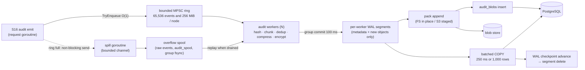
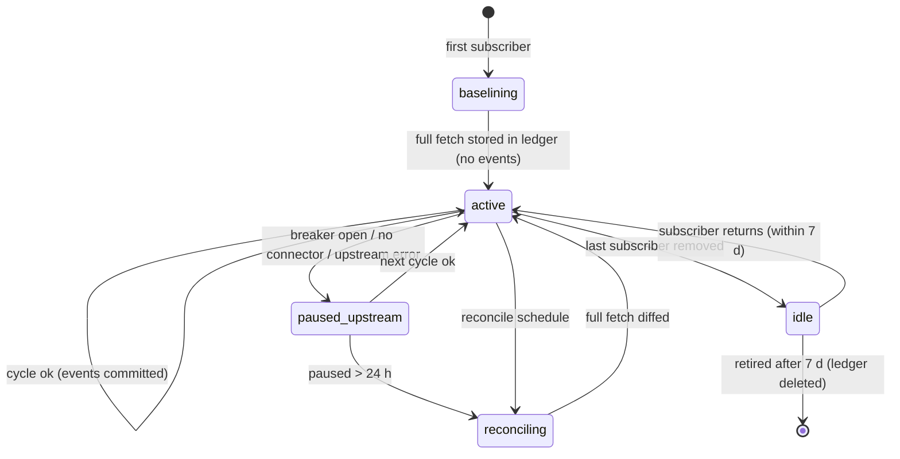
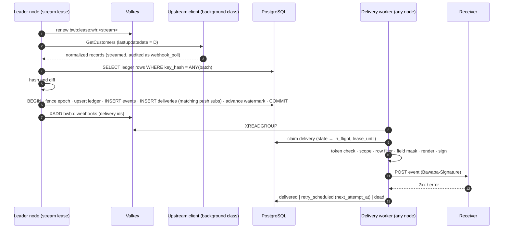
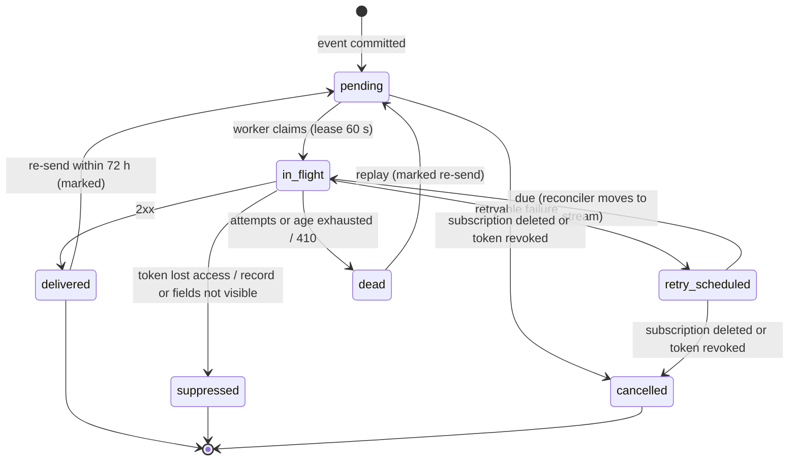
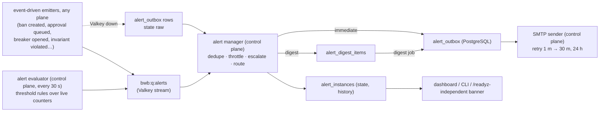
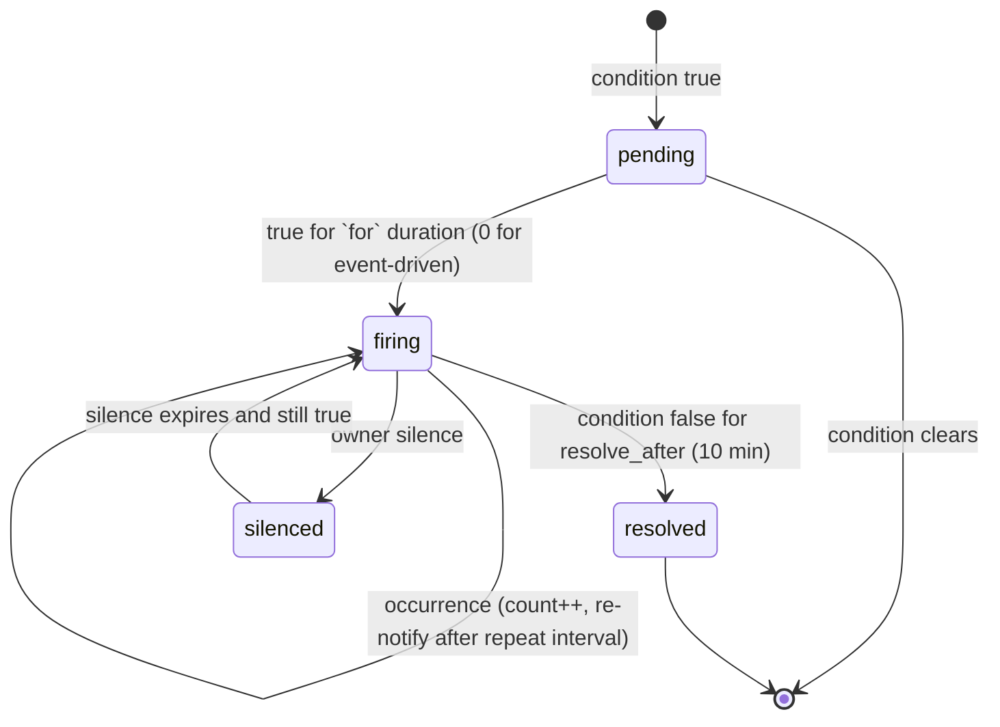
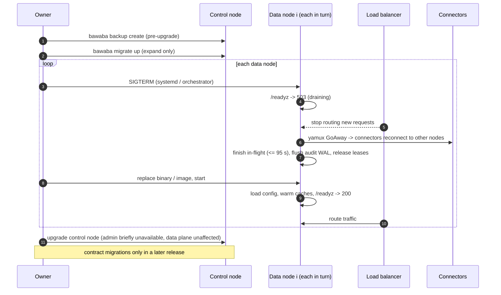

# 05 — Bawaba Operations

> Status: draft v1 · 2026-11-03 · Binding input: [`00-decisions.md`](00-decisions.md). Builds on
> [`01-architecture.md`](01-architecture.md) (pipeline stages S1–S17, workers, Valkey/PostgreSQL usage, key
> hierarchy). Upstream reference: [`../upstream/shamel-api.md`](../upstream/shamel-api.md).
>
> This document owns: the audit log (record schema, body storage, write pipeline, retention, estimates, querying),
> the webhooks engine (change detection, event store, delivery), e-mail alerts, the "inform the AI" behaviour,
> observability, the admin dashboard, the CLI, the documentation system, and backups / disaster recovery /
> upgrades. Table sketches below fix names and semantics; the data-model document is authoritative for final
> DDL details (types, constraints) and may refine them without changing behaviour.

---

## 0. Conventions used in this document

| Item | Convention |
|---|---|
| IDs | `req_` request (`req_` + 26-character Crockford base32 UUIDv7, 01 S2, 02 LV-24), `tok_` token, `up_` upstream, `conn_` connector, `areq_` access request, `apr_` write approval, `whs_` webhook subscription, `evt_` event, `whd_` delivery, `alr_` alert instance, `exp_` audit export, `bkp_` backup run. Audit object ids are shown as `b_` + 26-char base32. New ids are UUIDv7 unless stated. |
| Valkey keys | As 01: `bwb:<t>:…` tenant-scoped, `{…}` hash tag, `bwb:lease:<job>` worker leases, `bwb:q:<name>` queues. |
| Time | Timestamps RFC 3339; business dates `YYYY-MM-DD` in the upstream's business timezone (default `Asia/Hebron`). Schedules are 5-field cron strings evaluated in the business timezone. |
| Config | **Bootstrap** keys live in `/etc/bawaba/bawaba.yaml` (restart/SIGHUP); **runtime** keys live in PostgreSQL and propagate through compiled config (01 §5.4, §15). Each config block below says which. Listener addresses and ports are defined in 01 §5.2 / 02 §12.1 and are referred to here by name (`control`, `ops`). |
| Keys | The key hierarchy is owned by [`02-security.md`](02-security.md) §9.2: two root files, `master.key` (MK, loaded only by the control plane) and `data.key` (DK, loaded only by the data plane), wrap KEK_control and KEK_data, which wrap the per-purpose keys in `crypto_keys` (record envelope 02 §9.3). Data-plane purposes used here: `audit_addr` (keyed object ids; 01 calls it `blobid`), `audit_index` (blind indexes), `audit_chain` (integrity chain), `audit_spool` (overflow spool and WAL framing), `webhook_secret`, `webhook_url`, `webhook_event` (ledger state, event payloads), `webhook_ledger` (ledger keys and hashes), `queue`. Control-only purposes: `audit_seal` (HPKE key pair that opens audit epoch keys), `admin_chain`, `smtp_password`. **Audit bodies (`audit_body`) and audit metadata (`audit_meta`) are encrypted under per-node, per-epoch DEKs sealed to `audit_seal`** (§1.4.5), so the data plane can write audit content but cannot read stored content. One addition is requested from 02: the data-plane AEAD purpose `audit_dict` (compression dictionaries, §1.4.4). Backup archives use a random archive key wrapped directly by MK (§9.1). |
| Severity words | `critical` > `high` > `warning` > `info` (alerts, §3). |

---

## 1. Audit log

### 1.1 Decisions at a glance

| Topic | Decision |
|---|---|
| Coverage | **Every** data-plane request (`/v1`, `/legacy`; `/docs` metadata only), every upstream call (raw request and raw response, including Shamel's error text), every background upstream call (webhook polling, approved-write execution), every control-plane action. |
| Metadata | One compact row per request in **daily range-partitioned** PostgreSQL tables (`audit_events`, `audit_upstream_calls`); sensitive parameters encrypted in the row; searchable values exposed only as keyed **blind indexes**. Above the PostgreSQL ingest rating, `audit.metadata_mode: segment_first` writes metadata straight to encrypted segments in the blob store (§1.12). |
| Bodies | **Content-addressed objects**: id = truncated `HMAC-SHA256(audit_addr, …)`; **record-aligned content-defined chunking** for large JSON arrays (FastCDC for other large bodies); **zstd** with **trained dictionaries**; **AES-256-GCM** envelopes (purpose `audit_body`, 02 §9.3) under **per-node, per-epoch DEKs sealed to the control plane** (write-only for the data plane, §1.4.5); objects appended to immutable **pack files** in the blob store (filesystem or S3-compatible). |
| Dedup | Identical bodies and identical chunks are stored once per tenant. Estimated **~61× smaller than raw** and **~9× smaller than compression alone** for the medium workload (§1.7). |
| Pipeline | Asynchronous, non-blocking: bounded ring (events **and** bytes) → per-worker encrypted local **WAL** (dedup-first) → packs + batched `COPY`. Overflow goes to a dedicated spill goroutine and an on-disk **spool**; the request goroutine never writes or fsyncs in `standard` mode. When the disk budget is exhausted the gateway **fails closed** (`503 audit_unavailable`) or, if the owner opted in, records metadata only — never silently. |
| Retention | Metadata 2 y (90 d hot in PostgreSQL, then **cold Parquet segments** in the blob store), write bodies 2 y, read bodies 90 d, sandbox bodies 14 d; GC by per-object `retain_until` leases; pack compaction. |
| Caps | Size caps per store with alerts at 70/85/95 %; at the hard cap read bodies are trimmed oldest-first (recorded as a gap), never write bodies or metadata. |
| Access | Querying, decryption and export exist **only on the control plane** (admin API, dashboard, local CLI), which alone holds the `audit_seal` private keys. The data-plane DB role can insert but not read audit content, and data-plane keys cannot decrypt stored audit content (§1.10). Every body view and export is itself audited. |

### 1.2 What is recorded

| Event kind (`event_kind`) | Source | Metadata | Bodies |
|---|---|---|---|
| `api_v1`, `api_legacy` | S16 of every request that reached S2 | full row | client request body (if any), client response body, per upstream call: raw upstream request + raw upstream response |
| `docs` | `/docs` | row without bodies (body = build id + path, reproducible from the binary) | none |
| `blocked` | S3 rejections of banned / non-allowlisted / over-budget IPs | **full row per request** (stage, reason, IP, declared `Content-Length`). Flood guard: only while one IP exceeds `audit.blocked.aggregate_above` (120/min) are its further blocked requests folded into one row per (IP, reason, minute) with count and first/last request id; every such window writes an `audit_gaps` row (kind `blocked_aggregated`) and raises `audit_gap_detected` (warning), so the reduction is never silent | client response body (the error envelope, inline, §1.4.1); the request body is not read at S3 (rejected before it is consumed, 02 §10.1) and the row carries `body_not_read` |
| `webhook_poll` | change-detection cycles (§2) | row per cycle, `token_id` NULL, actor `system:webhooks:<detector>` | raw upstream request/response per call |
| `approved_write` | approved-write executor (01 §6.4) | row linked to the original `202` request (`upstream_ref`) | raw upstream request/response |
| `webhook_delivery` | delivery attempts (§2.7) | in `webhook_delivery_attempts` (not `audit_events`) | rendered payload hash + first 1 KiB of the receiver response |
| admin actions | control plane | `admin_events` (02 §12.5, §1.3.4) | before/after diff, secrets redacted |

**Redactions before storage** (the only content that is *not* "full"): Shamel credentials and the Shamel session
token are replaced by `cred_<id>` (02 §5.2 step 11) — login form bodies keep only the username; the client
`Authorization` header is replaced by the token id; webhook signing secrets and Bawaba tokens never appear in
bodies. Transport framing (chunked encoding, gzip from Shamel) is removed; **body bytes are otherwise stored exactly
as the gateway sent/received them** (no re-formatting; in connector mode the raw response is the connector-scrubbed
one, 02 §5.2), so raw upstream bodies keep forensic fidelity. Write request bodies are held
in `audit_writes` (01 §6.4) and referenced from the event row instead of being stored twice.

### 1.3 Metadata schema

#### 1.3.1 `audit_events` (one row per request)

```sql
CREATE TABLE audit_events (
  ts              timestamptz NOT NULL,  -- request start (partition key)
  request_id      uuid        NOT NULL,  -- req_ (UUIDv7: its timestamp ≈ ts → partition pruning)
  tenant_id       smallint    NOT NULL,
  node_id         smallint    NOT NULL,  -- dictionary of node ids
  event_kind      smallint    NOT NULL,  -- §1.2
  token_id        integer,               -- surrogate of tok_…; NULL when unauthenticated
  token_kind      smallint,              -- tool | agent | publishable
  environment     smallint    NOT NULL,  -- live | sandbox
  client_ip       inet,
  ua_id           integer,               -- audit_user_agents dictionary
  method          smallint    NOT NULL,
  op_id           smallint,              -- operation registry id (audit_ops dictionary: id → "customers.list", route template)
  status          smallint    NOT NULL,
  error_code      smallint,              -- apierr catalogue id
  stage_reached   smallint    NOT NULL,  -- S1..S17
  flags           integer     NOT NULL,  -- bit set: coalesce_leader/follower/local, cursor_read, client_abort,
                                         -- approval_hold, idempotent_replay, bodies_dropped, body_not_read,
                                         -- blocked_aggregate, slow, legacy
  warnings        integer,               -- bit set of Bawaba-Warning codes emitted (§4.2; 16 codes today)
  dur_total_us    integer     NOT NULL,
  dur_gateway_us  integer,               -- overhead (01 §10.1)
  dur_queue_us    integer,               -- upstream limiter wait
  dur_upstream_us integer,
  upstream_calls  smallint    NOT NULL DEFAULT 0,
  upstream_ref    uuid,                  -- follower → leader request; cursor page → snapshot origin request;
                                         -- approved_write → original 202 request
  bytes_in        integer,
  bytes_out       integer,
  req_body        bytea,                 -- body ref (§1.4.1), NULL if no body
  resp_body       bytea,
  params_enc      bytea,                 -- audit_meta envelope(zstd(canonical JSON)) under the node's epoch DEK
                                         -- (§1.4.5): raw path+query, route vars, normalized typed request,
                                         -- cursor {view_id, snapshot_id, offset, policy_version}, policy_version,
                                         -- Idempotency-Key hash, client correlation id, CF-Ray, decision trace
  subject_keys    bigint[],              -- blind index (§1.3.3)
  stage_timings   bytea,                 -- per-stage µs, only when slow (> audit.slow_threshold, 1 s) or error
  batch_seq       bigint      NOT NULL   -- integrity chain position within the node's chain (§1.9)
) PARTITION BY RANGE (ts);
-- per daily partition:
--   UNIQUE (ts, request_id) · BRIN (ts) · btree (token_id, ts) · GIN (subject_keys)
--   btree (status, ts) WHERE status >= 400
```

- Paths are stored as `op_id` (whose dictionary row holds the route template, e.g. `/v1/customers/{code}`); the
  concrete path, which may contain customer codes, is only inside `params_enc`.
- Lookup by request id needs no global index: request ids are UUIDv7 (01 S2, 02 LV-24), so the embedded timestamp
  selects the partition (or cold segment) and a ±2 s `ts` range, and the unique index answers in one probe.
- Partitions are created 7 days ahead by the retention/partition singleton (01 §5.6) and are append-only.

#### 1.3.2 `audit_upstream_calls` (one row per upstream call)

```sql
CREATE TABLE audit_upstream_calls (
  ts timestamptz NOT NULL, request_id uuid NOT NULL, call_seq smallint NOT NULL,
  tenant_id smallint NOT NULL, upstream_id smallint NOT NULL, identity_id smallint,
  transport smallint,        -- direct | tunnel | relay | mock
  connector_id smallint, relay_node_id smallint,
  shamel_op smallint,        -- Shamel endpoint id (registry); path text never stored outside bodies
  attempt smallint, outcome smallint,   -- ok | rejected | auth_failed | upstream_error | unavailable | timeout | bad_response
  http_status smallint, dur_queue_us integer, dur_us integer, bytes_out integer, bytes_in integer,
  req_body bytea, resp_body bytea,      -- raw upstream request (method, path, header params, form) / response
  snapshot_id uuid,                     -- snapshot written from this call (01 §9.4)
  PRIMARY KEY (ts, request_id, call_seq)
) PARTITION BY RANGE (ts);
```

Coalesced followers do **not** get upstream rows: they set `flags.coalesce_follower` and `upstream_ref` = the leader's
request id, so one upstream call is stored once however many clients shared it. Cursor pages point (via
`upstream_ref`) to the page-1 request whose upstream call produced their snapshot, giving a complete chain from any
page a client saw back to the raw Shamel bytes.

#### 1.3.3 Blind index for searchable business values

Searching by customer code (and similar) must work without storing those values in plaintext:

```
subject_key = int64( HMAC-SHA256(audit_idx_key[tenant], dimension ‖ 0x00 ‖ normalize(value))[0:8] )
dimensions  = customer | item | voucher | manual_code | store | salesman | barcode | serial | currency
```

Keys are extracted from the **validated request** (path variables, filters, write payloads such as a voucher's
`customer_code` and item codes) — not from list responses (indexing 2,000 customer codes per list response would
dwarf the row). The control plane computes the same HMAC to search; false positives (2⁻⁶⁴) are removed after
decrypting `params_enc`. Finding responses that *contained* a customer is a separate, explicit **deep search**
(§1.10) that decrypts and scans bodies in a bounded time range.

#### 1.3.4 Other audit tables

| Table | Content | Partitioning / retention default |
|---|---|---|
| `audit_writes` | 01 §6.4 write-ahead record: token, idempotency key, request hash, `payload_enc`, status, Shamel reference id, outcome. `UNIQUE (tenant_id, token_id, idempotency_key)` also acts as a durable backstop when Valkey idempotency records are lost (§9.5). | monthly · 2 y |
| `admin_events` | defined in 02 §12.5 (`seq, ts, actor, peer, action, target, diff, prev, mac`, HMAC-chained with the control-only key `admin_chain`); actions include `token.create`, `approval.approve`, `audit.body.view`, `audit.export`, `key.rotate`, `firewall.ban`, `alert.silence` | monthly · 5 y, never archived |
| `audit_ops`, `audit_user_agents` | small dictionaries (id ↔ text) | — |
| `audit_blobs`, `audit_packs`, `audit_zstd_dicts` | object index and storage bookkeeping (§1.4) | `audit_blobs` hash-partitioned (16) by id |
| `audit_epoch_keys` | defined in 02 §9.2: one HPKE-sealed DEK per (node, epoch); opened only by the control plane (§1.4.5) | until destroyed by the GC (§1.4.5) |
| `audit_segments` | cold-tier segment catalogue (§1.8; in `segment_first` mode also the hot catalogue, §1.12) | — |
| `audit_batches`, `audit_anchors` | integrity chain and hourly anchors (§1.9, 02 §12.5) | with metadata |
| `audit_gaps` | detected losses and reductions: unclean shutdown windows, cap-trimmed body ranges, blob loss after restore, blocked-request aggregation windows (§1.2) | forever |
| `audit_exports` | export jobs: who, filters, row count, output hash | 5 y |

### 1.4 Body storage

#### 1.4.1 Object model

```
body ref (bytea in a metadata row)
  0x01 ‖ object_id(16)        → object in the blob store (chunk or manifest)
  0x02 ‖ inline ciphertext    → tiny body (≤ audit.inline_max = 256 B after compression+encryption)
  0x03                        → write request body held in audit_writes (same request_id)

object kinds
  chunk     : one compressed+encrypted byte range of a body
  manifest  : {media_type, total_len, encoding: "whole" | "json_records" | "fastcdc",
               entries: [ {object_id, raw_len} … ]}       (itself stored as an object)
```

A body smaller than `audit.chunking.min_body` (32 KiB) is a single chunk; its ref points to the chunk. Larger
bodies are chunked and the ref points to a manifest. Identical bodies yield identical refs, so a repeated large
list response costs one manifest lookup and no new bytes.

#### 1.4.2 Object ids (keyed, confirmation-resistant)

```
object_id = HMAC-SHA256(audit_addr, tenant_id ‖ kind ‖ plaintext)[0:16]      -- 128 bits
```

- **Keyed** (02 §9.3): with a plain SHA-256 anyone holding the blob store or the database could test guesses ("is
  there a response saying customer X has balance Y?") by hashing candidate plaintexts. `audit_addr` is a data-plane
  MAC key under KEK_data, which only `master.key` and `data.key` unwrap; neither file is in the database, the
  bucket or a backup. (The data plane itself holds `audit_addr`; see the residual in §1.10.) Adding tenant and kind
  to the input and truncating to 128 bits are refinements of 02's `blob_id` definition.
- **Tenant in the input**: no cross-tenant dedup, so a future SaaS tenant cannot probe another tenant's content
  through storage behaviour.
- **128-bit truncation**: halves index and manifest size; accidental collision probability at 10⁹ objects is
  ≈ 10⁻²¹ and deliberate collisions require the key. On read, the control plane recomputes the HMAC over the
  decrypted plaintext and rejects mismatches (integrity check for free).
- Encryption uses **random nonces**, not convergent encryption; dedup happens by id lookup, never by comparing
  ciphertexts.

#### 1.4.3 Chunking (decision: record-aligned CDC for JSON arrays)

Successive responses of the same list differ in a few records, and records may be inserted or removed anywhere
(new vouchers sorted to the top shift everything). Fixed-size chunks would change after every insertion; whole-body
dedup only helps when *nothing* changed. **Decision:**

1. **JSON array bodies ≥ 32 KiB** (raw Shamel list responses, and `/v1` list pages `{"data":[…],"page":…}`) are cut
   at **record boundaries chosen by content**: the streaming tokenizer yields the exact byte range of each
   top-level array element; a boundary is placed after element *e* when
   `SipHash-2-4(chunk_seed, bytes(e)) mod 16 == 0`, subject to min 4 / max 64 elements and max 256 KiB per chunk.
   Average 16 records per chunk. The bytes before the first element and after the last element are their own small
   chunks. Because boundaries depend only on record content, an inserted, removed or changed record affects only
   its own chunk; neighbours re-synchronise at the next boundary. `chunk_seed` is derived from `audit_addr` so chunk
   sizes cannot be steered by crafted data.
2. **Other bodies ≥ 32 KiB** (non-array JSON, item images if ever audited, unknown content): **FastCDC** at byte
   level (min 16 KiB, avg 64 KiB, max 256 KiB).
3. **Bodies < 32 KiB**: one chunk.

Rejected alternatives: per-record objects (manifest of 2,000 × 20 B per fetch outweighs the savings and multiplies
index rows); byte-level CDC on JSON (boundaries inside records reduce dedup when field values change).

#### 1.4.4 Compression with trained dictionaries

- zstd (`klauspost/compress`) level 3 for chunks; small chunks (2–16 KiB) compress 2–3× without a dictionary and
  5–8× with one, because Shamel JSON repeats the same keys and value shapes.
- **Dictionary classes**: one per (body family × resource), e.g. `shamel.raw.customers`, `shamel.raw.items`,
  `shamel.raw.vouchers`, `v1.customers`, `v1.items`, `v1.vouchers`, `v1.errors`, `misc`. The class is known from
  the operation descriptor.
- **Training**: singleton job weekly (`audit.compression.dictionaries.retrain_interval`, 168 h) samples up to
  20,000 recent chunks per class (decrypted in memory on the control node), trains a 112 KiB dictionary
  (`zstd` COVER), keeps it only if it improves the sample ratio by ≥ 5 %. Dictionaries are stored in
  `audit_zstd_dicts(dict_id, class, created_at, bytes_enc, objects_using)`, encrypted under the data-plane purpose
  `audit_dict` (requested from 02, AAD `audit_dict/<dict_id>`), because data nodes must read them to compress; they
  are never deleted while any object references them (they are tiny). Nodes load new dictionaries via a
  compiled-config-style notification. **Residual:** a dictionary holds frequent byte sequences of past bodies
  (mostly JSON keys and repeated values, not whole records), so it is the one piece of past audit content a data
  node can read; owners who do not accept that set `audit.compression.dictionaries.enabled: false` (≈ 2× more
  stored body bytes for small chunks).
- The dictionary changes the compressed bytes, not the object id (computed over plaintext), so retraining never
  breaks dedup.
- **Codec lifecycle** (klauspost/compress): one long-lived `*zstd.Encoder` per (dictionary id, level), created
  once with `WithEncoderDict`, `WithWindowSize(256 KiB)` (the maximum chunk size, §1.4.3) and
  `WithLowerEncoderMem(true)`, and used only through `EncodeAll`, which is safe for concurrent use; the same for
  decoders (`DecodeAll`, dictionaries registered with `WithDecoderDicts`, `WithDecoderMaxWindow(256 KiB)`). No
  per-object `NewWriter`/`NewReader`, whose window buffers would dominate CPU and GC at > 1.5 M objects/day.
  Encoders for retired dictionaries are dropped when the new one is loaded. The spool's level-1 encoder and the
  snapshot codec (01 §9.4) follow the same pattern. CI runs a `-benchmem` gate on the object-encode path
  (hash → compress → seal for an 8 KiB chunk: ≤ 2 allocations, no allocation proportional to the window).

#### 1.4.5 Encryption (write-only for the data plane)

Audit content is encrypted so that the plane that writes it cannot read it back (02 §9.2 "write-only audit"):

- **Epoch DEKs.** Each data-plane node generates a random 256-bit DEK per epoch (`security.audit_epoch`, 1 h, or
  earlier after 64 GiB of output). It HPKE-seals the DEK to the control plane's current `audit_seal` public key
  (`info = "bawaba/audit-epoch/v1"`, `aad = epoch_key_id ‖ node_id`), inserts the sealed DEK into
  `audit_epoch_keys(id, tenant_id, node_id, seal_key_id, sealed_dek, created_at, not_after)` and also writes it into
  the WAL segment header, so an epoch that starts during a PostgreSQL outage is still recoverable (replay inserts
  the key row before any row that uses it). The plaintext DEK lives only in memory and is zeroized when the epoch
  ends. Cost: one HPKE seal per node per epoch; per object it is plain AES-GCM.
- **Objects** are sealed with the envelope of 02 §9.3: purpose `audit_body`, AES-256-GCM with a per-message HKDF
  subkey of the epoch DEK, envelope key id = the `audit_epoch_keys` id, AAD binding `blob/<object_id>`. The
  envelope adds 61 bytes (version, key id, salt, nonce, tag). **Metadata columns** (`params_enc`, inline bodies,
  `stage_timings`) use purpose `audit_meta` under the same epoch DEK, AAD `audit_event/<request_id>/<column>`.
- **Reading** happens only in the control plane: it holds the `audit_seal` private keys (wrapped by KEK_control,
  which only `master.key` unwraps), opens an epoch DEK on first use and caches it in memory for the reader,
  dictionary training, segment writing and restore-drill jobs.
- **Dedup never decrypts.** Object ids are keyed HMACs over plaintext the worker already holds; the dedup query
  reads only `id` and `retain_until`; a manifest's lease cascade (§1.5.1 step 7) uses the chunk ids the worker has
  just computed from the body in hand, never a stored manifest.
- **Rotation.** Epoch DEKs rotate every epoch; no ciphertext is ever rewritten. The `audit_seal` key pair rotates
  monthly and automatically (`security.rotation.audit_seal`, 02 §9.6): nodes seal from their next epoch to the new
  public key; the old private key becomes `decrypt_only` and is destroyed when no live epoch key is sealed under it.
- **Destruction.** The GC (§1.6.2) destroys an epoch key only when (a) its epoch ended more than
  `audit_retention.metadata` ago (inline bodies and `params_enc` in hot partitions and cold segments use it) and
  (b) no live pack lists it in `audit_packs.epoch_key_ids` (the set of epoch key ids of the objects in the pack;
  consolidation and compaction copy ciphertext verbatim and carry the ids along). No crypto-shredding before that
  point: a chunk created in month 1 may be referenced by a write record kept two years. Deletion is by GC (§1.6).
- **Other node-local files.** The overflow spool holds raw, unprocessed events and therefore uses the data-plane
  purpose `audit_spool` (02 §9.2); WAL records are framed with `audit_spool` too (so replay after a restart needs no
  past epoch DEK), but their bodies and sensitive columns inside are already sealed under the epoch DEK. Capture
  temp files (§1.5.1) use a random per-file key held only in memory and are deleted when processed.

#### 1.4.6 Pack files

Millions of small objects per day would waste filesystem blocks (4 KiB minimum per file) and S3 request budgets.
Objects are therefore appended to **packs**:

```
packs/<tenant>/<class>/<yyyy>/<mm>/<pack_id>.bwp
  header  : "BWP1", pack_id, node_id, created_at
  records : [object_id 16][kind 1][dict_id 2][len 4][02 §9.3 envelope: version, epoch key id, salt, nonce, ciphertext, tag]
  footer  : index of (object_id, offset, len) + SHA-256 of the pack   -- allows rebuilding audit_blobs without PostgreSQL
```

- `class` = retention class at creation (`read`, `write`, `sandbox`, `meta` for cold segments), so most packs expire
  as a whole.
- Each audit worker owns one open pack, sealed at 32 MiB or 60 s (`audit.packs.seal_bytes`, `seal_interval`). With
  the FS backend the open pack is written in place and fsynced per batch; with S3 it is staged in the WAL directory
  and uploaded on seal.
- `audit_blobs(id, tenant_id, pack_id, offset, len, raw_len, kind, dict_id, class, durable, retain_until)` indexes
  objects (in `postgres` metadata mode, §1.12); `durable = false` while the pack is only staged locally. Other nodes
  treat non-durable objects as misses (they store their own copy), so cross-node references never point at another
  node's local disk.
- `audit_packs(pack_id, tenant_id, class, backend_key, state staged|sealed|uploaded|compacting|deleted, bytes_total,
  bytes_live, epoch_key_ids uuid[], sealed_at)`; `epoch_key_ids` drives epoch-key destruction (§1.4.5).
- **Consolidation**: hourly, small sealed packs (< 8 MiB) of the same class and week are merged into ~128 MiB packs
  by copying ciphertext verbatim (the AAD binds the object id, not its location).

### 1.5 Write pipeline



#### 1.5.1 Stages

1. **Emit (request goroutine, S16).** Builds the event from the bodies that already exist: the response writer's
   buffer and the **capture buffer** into which the streaming decoder tees the raw upstream bytes as they arrive
   (pooled memory up to `audit.capture_mem_max`, 4 MiB, per body, spilling beyond that to an encrypted temp file in
   the WAL directory, so a 50 MB list never pins heap). Bodies ≤ `audit.copy_max` (64 KiB) are **copied** into a
   pooled event buffer, so the request's buffers return to their pools at once; larger pooled buffers are
   **reference-counted** and released by the worker when it is done (temp files are deleted then). The event's
   **charge** = copied bytes + referenced bytes + temp-file bytes. `ring.TryEnqueue` succeeds only if both
   `audit.ring_size` (65,536 events) and `audit.ring_max_bytes` (256 MiB of charge) have room; otherwise the event
   goes to the spill path (§1.5.3) by a non-blocking channel send. Cost ≤ 20 µs (01 §10.1). The request goroutine
   never writes to disk or waits for an fsync in `standard` mode.
2. **Workers** (`audit.workers`, default `GOMAXPROCS/2`) take events and, per body: strip framing → choose chunking →
   compute object ids → **dedup check** in order: (a) worker-local and node-shared LRU of recently stored ids
   (`audit.seen_cache`, 1 M entries ≈ 48 MiB), (b) batched `SELECT id, retain_until FROM audit_blobs WHERE id = ANY($1)`
   for misses → only unseen objects are compressed and encrypted.
3. **WAL append.** The worker appends one WAL record per event: the metadata row (its sensitive columns already
   sealed under the epoch DEK, the record framed with `audit_spool`, §1.4.5) + manifests + **only new objects**
   (already compressed and sealed, so the WAL holds no plaintext and needs no second compression). WAL segments
   (`audit.wal.dir`, 64 MiB each, header with `boot_id` and the sealed epoch DEKs in use) are fsynced by group
   commit every `audit.wal.sync_interval` (100 ms).
4. **Pack + index.** New objects are appended to the worker's open pack; `audit_blobs` rows are inserted with
   `ON CONFLICT DO NOTHING` in the same transaction as step 5.
5. **COPY.** Metadata rows are copied every 250 ms or 1,000 rows (01 §10.2); a batch commits only after its new
   objects are in a fsynced pack (FS) or staged pack (S3), so a committed row never references a missing object on
   the same node.
6. **Checkpoint.** After commit the worker advances its WAL checkpoint; fully checkpointed segments are deleted.
   On S3, staged packs are uploaded on seal, then marked `durable`.
7. **Lease extension.** When a dedup hit references an object whose cached `retain_until` is below the new
   requirement, the batch issues `UPDATE audit_blobs SET retain_until = $d WHERE id = ANY($ids) AND retain_until < $d`
   (at most once per object per day thanks to the cache); for manifests the extension cascades to their chunks,
   whose ids the worker has just computed from the body in hand (no stored manifest is read or decrypted).

#### 1.5.2 Durability modes

| Mode (`audit.durability`) | Behaviour | Crash exposure |
|---|---|---|
| `standard` (default) | Request returns before its audit record is on disk. | Events still in the ring plus ≤ 100 ms of un-fsynced WAL. Not silent: each node writes `(boot_id, last_durable_seq, ts)` into its WAL header; on restart after an unclean exit it inserts an `audit_gaps` row covering `[ts of last durable event, restart]` and raises the `audit_gap_detected` alert. |
| `strict` | Every event takes the spool path: S16 hands the event to the spill goroutine, which appends it (zstd level 1, `audit_spool`) with a 2 ms group commit, and S17 sends the response only after that fsync is confirmed (≈ 0.5–3 ms on SSD, more for multi-MB bodies); workers then consume the spool as usual. Waiting for the fsync is the point of this mode. | None beyond disk loss. |
| Writes (always) | Synchronous write-ahead `audit_writes` insert before contacting Shamel (01 §6.4). | None. |

`standard` is the default because the exposure is bounded, detected and limited to reads; owners who want
zero-loss read auditing switch to `strict` at a small latency cost.

#### 1.5.3 Backpressure

| Condition | Behaviour | Signals |
|---|---|---|
| Ring has space (events and bytes) | Normal path. | `bawaba_audit_queue_depth`, `bawaba_audit_ring_bytes` |
| Ring full by count or by `ring_max_bytes` (workers CPU-bound, or very large bodies) | S16 hands the event to the **spill goroutine** through a bounded channel (`audit.spill_queue`: 4,096 events or 64 MiB of charge) with a non-blocking send and returns. The spill goroutine appends the **raw** event (zstd level 1, `audit_spool`) to the overflow spool with group fsync and releases the event's buffers; workers drain the spool after the ring. | `bawaba_audit_events_total{result="spilled"}` |
| Spill channel also full | The `audit.on_spool_full` policy applies to this event at once: `reject` → this request gets `503 audit_unavailable`; `metadata_only` → its metadata row is kept, bodies dropped, `bodies_dropped` flag, `audit_gaps` row. Alert `audit_unavailable`. | alert |
| PostgreSQL or blob store slow/down | WAL and staged packs grow on local disk; requests unaffected. Dedup degrades to the local cache (more new objects written). | `bawaba_audit_lag_seconds`, `bawaba_audit_wal_bytes` |
| WAL + spool + capture temp files ≥ 50 % of `audit.spool_max_bytes` (10 GiB, 02 §16) | Continue; alert `audit_spool_filling` (warning), ≥ 80 % critical. | alert |
| WAL + spool + capture temp files = 100 % | `audit.on_spool_full: reject` (default) → new requests get `503 audit_unavailable` (fail closed, 01 S16). `metadata_only` → metadata rows are kept, bodies dropped, rows flagged `bodies_dropped`, `audit_gaps` row written. Alert `audit_unavailable` (critical). | alert |
| Local disk itself full | Same as 100 % (disk-free check every 5 s with a 2 GiB reserve). | alert |
| Any of the above while PostgreSQL or the blob store is unavailable | **Writes fail closed** (`503 audit_unavailable`, 02 §16) even though their `audit_writes` row could be stored; reads continue through WAL/spool as above. | alert |

Sizing: at the medium workload the WAL receives ≈ 25 KiB/s (dedup-first). If PostgreSQL and the blob store are both
down, 10 GiB holds ≈ 4 days with a warm dedup cache and ≈ 20 h in the worst case (no dedup hits, ~12.5 GB/day of
compressed bodies, §1.7). Memory: the ring's byte bound caps pinned body memory at 256 MiB plus 64 MiB in the spill
channel per node, whatever the body sizes; node sizing reserves ≈ 512 MiB of the `GOMEMLIMIT` budget (01 §10.2) for
audit buffers, including capture buffers of requests in flight.

#### 1.5.4 Recovery and replay

On start each worker replays its WAL from the checkpoint: sealed epoch DEKs from the segment headers via
`INSERT … ON CONFLICT (id) DO NOTHING` into `audit_epoch_keys` first, then metadata via `INSERT … ON CONFLICT (ts,
request_id) DO NOTHING` (instead of `COPY`), objects re-appended (duplicates in packs become garbage for compaction, index inserts
are idempotent). The overflow spool is replayed through the normal worker path. Spool and WAL files carry a format
version; readers support N−1 (§9.6).

### 1.6 Retention, garbage collection, compaction, caps

#### 1.6.1 Retention classes (runtime, `audit_retention`)

| Class | Default | Applies to |
|---|---|---|
| `metadata` | 730 d | `audit_events`, `audit_upstream_calls` (hot + cold) |
| `metadata_hot` | 90 d | rows kept in PostgreSQL; older rows only in cold segments (§1.8). `0` = keep all in PostgreSQL. |
| `write_bodies` | 730 d | bodies of write requests and their upstream calls, approval executions |
| `read_bodies` | 90 d | bodies of reads (client and upstream) and webhook polls |
| `rejected_bodies` | 30 d | bodies of requests rejected before any upstream call (4xx) |
| `sandbox_bodies` / `sandbox_metadata` | 14 d / 90 d | `environment = sandbox` (fake data) |
| `admin_events` | 1,825 d | `admin_events`, `audit_exports` |

Each object carries `retain_until = max over referencing records (record date + class retention)`, set at creation
and extended on reuse (§1.5.1 step 7). A record outliving its bodies (metadata 2 y, read bodies 90 d) shows
`body_expired` in queries.

#### 1.6.2 GC and compaction (control-node singleton, daily, `audit.blob_gc.schedule` = `23 4 * * *`)

This describes the `postgres` metadata mode; `segment_first` replaces steps 1 and 5 with a mark phase (§1.12).

1. `DELETE FROM audit_blobs WHERE retain_until < current_date - audit.blob_gc.grace(7 d) RETURNING pack_id, len`
   in batches; decrement `audit_packs.bytes_live`.
2. Packs with `bytes_live = 0` → deleted after `audit.packs.delete_delay` (24 h, lets readers and the backup sync
   finish).
3. Packs with live ratio < `compact_live_ratio` (0.5) → live objects copied verbatim into a new pack, index rows
   repointed in one transaction, old pack deleted after the delay.
4. Metadata: partitions older than `metadata_hot` are dropped after their cold segment is verified (§1.8);
   segments older than `metadata` are deleted.
5. The 7-day grace makes the reuse race safe: a writer only trusts a cached object if its `retain_until ≥ today + 1`,
   otherwise it extends via `UPDATE … RETURNING`; zero rows (already deleted) → it stores the object again.
6. Epoch keys that satisfy the destruction rule of §1.4.5 are destroyed (row deleted after the sealed DEK is
   overwritten); `audit_seal` private keys with no live epoch key left are destroyed (02 §9.6).

**Policy changes**: increasing a retention value triggers `bawaba audit retention reapply` (background mark phase over
hot partitions and cold segments within the new window, extending `retain_until`); decreasing applies to new
records immediately and to existing objects at their recorded date (or immediately with `--recompute`).

#### 1.6.3 Size caps (runtime, `audit_caps`)

| Key | Default | Meaning |
|---|---|---|
| `pg_bytes` | 200 GiB | audit tables + indexes in PostgreSQL (`pg_total_relation_size` sum, sampled every 10 min) |
| `blob_bytes` | 500 GiB | packs + segments (from `audit_packs` / `audit_segments` bookkeeping) |
| `alert_at` | `[0.70, 0.85, 0.95]` | `audit_storage_near_cap` warning / high / critical |
| `on_cap` | `trim_read_bodies` | at 100 %: shorten effective `read_bodies` (then `rejected_bodies`, `sandbox_*`) oldest-first down to `min_read_body_days` (7 d), write an `audit_gaps` row, alert critical. `alert_only` = never trim. |
| `min_read_body_days` | 7 | floor for trimming |

If trimming reaches the floor and usage is still at the cap, the store is treated like a full spool (§1.5.3):
`reject` or `metadata_only`. Write bodies and metadata are never trimmed by caps. Defaults leave ≈ 2× headroom over
the medium-workload steady state (§1.7.4).

### 1.7 Storage estimates — medium workload (1,000 req/min)

Decimal units (1 KB = 1,000 B). 1,000 req/min = **1,440,000 req/day** = 525.6 M req/year.

#### 1.7.1 Assumed mix

| Class | Share | Req/day | Client body (req + resp) | Upstream raw response | Upstream calls |
|---|---|---|---|---|---|
| A single-entity reads (customer, item details, voucher, balance, order status) | 50 % | 720,000 | 2 KB | 3 KB | 1 per request |
| B list page 1 (live fetch; 100-record page) | 5 % | 72,000 | 60 KB | 1 MB (≈ 2,000 records) | 0.7 per request (30 % coalesced) |
| C cursor pages 2..N (no upstream call) | 20 % | 288,000 | 60 KB | — | 0 |
| D reports and master data | 20 % | 288,000 | 15 KB | 20 KB | 1 |
| E writes (milestone 2) | 1 % | 14,400 | 2.5 KB | 3.3 KB (req + resp) | 1 |
| F rejected before upstream (401/403/404/422/429) | 4 % | 57,600 | 0.4 KB | — | 0 |

Chunk geometry (§1.4.3): a 1 MB raw list of ≈ 2,000 records (≈ 500 B each) is cut into ≈ 125 chunks of 16 records
(≈ 8 KB); a 60 KB client page of 100 records into ≈ 6 chunks of ≈ 9.6 KB. Manifest = 20 B per entry (16-byte id +
length), so ≈ 2.5 KB for a 1 MB list.

Change rate assumption for dedup: 30 % of consecutive fetches of the same list are byte-identical and the other 70 %
change ≈ 3.6 chunks, i.e. on average ≈ 2 % of a list's chunks (≈ 2.5 of 125) change between consecutive fetches;
20 % of page-1 responses differ from the previous identical query; 50 % of single-entity responses and 75 % of
report/master-data responses are repeats of an earlier identical response; cursor pages are 15 % new bytes (page
boundaries shift on inserts; CDC re-synchronises inside each page). Compression ratios: small bodies and 8–10 KB
chunks ≈ 2.5× with zstd alone and 5–8× with a dictionary; whole large lists ≈ 8× with zstd alone (§1.4.4).

Blocked traffic (§1.2) is outside this mix: each blocked request adds one ≈ 400 B metadata row with its error body
inline, so a sustained 100 blocked req/s from IPs under the aggregation threshold would add ≈ 3.5 GB/day.

#### 1.7.2 Metadata per request

| Item | Bytes |
|---|---|
| `audit_events` tuple (header 24 + fixed columns ≈ 70 + inet 10 + 2 body refs 34 + `params_enc` ≈ 100 + `subject_keys` ≈ 30 avg + line pointer/alignment ≈ 40) | ≈ 310 |
| Its indexes (unique (ts, request_id) ≈ 32, (token_id, ts) ≈ 28, GIN ≈ 10, partial errors ≈ 5, BRIN ≈ 0) | ≈ 75 |
| `audit_upstream_calls`: 0.745 calls/request × (≈ 130 tuple + 30 index) | ≈ 120 |
| **Total** | **≈ 505 B/request** |

→ 1.44 M × 505 B = **0.73 GB/day**, 265 GB/year, **530 GB for 2 years if all kept in PostgreSQL**. With
`metadata_hot = 90 d`: **65 GB** in PostgreSQL + 640 days of cold Parquet segments at ≈ 10× compression
(columnar, sorted by token and time) = **46 GB** in the blob store.

#### 1.7.3 Bodies per day

| Class | Raw | zstd only | Final (dedup + record CDC + dictionaries) | How the final figure arises |
|---|---|---|---|---|
| A | 3.60 GB | 1.44 GB | 0.36 GB | 50 % repeats → 1.80 GB new ÷ 5 (dictionaries) |
| B upstream | 50.40 GB | 6.30 GB | 0.22 GB | 50,400 calls × 2.5 new 8 KB chunks ÷ 8 = 0.13 GB + manifests (2.5 KB, unique for the 70 % of calls that changed) 0.09 GB |
| B client | 4.32 GB | 0.54 GB | 0.03 GB | 20 % changed × one 9.6 KB chunk ÷ 6 + manifests |
| C | 17.28 GB | 2.88 GB | 0.46 GB | 15 % new bytes ÷ 6 = 0.43 GB + manifests (≈ 165 B, unique for half of the pages) 0.02 GB |
| D | 10.08 GB | 1.26 GB | 0.32 GB | 25 % new ÷ 8 |
| E | 0.08 GB | 0.02 GB | 0.02 GB | no dedup assumed (request bodies live in `audit_writes`) |
| F | 0.02 GB | 0.01 GB | ≈ 0 | each error envelope carries its own `request_id`, so it does not dedup; ≈ 150 B sealed, stored inline in the row (§1.4.1) |
| **Total** | **85.8 GB** | **12.45 GB** | **1.41 GB** | **≈ 61× vs raw, ≈ 8.8× vs compression only** |

New objects per day: A 720,000 (client + upstream response of each new request) · B upstream 161,280 (126,000
chunks + 35,280 manifests) · B client 28,800 · C ≈ 414,000 (270,000 chunks + ≈ 144,000 manifests) · D 144,000 ·
E 43,200 → **≈ 1.51 M objects/day** (≈ 1.05 per request). Overheads on top: × ≈ 85 B framing (pack record header +
02 §9.3 envelope) = 0.13 GB/day (blob store) and × ≈ 120 B `audit_blobs` row+index = 0.18 GB/day (PostgreSQL). The
dominant saving is list polling (class B): the same 1 MB list fetched 1,680 times a day costs 1.7 GB raw but
≈ 4–8 MB stored.

#### 1.7.4 Steady state with default retention

| Store | Content | Size |
|---|---|---|
| PostgreSQL | hot metadata 90 d (65 GB) + `audit_blobs` (132 M read objects + 32 M write objects × 120 B ≈ 20 GB) + `audit_writes` 2 y (≈ 16 GB) + webhooks/usage/config (≈ 5 GB) | **≈ 106 GB** |
| Blob store | read bodies 90 d (≤ 90 × 1.52 GB ≈ 137 GB, i.e. 1.39 GB bodies + 0.13 GB framing per day; less with cross-day dedup) + write bodies 2 y (730 × 0.024 GB ≈ 17 GB) + cold metadata (46 GB) | **≈ 200 GB** |
| **Total** | | **≈ 0.31 TB** |
| Same retention, no optimisation (raw bodies, all metadata in PostgreSQL) | 85.8 GB × 90 + 0.06 TB + 0.53 TB | ≈ 8.3 TB (**≈ 27×**) |
| Compression only | 12.45 GB × 90 + 0.015 TB (write bodies) + 0.53 TB | ≈ 1.7 TB (**≈ 5×**) |

Heavy load scales linearly in metadata and sub-linearly in bodies (more polling of the same lists dedups better);
the PostgreSQL ingest ceiling that linear metadata growth eventually reaches is quantified in §1.12.
`bawaba audit stats` reports the live figures (raw vs stored bytes per class, dedup hit ratio, per-day growth) so the
owner can check these assumptions against reality.

### 1.8 Cold tier: metadata segments

- One **segment per (tenant, UTC day)** (partitions are UTC days too), written once every live node's audit
  watermark (oldest uncommitted event) has passed the day's end — normally about 1 h after midnight. Rows that
  still arrive later (WAL replay after a long outage) are written to a supplementary segment for that day, so a day
  may have several segment objects. Format: Parquet (`parquet-go`), one file each for `audit_events` and
  `audit_upstream_calls` rows, sorted by (`token_id`, `ts`) resp. (`ts`, `request_id`), zstd column compression,
  then each file encrypted in 64 KiB segments, each an `audit_meta` envelope (02 §9.3) bound to
  `segment/<object_id>/<n>`. Segments are written by the control node under its own epoch DEK, sealed to
  `audit_seal` like any node's (§1.4.5); the rows' already-sealed columns (`params_enc`, inline bodies) are copied
  as ciphertext, never re-encrypted.
- Stored as a `meta`-class object; catalogued in `audit_segments(day, tenant_id, node_id NULL, hour NULL, object_id,
  rows, sha256, token_ids int[], op_ids smallint[], status_summary jsonb, subject_bloom bytea (1 % FPR),
  min_request_id, max_request_id, chain_heads)` (`node_id`/`hour` are used by `segment_first` segments, §1.12).
- Segments are written **immediately** after the day closes even though the PostgreSQL partition stays for 90 days:
  the segment is the long-term copy and the unit of backup (§9.1); the partition is only a query accelerator.
  The partition is dropped only after the segment has been re-read and its row count and chain heads verified.
- Querying cold data: the control plane selects candidate segments by day range, `token_ids`, `op_ids` and the
  subject Bloom filter, decrypts them into a temporary directory under `/var/lib/bawaba/tmp` (0700) and scans with
  predicate pushdown. A request-id lookup maps directly to one day (UUIDv7 timestamp) and is pruned further by
  `min_request_id`/`max_request_id`. Typical cold query: seconds per day scanned.
- `bawaba audit rehydrate --from --to` reloads segments into temporary partitions for heavy investigations.

### 1.9 Integrity chain

02 §12.5 requires the audit index to be HMAC-chained per node and hour with hourly roots in `audit_anchors` and the
latest anchors in the owner's daily security digest. Implementation in the pipeline:

- Each worker batch writes `audit_batches(node_id, boot_id, batch_seq, ts_from, ts_to, rows, prev_hash, hash)` with
  `hash = HMAC-SHA256(audit_chain, prev_hash ‖ node_id ‖ batch_seq ‖ SHA-256(row encodings in batch order))`; rows
  carry `node_id` and `batch_seq`. The first batch after a restart links to the last hash recorded in the WAL header.
- Hourly, a singleton writes `audit_anchors(hour, tenant_id, root = HMAC(audit_chain, hour ‖ sorted node chain
  heads))`. The daily security digest e-mail (§3.2) lists the last 24 anchors (first 16 hex characters each), giving
  an out-of-band copy that survives even an attacker who later obtains the chain key.
- `bawaba audit verify-chain [--since …]` recomputes chains from rows (hot partitions or cold segments) and compares
  them with the anchors.

### 1.10 Querying, viewing, exporting (control plane only)

**Separation.** Search, decryption and export code lives in `internal/audit/reader`, importable only by
`internal/controlplane` (enforced by `tools/archcheck`). The data plane can write audit content but not read it
back; three independent layers enforce this:

| Layer | Data plane | Control plane |
|---|---|---|
| Keys (02 §9.2) | only the DEK of its **current** epoch (memory), plus `audit_addr`, `audit_index`, `audit_chain`, `audit_spool`, `audit_dict` | `audit_seal` private keys → every epoch DEK |
| PostgreSQL (02 §12.4) | `bawaba_data`: `INSERT` on audit tables and `audit_epoch_keys`; column-level `SELECT (id, retain_until)` and `UPDATE (retain_until)` on `audit_blobs` (dedup); `SELECT` on `audit_zstd_dicts` and the `audit_seal` public keys; nothing else (full list §10) | `bawaba_control`: `SELECT` on everything audit |
| Blob store | topology C: write-only credentials where the backend supports it (S3 bucket policy: `PutObject` only on `packs/`, read on `idx/` for `segment_first`, §1.12) | read/write |

What this means per topology:

- **Topology C** (data nodes on their own hosts): a compromised data node holds neither the keys nor the bucket or
  database read rights for stored audit content.
- **Topologies A/B** (one host, filesystem blob store and WAL on the same disk, readable by the gateway user): the
  bytes are readable but not decryptable. A data-plane compromise at time T exposes only (1) the bodies of the
  current epoch, which the node processes in plaintext anyway; (2) spooled events not yet processed (`audit_spool`,
  normally an empty backlog) and capture temp files (per-file keys in memory); (3) the plaintext-safe columns of
  WAL records not yet checkpointed (normally seconds of data); and (4) the ability to test whether an exact guessed
  plaintext was stored, because the data plane holds `audit_addr` and the dedup `SELECT`. Bodies and `params_enc`
  of earlier epochs and of other nodes stay unreadable (02 §9.2).

Jobs that must read audit content (dictionary training, cold-segment writing, pack consolidation/compaction, GC
and restore drills) therefore run as singleton workers on the **control node**, which holds the `audit_seal` keys,
the read credentials and the `bawaba_control` role.

**Query interface.** Admin API `POST /admin/v1/audit/search` (used by the dashboard and `bawaba audit search`):

| Filter | Implementation |
|---|---|
| time range (required, default last 24 h) | partition / segment pruning |
| `request_id` | UUIDv7 → partition + unique index |
| `token` (id or name) | `(token_id, ts)` index; segments via `token_ids` |
| `op` / route (e.g. `customers.list`, `/v1/customers/{code}`) | `op_id` |
| `status`, `error_code`, `status>=400` | partial index |
| `ip` / CIDR | BRIN time range + filter (error partial index for failures) |
| `customer`, `item`, `voucher`, `manual_code`, `store`, `salesman` | blind index `subject_keys @> ARRAY[$k]` |
| `environment`, `token_kind`, `event_kind`, flags (`coalesce_follower`, `approval_hold`, `bodies_dropped`) | filter |
| `--decrypt --grep '<pattern>'` | streaming body search (02 §17): decrypts and scans bodies in the range (step-up; capped by `audit.deep_search.max_bytes`, 2 GiB, and 10 min); used for "which responses contained customer C-1001" |

Results return metadata only, newest first, cursor-paginated. **Viewing a body** (`GET /admin/v1/audit/objects/{id}`,
`bawaba audit body`) is "audit decryption" and requires owner **step-up** in the dashboard (02 §12.5); every view
writes an `admin_events` entry (`audit.body.view`). The viewer renders JSON with syntax highlighting,
shows the decision trace and a stage-timing waterfall, links follower/cursor rows to the originating upstream call,
and offers a **diff** between two bodies (e.g. two polls of the same list: only changed manifest entries are
fetched).

**Export** (`bawaba audit export`, dashboard "Export"): JSON Lines of metadata (decrypted params) and optionally
bodies (`--bodies none|refs|inline`), zstd-compressed, written under `/var/lib/bawaba/exports` (0600) and encrypted
to an `age` X25519 recipient (`--recipient age1…`) unless the owner passes `--unencrypted` explicitly. Formats:
`jsonl` (default), `parquet` (metadata only), `csv` (metadata only). Each export is recorded in `audit_exports`
with the SHA-256 of the output. Exports never leave the server by themselves.

### 1.11 Audit configuration

```yaml
# bootstrap (/etc/bawaba/bawaba.yaml)
audit:
  durability: standard              # standard | strict
  metadata_mode: postgres           # postgres | segment_first (§1.12)
  ring_size: 65536                  # events
  ring_max_bytes: 256MiB            # body bytes charged to queued events (copied + referenced + temp files)
  copy_max: 64KiB                   # bodies up to this size are copied into the event; larger ones ref-counted
  spill_queue: { events: 4096, max_bytes: 64MiB }   # ring full → spill goroutine; full → on_spool_full
  workers: 0                        # 0 = GOMAXPROCS/2
  seen_cache: 1000000               # object ids
  capture_mem_max: 4MiB             # raw upstream body capture in memory; beyond → encrypted temp file
  wal:   { dir: /var/lib/bawaba/audit-wal, segment_bytes: 64MiB, sync_interval: 100ms }
  spool_dir: /var/lib/bawaba/spool  # overflow spool (01 §15.2); WAL + spool + capture temp files share spool_max_bytes
  spool_max_bytes: 10GiB
  on_spool_full: reject             # reject | metadata_only
  flush: { interval: 250ms, max_rows: 1000 }
  slow_threshold: 1s
  inline_max: 256B
  blocked: { aggregate_above: 120/min }   # per IP; below it every blocked request gets a full row; 0 = never aggregate
  capacity: { pg_rows_per_second: 5600 }  # PostgreSQL ingest rating used by audit_ingest_near_capacity (§1.12)
  segment_first: { roll_interval: 5m, roll_bytes: 64MiB, index_shards: 256 }
  chunking: { min_body: 32KiB, records: { avg: 16, min: 4, max: 64 }, max_chunk: 256KiB,
              fastcdc: { min: 16KiB, avg: 64KiB, max: 256KiB } }
  compression: { level: 3, dictionaries: { enabled: true, retrain_interval: 168h, sample_objects: 20000, size: 112KiB } }
  packs: { seal_bytes: 32MiB, seal_interval: 60s, consolidate_below: 8MiB, target_bytes: 128MiB,
           compact_live_ratio: 0.5, delete_delay: 24h }
  blob_gc: { schedule: "23 4 * * *", grace: 7d }
  deep_search: { max_bytes: 2GiB, max_duration: 10m }
# runtime (control plane → compiled config)
audit_retention: { metadata: 730d, metadata_hot: 90d, write_bodies: 730d, read_bodies: 90d,
                   rejected_bodies: 30d, sandbox_bodies: 14d, sandbox_metadata: 90d, admin_events: 1825d }
audit_caps: { pg_bytes: 200GiB, blob_bytes: 500GiB, alert_at: [0.70, 0.85, 0.95],
              on_cap: trim_read_bodies, min_read_body_days: 7 }
```

### 1.12 Capacity of the metadata store and the `segment_first` mode

**Load per request in the default `postgres` mode** (medium mix of §1.7):

| Quantity | Value |
|---|---|
| Indexed rows per request | ≈ 2.8: 1 `audit_events` + 0.745 `audit_upstream_calls` + ≈ 1.05 `audit_blobs` (§1.7.3) |
| PostgreSQL bytes per request | ≈ 630 B: 505 B metadata (§1.7.2) + 1.05 × 120 B object index |
| Ingest rating of one primary | **≤ 2,000 req/s sustained** (≈ 5,600 rows/s, ≈ 1.3 MB/s of table and index data, ≈ 3 MB/s of PostgreSQL WAL) on a dedicated 8 vCPU / NVMe primary, leaving room for autovacuum, the control plane and investigations. A CI load test (`audit-pg-ingest`) must sustain 1.5× the rating with `bawaba_audit_lag_seconds` p99 < 5 s. |
| Storage | `pg_bytes` ≥ req/day × 630 B × `metadata_hot` days + `audit_writes` + ≈ 5 GB. The default cap (200 GiB, 90 d hot) therefore supports ≈ 3.8 M req/day (≈ 2,600 req/min average); beyond that the owner raises `pg_bytes`, lowers `metadata_hot`, or switches mode. |

So the cluster-wide audited request rate in `postgres` mode is bounded by one PostgreSQL primary, well below the
01 §10.1 per-node throughput targets multiplied by 8 nodes (≈ 34,000 req/s would mean ≈ 94,000 indexed rows/s and
≈ 1.8 TB/day). 01's targets hold per node; cluster-wide they hold only in `segment_first` mode (requirement on 01
§10.1 to say so). The alert `audit_ingest_near_capacity` (§3.3) fires when the 1-h average of audit rows/s exceeds
70 % of `audit.capacity.pg_rows_per_second` (90 % → high), when `bawaba_audit_lag_seconds` p95 stays above 30 s
for 15 min, or when the 7-day growth projects `pg_bytes` to fill within 30 days.

**`segment_first` mode** (decision: opt-in, for heavy load; the default stays `postgres` because it gives
millisecond investigations and simple GC at the owner's real load):

1. **Metadata.** Workers write metadata rows into per-node Parquet segments in the §1.8 format, rolled every
   `roll_interval` (5 min) or `roll_bytes` (64 MiB), staged in the WAL directory and uploaded to the blob store as
   `meta`-class objects; an hourly control-node singleton compacts them into one segment per (tenant, node, hour).
   PostgreSQL receives one `audit_segments` row per segment (token ids, op ids, `status_summary`, subject Bloom
   filter, request-id range, chain heads), not one row per request. `audit_events` and `audit_upstream_calls` stay
   empty. `audit_batches` rows (one per worker batch) and anchors are unchanged.
2. **Object index.** No `audit_blobs` rows. Pack footers already list their objects (§1.4.6); the control-node
   singleton merges new footers hourly into a sharded index in the blob store: `idx/<tenant>/<shard>/<generation>.bwi`
   (256 shards by id prefix; sorted `object_id, pack_id, offset, len, retain_until` plus a Bloom filter). Index files
   hold only keyed ids, locations and dates, the same columns `audit_blobs` holds in clear. Data nodes may read
   `idx/` and cache shards locally.
3. **Dedup check.** Seen cache → Bloom filter of the node's own recent packs → index shard lookup. Objects stored
   by other nodes since the last index generation are misses and are stored again; duplicates are bounded by the
   index lag (≈ 1 h) and removed by compaction.
4. **Retention by mark-and-sweep.** There are no per-object lease updates. The daily GC reads only the body-ref
   columns of the segments within retention (Parquet column projection), computes each object's `retain_until` =
   max over referencing records of (record date + class retention), writes a new index generation with these dates,
   and sweeps objects whose `retain_until + grace` (7 d) has passed (pack compaction as §1.6.2). A writer dedups
   against an index entry only if its `retain_until ≥ today + 1 d`; its new reference lands in a segment within
   minutes and is therefore marked long before the grace runs out. While any live node's audit watermark is older
   than 24 h, GC skips its sweep (reported on the System page and by `bawaba audit stats`), so the references of a
   delayed node are never missed.
5. **Queries.** Time range → segment pruning by `token_ids`, `op_ids`, subject Bloom filter and request-id range →
   scan with predicate pushdown. Recent-data searches take seconds instead of milliseconds and see data up to one
   `roll_interval` late; request-id lookups probe that hour's segments of each node.
6. **Unchanged in PostgreSQL:** `audit_writes` (writes are rare and need the unique key), `admin_events`,
   `audit_segments`, `audit_batches`, `audit_anchors`, `audit_gaps`, `audit_exports`, `audit_packs` (per pack),
   `audit_zstd_dicts`, `audit_epoch_keys`. Rows per request ≈ 0 (per node one segment row every 5 min).
7. **Switching** takes effect at the next UTC day boundary. Existing partitions age out normally;
   `bawaba audit blobs reindex --to-index` exports `audit_blobs` into a first index generation once.

Trade-offs: slower and slightly delayed recent-data search, a cross-node dedup lag, and a heavier daily GC, in
exchange for metadata throughput that scales with nodes and blob-store bandwidth instead of one primary.

---

## 2. Webhooks engine

### 2.1 Decisions at a glance

| Topic | Decision |
|---|---|
| Detection | Polling Shamel (it has no change feed) every `webhooks.poll_interval` (default **5 min**, minimum 1 min), **only for detectors that have at least one active subscription**. |
| Unit of polling | A **poll stream** = (tenant, upstream, Shamel identity, request variant, detector). Identity is part of the key for the same reason it is part of the coalescing key (01 §9.1): two tokens share detection only if Shamel would return them identical data. It is dropped from the key for Shamel endpoints that calibration has proven not to be identity-scoped (`identity_sensitive = false`, §2.3); per-token data scope still applies at fan-out. |
| Leadership | One Valkey lease per poll stream (`bwb:lease:wh:<stream_id>`, 01 §5.6) plus a **PostgreSQL epoch fence** on the stream row, so a deposed leader can never commit events. |
| Change logic | Customers/items: `lastupdatedate` with overlap windows + keyed record hashes (created vs updated, clock-skew tolerant) + daily full reconciliation. Stock and balances: full snapshot diff. Vouchers: tiered date-range scans (`GetVouchers` fast window, `GetExtraVouchers` back-date sweep, nightly deep scan). Order status: `GetStatus` for tracked orders with age-based schedule. |
| Event store | PostgreSQL (`webhook_events`, payload encrypted, 30 d). Deliveries in PostgreSQL (source of truth) dispatched through Valkey Streams (`bwb:q:webhooks`). Bawaba-generated events (`approval.resolved`) are written into the same store without a poll stream. |
| Delivery | At-least-once, HMAC-SHA256 `Bawaba-Signature`, exponential backoff with jitter (16 attempts / ≈ 38 h), dead-letter state, delivery logs, replay. Optional **pull** mode (no inbound endpoint needed). |
| Permissions | Evaluated **at send or read time** with the subscribing token's **current** policy: scope, data scope (row filter, vouchers atomic), field hiding, rendered from the token's view (scope transitions become `*.created` / `*.removed`, §2.6). Events whose only changes are in hidden fields are not delivered to that token. |
| Targets and origin hiding | Every push target host must be **owner-approved** (global allowlist, or a per-token approval of a target request), in every egress mode, so no token can open a new data destination without the owner. Egress goes direct or through `webhooks.egress_proxy_url`; in both modes the gateway resolves and validates the target address itself (§2.7.3, §2.7.4). |

### 2.2 Event catalogue

| Event type | Detector | Required scope (besides `webhooks:write` to subscribe) | Payload `data` |
|---|---|---|---|
| `customer.created` | customers | `customers:read` | `object` (customer resource of 03 §9.1 with `classifications` and `contacts`, without `balance`) |
| `customer.updated` | customers | `customers:read` | `object`, `changed_fields`, `previous` (visible changed fields only) |
| `customer.removed` | customers (reconciliation) | `customers:read` | `object` = last known visible state, `reason: "no_longer_visible"` (one value for "deleted upstream" and "left the token's scope", 04 §4.7) |
| `customer.balance_changed` | balances | `customers:read` (balance visible to the token) | `customer_code`, `currency_code`, `balance`, `previous_balance`, `delta`, `as_of` |
| `item.created` / `item.updated` / `item.removed` | items | `items:read` | as for customers (item resource, 03 §10.1) |
| `stock.changed` | stock | `stock:read` | `item_code`, `store_id`, `quantity`, `previous_quantity`, `delta`, `shelf`, `row_removed` |
| `stock.bulk_changed` | stock | `stock:read` | `changed_rows`, `store_ids` (both computed per subscription over the rows visible to its token; not sent if none is visible), `resync_hint` (emitted instead of more than `max_events_per_cycle` single events) |
| `voucher.created` / `voucher.updated` / `voucher.removed` | vouchers | `vouchers:read` | `object` (voucher resource of 03 §12.1 with `lines`, `cheques`, `accounts`), `changed_fields`, `previous` |
| `order.status_changed` | order_status | `vouchers:read` | `order_code`, `manual_code`, `customer_code`, `status`, `status_id`, `previous_status` (`not_ready`, `ready`, `closed`, `sent_partially`, `sent`, `unknown`) |
| `approval.resolved` | none (generated by Bawaba, §2.5) | none (own lineage's approvals) | approval resource (03 §16) when it reaches a final state; delivered only to subscriptions of the same lineage (04 §11.8) |
| `webhook.test` | — | — | sent on demand by `POST /v1/webhooks/{id}/test` |

Subscriptions may narrow events with filters evaluated at fan-out: `voucher_types` (e.g. `[order, sales_invoice]`),
`store_ids`, `customer_codes`, `item_codes` (out-of-scope values are accepted and match nothing, 04 §4.7). Event
`data` objects use exactly the `/v1` resource encoders, so field names, typo fixes, dates and decimal formatting
(no trailing fractional zeros, 03 §4.6) match the API.

### 2.3 Poll streams, scheduling, leadership

```
webhook_streams(id, tenant_id, upstream_id, identity_id NULL, variant_flags, detector,
                state, epoch, leader_node, watermark_at, last_cycle_started_at, last_success_at,
                last_reconcile_at, consecutive_failures, cursor_enc)
```

- **Stream activation**: creating, resuming or deleting a subscription recomputes, in the control/data transaction,
  the set of required streams: for each active subscription → its token's (upstream, Shamel credential per 01 S10, variant
  such as `getAll` permission) × detectors of its event types. New streams start in `baselining`; streams with no
  subscribers go to `idle` and are retired after 7 days (ledger deleted).
- **Identity sharing** (`identity_sensitive`): each Shamel endpoint in the operation registry carries
  `identity_sensitive`, default `true`. Per upstream it can become `false` only through
  `bawaba upstream calibrate <id> --scoping`, which fetches the endpoint (e.g. `GetItemsStores`,
  `GetCustomerBalances`) once with the default service account and once with each pinned salesman credential and
  finds identical record hashes; the result is stored in `upstream_endpoint_scoping(upstream_id, shamel_op,
  identity_sensitive, verified_at, verified_with)` and re-verified automatically every 7 days. For endpoints with
  `false` the identity is dropped from the stream key and the stream polls with the upstream's default service
  account, so N salesman-pinned subscribers cost one diff instead of N; each token's data scope (including the
  effective salesman set of a pinned credential, 04 §4) is still applied at fan-out (§2.6). A re-verification that
  finds a difference sets the flag back to `true`, re-baselines the affected streams per identity and raises
  `upstream_scoping_changed`. Calls Shamel documents as salesman-scoped (`GetCustomers` without `getAll=true`) are
  never calibrated to `false`.
- **Scheduling**: every node runs a scheduler that tries to acquire leases for streams that are due. Each stream has a
  fixed phase `offset = hash(stream_id) mod poll_interval`, so streams spread over the interval instead of hitting
  Shamel together. Different streams can be led by different nodes.
- **Lease** (01 §5.6): `SET bwb:lease:wh:<stream_id> <node> NX PX 30000`, renewed every 10 s.
- **Epoch fence**: after acquiring the lease the node runs `UPDATE webhook_streams SET epoch = epoch + 1,
  leader_node = $node WHERE id = $id RETURNING epoch`. Every cycle commit includes `WHERE id = $id AND epoch = $mine`;
  zero rows → leadership was lost → the cycle's results are discarded (no events). Double polling of Shamel during a
  lease handover is possible for one cycle; duplicate events are not.
- **Priority**: detector calls use the `background` class of the upstream limiter (≤ 25 % of the share, 01 §7.6) and
  never retry beyond the normal read retry; when the breaker is open or no connector is online, the cycle is skipped
  without moving the watermark.
- **Valkey unavailable**: no leases → detection pauses (queues pause too, 01 §13.2). The overlap windows and the
  next reconciliation make detection catch up automatically; `webhook_detection_stalled` fires after 3 missed
  intervals. Rejected alternative: a PostgreSQL advisory-lock fallback (session locks break behind transaction-mode
  poolers and pin a connection; two lock systems would also be harder to reason about).



### 2.4 Detector algorithms

All detectors normalize upstream data with the same normalizers as the API (01 S13), then compute per record:

```
key          = resource identity (customer code; item code; item_code‖store; customer_code‖currency; voucher type‖code)
record_hash  = HMAC-SHA256(webhook_ledger, canonical(normalized record minus volatile fields))[0:16]
field_hashes = per top-level field, 8-byte truncated HMAC, in field-catalogue order
state_enc    = webhook_event envelope (02 §9.3) of zstd(compact normalized record)   -- enables `previous` values
```

and compare against the **ledger** `webhook_ledger(stream_id, key_hash, record_hash, field_hashes, light_hash NULL,
state_enc, first_seen_at, last_changed_at, last_seen_cycle, missing_count)` with
`key_hash = HMAC(webhook_ledger, key)[0:16]` (the key itself is only inside `state_enc`; `light_hash` is used only by
the voucher back-date sweep, §2.4.4). Ledger size is small (2,000 customers ≈ 1.5 MB, 50,000 stock rows
≈ 4 MB) and holds no plaintext business data — not even codes.

| Comparison | Outcome |
|---|---|
| key not in ledger (stream past baseline) | `*.created` (stock/balances: change from `null`) |
| key present, `record_hash` differs | `*.updated` with `changed_fields` = fields whose `field_hashes` differ, `previous` from `state_enc` |
| key present, same hash | nothing (this is what makes overlap windows harmless) |
| key absent from a full fetch (reconciliation/deep scan) | `missing_count += 1`; at 2 consecutive misses → `*.removed`, tombstone kept 30 d (a reappearing key emits `*.created` with `reappeared: true`) |

#### 2.4.1 Customers and items (`lastupdatedate` + overlap + hashing)

Shamel's `lastupdatedate` is date-only, possibly exclusive ("updated after"), in an undocumented timezone, and does
not signal deletions or (probably) balance changes (upstream Q18). The detector therefore treats it as a coarse
pre-filter, never as truth:

```
W  = watermark_at                 -- start time of the last successful cycle (initially: baseline start)
D  = local_date(W − overlap, upstream.timezone) − 1 day
call GetCustomers (or GetItems) with lastupdatedate = D,
     getClassifications=true, getContacts=true, getAll=<stream variant>   (customers; getBalance not sent)
diff every returned record against the ledger; commit; watermark_at = this cycle's start time
```

- `− 1 day` covers exclusive "after" semantics; `overlap` (default 6 h) covers an unknown Shamel timezone (it may run
  in UTC while the business is in `Asia/Hebron`) and clock skew between Shamel and Bawaba. Each incremental call
  therefore returns roughly the last 30–54 hours of changes; re-seen records hash identical and emit nothing.
- Volatile fields excluded from hashes: the customer `balance` object (`balance.current`, `balance.unpaid_cheques`,
  `balance.returned_cheques` in `/v1` names). The detector does not request them (`getBalance` not sent), customer
  events carry the resource without `balance` (03 §17.2), and balance movements are covered by
  `customer.balance_changed`.
- **Reconciliation**: full fetch without `lastupdatedate` daily (`reconcile: "17 3 * * *"` for customers,
  `"47 3 * * *"` for items) and whenever the stream was paused > 24 h. It catches changes Shamel did not date-stamp
  and detects removals.
- Cost at medium size: one small incremental call per 5 min + one ≈ 1 MB full call per day per stream.

#### 2.4.2 Stock (`GetItemsStores` snapshot diff)

Whether quantity movements update `lastupdatedate` is unknown, so the default is a **full diff every cycle**:
`GetItemsStores` without parameters, key `item_code‖store`, state `{quantity, shelf, main_unit}`. Rows that appear
are changes from `null`; rows that disappear emit `quantity: "0"`, `row_removed: true`. `delta` is computed in exact
decimal. If a cycle yields more than `max_events_per_cycle` (default 5,000, e.g. after a stock-take), one
`stock.bulk_changed` event is stored instead, telling receivers to re-read `/v1/stock`; its encrypted payload holds
the changed row keys (`item_code`, `store_id`, zstd-compressed) so that `changed_rows` and `store_ids` are computed
per subscription over the rows visible to its token (§2.6). Cost: one ≈ 3–4 MB call per
5 min. `detectors.stock.mode: incremental` (incremental each cycle + hourly full diff) can be enabled once ISCO
confirms `lastupdatedate` semantics for stock.

#### 2.4.3 Customer balances (`GetCustomerBalances` snapshot diff)

Full call (empty `customerCode`) per cycle, key `customer_code‖currency`, state `{balance, date, rate}`. Emits
`customer.balance_changed` with exact-decimal `delta`. Only polled when that event type is subscribed.

#### 2.4.4 Vouchers (tiered date-range scans)

`GetVouchers` filters by voucher **date**, and users can enter vouchers with past dates. Three tiers, all in the
upstream business timezone, all with `getCustomerBalance` unset (so the volatile balance field stays 0):

| Tier | Call | Window | Schedule | Purpose |
|---|---|---|---|---|
| Fast | `GetVouchers` `{fromDate: today−window_days, toDate: today+1}` | `window_days` = 3 | every cycle | new and edited recent vouchers (full objects) |
| Back-date sweep | `GetExtraVouchers` (light rows: type, code, date, customer, amount, currency, rate, direction) | `extra_scan_days` = 35 | hourly | key missing from the ledger, or `light_hash` different from the value stored by the previous sweep → `GetVoucher` per code (max 200 per sweep) → created/updated |
| Deep scan | `GetVouchers` in 7-day slices | `deep_scan_days` = 35 | nightly `13 2 * * *` | full diff of the window incl. edits not visible in light rows, and removals |

- `toDate = today+1` absorbs timezone skew. Key = `type‖code` (codes carry a type prefix, upstream §6.2).
- `record_hash` covers header + `lines` + `cheques` + `accounts` of the normalized voucher; `changed_fields` lists
  header fields and the collection markers `lines`, `cheques`, `accounts`.
- **Light hash for the sweep.** The light row has no reliable counterpart in the full voucher (its `amount` is not
  confirmed to equal any full-voucher total, Q41), so the sweep never compares light rows with full records.
  Instead it keeps its own fingerprint: `light_hash = HMAC-SHA256(webhook_ledger, canonical{type, code, date,
  customer_code, amount, currency, rate, cr_dr})[0:16]` (the volatile `customer_balance_at_voucher_date` is
  excluded), written to the ledger row every time the sweep sees the voucher. A sweep change is a missing key or a
  `light_hash` that differs from the stored one. A ledger row created by the fast tier or the deep scan has
  `light_hash = NULL`; the next sweep fills it **without** emitting an event or fetching the voucher (those tiers
  already diffed the full record). Baselining runs one sweep to fill all light hashes. So the 200-fetch budget is
  spent only on real changes, and `webhook_detection_lagging` reflects real backlog.
- Ledger entries with voucher date older than `deep_scan_days + 7` are pruned: changes to vouchers older than the deep
  window are out of scope (documented limit; configurable).
- Whether `GetExtraVouchers` covers stock-only voucher types (stockout, internal delivery) is unknown (upstream Q23);
  the deep scan covers them regardless.

#### 2.4.5 Order status (`GetStatus` for tracked orders)

```
webhook_tracked_orders(stream_id, manual_code, order_code, customer_code, created_at,
                       last_status, next_check_at, terminal)
```

- **Tracked set**: orders created through Bawaba writes (milestone 2) and type `order` (0) vouchers seen by a
  voucher scan (the order-status detector runs the fast-window `GetVouchers` itself when no voucher subscription
  exists; when both run, local single-flight makes it one upstream call). Orders without `manual_code` cannot be
  queried (`GetStatus` takes the `manual` header) and are skipped (ISCO question).
- **Schedule by age**: < 24 h → every cycle; 1–7 d → every 30 min; 7–30 d → every 3 h; older than `max_age` (30 d)
  → dropped. Terminal statuses `closed` and `sent` stop tracking after the event.
- **Budget**: at most `max_calls_per_cycle` (200) `GetStatus` calls per cycle, most overdue first; a persistent
  backlog raises `webhook_detection_lagging`.
- First observation of a discovered order is recorded silently; orders created via Bawaba start at `not_ready`.

### 2.5 Event store and cycle commit

```
webhook_events(id evt_, tenant_id, stream_id, type, sequence bigint, resource_key_hash, detected_at,
               cycle_started_at, payload_enc)            -- monthly partitions, 30 d
webhook_subscriptions(id whs_, tenant_id, token_id, environment, delivery_mode push|pull,
               url_enc (purpose webhook_url, 02 §5.5), url_host, event_types[],
               filters jsonb, secret_enc, secret_prev_enc (purpose webhook_secret), secret_prev_expires_at, status, description,
               created_at, updated_at, consecutive_failures, failing_since)
webhook_deliveries(id whd_, tenant_id, subscription_id, event_id, state, attempts, next_attempt_at,
               lease_until, last_status, last_error, created_at, delivered_at)   -- monthly, 30 d
webhook_delivery_attempts(delivery_id, attempt, started_at, duration_ms, http_status, error_class,
               payload_sha256, response_snippet_enc, request_signature_ts)        -- monthly, 30 d
```

`payload_enc` (purpose `webhook_event`) holds the **unfiltered** normalized record, `previous` values and
`changed_fields` (for `stock.bulk_changed`: the changed row keys); per-token filtering happens when rendering (§2.6).
`sequence` is monotonic per stream.

**Bawaba-generated events.** `approval.resolved` is not detected by polling: the approved-write executor (data
plane) and the owner's reject/expire actions (control plane) insert the event and its delivery rows into
`webhook_events` / `webhook_deliveries` **in the same transaction** that moves the approval to its final state
(04 §11.6, §11.8). Its `stream_id` is the tenant's synthetic `approvals` stream (`detector = approvals`,
`identity_id` NULL, always `active`, never polled, no lease, no ledger), which gives it a per-tenant `sequence`.
Fan-out matches push subscriptions of the approval's lineage that include `approval.resolved`; pull subscriptions
of that lineage read it like any other event.



A reconciler (singleton, every 30 s) re-enqueues deliveries in `pending`/`retry_scheduled` whose `next_attempt_at` has
passed and whose `lease_until` expired, so a crash between commit and `XADD`, or a Valkey loss, never strands a
delivery. Retries are scheduled through `bwb:q:webhooks:delayed` (ZSET scored by due time) and moved to the stream
by the same reconciler.

### 2.6 Fan-out and per-subscription permission filtering

- **Fan-out** (at commit): one delivery row per active push subscription bound to the stream whose `event_types`
  and filters match. Pull subscriptions get no rows; they read the event store directly (§2.7.5).
- **At send time** (push) or read time (pull) the worker loads the subscribing token from the *current* compiled
  config and renders the event **from that token's view**:
  1. token must be `active` (revoked/expired/suspended → subscription `suspended`, pending deliveries `cancelled`);
     for `approval.resolved`, the approval must belong to the token's lineage;
  2. scope check: the event type's required read scope (§2.2) ⊆ token scopes;
  3. **data scope, both states**: the S14 row predicate of the corresponding read operation (stores, salesmen,
     customers, currencies, price classes, voucher types) is evaluated on the **current** state (`object`) and on the
     **previous** state (`object` overlaid with `previous`; absent for `*.created`, the tombstone for `*.removed`).
     Vouchers are atomic (03 DS-5): a voucher with any line, cheque or header value outside the scope is not visible
     as a whole, never shown with lines removed; element-wise filtering applies only to the sub-collections of
     04 §4 (DS-4: item prices, stock rows inside items, customer balances). Then:

     | Previous visible | Current visible | Rendered as |
     |---|---|---|
     | no | yes | `*.created` with the current object, no `previous`, no `changed_fields` (record entered the scope) |
     | yes | no | `*.removed` with the last visible state, `reason: "no_longer_visible"` (record left the scope) |
     | yes | yes | the stored type (`*.updated`, or `*.removed` for an upstream deletion, also with `no_longer_visible`) |
     | no | no | delivery `suppressed` (`outside_data_scope`), not retried |

     For row events the same rule gives: `stock.changed` entering → `previous_quantity: null`, leaving →
     `row_removed: true` with `quantity: "0"` (exactly what a deleted row looks like); `customer.balance_changed`
     entering → `previous_balance: null`, leaving → suppressed (subscribers of `customer.*` receive the
     `customer.removed`). `stock.bulk_changed` is rendered per subscription: `changed_rows` and `store_ids` count only
     the stored row keys visible to the token; zero → `suppressed`. A receiver therefore cannot distinguish "deleted
     upstream" from "reassigned outside my scope" (04 §4.7);
  4. **field hiding**: the S15 mask for the corresponding read operation is applied to `object` and `previous`;
     hidden fields are removed from `changed_fields`; if no visible field changed → `suppressed`
     (`hidden_fields_only`) so a token cannot infer that a hidden field (e.g. `purchase_price`) changed;
  5. render with the generated `/v1` encoder, sign, send.
- Evaluating at send time means a scope reduction or revocation also applies to retries already queued. A policy
  change itself emits no events (records that become visible through a wider policy arrive with their next change;
  tools resynchronise with a paged read after a policy change).

### 2.7 Delivery

#### 2.7.1 Request format

```http
POST /hooks/bawaba HTTP/1.1
Host: tools.example.com
Content-Type: application/json
User-Agent: Bawaba-Webhooks/1
Bawaba-Event-Id: evt_01JBX3V5M6S9QK2T7D8R4F1HZW
Bawaba-Event-Type: customer.updated
Bawaba-Delivery-Id: whd_01JBX3V5Q0B2N7C4K9P6M3A8TE
Bawaba-Delivery-Attempt: 1
Bawaba-Signature: t=1762165200,v1=<hex HMAC-SHA256>

{"id":"evt_01JBX3V5M6S9QK2T7D8R4F1HZW","type":"customer.updated","sequence":18342,
 "created_at":"2026-11-03T12:20:00+02:00","environment":"live","api_version":"v1",
 "data":{"object":{"code":"C1001","name":"…","credit_limit":"5000"},
         "changed_fields":["credit_limit"],"previous":{"credit_limit":"3000"}}}
```

- **Signature**: `v1 = hex(HMAC-SHA256(secret, t ‖ "." ‖ raw_body))`, `t` = Unix seconds at signing (per attempt).
  Receivers must use constant-time comparison and reject `|now − t| > 300 s`. During secret rotation
  (`POST /v1/webhooks/{id}/rotate-secret`) both secrets sign for 24 h: `t=…,v1=<new>,v1=<old>`.
- Secrets (02 §9.9): `whsec_` + 256-bit random (base62), shown once at creation/rotation, stored encrypted
  (`webhook_secret`).
- Docs ship verification snippets (Go, Node.js, Python, C#, PHP) and test vectors (§8).

#### 2.7.2 Retries, backoff, dead letters

```
attempt 1: immediately after commit
delay before attempt n+1: d_n = min(6 h, 30 s × 2^(n−1)) × uniform(0.5, 1.0)        -- "equal jitter"
          nominal: 30 s, 1, 2, 4, 8, 16, 32, 64, 128, 256 min, then 6 h × 5
max_attempts = 16 (≈ 38 h nominal) · max_age = 72 h · whichever first → state dead
```

| Receiver result | Handling |
|---|---|
| 2xx within 10 s | `delivered` |
| 410 Gone | `dead`, subscription `disabled` (receiver asked to stop) |
| 429 / 503 with `Retry-After` | next attempt at `max(d_n, Retry-After)`, capped at 6 h |
| 3xx | failure (redirects are never followed) |
| other 4xx/5xx, timeout (connect 5 s, total 10 s), TLS or DNS error, blocked target | retry per schedule |
| response body | read up to 64 KiB (then closed); first 1 KiB stored encrypted in the attempt log, **visible only to the owner**. Tools see only the outcome enum (`delivered`, `http_status`, `connect_failed`, `tls_failed`, `timeout`, `blocked_target`), the HTTP status and the latency (02 §5.5, 03 §17.5), so webhooks cannot be used as a port scanner |

- **Failing subscriptions**: after ≥ 10 consecutive failures the subscription is marked `failing` (alert
  `webhook_endpoint_failing`, warning); after failing continuously for `disable_after` (24 h) it becomes
  `disabled_failing` (alert high). Its pending deliveries stay in the dead-letter state for replay.
- **Dead-letter queue** = deliveries in state `dead`, kept for `delivery_log_retention` (30 d). Replay: API
  `POST /v1/webhooks/{id}/deliveries/{delivery_id}/retry` (a `dead` delivery within the 30 d retention, or a
  `delivered` one less than `replay_delivered_max_age` = 72 h ago, the receivers' de-duplication window; anything
  else → `409 delivery_not_retryable`, 03 §17.5), owner CLI `bawaba webhook deliveries replay --subscription whs_…
  --since …` (any retained delivery). Replays create new attempts with fresh signatures and are **always marked as
  re-sends**: header `Bawaba-Delivery-Replay: true` and the envelope field `"replayed_at": "<RFC 3339>"`, which is
  inside the signed body (03 §17.4); automatic retries carry neither. The 72 h limit stops a stolen
  `webhooks:write` token from re-signing old, already-processed events after receivers have forgotten their ids.
- **Concurrency**: at most `concurrency_per_subscription` (4) in-flight deliveries per subscription; a global worker
  pool (`webhooks.delivery.workers`, 32 per node).
- **Ordering**: not guaranteed (head-of-line blocking would let one slow receiver stall everything). Every event
  carries the full current `object` and a per-stream `sequence`; receivers apply "highest sequence wins" per resource
  and de-duplicate by `id` (delivery is at-least-once).



#### 2.7.3 Target safety (SSRF)

The guards of 02 §5.5 apply unchanged: `https` only (URLs with userinfo rejected), port 443 unless
`webhooks.allowed_ports` says otherwise, the address checked **at dial time** after DNS resolution (defeats DNS
rebinding) against the 02 §5.5 list of private, reserved, documentation and special ranges plus the configured
upstream addresses and the gateway's own addresses, no redirects, TLS verified, no proxy environment variables, at
most 64 KiB of the response read. Operations adds `webhooks.deny_cidrs` (extra ranges, e.g. office networks) and
re-runs the check on every attempt, so a DNS change cannot turn an approved subscription into an internal probe.

**The gateway always resolves and validates the target itself**, also behind an egress proxy: it resolves the
host, applies the checks above to every returned address and picks a validated address. Directly, it dials that
address. Through the proxy it sends `CONNECT <validated-IP>:<port>` (never `CONNECT <hostname>`, which would let
the proxy resolve private, metadata or rebinding targets that the gateway never saw) and then runs TLS through the
tunnel with SNI and `Host` set to the hostname and the certificate verified against the hostname. A proxy that
refuses IP-literal `CONNECT` is a configuration error reported by `bawaba doctor`.

#### 2.7.4 Target approval and origin hiding

A delivery is an outbound connection from Bawaba that carries business data, so two questions are separate: **who
may open a new destination** and **which IP the destination sees**.

**Target approval (every egress mode).** A push target's host must match either a global entry in
`webhooks.allowed_target_hosts` (owner-managed, exact hosts or `*.example.com`) or a per-token entry in
`webhook_target_approvals(tenant_id, token_lineage_id, host, approved_at, approved_by)`. A subscription (create or
`PATCH` of `url`) to any other host is refused with `422 webhook_target_not_allowed` and files a **target request**
(`webhook_target_requests(id, tenant_id, token_id, host, description, status pending|approved|rejected,
created_at)`, at most one pending per token and host, 10 pending per token), shown on the dashboard's Webhooks page
and raised as
`webhook_target_requested` (high, owner action needed). The owner approves with
`sudo bawaba webhook targets approve <host> --token <id>` or in the dashboard (step-up, `admin_events`); the tool then
retries. So a `webhooks:write` token, including a live agent token, can never start pushing customer or voucher data
to a host the owner has not approved, which keeps webhooks inside the "request, you approve" model (00 §6). Pull mode
needs no target. Deliveries are counted per token in the usage rollups as the pseudo-operation `webhooks.deliver`
(count, bytes out, failures, §5.6), visible in usage analytics and `/v1/me`, so webhook egress volume is as visible
as request volume.

**Origin hiding (egress mode).** Whoever controls the target learns the egress IP, which in most topologies is the
gateway's own IP that Cloudflare is meant to hide (00 §4):

| Egress | Rule |
|---|---|
| `webhooks.egress_proxy_url` unset (default) | Deliveries leave from the gateway (or its NAT gateway). Approved targets are the owner's own tools, so revealing that IP to them is accepted. |
| `webhooks.egress_proxy_url` set (02 §5.5) | All deliveries go through that HTTP CONNECT proxy on a separate host/IP (e.g. a small egress VPS or NAT gateway), with the target validated and pinned by the gateway as in §2.7.3; only the proxy's IP is ever revealed. Target approval still applies. |

02 §5.5 recommends egress separation in any case.

#### 2.7.5 Pull mode

`delivery_mode: pull` subscriptions receive no POSTs. The tool reads `GET /v1/webhooks/{id}/events?cursor=…&limit=…`,
served from `webhook_events` (no Shamel call), filtered and rendered per token exactly as in §2.6, ordered by
`sequence`, retained 30 d. This suits dashboards behind NAT and is the cheapest replacement for tight polling; the
AI integration guide recommends it first (§4.6).

#### 2.7.6 Subscription management (data plane)

Operations (shapes normative in the API design): `POST/GET /v1/webhooks`, `GET/PATCH/DELETE /v1/webhooks/{id}`,
`POST /v1/webhooks/{id}/test`, `POST /v1/webhooks/{id}/rotate-secret`, `GET /v1/webhooks/{id}/deliveries`,
`POST /v1/webhooks/{id}/deliveries/{delivery_id}/retry`, `GET /v1/webhooks/{id}/events`. `webhooks:write` manages
subscriptions, `webhooks:read` lists them and their deliveries; a token only sees its own subscriptions (the owner
sees all in the dashboard/CLI). Publishable tokens cannot use webhooks. Per-token limit `webhooks.max_subscriptions_per_token`
(default 20).

### 2.8 Sandbox behaviour

Test-token subscriptions bind to streams on the sandbox upstream (`bawaba-mock`). The mock includes a
**deterministic activity generator**: changes (customer edits, new vouchers, stock movements, order status
progressions) are a pure function of `(sandbox.seed, dataset_version, 5-minute time bucket)`, so all embedded mocks
on all nodes agree without shared storage, and `sandbox.activity.changes_per_hour` (default 30) controls the rate.
Agents can therefore build and test webhook receivers end to end; `POST /v1/webhooks/{id}/test` sends an immediate
`webhook.test`. Sandbox subscriptions follow the same target rules as live ones (HTTPS, owner-approved host, egress
mode); agents without a public receiver use pull mode.

### 2.9 Webhooks configuration (runtime)

```yaml
webhooks:
  poll_interval: 5m                 # minimum 1m; per-detector override below
  detectors:
    customers:    { overlap: 6h, reconcile: "17 3 * * *" }
    items:        { overlap: 6h, reconcile: "47 3 * * *" }
    stock:        { mode: full_diff, max_events_per_cycle: 5000 }      # full_diff | incremental
    balances:     { }
    vouchers:     { window_days: 3, extra_scan_days: 35, extra_scan_every: 1h, max_detail_fetches: 200,
                    deep_scan_days: 35, deep_scan: "13 2 * * *" }
    order_status: { max_age: 30d, max_calls_per_cycle: 200 }
  delivery:
    workers: 32                     # per node
    timeout: 10s
    connect_timeout: 5s
    max_attempts: 16
    max_age: 72h
    backoff: { base: 30s, cap: 6h, jitter: equal }
    concurrency_per_subscription: 4
    failing_after_failures: 10
    disable_after: 24h
    max_response_bytes: 64KiB       # 02 §19 calls it webhooks.max_response_read
    replay_delivered_max_age: 72h   # API re-send of delivered events (03 §17.5); owner CLI is not limited
  egress_proxy_url: ""              # set → deliveries via CONNECT <validated-IP> through this proxy (§2.7.3)
  allowed_target_hosts: []          # global owner-approved hosts; per-token approvals in webhook_target_approvals
  max_pending_target_requests_per_token: 10
  allowed_ports: [443]
  deny_cidrs: []                    # added to the 02 §5.5 built-in list
  max_subscriptions_per_token: 20
  event_retention: 30d
  delivery_log_retention: 30d
```

---

## 3. E-mail alerts

### 3.1 Pipeline



- **Placement.** The alert manager, evaluator, digest job and SMTP sender run in the **control plane**, the only
  process that holds `smtp_password` (control-only purpose, 02 §9.2) and the SMTP egress allowance (02 §15.4).
  Data-plane code only emits. While the control plane is down, alerts queue in `bwb:q:alerts` / `alert_outbox` and
  are sent when it returns; owners who need alerting for that case use the Prometheus rules (§5.5).
- **Event-driven alerts** are emitted by the code path that observes the condition (`alerts.Emit(id, subject,
  fields)`), e.g. S4 auto-ban, approval creation, `write_outcome_unknown`. Emission is a non-blocking `XADD`; when
  Valkey is down the emitter inserts an `alert_outbox` row in state `raw`, which the manager deduplicates and routes
  like a stream entry (PostgreSQL is the source of truth, 01 §13.2).
- **Threshold alerts** are evaluated by a singleton evaluator over cluster-wide counters that nodes already flush
  every 10 s (usage aggregator → Valkey minute buckets `bwb:<t>:m:<metric>:<minute>`, 2 h TTL) and over component
  state (tunnel registry, breaker events, storage sampling). Bawaba does not depend on Prometheus for alerting;
  equivalent Prometheus rules ship for owners who run Alertmanager (§5.5).
- **Alert instance** = (`alert_id`, `subject`), e.g. (`connector_disconnected`, `up_1`), (`auth_failure_burst`,
  `203.0.113.0/24`), (`abusive_tool`, `tok_…`).



### 3.2 Severity, routing, deduplication, throttling, digests

| Severity | Delivery | Repeat while firing | Resolution e-mail |
|---|---|---|---|
| `critical` | immediate | every 1 h | yes |
| `high` | immediate | every 6 h | yes |
| `warning` | hourly digest (`digest.warning_interval`) | in next digests while firing | no (shown in digest) |
| `info` | **daily security digest** at `digest.info_at` (08:07 business time; also carries the audit anchors of 02 §12.5, §1.9, and the count of pending sandbox write approvals, 04 §11.9) | no | no |

- **Dedup**: first occurrence of an instance notifies (per its severity); further occurrences only increment
  `occurrences` until the repeat interval elapses. Instance state lives in `alert_instances` (PostgreSQL) with a
  Valkey hot copy (`bwb:<t>:alert:<hash>`) so emitters drop duplicates cheaply.
- **Escalation**: rules may set `escalate_after` (e.g. `abusive_tool` warning → high after 2 h firing).
- **Global budget**: `max_emails_per_hour` per recipient (20); excess non-critical mail rolls into the next digest
  with a "N alerts held back by rate limit" line. Criticals bypass the budget up to `critical_burst` (10/h).
- **Quiet hours** (optional): non-critical immediate mail is held for the digest during `quiet_hours`.
- **Silences**: `bawaba alerts silence --alert <id> [--subject …] --for 2h --reason …`; `bawaba system maintenance
  on --for 1h` silences availability alerts (`shamel_down`, `connector_disconnected`, `circuit_open`, `node_down`)
  during planned work. Silences are audited.
- **Batching of security bursts**: bans and token suspensions are additionally batched into at most one e-mail per
  `alerts.batch_window` (15 min, 02 §10.3), whatever their severity, so an attack produces one summary rather than
  hundreds of mails.
- **Routing**: `alerts.recipients[]` each with `min_severity` and `language` (`ar`, `en`, `both`).

### 3.3 Catalogue

Thresholds are runtime-configurable per rule (`enabled`, thresholds, window, `for`, severity override).

| Alert id | Default trigger | Severity | Subject (dedup key) |
|---|---|---|---|
| `auth_failure_burst` | ≥ 50 invalid-token requests/5 min globally, or ≥ 20/5 min from one IP or /24 (/48 for IPv6); ≥ 500/5 min → critical | warning → critical | IP prefix or `global` |
| `ip_auto_banned` | auto-ban created by any 02 §10.3 signal (`auth_failure`, `token_spray`, `scanner_paths`, `injection_probe`, `rate_abuse`, `enroll_failure`); batched per `batch_window` | warning | IP |
| `token_auto_suspended` | a secret token was actually suspended under the containment rule of 02 §10.3 / 04 §2.4.6: `injection_probe` from an IP **inside** its non-empty IP allowlist (`firewall.autosuspend.injection_probe = allowlisted_source`), or from any IP for a kind the owner listed in `firewall.autosuspend.any_source_kinds`. Publishable tokens are never auto-suspended. | high | token |
| `token_probe_suspected` | `injection_probe` carrying a valid secret token that was **not** suspended (probing IP outside its allowlist, or the token has no allowlist): the IP is banned and the token may be stolen; rotate it or add an IP allowlist (02 §10.3). Probes through publishable tokens only ban the IP (`ip_auto_banned`). | warning | token |
| `scope_probe` / `enumeration` | ≥ 50 `insufficient_scope` per token / ≥ 200 single-resource `not_found` per (token, IP) in 10 min; enumeration throttles only that (token, IP) pair to 1 req/s for 10 min, never the whole token (02 §10.3) | warning | token |
| `origin_leak_guard` | security event `origin_leak_blocked` (exact-marker hit, 02 §5.2 step 9), docs runtime guard hit (§8.4), or header-guard violation (01 §7.2) → critical, never digested or silenced; heuristic-pattern finding in `report` mode → high | critical / high | operation |
| `security_invariant_violation` | S9 environment invariant broken, sealed cursor/approval forgery detected, control socket peer rejected | critical | kind |
| `control_plane_tripwire` | control listener received a request with Cloudflare headers (02 §12.1) | critical | — |
| `connector_clone_suspected` | connector certificate used from a new IP/ASN or concurrently from two places (02 §7.6) | critical | connector |
| `shamel_credentials_exposed` | a legacy client sent Shamel `username`/`token` headers (02 LV-28) | high | token |
| `token_pickup_anomaly` | approved token picked up from a different IP than the request (02 §13.3) | high | access request |
| `write_anomaly` | a token's first write, write bursts, writes at unusual hours (02 §13.4) | warning (first write: high) | token |
| `lockdown_active` | `bawaba lockdown on` engaged; repeated while active | critical | — |
| `owner_login_failures` | ≥ 5 failed owner logins (lockout, 02 §9.8) | high | owner |
| `connector_disconnected` | no tunnel session for an upstream for `alerts.connector_down_after` (2 min, 02 §16) → critical; one connector instance absent 5 min → warning | critical / warning | upstream / connector |
| `shamel_down` | upstream `unavailable`/`timeout` outcomes ≥ 90 % for 60 s, or breakers open on all nodes | critical | upstream |
| `shamel_slow` | upstream p95 > 5 s for 10 min, or limiter queue saturated (01 §7.6) > 5 min | warning | upstream |
| `circuit_open` | breaker open on any node > 2 min | warning | upstream |
| `shamel_login_failed` | Shamel login rejected or user disabled (01 §7.1; "Shamel credential problem", 02 §5.6) | critical | credential |
| `plaintext_upstream_in_use` | direct-URL mode running with `allow_plaintext` (02 DU-3) | warning (daily) | upstream |
| `edge_ranges_stale` | Cloudflare IP list refresh failing for 7 days (02 §16) | warning | — |
| `abusive_tool` | behaviour score ≥ 100 for 15 min (§4.3) | warning (escalates to high after 2 h) | token |
| `rate_limited_sustained` | a token received ≥ 100 `429` in 10 min from any bucket (reads, writes or upstream units, 03 §23.3); the e-mail names the bucket | warning | token |
| `access_request_pending` | new agent access request; reminder after 24 h. Requests flagged `public_exposure` (publishable token with `customers:read`, `vouchers:read` or `reports:read`, 04 §10.5) get a subject starting with `PUBLIC:` | high (owner action needed) | request |
| `write_approval_pending` | new **live** write waiting for approval; reminder hourly until it expires. Sandbox approvals never raise it; they appear only as a count in the daily digest (04 §11.9) | high | approval |
| `approval_queue_full` | a live lineage reached `approvals.max_pending_per_lineage` (50); further held writes get `429 approval_limit_reached` (04 §11.1) | warning | lineage |
| `webhook_target_requested` | a token tried to subscribe a push target whose host is not owner-approved (§2.7.4); reminder after 24 h | high (owner action needed) | token + host |
| `write_outcome_unknown` | write timed out after being sent (01 §6.4) — needs manual reconciliation in Shamel | critical | request |
| `token_near_expiry` | token with `expires_at` within 7 days | info (daily) | token |
| `token_unused` | token unused for 90 days (00 §5) | info (weekly) | token |
| `audit_storage_near_cap` | 70 / 85 / 95 % of `audit_caps` | warning / high / critical | store |
| `audit_spool_filling` | WAL + spool ≥ 50 % / 80 % of `spool_max_bytes` | warning / critical | node |
| `audit_unavailable` | requests rejected with `503 audit_unavailable` or `metadata_only` engaged | critical | node |
| `audit_gap_detected` | unclean-shutdown gap, cap trimming, blob loss → high; blocked-request aggregation window (§1.2) → warning | high / warning | node / day / IP |
| `audit_ingest_near_capacity` | `postgres` metadata mode: 1-h average audit rows/s > 70 % of `audit.capacity.pg_rows_per_second` (90 % → high), `bawaba_audit_lag_seconds` p95 > 30 s for 15 min, or `pg_bytes` projected full within 30 days (§1.12) | warning / high | — |
| `webhook_endpoint_failing` | ≥ 10 consecutive delivery failures → warning; `disabled_failing` → high | warning / high | subscription |
| `webhook_detection_stalled` | stream has not completed a cycle for 3 intervals; `webhook_detection_lagging` for budget backlog | warning | stream |
| `node_down` | node left the registry without draining | warning | node |
| `dependency_unavailable` | PostgreSQL / Valkey / blob store errors > 60 s; a node that reaches neither PostgreSQL nor Valkey is "blind" and stops authenticated reads after `config.blind_staleness` (5 min, 02 §16) | critical (PostgreSQL, or blind node) / high | dependency |
| `config_stale` | node config age > 50 % of `config.max_staleness` (6 h, 02 §16) | critical | node |
| `upstream_scoping_changed` | the weekly re-verification found an endpoint calibrated as not identity-scoped returning different data per credential (§2.3); affected streams re-baselined | warning | upstream + endpoint |
| `cert_expiry` | internal CA, node or connector certificate < 7 days; origin TLS cert < 14 days | high | certificate |
| `clock_skew` | node vs Valkey `TIME` > 2 s (01 §13.3) → warning; > 2 min (TOTP and certificates affected, 02 §16) → high | warning / high | node |
| `backup_failed` / `backup_stale` | backup run failed, or no successful backup in 26 h | high | target |
| `restore_drill_overdue` | no successful drill in 35 days | warning | — |
| `key_backup_unverified` | `master.key` created/rotated and no `key verify --file … --record` within 7 days (§9.2; `data.key` needs no backup) | high | key id |
| `schema_drift` | first occurrence of an unknown upstream field (01 §13.1) | info | op/field |

### 3.4 E-mail format

- Subject: `[Bawaba][CRITICAL] Connector disconnected — upstream "main" (up_1)`; Arabic:
  `[بوابة][حرج] انقطاع الموصل — المصدر "main" (up_1)`. `language: both` → Arabic block first (`dir="rtl"`),
  then English.
- `multipart/alternative` (text + HTML), inline CSS only, no remote images, no tracking pixels.
- Body: what happened · subject · first/last seen · occurrences · what Bawaba already did (e.g. "IP banned for
  24 h", "requests queued, background polling paused") · suggested action · dashboard link
  (`http://127.0.0.1:<control-port>/alerts/alr_…`, reached through the SSH tunnel) · related request ids.
- **Never included**: token values, secrets, Shamel credentials, upstream hostnames/IPs/URLs, raw upstream error text,
  request/response bodies. Investigation happens in the audit explorer via the request id.
- Digest: one mail per recipient grouping instances by alert id with counts and top subjects; the daily security
  digest also lists the last 24 audit anchors (§1.9, 02 §12.5).

### 3.5 SMTP and alert configuration

```yaml
# bootstrap (02 uses the alerts.smtp.* prefix; 01 §15.2's smtp.password_file means the same key)
alerts:
  smtp:
    host: smtp.example.com
    port: 587
    tls: starttls                   # starttls | implicit; plaintext transport is refused
    username: bawaba-alerts
    password_file: /run/secrets/smtp_password   # mounted into the control plane only; or stored encrypted
                                                # under the control-only purpose smtp_password (02 §9.2)
    from: "Bawaba <alerts@example.com>"
    timeout: 15s
# runtime
alerts:
  recipients: [ { email: owner@example.com, min_severity: info, language: both } ]
  batch_window: 15m                 # bans / suspensions summary (02 §10.3)
  connector_down_after: 2m          # 02 §16
  digest: { warning_interval: 1h, info_at: "08:07" }
  max_emails_per_hour: 20
  critical_burst: 10
  quiet_hours: { enabled: false, from: "22:00", to: "07:00" }
  resolve_after: 10m
  rules:
    auth_failure_burst: { enabled: true, global_threshold: 50, per_prefix_threshold: 20, window: 5m, critical_threshold: 500 }
    shamel_slow:        { enabled: true, p95: 5s, for: 10m }
    abusive_tool:       { enabled: true, score: 100, for: 15m, escalate_after: 2h }
    write_approval_pending: { enabled: true }   # live items only; sandbox items: daily digest count (04 §11.9)
    # … one entry per catalogue id
```

Mail is queued in `alert_outbox` and sent by the alert mailer, a control-plane singleton (§3.1; 01 §5.6 lists it
among the workers), with retries (1 min doubling to 30 min, for 24 h). Failed delivery is shown as a dashboard banner and by `bawaba doctor`, since it cannot be e-mailed.
`bawaba alerts test [--severity critical]` sends a test message. The relay should be the owner's mail provider:
the SMTP server sees the sending host's IP, so it must be a trusted relay (02 LV-26).

---

## 4. "Inform the AI"

### 4.1 Principles

The owner prefers teaching AI agents to build well-behaved tools over hard limits (00 §6, §8). Bawaba therefore:

1. **tells** every client its budget on every response (`RateLimit-*`);
2. **explains** misuse in-band, on the response that exhibits it (`Bawaba-Warning`), while still serving it;
3. **summarises** behaviour on demand (`/v1/me`) with concrete, evidence-backed hints;
4. **escalates to the owner** (dashboard flag, then e-mail) when a tool keeps misbehaving;
5. **documents** the right patterns in AI-readable form (`llms.txt`, `llms-full.txt`, AI integration guide, OpenAPI
   extensions);
6. keeps the invisible **global upstream concurrency cap** (01 §7.6) as the safety net that protects Shamel no
   matter what tools do. Per-token rate limits exist but default generous.

### 4.2 Response headers

**`RateLimit-Limit` / `RateLimit-Remaining` / `RateLimit-Reset`** on every authenticated response (01 S6). A token
has three GCRA buckets (03 §23.3): **reads** (requests), **writes** (Shamel writes) and **upstream units** (the
cost classes of the upstream calls a read's plan makes: `none` 0, `small` 1, `report` 5, `list` 10, published as
`x-bawaba-cost`). The headers describe the most constrained bucket the request consumed: units per 60 s window,
units available now, seconds until that bucket is full again. `429` adds `Retry-After` and names the exhausted
bucket in `details`; `/v1/me` shows all three.

**`Bawaba-Warning`** carries advisory codes. Syntax: an RFC 9651 structured-field **List** of tokens with
parameters; at most `advice.max_warnings_per_response` (3) per response, most important first; documentation for
each code is at `/docs/warnings/<code>` (derivable, so it is not repeated in the header).

```http
Bawaba-Warning: polling_too_frequent;observed=8;recommended=60, use_webhooks;events="customer.created customer.updated"
```

| Code | Emitted when | Parameters |
|---|---|---|
| `polling_too_frequent` | the same (token, operation, normalized query) repeats faster than the operation's `PollInterval` for ≥ 5 consecutive requests | `observed`, `recommended` (seconds) |
| `use_webhooks` | together with `polling_too_frequent` or full-list loops on a resource that has events | `events` |
| `use_updated_since` | full customer/item list fetched repeatedly where an incremental filter exists | `param` |
| `use_cursor_snapshot` | page 1 of the same query requested again within the snapshot TTL while the previous response's `next_cursor` was never used (re-fetching instead of paging) | `ttl` |
| `large_unfiltered_request` | the token's **view** (the records visible to it after S14, 01 §9.5) exceeds `advice.large_list_records` (5,000) records and the request had no filter | `records` = visible count, never the raw snapshot count (04 §4.7) |
| `expensive_lookup` | a single lookup had to fetch a whole list (non-ASCII code, 03 §4.2) and was charged the `list` class in the upstream-units bucket | `reason` (`non_ascii_code`) |
| `rate_limit_approaching` | a bucket (reads, writes or upstream units) fell below `limits.warn_ratio` (20 %) of its limit (04 §14.2) | `bucket`, `remaining`, `reset` |
| `duplicate_request` | ≥ 3 identical requests within 2 s (double-firing UI code, retry loops) | `count`, `window` |
| `retry_too_fast` | a request arrives before the `Retry-After` of a previous `429`/`503` for the same token elapsed | `retry_after` |
| `repeated_error` | the same request produced the same 4xx ≥ 20 times in 1 min, or the token received ≥ 50 `403 insufficient_scope` in 10 min (02 §10.3 `scope_probe`); added to the error response | `count` |
| `upstream_saturated` | the upstream queue is saturated (01 §7.6) | — |
| `partial_result` | an optional sub-call of a combined endpoint failed (01 §7.11) | `missing` |
| `deprecated` | operation or parameter is deprecated | `sunset` (date) |
| `token_expiring` | token expires within 7 days | `expires_at` |
| `fields_hidden` | `fields=` or `include=` asked for fields hidden by policy (03 §23.4) | `fields` |
| `parameter_ignored` | a legacy parameter was not forwarded by policy (03 §20.3) | `name` |

The list matches 03 §23.4, which owns the header grammar; this section owns detection (§4.3). 01 S6 shows the
polling warning as `polling_too_fast`; the canonical code is **`polling_too_frequent`** (see §11).

**Recommended polling intervals** (`Operation.PollInterval`, published as `x-bawaba-poll-interval` in OpenAPI):

| Operation group | Interval | Better alternative |
|---|---|---|
| master data (currencies, banks, branches, cities, stores, price classes, salesmen) | 10 min | cache client-side |
| currency rates | 5 min | — |
| list customers / items / vouchers | 60 s | webhooks or pull events; `updated_since` |
| single customer / item / voucher | 15 s | `*.updated` events |
| customer balances | 60 s | `customer.balance_changed` |
| stock | 60 s | `stock.changed` |
| order status | 30 s | `order.status_changed` |
| reports (account sheets, last price, cost-center sheet) | 60 s | — |

These values drive warnings only; they are not limits.

### 4.3 Detection heuristics

Evaluated in S6 inside the **same pipelined Valkey round trip** that already performs GCRA and the poll counter
(01 S6), by one Lua script (`advice.lua`) over a small hash per (token, normalized query):
`bwb:<t>:adv:<token>:<qhash>` = `{last_ts, streak, burst_count, burst_start, cursor_pending, walks_hour,
retry_not_before}`, TTL `max(2 × PollInterval, 120 s)`, clock = Valkey `TIME`.

| # | Pattern | Detection | Warning / effect |
|---|---|---|---|
| H1 | duplicate burst | `burst_count ≥ 3` within 2 s | `duplicate_request` |
| H2 | tight polling | interval < `PollInterval` → `streak++` (else reset); `streak ≥ 5` | `polling_too_frequent` (+ `use_webhooks` / `use_updated_since`) |
| H3 | unbounded full-list loop | S14 marks a walk complete when the last page of a view with > 1,000 visible records is served; `walks_hour ≥ 10` for the same query | `use_webhooks` + `large_unfiltered_request` (visible count) |
| H4 | cursor ignored | page 1 sets `cursor_pending=1` when it returns `next_cursor`; a cursor read clears it; another page 1 within the snapshot TTL with `cursor_pending=1` | `use_cursor_snapshot` |
| H5 | retry storm | request before `retry_not_before` (set from `Retry-After` on 429/503) ≥ 3 times/min | `retry_too_fast` |
| H6 | error loop | same request + same 4xx ≥ 20 times/min | `repeated_error` |
| H7 | slow paging | ≥ 3 `409 snapshot_expired` per hour for a token | `/v1/me` hint (page faster or use smaller filters) |
| H8 | living at the limit | any bucket's remaining < 10 % for > 10 min (`rate_limit_approaching` is emitted from 20 %) | `/v1/me` hint naming the bucket; `rate_limited_sustained` alert if 429s follow |
| H9 | upstream-heavy | the upstream-units bucket is the most constrained one for > 10 min, or ≥ 30 `list`-class charges per hour for one operation, or ≥ 30 `expensive_lookup` per hour | `/v1/me` hint (use keyed lookups with ASCII codes, filters, cursors, webhooks); `expensive_lookup` per request |

- **Behaviour score** per token: each emitted warning adds points (H1 1, H2 1, H4 2, H3 2, H5 3, H6 1, H9 2) in the node
  usage aggregator; the evaluator maintains an exponentially decayed score (half-life 30 min) in
  `bwb:<t>:behav:<token>`. Score ≥ 50 → dashboard flag `buggy_pattern`; ≥ 100 for 15 min → `abusive_tool` e-mail (once
  per 6 h per token). Flags persist in `token_flags(token_id, flag, first_seen, last_seen, score, evidence_enc)` with
  sample request ids so the owner can open the exact requests in the audit explorer.
- **Degradation**: Valkey unavailable → no warnings (01 §13.2); detection is advisory and never blocks.
- **Never a hard block by itself.** Only the rate-limit buckets (reads, writes, upstream units; generous defaults,
  owner-adjustable per token) and the global upstream cap reject requests; the owner can suspend a flagged token
  from the dashboard.

### 4.4 `/v1/me` usage hints

`GET /v1/me` (any token kind) returns identity, scopes, limits, usage and advice; the exact schema is 03 §18.1
(publishable tokens get its reduced view), the content contract is (excerpt):

```json
{
  "token": {"id": "tok_01JB…", "name": "sales-dashboard", "kind": "tool", "environment": "live",
            "scopes": ["customers:read", "items:read"], "expires_at": null},
  "rate_limit": {"limit": 1200, "window_seconds": 60, "remaining": 1187, "reset_seconds": 3,
                 "writes": {"limit": 60, "window_seconds": 60, "remaining": 60, "reset_seconds": 0},
                 "upstream": {"limit": 600, "window_seconds": 60, "remaining": 571, "reset_seconds": 6,
                              "costs": {"small": 1, "report": 5, "list": 10}}},
  "usage": {"window": "24h", "requests": 18234, "upstream_units": 41210,
            "errors": {"rate_limited": 12, "snapshot_expired": 3},
            "p95_ms": 420, "top_operations": [{"operation": "customers.list", "requests": 9120, "upstream_units": 6300}],
            "webhook_deliveries": {"count": 512, "bytes_out": 1830400}},
  "advice": {
    "score": 64, "flags": ["buggy_pattern"],
    "hints": [{
      "code": "use_webhooks", "operation": "customers.list",
      "message": "GET /v1/customers was called 9,120 times in 24 h at a median interval of 9 s. Subscribe to customer.created and customer.updated (or use pull events) instead.",
      "message_ar": "…",
      "evidence": {"requests": 9120, "median_interval_s": 9, "recommended_interval_s": 60,
                   "sample_request_ids": ["req_…", "req_…"]},
      "docs_url": "https://api.example.com/docs/warnings/use_webhooks"
    }],
    "owner_notified": false
  }
}
```

Usage figures come from the usage rollups (§5.6), advice from `token_flags` and the behaviour score. `bawaba me` and
`bawaba usage` print the same data in remote agent mode.

### 4.5 Owner visibility

Dashboard: flagged tokens on the overview, a "Behaviour" tab per token (score history, warnings by code, evidence
links), and usage analytics per warning code. E-mail: `abusive_tool`, `rate_limited_sustained` (§3.3). The owner can
reply to a flagged tool by tightening its limit, suspending it, or simply forwarding the evidence and the AI
integration guide to the agent building it.

### 4.6 AI-facing documentation

| Artifact | URL | Content |
|---|---|---|
| `llms.txt` | `/docs/llms.txt`, alias `/llms.txt` (exact public path, 02 §10.1, 03 §6.5) | llmstxt.org format: one-paragraph summary (base path, auth header, sandbox first, rules), links to the Markdown pages below and to the OpenAPI JSON |
| `llms-full.txt` | `/docs/llms-full.txt` | All English guides + condensed reference (every operation: method, path, scopes, parameters, response fields, errors, poll interval, webhook alternative) + error and warning catalogues + event catalogue, as one Markdown file (target < 500 KB) |
| Markdown pages | `/docs/en/…/*.md`, `/docs/ar/…/*.md` | every HTML guide page has a raw Markdown twin |
| OpenAPI 3.1 | `/docs/v1/openapi.en.json`, `/docs/v1/openapi.ar.json` | with `x-bawaba-scopes`, `x-bawaba-poll-interval`, `x-bawaba-webhook-events`, `x-bawaba-snapshot`, `x-bawaba-cost`, `x-bawaba-warnings`, `x-bawaba-errors` on each operation (03 §24.3) |
| AI integration guide | `/docs/{lang}/guides/ai-integration` | below |

**AI integration guide — outline**

1. *Golden rules* (the ten lines `llms.txt` also carries):
   build against `bwb_test_` tokens first · ask for the least privilege you need · never poll what you can
   subscribe to · fetch one record by its code, not by listing · follow `next_cursor` promptly (snapshot ≈ 60 s) ·
   honour `RateLimit-*` and `Retry-After` · read and act on `Bawaba-Warning` · send `Idempotency-Key` on every write
   and reuse it on retry · cache master data client-side · log `Bawaba-Request-Id`.
2. *Choosing how to get data*: one record → `GET /v1/<resource>/{code}`; changes → webhooks or pull events;
   initial full sync → paged walk + `updated_since` afterwards; dashboards → one backend poller (≥ 60 s) fanning out
   to browsers, never one poller per tab.
3. *Pagination and snapshots*, *rate limits and warnings* (pseudo-code for a client that backs off on
   `RateLimit-Remaining` and logs warnings), *errors and retries* (retry 429/503/504-read only, never 4xx),
   *writes* (idempotency, `202` approval holds, `write_outcome_unknown` handling), *security* (publishable tokens
   for browsers, secrets out of source control), *sandbox* (`Bawaba-Mock-Scenario` fault injection, 01 §11).
4. *Anti-patterns*:

| Anti-pattern | Harm | Do instead |
|---|---|---|
| Polling full lists every few seconds | load on the accounting server, `polling_too_frequent` | webhooks / pull events / `updated_since` |
| Listing all customers to find one | large transfers; 10 upstream units per page 1 instead of 1 | `GET /v1/customers/{code}` or filters |
| Ignoring `expensive_lookup` / the upstream-units bucket | `429` on the `upstream` bucket while request counts look low | keyed lookups by ASCII codes, cursors instead of re-fetching page 1, webhooks |
| N+1 loops (one request per row) | many round trips | list filters, combined endpoints |
| Ignoring `next_cursor`, re-requesting page 1 with a bigger `limit` | repeated live fetches | follow the cursor within the TTL |
| One poller per browser tab or per user | multiplies traffic | shared backend poller |
| Retrying 4xx | wasted calls, `repeated_error` | fix the request |
| Retrying a write with a new `Idempotency-Key` | duplicate accounting entries | reuse the same key |
| Parallel workers to go faster | `upstream_saturated`, queueing | respect `RateLimit-*` |
| Live tokens in front-end code or repositories | token theft | publishable tokens; secret storage |
| Requesting broad scopes "just in case" | access requests rejected | request exactly what is needed |
| Treating `202` (approval pending) as success | false confirmations | track the approval result |

5. *Checklist before asking the owner for a live token* (sandbox tests pass, warnings clean for 24 h, scopes
   minimal, webhook receiver verifies signatures).

---

## 5. Observability

### 5.1 Prometheus metrics

Exposed on the loopback/private `ops` listener (01 §5.2, 02 §12.1) at `/metrics`; native histograms enabled with
classic-bucket fallback. Label values are bounded: `op` = operation id (≈ 60), `upstream` = upstream id, no request
ids, IPs or customer codes ever. Per-token series are opt-in (`metrics.per_token: true`, recommended only below
~500 tokens); per-token analytics otherwise come from usage rollups (§5.6).

| Area | Metric | Type · labels |
|---|---|---|
| Requests | `bawaba_http_requests_total` | counter · `surface` (v1, legacy, docs), `op`, `status_class`, `env` |
| | `bawaba_request_duration_seconds` | histogram · `op`, `status_class` |
| | `bawaba_overhead_seconds` | histogram · `op` (01 §10.1 budget) |
| | `bawaba_stage_duration_seconds` | histogram · `stage` (S1–S17) |
| | `bawaba_inflight_requests`, `bawaba_response_bytes` | gauge · — ; histogram · `op` |
| Security | `bawaba_auth_failures_total` | counter · `reason` (missing, malformed, unknown, revoked, expired) |
| | `bawaba_firewall_blocks_total` | counter · `reason` (deny, ban, not_allowlisted, preauth_budget, token_ip) |
| | `bawaba_bans_active` | gauge |
| | `bawaba_rate_limited_total`, `bawaba_warnings_total`, `bawaba_upstream_units_total` | counter · `bucket` (reads, writes, upstream) ; counter · `code` ; counter · `class` (small, report, list) |
| | `bawaba_origin_guard_blocks_total` | counter · `op` |
| Upstream | `bawaba_upstream_requests_total` | counter · `upstream`, `shamel_op`, `outcome`, `class` (interactive, write, background) |
| | `bawaba_upstream_duration_seconds` | histogram · `upstream`, `shamel_op`, `outcome` |
| | `bawaba_upstream_queue_depth`, `bawaba_upstream_queue_wait_seconds` | gauge / histogram · `upstream`, `class` |
| | `bawaba_upstream_inflight`, `bawaba_upstream_slots` | gauge · `upstream` |
| | `bawaba_breaker_state` | gauge · `upstream` (0 closed, 1 half-open, 2 open) |
| | `bawaba_upstream_logins_total`, `bawaba_upstream_retries_total`, `bawaba_upstream_schema_drift_total` | counters (01 §7) |
| Tunnel | `bawaba_tunnel_sessions`, `bawaba_tunnel_streams_inflight`, `bawaba_tunnel_reconnects_total`, `bawaba_relay_requests_total`, `bawaba_connector_shamel_reachable` | gauges/counters · `upstream`, `connector` |
| Coalescing / snapshots | `bawaba_coalesce_total{result}`, `bawaba_snapshot_bytes`, `bawaba_snapshots_created_total`, `bawaba_snapshot_expired_total`, `bawaba_views_active` | 01 §9 |
| Audit | `bawaba_audit_queue_depth`, `bawaba_audit_ring_bytes`, `bawaba_audit_events_total{result=stored\|spilled\|rejected\|metadata_only\|blocked_aggregated}`, `bawaba_audit_lag_seconds`, `bawaba_audit_wal_bytes`, `bawaba_audit_spool_bytes`, `bawaba_audit_bytes_total{stage=raw\|unique\|stored,class}`, `bawaba_audit_dedup_hits_total{class}`, `bawaba_audit_pg_copy_seconds`, `bawaba_audit_pack_put_seconds`, `bawaba_audit_storage_bytes{store}`, `bawaba_audit_gc_deleted_bytes_total` | |
| Webhooks | `bawaba_webhook_cycle_seconds{detector}`, `bawaba_webhook_last_success_timestamp{detector}`, `bawaba_webhook_events_total{type}`, `bawaba_webhook_deliveries_total{result}`, `bawaba_webhook_delivery_seconds`, `bawaba_webhook_delivery_bytes_total`, `bawaba_webhook_pending`, `bawaba_webhook_dead`, `bawaba_webhook_target_requests_pending` | |
| Alerts | `bawaba_alerts_fired_total{alert,severity}`, `bawaba_alert_emails_total{result}` | |
| Runtime | `bawaba_build_info{version,commit}`, `bawaba_config_version`, `bawaba_config_age_seconds`, `bawaba_degraded{function}` (incl. `blind`), `bawaba_clock_skew_seconds`, `bawaba_valkey_rtt_seconds`, `bawaba_pg_pool_*`, Go and process collectors | |

Connectors have no listening port; they push their counters (requests, errors, Shamel RTT, version) over the tunnel
control stream every 30 s and the gateway re-exports them with the `connector` label.

### 5.2 Structured logs and redaction

- `log/slog` JSON to stdout (journald/Docker); fields: `ts`, `level`, `msg`, `node`, `role`, `request_id`, `op`,
  `token_id` (never the token), `status`, `dur_ms`, `upstream`, `outcome`, `error_code`. Bodies are never logged —
  the audit log is the record of content.
- Request completion lines only for errors, slow requests (> `log.slow_threshold`, 1 s) and a 1 % sample
  (`log.requests: errors_and_slow`); the audit log is the access log.
- **Redaction** is layered: (1) secret-bearing types (`secret.String`, token, credential, DEK) implement
  `slog.LogValuer` returning `"[REDACTED]"`; (2) a wrapping `slog.Handler` drops attributes whose keys are not in an
  allowlist of known keys and scrubs string values with patterns for Bawaba tokens (`bwb_(live|test|pk_live|pk_test)_…`),
  `whsec_…`, `Authorization`, `password`, Shamel `token` header values, and every configured upstream host/IP/base URL
  (replaced by `<upstream:up_1>`); (3) a CI test feeds known secrets through every logger path and fails on leaks.
- Client IPs are logged in full by default (security relevance); `log.client_ip: truncated` keeps /24 and /48.
- Connector logs follow the same rules (metadata only, 01 §8.4).

### 5.3 OpenTelemetry traces

- Off by default (`tracing.enabled`); OTLP/gRPC or HTTP exporter; head sampling `tracing.sample_ratio` (0.01),
  with errors and slow requests force-sampled at span end via a sampler that records span data and decides on export
  (a collector with tail sampling is recommended for higher fidelity).
- **Trace id = request id bytes** (both are 128-bit; UUIDv7 time prefix), so a request id from a client report finds
  the trace directly. Incoming `traceparent` headers from clients are not trusted as parents; they are recorded as a
  span link attribute. `traceparent` is never returned to clients.
- Spans: root (operation), stage groups (auth+policy, coalescing, upstream, normalization, encode), each upstream
  call (`peer.service = "shamel:<upstream_id>"`, transport, outcome; never base URL or host), Valkey and PostgreSQL
  client spans, audit worker batches, webhook cycles and deliveries.

### 5.4 Health endpoints

| Endpoint | Listener | Semantics | Body |
|---|---|---|---|
| `/healthz` | `public` | constant answer independent of upstream and dependency state (02 LV-17); still answered in lockdown (02 §16); usable by external probes such as Cloudflare Load Balancing | `{"status":"ok"}` |
| `/healthz` | `ops` (private) | liveness: process up and internal watchdog ticked in the last 10 s; deliberately **no** dependency checks (a PostgreSQL outage must not cause restart loops) | `{"status":"ok"}` |
| `/readyz` | `ops` (private) | readiness: compiled config loaded and younger than `config.max_staleness` (6 h), the plane's own key file loaded and verified (`data.key` on data nodes, 02 §9.4), not draining, clock skew < 30 s, audit not rejecting, and not **blind** for longer than `config.blind_staleness` (5 min: neither PostgreSQL nor Valkey reachable, so no revocation can arrive by any path, 02 §16; the node answers 503 on authenticated routes then, so it should also leave the load balancer). Either PostgreSQL or Valkey failing alone reports `degraded` but stays ready (01 §13), except at startup. **Upstream state is not an input**: when Shamel is down nodes stay in rotation and answer `503 upstream_unavailable` with `Retry-After`. | `{"status":"ready","checks":{"config":"ok","postgres":"ok","valkey":"degraded","audit":"ok","clock":"ok"}}` |

No health endpoint reveals versions, hostnames, upstream reachability or latency; the private ones add only the
coarse check names above. Upstream and connector health are visible only in the dashboard, CLI and metrics. Load
balancers inside topology C probe the private `/readyz`.

### 5.5 Dashboards and external tooling

- **Built-in**: the admin dashboard (§6) is the primary operational view and needs no Prometheus.
- **Grafana** (`deploy/grafana/`): `bawaba-overview`, `bawaba-upstreams` (latency, queue, breaker, connectors),
  `bawaba-audit` (lag, spool, dedup ratio, storage vs caps), `bawaba-webhooks`, `bawaba-security` (auth failures,
  bans, warnings).
- **Prometheus rules** (`deploy/prometheus/bawaba-alerts.yml`) mirroring the catalogue for owners who prefer
  Alertmanager; the built-in e-mail alerts stay the default.

### 5.6 Usage analytics rollups

| Table | Grain | Retention | Source |
|---|---|---|---|
| `usage_1m` | (tenant, token, op, status_class, error_code, env, minute): count, errors, bytes_out, upstream units charged (03 §23.3), latency buckets (35 exponential buckets 1 ms–120 s, `int4[]`, mergeable by addition), warnings count per code, coalesced followers, cursor pages, writes held for approval, 429 count per bucket, minimum `RateLimit-Remaining` ratio (04 §8 measures) | 14 d | node aggregators every 10 s (01 §5.6) |
| `usage_1h` | same, hourly | 400 d | rollup job |
| `usage_1d` | same, daily | 5 y | rollup job |
| `upstream_1m` / `upstream_1h` | (upstream, shamel_op, outcome, class, minute/hour) | 14 d / 400 d | upstream client |

Webhook deliveries are recorded in the same tables under the pseudo-operation `webhooks.deliver` (count, bytes out,
failures as errors), so a token's webhook egress shows next to its request volume (§2.7.4). `error_code` comes from
the closed catalogue, so its cardinality is bounded. `tokens.last_used_at` is updated from the flush (max). These
tables back the dashboard's usage analytics, `bawaba usage`, `/v1/me` and the stale-token flagger.

---

## 6. Admin dashboard

### 6.1 Technology (decision)

**Server-rendered HTML with Go `html/template`, vendored htmx (+ its SSE extension), embedded in the binary with
`go:embed`** — the choice already fixed in 01 §14, confirmed here. Reasons: no npm toolchain or dependency tree on
the most privileged surface; the strict CSP and security headers of 02 §12.2 (no inline script, no third-party assets); one language and one i18n catalogue
shared with API errors; trivial to audit. Charts are rendered **server-side as SVG** (sparklines, bars, stacked
areas, latency heatmaps), styled through CSS variables, so no charting library is shipped. Live counters use
Server-Sent Events (`/events`, 2 s ticks). Rejected: a React+Vite SPA (better interactivity, but a large JS supply
chain and a JSON admin API surface designed for a browser).

### 6.2 Access and authentication

The security controls are specified in 02 (§9.8, §12.1, §12.2, §12.5); the dashboard implements them as follows:

- Served only by the `control` listener (loopback only, startup fails otherwise); the owner reaches it with
  `ssh -L <port>:127.0.0.1:<port> <server>`. Requests carrying Cloudflare headers trip the 02 §12.1 tripwire
  (`control_plane_tripwire` alert).
- **Host / Origin pinning** against DNS rebinding: `Host` must be `127.0.0.1:<port>`, `localhost:<port>` or
  `[::1]:<port>` (else 421); state-changing requests need the loopback `Origin`, `Sec-Fetch-Site: same-origin` (or
  absent), the session-bound `X-CSRF-Token` (sent by htmx on every non-GET) and `SameSite=Strict` cookies.
- **Owner login**: the single v1 owner account (02 §9.8): Argon2id password set with `bawaba owner set-password`,
  TOTP strongly recommended (`bawaba owner totp enable`; the dashboard shows a persistent banner while it is off),
  progressive lockout after 5 failures (`owner_login_failures` alert), `bawaba owner unlock` from the server.
- **Sessions**: `bawaba_session` cookie (`HttpOnly`, `Secure` — valid on loopback as a secure context,
  `SameSite=Strict`), id rotated at login and step-up, 30 min idle / 12 h absolute, stored hashed server-side,
  revocable with `bawaba owner sessions revoke`.
- **Step-up** (password, plus TOTP if enabled, within `control.stepup_window` = 5 min) gates the 02 §12.5 list:
  approving access requests and queued writes, creating or promoting live tokens, (here also) approving webhook
  target hosts, firewall edits, connector
  kill/confirm, key operations, owner settings and audit decryption (body view, `--decrypt` search, export with
  bodies). The dashboard asks inline and resumes the action.
- **Rendering of untrusted text** (agent-written reasons, business data in bodies) follows 02 §12.2: escaped, shown
  in `<pre>`/`<bdi>` with control and bidi characters made visible, labelled as untrusted; approval decisions are
  based on the machine-generated permission diff shown separately.
- Every action → `admin_events` (02 §12.5).

### 6.3 Bilingual UI and RTL

- Language from the owner's preference, overridable by a toggle (cookie); `<html lang="ar" dir="rtl">` /
  `<html lang="en" dir="ltr">`.
- Layout uses CSS logical properties only (`margin-inline-start`, `inset-inline-end`, `text-align: start`); a CI
  stylesheet lint rejects physical `left`/`right` properties. Directional icons are mirrored in RTL.
- Identifiers, codes, IPs, JSON and token ids are wrapped in `<bdi dir="ltr">` so they render correctly inside Arabic
  text; numbers use Western digits by default (`ui.digits: latin | arabic_indic`); dates use `YYYY-MM-DD` and the
  business timezone, with relative times ("قبل ٥ دقائق" / "5 min ago").
- Fonts are embedded (an OFL-licensed Arabic+Latin family); no external requests of any kind.
- Catalogues `internal/i18n/{en,ar}.toml`; CI fails if a key lacks either language.

### 6.4 Pages

| Page | Shows | Actions |
|---|---|---|
| **Overview** | live req/min, error rate, p95; upstream health per upstream (breaker, connector sessions, queue); pending access requests, **live** write approvals and webhook target requests (badges also in the header; sandbox approvals are never counted in badges, 04 §11.9); firing alerts; flagged tokens; audit pipeline (lag, spool) and storage vs caps; webhook health | jump to any item |
| **Tokens** | list with filters (kind, environment, status, preset, flags, last used, unused ≥ 90 d, expiring); detail: scopes, voucher-type writes, data scope, hidden fields, IP allowlist, origins, legacy routes, approval-queue setting, pinned identity, expiry, usage charts, behaviour tab, recent requests | create (wizard with presets; token shown once with copy button), edit policy (diff preview before save), suspend/resume, revoke (optionally cascading to agent-born tokens), rotate (issue new + revoke old after a grace), **promote to live** (`--mirror`, diff preview), policy history diff and "explain decision" (04 §9), view in audit |
| Tokens › Presets | built-in presets (`read_only`, `write_only`, `full_access`, `sales_dashboard`, `stock_monitor`, 04 §3.5), custom presets and which tokens use them | create/edit/delete presets |
| **Access requests** | queue from agent tokens; machine-generated diff of requested vs requesting-agent's own grants (an agent can never exceed its own) with the live subset-rule result; the agent's reason shown apart, labelled untrusted; environment. Requests flagged `public_exposure` (publishable token with `customers:read`, `vouchers:read` or `reports:read`) show a bilingual banner above the diff ("Publicly readable data: anyone who can load the page can read these resources" / Arabic), listing atoms, visible fields and origins (04 §10.5) | approve (optionally narrowed, step-up); a `public_exposure` request needs a separate, unticked-by-default acknowledgement checkbox and can never be bulk-approved (widening requests neither); reject with reason (visible to the agent); bulk reject |
| **Write approvals** (live) | pending **live** writes rendered as business documents (voucher type, customer, lines, totals, currency, live context, risk flags, 04 §11.4) plus raw JSON; requesting token; expiry; outcome-unknown items to reconcile | approve (step-up), reject; resolve outcome-unknown items (`approval resolve`); view executed result and Shamel reference id |
| **Sandbox approvals** | test-token write approvals only (never mixed into the live list, badges or risk views); expire after `approvals.sandbox_ttl` (24 h) (04 §11.9) | approve, reject, **bulk** approve/reject (all, per token, or older than an age; sandbox only, since these items can reach only bawaba-mock) |
| **Upstreams & connectors** | upstreams (mode, timezone, concurrency, timeouts), Shamel credentials (passwords never shown; direct-mode base URL masked unless revealed with step-up, 02 §14; last login), connectors (status, version, sessions, last probe, certificate expiry) | edit settings, set credential, test login, calibrate, enroll connector (one-time code + SAS confirmation, 02 §7.3), suspend / kill / revoke connector |
| **Firewall** | global allow/deny CIDRs, per-token allowlists summary, active bans (auto/manual, reason, expiry, hits), auth-failure heatmap by prefix | add/remove rules, ban/unban, "explain verdict for IP" |
| **Audit explorer** | search form (§1.10), results table, detail view (metadata, decision trace, timing waterfall, upstream calls, linked follower/cursor rows), body viewer and diff | decrypt body (step-up), deep search, export |
| **Usage analytics** | requests/errors/latency by token, operation, time; top consumers; warnings by code; behaviour scores | drill into token / audit |
| **Webhooks** | subscriptions (all tokens), **target requests** and approved target hosts (§2.7.4), poll streams (state, last cycle, duration, watermark, next run, identity-shared or per identity), events browser, deliveries and dead letters, webhook egress per token | approve/reject target requests (step-up), pause/resume/disable subscription, replay deliveries, run detector now, re-baseline stream |
| **Alerts** | rules (enabled, thresholds, severity), recipients, digest and quiet-hours settings, silences, alert history and firing instances | edit rules, add recipients, silence, send test mail |
| **System** | nodes (roles, version, config version, load, blind/degraded state), schema version, key status (`master.key` and `data.key` ids and check values, KEK and key versions per plane and purpose, `audit_seal` pairs, epoch keys per node, rotation dates, master-key backup verified), audit metadata mode and ingest vs rating, backups and drills (last/next, sizes), storage (PostgreSQL, blob, caps), partitions, sandbox (seed, dataset version), owner session list, lockdown state | maintenance mode, lockdown on/off, sandbox reset, trigger backup, key operations, revoke sessions |

---

## 7. CLI (`bawaba`)

### 7.1 Modes and authentication

| | **Local owner mode** | **Remote agent mode** |
|---|---|---|
| Where | on a Bawaba server (control node) | anywhere (owner PC, CI, cloud agent; Linux, macOS, Windows) |
| Transport | Unix socket `/run/bawaba/control.sock` (`0600 root:root`) → admin API `/admin/v1/*` | HTTPS to the public hostname (through Cloudflare) → `/v1/*`, `/docs/*` |
| Auth | **peer credentials** (02 §12.3): `SO_PEERCRED` uid must be 0 (`sudo bawaba …`); the admin event log records peer uid, pid and `loginuid` (the human behind `sudo`). Non-root operators use `bawaba login` (owner password + TOTP over the loopback control listener; session in `~/.config/bawaba/session`, 0600, dashboard lifetimes). Step-up actions prompt for the password/TOTP in login mode; root socket callers are already the strongest local principal. | `Authorization: Bearer` with the token from `--token-file`, `BAWABA_TOKEN_FILE`, a profile, or `BAWABA_TOKEN` (discouraged: shell history) |
| Commands | all | only commands marked **[A]** below; anything else fails locally with exit code 4 without contacting the server |

Owner actions that the decisions restrict to the server (approve, firewall, live-token creation) do not exist in
remote mode. 01 §5.2 mentions a `0660 root:bawaba-admin` socket; this document follows 02's root-only socket.

Profiles (`~/.config/bawaba/config.yaml`, 0600):

```yaml
profiles:
  agent-test: { remote: https://api.example.com, token_file: ~/.config/bawaba/agent-test.token }
current: agent-test
```

### 7.2 Output contract and exit codes

- `--json` on **every** command prints exactly one JSON document to stdout; human text and progress go to stderr.
  Success: `{"data": …, "meta": {…}}`; lists: `{"data": [...], "page": {"next_cursor": "…"}}`; errors: the API error
  envelope `{"error": {"code", "message", "message_ar", "request_id", "docs_url"}}`. Streaming commands
  (`audit search --follow`, `webhooks events --follow`) support `--jsonl` (one object per line).
- Field names are snake_case and stable within a CLI major version; additions only.
- Human output: tables, `--lang en|ar` (default from `LANG`), `--no-color`, `--quiet`.
- Destructive commands ask for confirmation unless `--yes`. There is no simulation flag (no "dry-run" concept in v1).
- Secrets (new tokens, webhook secrets, enrollment codes) are printed once; `--out <file>` writes them to a 0600 file
  instead of stdout.

| Exit | Meaning |
|---|---|
| 0 | success |
| 1 | unexpected error |
| 2 | usage error (unknown flag, missing argument) |
| 3 | not found |
| 4 | not permitted (scope, mode, socket peer) |
| 5 | conflict / precondition failed (already approved, state changed) |
| 6 | validation failed |
| 7 | cannot reach server (socket missing, network, TLS) |
| 8 | authentication failed (invalid/expired token, owner login required) |
| 9 | partially completed (batch: see per-item results) |
| 10 / 11 | `doctor`: warnings / failures found |
| 12 | timed out (e.g. `access-requests wait`) |
| 130 | interrupted |

### 7.3 Command tree

`[A]` = also available in remote agent mode (scoped to the calling token). **Group names are singular, as in 01 and
02** (`bawaba token …`, `bawaba key …`); every group also accepts its plural (`tokens`, `keys`, `upstreams`,
`connectors`, `webhooks`, `approvals`, `access-requests`, `presets`) as a cobra alias, so both spellings work in
scripts. Commands quoted in 02 (§10.3, §12, §13.3, §17) appear here unchanged.

```text
bawaba
├── init [--reinitialize]                  first-time setup: master.key + data.key (02 §9.4), install id, DB roles, owner password
├── migrate up | status | to <version>     schema migrations (bawaba_migrate role, §9.6)
├── doctor [--smtp]                   [A]  health checks (§7.5); remote: connectivity, token, clock, limits
├── version                           [A]
├── status                                 cluster summary: nodes, upstreams, connectors, pipeline lag, alerts
├── login | logout                         owner session for non-root operators (02 §12.3)
├── owner set-password | tune-kdf | unlock | totp enable | totp reset | sessions [revoke [--all]]
├── lockdown on --reason … | off           02 §16: data plane answers 503 except /healthz
├── security events [--since 24h]          security event stream (bans, probes, leak blocks, tripwires)
├── me                                [A]  /v1/me: token, scopes, limits, usage, advice
├── usage [--token] [--op] [--window 24h|7d|30d] [--by op|status|hour]   [A: own token only]
├── api <METHOD> <path> [--data @file] [--header k:v]   [A]  authenticated raw call, pretty JSON, prints warnings
├── docs llms | llms-full | openapi [--lang ar|en] | open <page>   [A]
│   ├── legacy [--out file]          [A]  legacy passthrough reference: GET /v1/docs/legacy with a legacy-enabled
│   │                                     token (entitled endpoints only); owner mode prints the full reference
│   └── lint [dir]                        upstream-leak lint of built docs (CI, doctor)
├── token
│   ├── create --name --kind tool|agent|publishable --env live|test [--confirm-live] [--preset] [--scopes …]
│   │          [--voucher-writes order,receipt] [--data-scope store=1,2 salesman=S01 …] [--hide-fields …]
│   │          [--ip-allow CIDR…] [--origins https://…] [--legacy route…] [--approval-queue]
│   │          [--credential <cred_id>] [--expires 2027-06-30] [--rate 1200/m] [--writes 60/m]
│   │          [--upstream-units 600/m] [--out file]          (the three buckets of 03 §23.3)
│   │          [--acknowledge-public]       (publishable tokens with customers/vouchers/reports read, 04 §13)
│   ├── create --mirror <test-token-id> --env live --name … [--credential <cred_id>] [--drop-unknown]
│   │                                      promote a sandbox tool to live (04 §12); the dashboard's "Promote to live"
│   ├── list [--kind] [--env] [--status] [--flag buggy_pattern|unused] [--expiring 7d] [--sort last_used]
│   ├── show <id> | update <id> [create flags] | suspend <id> | resume <id>
│   ├── diff <id> --from <v> --to <v>      policy version diff (04 §9.6)
│   ├── explain <id> --op <operation> [--param k=v]   why a request would be allowed, filtered or denied (04 §9.7)
│   ├── revoke <id> | --all | --kind agent --all  [--reason …] [--emergency] [--cascade]
│   │                                      (--emergency: 01 §5.4; --cascade: also tokens born from the agent's requests)
│   └── rotate <id> [--grace 24h]          issue replacement, revoke old after grace
├── preset list | show | create | update | delete
├── request-token --scopes … [--env test|live] [--reason …] --wait   [A]  agent shortcut (02 §13.3): generates an
│                                          X25519 key, files the access request, polls (≥ 10 s), decrypts, prints once;
│                                          --env never exceeds the calling agent's own environment (04 §10.3)
├── access-request
│   ├── list [--status pending] | show <id> | reject <id> --reason | reject --all-pending [--token <agent>] --reason
│   ├── approve <id> [--narrow '<json>'] [--acknowledge-public]   step-up; --acknowledge-public required for
│   │                                      requests flagged public_exposure (exit 2 without it); never bulk (04 §10.5)
│   └── [A] create … | list | show <id> | cancel <id> | wait <id> [--timeout 30m]
├── approval                               live write approvals by default (04 §11)
│   ├── list [--status pending] [--env live|test] | show <id> | approve <id> | reject <id> --reason
│   ├── resolve <id> --succeeded --reference-id <ref> | --failed --note …   reconcile outcome_unknown (04 §11.7)
│   └── bulk approve|reject --env test [--token <id>] [--older-than 2h] [--all]   sandbox approvals only (04 §11.9)
├── firewall
│   ├── allow add <cidr> [--token <id>] [--note] [--expires] | remove <rule-id> | list [--token]
│   ├── deny  add <cidr> [--token <id>] [--note] [--expires] | remove <rule-id> | list [--token]
│   ├── ban <ip|cidr> --duration 24h|permanent --reason ;  unban <ip|cidr> --reason [--keep-level]
│   ├── bans list [--active] [--auto|--manual]
│   ├── explain <ip> [--token <id>]        which rule or ban decides, and why
│   └── ip allow|deny|ban|unban …          aliases of the commands above
├── upstream list | show | create | update | disable | test | calibrate <id> [--scoping]   (--scoping: §2.3)
│   └── credential list | set <cred_id> | add | remove | test-login | set-default   (alias: identity)
├── connector create --upstream <id> --name <n>   (alias: enroll)   one-time enrollment bundle/code (01 §8.2, 02 §7.3)
│   └── confirm <id> --sas <code> | list | status [<id>] | suspend | resume | kill <id>|--all | revoke <id>
│       | renew-cert <id> | rotate-sealing-key <id>
├── pki rotate-issuing | rotate-root | export-root [--remove]     (02 §7.2)
├── audit
│   ├── search [--since --until] [--request-id] [--token] [--op] [--status] [--codes c1,c2] [--ip]
│   │          [--customer|--item|--voucher|--manual-code|--store|--salesman] [--env] [--writes]
│   │          [--admin-events] [--decrypt --grep '<pattern>'] [--fields …] [--follow]
│   ├── show <request-id>                  metadata, decision trace, timings, upstream calls
│   ├── body <request-id> [--request|--response] [--upstream <n>] [--raw]   decrypt and print
│   ├── diff <request-id> <request-id>     body diff (record-level for lists)
│   ├── export --since --until [filters] [--bodies none|refs|inline] [--format jsonl|parquet|csv]
│   │          --recipient age1… | --unencrypted   [--out dir]
│   ├── stats [--window 7d]                volumes, dedup ratios, storage vs caps
│   ├── verify-chain [--since …]           integrity chain vs anchors (§1.9)
│   ├── retention show | set <class> <duration> | reapply [--recompute]
│   └── gc [--now] ;  rehydrate --since --until ;  blobs reindex [--check] [--to-index] ;  gaps
├── webhook
│   ├── list | show | pause | resume | disable | delete          (owner: all tokens)
│   ├── [A] create | list | show | update | delete | test | rotate-secret   (own; webhooks:write / webhooks:read)
│   ├── rotate-secret --all                (02 §17)
│   ├── events list [--type] [--since] [--follow] | show <evt>     [A: own pull subscriptions]
│   ├── deliveries list [--subscription] [--state dead] | show | retry <whd> | replay --subscription --since
│   │                                      (every re-send is marked: Bawaba-Delivery-Replay, signed replayed_at)
│   ├── targets list [--pending] | approve <host> --token <id> | reject <request-id> --reason | remove <host> --token <id>
│   │                                      owner approval of push target hosts per token (§2.7.4; step-up)
│   └── streams list | status <id> | run-now <id> | rebaseline <id>
├── alerts
│   ├── list [--firing]                    (02 §17) ;  history
│   ├── rules list | update <id> [--threshold …] [--severity …] | enable <id> | disable <id>
│   ├── recipients list | add | remove
│   ├── silence --alert <id> [--subject …] --for 2h --reason … ;  silences [--remove <id>]
│   └── test [--severity critical]
├── key status                             both key files (ids, kcv), KEK/key versions per plane, audit_seal pairs,
│   │                                      epoch keys per node, master-key backup verification
│   ├── export --format paper | --shares 3 --threshold 2 ;  verify --file <backup> [--record]   (02 §9.5; master.key only)
│   ├── restore --file <backup>            write master.key on a new host (§9.3)
│   ├── reissue-data-key                   new data.key from the control plane, KEK_data rewrapped (alias of rotate-data-key;
│   │                                      after a restore or a lost data.key, 02 §9.5)
│   ├── rotate-master | retire-master <old_key_id> | rotate-data-key
│   ├── rotate-kek [--plane control|data] | rotate-dek --purpose <p> | --plane <p> | --all
│   │                                      (--purpose audit_seal rotates the audit sealing pair now instead of monthly)
│   └── rotate-pepper [--list-affected]
├── backup create [--target] | list | verify <id> | prune | blobs sync [--target] [--reverse]
├── restore --from <backup-id|path> [--target-dsn …] [--verify-only] ;  restore drill
├── sandbox status | reset [--token <id>] | set-seed <n> [--dataset-version <v>]   [A: reset own namespace]
├── edge refresh-ranges                    (alias: sync-cloudflare-ips, 02)
├── config show [--section] | validate [file] | reload
├── system maintenance on --for 1h | off
└── completion bash | zsh | fish | powershell
```

### 7.4 Examples

```console
# Owner, on the server: create a sandbox tool token for an AI-built dashboard
$ sudo bawaba token create --name sales-dashboard --kind tool --env test --preset read_only \
    --scopes customers:read,items:read,stock:read --data-scope store=1,2 \
    --hide-fields items.purchase_price --out /root/sales-dashboard.token --json
{"data":{"id":"tok_01JBX4…","name":"sales-dashboard","kind":"tool","environment":"test",
 "token_written_to":"/root/sales-dashboard.token","scopes":["customers:read","items:read","stock:read"]},"meta":{}}

# Everything that touched customer C-1001 in October, as JSON (metadata only, no decryption)
$ sudo bawaba audit search --since 2026-10-01 --until 2026-11-01 --customer C-1001 --json

# Review and approve a pending voucher write
$ sudo bawaba approval show apr_01JBX5… && sudo bawaba approval approve apr_01JBX5…

# Ban an address for a day (documentation range)
$ sudo bawaba firewall ban 203.0.113.7 --duration 24h --reason "credential stuffing"

# AI agent (test agent token), remote mode: inspect own usage and advice, then request a sandbox tool token
$ bawaba --profile agent-test me --json
$ bawaba --profile agent-test request-token --scopes items:read,stock:read --env test \
    --reason "Inventory dashboard for the sandbox" --wait --out ~/.config/bawaba/inventory-test.token
$ echo $?    # 0 approved and delivered, 5 rejected, 12 timed out

# Owner, on the server, once the sandbox tool is trusted: promote it to live (diff preview, step-up)
$ sudo bawaba token create --mirror tok_01JBX6… --env live --name inventory-live --json
```

An agent can never request more than its own token holds (00 §6, 04 §10.3): a **test** agent token cannot request a
live token (`environment_higher`). Live tool tokens come only from the owner (`token create`, `--mirror`, the
dashboard's "Promote to live") or from a **live** agent token whose own grant covers the request; the AI integration
guide (§4.6) teaches exactly this flow.

### 7.5 `bawaba doctor`

Each check returns `{id, status: ok|warn|fail, message, fix}`; exit 0/10/11.

| Group | Checks (local) |
|---|---|
| Keys | key-file checks of 02 §9.4 for each plane: `master.key` readable only by the control-plane unit, `data.key` only by the data-plane unit, the data plane cannot read `master.key`, no unit receives both; master-key backup verified (`key verify --file --record`) since the last master-key rotation; no KEK left in `retired` past its destroy date; current `audit_seal` pair younger than `security.rotation.audit_seal` + 7 d; every live data node inserted an epoch key within 2 × `security.audit_epoch` |
| Config | file validates; control listener loopback; secrets only via files; edge mode consistent with listeners |
| PostgreSQL | reachable; schema version within binary range; role separation (data role cannot read config secrets or audit content); partitions exist 7 days ahead |
| Valkey | reachable; AOF `everysec`; `maxmemory-policy volatile-ttl`; ACL users per role (01 §13.2) |
| Blob store | write/read/delete probe object; S3 write-only credentials on data nodes (topology C) |
| Audit | WAL/spool free space and usage vs cap; lag; storage vs caps; ingest vs `audit.capacity.pg_rows_per_second` (§1.12); last hourly anchor written and verified |
| Webhooks | egress proxy (if set) reachable and accepting `CONNECT` to IP literals (§2.7.3); pending target requests |
| Upstreams | each upstream reachable through the gateway (status only, no address printed); connector sessions; certificate expiry |
| Ops | clock skew; SMTP reachable (optional `--smtp`); last backup and drill ages; TLS certificate expiry; docs leak lint of the embedded docs |
| Remote mode | DNS/TLS to the gateway, token valid, scopes, clock vs `Date` header, rate-limit headroom |

---

## 8. Documentation system

### 8.1 Sources and build

| Source | Location | Notes |
|---|---|---|
| OpenAPI 3.1 (English, source of truth) | `api/openapi/bawaba.v1.yaml` + `components/` (layout of 03 §24.2) | operations carry `x-bawaba-*` extensions (§4.6, 03 §24.3); examples are generated from `bawaba-mock` data (`api/openapi/examples/`) |
| Arabic overlay | `api/openapi/i18n/ar.yaml` | Arabic summaries and descriptions keyed by operationId and schema pointer; merged at build into `openapi.ar.json` |
| Guides | `docs/product/{en,ar}/*.md` | quickstart, authentication & tokens, scopes & permissions, pagination & snapshots, rate limits & warnings, errors, webhooks (with signature verification in Go/Node.js/Python/C#/PHP + test vectors), writes & idempotency, approvals, sandbox, AI integration guide, changelog, glossary |
| Error catalogue | `api/openapi/errors.yaml` (generates `internal/apierr`) | code, status, `message`/`message_ar`, retry class, description and remediation in both languages |
| Warning and event catalogues | `api/openapi/warnings.yaml`, `api/openapi/events.yaml` (generate `internal/advice` and `internal/webhooks/events` constants) | generate `/docs/{lang}/warnings/<code>` and `/docs/{lang}/events/<type>` |
| Legacy reference | `api/openapi/bawaba.legacy.yaml` | never part of the public site; served only by `GET /v1/docs/legacy` (§8.4) |
| Changelog | `api/openapi/CHANGELOG.yaml` | entries: date, API version, type (added / changed / deprecated / fixed), operations |

`cmd/bawaba-docs` (03 §24.5; run by `make docs` and CI) renders guides with goldmark, generates catalogue pages,
merges translations, builds `llms.txt` / `llms-full.txt`, validates examples against schemas, and writes everything
to `internal/docs/dist/`, embedded with `go:embed`. **Each binary serves exactly the docs of the API it implements**
— docs cannot drift from the running gateway.

### 8.2 API reference renderer (decision)

**Scalar API Reference, self-hosted**: the pinned standalone bundle is vendored into `internal/docs/dist/assets/`
and served from `/docs/assets/` with Subresource Integrity; its CDN fonts, telemetry and request proxy are disabled
in configuration, and the page CSP (`connect-src 'self'`) blocks any external origin anyway. Chosen over Redoc for
first-class OpenAPI 3.1 and built-in code samples in many languages (useful to both humans and agents); RTL is
handled with a small stylesheet override (prose RTL, code and JSON LTR). **Scalar's "try it" client is disabled**
(03 §24.5), with no configuration switch: a secret token sent from the docs page would be refused anyway
(`403 secret_token_in_browser`, `tokens.reject_browser_origin_default: true`), and a console on the public API
origin would teach owners and agents to paste `bwb_live_` tokens into a web page. Every operation shows `curl` and
code-sample requests instead. For no-JS readers and LLMs, `cmd/bawaba-docs` also emits a static Markdown reference
(one page per resource) from the same spec.

### 8.3 Site map (public listener, `Public` operations, 01 S4)

| Path | Content |
|---|---|
| `/docs/` | language negotiation (`Accept-Language`, cookie) → `/docs/en/` or `/docs/ar/` |
| `/docs/{lang}/` | overview and navigation |
| `/docs/{lang}/guides/<slug>` (+ `.md`) | guides |
| `/docs/{lang}/reference` | Scalar reference for the current major version |
| `/docs/{lang}/errors/<code>`, `/docs/errors/<code>` | error pages; `docs_url` in the error envelope uses the language-neutral form, which negotiates |
| `/docs/{lang}/warnings/<code>`, `/docs/warnings/<code>` | warning pages |
| `/docs/{lang}/events/<type>` | webhook event pages with payload schema and example |
| `/docs/v1/openapi.{en,ar}.{json,yaml}`, `/docs/openapi.json` (latest major, English) | specs |
| `/docs/llms.txt`, `/docs/llms-full.txt` | AI entry points |
| `/llms.txt` | alias of `/docs/llms.txt`; one of the two exact public paths outside the prefixes (`/llms.txt`, `/healthz`; prefixes `/v1/`, `/legacy/`, `/docs`; 02 §10.1, 03 §6.5) |
| `/docs/changelog`, `/docs/{lang}/changelog` | API changelog (the language-neutral form negotiates) |

Everything under `/docs` (and `/llms.txt`) is public and cacheable, so nothing upstream-shaped is served there: the
legacy passthrough reference is the authenticated operation `GET /v1/docs/legacy` (§8.4). Docs responses:
`Cache-Control: public, max-age=300` with `ETag` (static build artifacts, not business data), strict CSP,
`Bawaba-Request-Id`, metadata-only audit rows. `docs.public: true` (default, 02 §19) or `false` (requires any valid
Bearer token; useful if the owner wants the API surface private).

### 8.4 Never revealing upstream details

- Public docs describe Bawaba as the company's accounting API (the backend is called
  `docs.backend_display_name`, default "accounting system", 02 LV-13) and **never name the upstream product,
  vendor, hosts, paths, field names or quirks**. The only material that necessarily mirrors Shamel — the `/legacy`
  passthrough — is served only by the authenticated operation **`GET /v1/docs/legacy`** (03 §20.5): kinds `tool`
  and `agent` with legacy enabled (`403 legacy_not_enabled` otherwise, anonymous `401`), the OpenAPI document
  restricted to the endpoints the calling token is entitled to, `Cache-Control: no-store`, upstream-units cost
  `none`. `bawaba docs legacy` calls it in agent mode and prints the full reference in owner mode. Nothing legacy is
  ever under public `/docs`; the origin-leak suite asserts the anonymous `401`.
- **Build-time lint** (`bawaba docs lint`, CI-blocking): denylist of upstream product/vendor names in Latin and
  Arabic script, Shamel path segments and action names (`/Customer/`, `GetCustomers`, `Post2`, …), Shamel wire field
  names and misspellings (`sale_parice`, `orgnization`, `lastupdatedate`, `obj=`, …), server technology strings,
  IP-address and internal-hostname patterns. Examples must come from the mock dataset.
- **Runtime guard**: at startup the gateway scans the embedded docs for every configured upstream host, IP and base
  URL (deployment-specific values a build lint cannot know) and refuses to serve `/docs` if any appears
  (`origin_leak_guard` alert).
- Error pages document Bawaba codes only; upstream error text is never shown (00 §4).

### 8.5 Versioning

- API major version in the path (`/v1`); docs URLs and specs carry the major (`/docs/v1/…`). Within v1 changes are
  additive; the spec's `info.version` is the semver of the v1 contract (e.g. `1.4.0`), independent of the binary
  version and shown on every page.
- Deprecation: `deprecated: true` + `x-bawaba-sunset` in the spec → `Bawaba-Warning: deprecated;sunset=…` on use,
  changelog entry, docs banner. Nothing is removed within a major version: a deprecated item keeps working until
  the major version that contains it reaches its sunset.
- When v2 exists, `/docs/{lang}/v2/…` is served alongside v1 until v1's sunset; `/docs/openapi.json` points to the
  latest major.

---

## 9. Backups, disaster recovery, upgrades

### 9.1 What is backed up, and how

| Asset | Method | Encryption | Frequency |
|---|---|---|---|
| PostgreSQL — configuration and state (tenants, upstreams, encrypted credentials, hashed tokens, policies, compiled config, `crypto_keks`/`crypto_keys` (wrapped), `crypto_meta`, `audit_epoch_keys` (HPKE-sealed), approvals, access requests, webhooks, usage, alerts, `audit_writes`, `admin_events`, `audit_blobs`, `audit_segments`, `audit_anchors`, open audit partitions of the last 2 days) | `bawaba backup create` (runs in the control plane, the only process holding MK): `pg_dump` directory format (parallel), excluding closed audit partitions | the dump already holds only ciphertext columns and keyed hashes (02 §14); the archive is additionally encrypted with a random per-archive key (AES-256-GCM, 64 KiB segments) **wrapped by `master.key`** and stored in the manifest with the master key id; per-file SHA-256 in a MAC-protected manifest | daily (`backup.schedule`, `41 2 * * *`) |
| PostgreSQL — continuous (recommended in production) | WAL archiving + PITR via pgBackRest / WAL-G, or the managed provider's PITR (documented, not reimplemented) | repository encryption of the chosen tool | continuous |
| Audit metadata (closed days) | **cold segments in the blob store** (§1.8) are the backup unit; closed partitions are therefore not dumped | already encrypted | daily, as days close |
| Blob store (packs + segments) | `bawaba backup blobs sync`: copies packs/segments not yet present at the target (immutable, content-addressed → incremental by name); target deletions delayed by `deleted_retention` (30 d) | already encrypted; copied as-is | hourly |
| Bootstrap config | `/etc/bawaba/bawaba.yaml`, public certificates, systemd/Compose files — included in the daily archive. **Excluded** (02 §14): TLS private keys and `cloudflared` credentials, which are re-issued on restore (§9.3) | inside the encrypted archive | daily |
| Key files `master.key`, `data.key` | **never** included; `bawaba backup` refuses paths matching either key file (02 §9.4, §14) | — | `master.key`: key backup (§9.2); `data.key`: none, re-issued after a restore |
| Valkey | not backed up: ephemeral by design (snapshots, coalescing, rate limits); queues are re-derived from PostgreSQL (§2.5); idempotency records are backstopped by `audit_writes` (§1.3.4) | — | — |

- **Targets**: `backup.targets` (filesystem path and/or S3-compatible bucket). An **off-site** target is required for
  topology B (office box) and recommended for all; enable S3 Object Lock / versioning on the bucket for ransomware
  resistance. Backup credentials on the server are write-only where the backend supports it.
- **Retention (GFS)**: 7 daily, 4 weekly, 12 monthly archives; blob target keeps deleted packs 30 days.
- A stolen backup is useless without the master key (00 §4): the archive key is wrapped by it, sensitive columns
  are additionally envelope-encrypted inside the dump (under KEKs wrapped by MK and DK, neither of which is in the
  backup), and audit bodies need the `audit_seal` private keys (under KEK_control). Wrapping the archive key directly
  with the master key (rather than with a key stored in the database) is deliberate: the database being restored
  cannot hold the key that decrypts it. Consequence: after a master-key rotation the retired key must stay in the
  key backup until the last archive made under it has aged out (12 months with the default retention).
- `backup_runs(id bkp_, started_at, finished_at, target, kind, bytes, sha256, status, error)`; `backup_failed` and
  `backup_stale` alerts (§3.3).

### 9.2 Master key backup (separately from data backups)

Of the two key files (02 §9.2) only **`master.key` (MK)** needs a backup. `data.key` (DK) is re-issuable from MK at
any time (`bawaba key reissue-data-key`), because KEK_data is wrapped under both. Losing MK makes every backup
unrecoverable (the archive key is wrapped by it) and, once no running host still holds DK, the live database too:
without MK, KEK_control (internal CA key, TOTP seed, admin chain, `smtp_password`, and the `audit_seal` private
keys that open every audit epoch key) can never be unwrapped, so stored audit bodies and metadata are lost and no
connector certificate can be issued; KEK_data (token pepper, Shamel credentials, webhook secrets) survives only in
the memory and `data.key` of still-running data-plane hosts. Losing *only* backups is recoverable; losing MK is not.
The mechanism is 02 §9.5; operations adds tracking:

- `bawaba key export --format paper` (base32 groups with per-line checksums) or `--shares 3 --threshold 2` (Shamir)
  produces the backup of `master.key`. Two copies in separate places (a safe and the owner's password manager), never
  on the same medium, bucket, server or mailbox as data backups. `data.key` is never exported.
- `bawaba key verify --file <backup> --record` checks the backup against `kcv` and records the verification date;
  until that happens after `init` or `key rotate-master`, `key_backup_unverified` (high) fires and `doctor` warns.
- After `key rotate-master` the backup must contain both keys until `key retire-master` *and* until the last data
  archive wrapped by the old key has expired (§9.1).
- Monthly automated restore drills (§9.4) exceed 02 §9.5's quarterly minimum; a manual drill with the paper key on a
  scratch host is recommended once a year.

### 9.3 Restore procedure

1. Provision the host (same topology or a new one), install the same Bawaba version as the backup (manifest records
   it) or newer.
2. Place the master key from the key backup: `bawaba key restore --file <backup>` writes the master key file with
   the ownership and mode required by 02 §9.4 (or re-seals it with TPM2).
3. `bawaba restore --from <bkp_id|path> --target-dsn …`: verifies manifest signature and hashes, decrypts, restores
   PostgreSQL, restores bootstrap config; then `bawaba migrate up` if the binary is newer.
4. Point the blob configuration at the restored/synced blob target (or `bawaba backup blobs sync --reverse`).
   Packs referenced by `audit_blobs` but missing at the target (created after the last sync) are recorded in
   `audit_gaps` by `bawaba audit blobs reindex --check`.
5. Re-issue the excluded secrets: a new Cloudflare Origin CA certificate (AOP mode) or new `cloudflared` tunnel
   credentials (tunnel mode), and the gateway's own TLS keys.
6. Start Valkey empty and the gateway. Connectors reconnect on their own once the public hostname points at the new
   origin; their certificates remain valid because the internal CA key lives (encrypted) in PostgreSQL.
7. `bawaba doctor`, then spot checks: a sandbox request, a live read, a webhook test delivery.

### 9.4 Restore drills

`bawaba restore drill` (scheduled monthly, `backup.drill.schedule`, `11 5 1 * *`) restores the latest archive into a
scratch database `bawaba_drill` on the same PostgreSQL server (or `backup.drill.dsn`), then: runs migrations; checks
row counts against the manifest; unwraps the restored KEK and decrypts a sample of protected columns (no Shamel
login); fetches and decrypts
`backup.drill.sample_blobs` (200) random objects from the **backup** blob target, recomputing their keyed ids;
verifies one cold segment and the integrity chain of one day; measures elapsed time. Results go to `backup_runs`
(kind `drill`), the System page and `restore_drill_overdue` / `backup_failed` alerts. The scratch database is dropped
afterwards.

### 9.5 Disaster scenarios

| Scenario | Recovery | RPO | RTO (single node) |
|---|---|---|---|
| One node lost (topology C) | load balancer drops it; tunnels reconnect elsewhere; leases expire (01 §13) | 0 (except that node's un-uploaded audit WAL, recorded as a gap) | minutes, automatic |
| Host lost (topology A/B) | §9.3 on a new host | 24 h with daily dumps; ≤ 5 min with WAL archiving; audit bodies ≤ 1 h (blob sync) | ≤ 2 h |
| PostgreSQL corruption / bad migration | PITR to before the event (WAL archiving) or last daily dump | as above | ≤ 1 h |
| Blob store lost | restore from blob backup target; newer objects recorded as gaps | ≤ 1 h of bodies | depends on volume (≈ 200 GB at medium load) |
| Valkey lost | start empty; snapshots/cursors expire (`409 snapshot_expired`), coalescing and rate limits rebuild, queues re-derived; idempotency backstopped by `audit_writes` unique key | none for durable state | minutes |
| Ransomware or root compromise | rebuild host; restore from off-site, object-locked targets; follow the 02 §17 runbook (rotate master key, KEK, owner password, TOTP, all tokens, Shamel passwords, connector re-enrollment, Cloudflare credentials) | as backups | ≤ 4 h |
| Master key lost and its backup lost | not recoverable: `bawaba init --reinitialize` with a new key, re-enter Shamel credentials, reissue all tokens, re-enroll connectors; old audit bodies unreadable | — | hours, plus reissuing tokens |

### 9.6 Upgrades and schema migrations

**Compatibility rules (every release):**

- Migrations are embedded (goose, 01 §14) and follow **expand / contract**: a release may only *add* (tables,
  nullable columns, indexes `CONCURRENTLY`, new enum values); destructive steps (drop/rename) ship in a **later**
  release once no supported binary reads the old shape. Therefore binaries N and N+1 run against the same schema
  during a rolling upgrade.
- Each binary declares `min_schema` / `max_schema`; nodes refuse to start outside the range (`doctor` explains).
  Migrations run with `lock_timeout = 5s`, `statement_timeout` per step, non-transactional for `CONCURRENTLY` steps,
  and are resumable.
- Versioned formats with N−1 readers: compiled config payload (the control plane writes the format understood by the
  oldest node in the registry), audit WAL/spool/pack/segment formats, Valkey values (coalescing keys already include
  `normalizer_version`; Lua scripts are loaded by SHA under versioned names), webhook payload `api_version`,
  connector protocol (`min_version`, 01 §8.3).
- Rollback: binaries can roll back one release as long as no contract migration has run; contract migrations are
  never in the same release as the code change that stops using the old shape.

**Rolling upgrade (topology C, zero downtime):**



**Single node (topologies A/B):** binary installs use **socket handover**: the new process starts with
`SO_REUSEPORT` on the same listeners, becomes ready, then the old process stops accepting and drains as above —
no refused connections. Docker Compose installs run a short blue/green: a second gateway service starts on alternate
ports, `cloudflared` (or the local reverse proxy) is switched, the old container drains and stops; without that
setup the restart costs a few seconds of unavailability, which the docs state plainly. Connectors are upgraded one
instance at a time (two instances per upstream, 01 §8.5).

### 9.7 Backup configuration (bootstrap)

```yaml
backup:
  targets:
    - { name: local,   type: fs, path: /var/backups/bawaba }
    - { name: offsite, type: s3, endpoint: https://s3.example.com, bucket: bawaba-backups, prefix: site-a/,
        access_key_file: /run/secrets/backup_s3_key, secret_key_file: /run/secrets/backup_s3_secret }
  schedule: "41 2 * * *"
  retention: { daily: 7, weekly: 4, monthly: 12 }
  blobs: { sync_interval: 1h, target: offsite, deleted_retention: 30d }
  include_blob_index: true          # false: smaller dumps; restore rebuilds audit_blobs from pack footers
  drill: { schedule: "11 5 1 * *", dsn: "", sample_blobs: 200 }
```

---

## 10. Interfaces this document requires from other components

| From | Requirement |
|---|---|
| Pipeline (01 §6) | S6 runs `advice.lua` in the existing pipelined Valkey call and records warnings in `reqctx`; S14 reports snapshot size and walk completion; S16 passes body buffers by reference and the decoder tees raw upstream bytes into the audit capture buffer; S17 writes `Bawaba-Warning` (max 3). |
| Operation registry (01 §6.1) | `PollInterval`, webhook event alternatives, dictionary class for audit compression, blind-index dimension extractors, `x-bawaba-*` doc metadata. |
| Security design (02) | New key purposes `audit_index` (MAC), `webhook_event` (AEAD), `webhook_ledger` (MAC). Additional `bawaba_data` grants beyond 02 §12.4: `SELECT (id, retain_until)` + `UPDATE (retain_until)` on `audit_blobs`; INSERT on `audit_batches`; SELECT on `audit_zstd_dicts`; DML on the worker tables `webhook_streams`, `webhook_ledger`, `webhook_events`, `webhook_deliveries`, `webhook_delivery_attempts`, `webhook_tracked_orders`, `alert_instances`, `alert_outbox`, `alert_digest_items`, `token_flags`, `usage_*`. Valkey ACL patterns for `adv:*`, `behav:*`, `alert:*`, `m:*`, `lease:*` keys. |
| API design | final schemas for `/v1/me`, `/v1/webhooks…`, `/v1/webhooks/{id}/events`, `/v1/docs/legacy`, `Bawaba-Warning` grammar, error codes `audit_unavailable`, `webhook_target_not_allowed`; an incremental-sync filter on customer and item lists (this document assumes the name `updated_since`, mapped to Shamel's `lastupdatedate`). |
| Data model | final DDL for the tables named here; `UNIQUE (tenant_id, token_id, idempotency_key)` on `audit_writes`. |

---

## 11. Assumptions and open questions

**Assumptions**

1. Shamel serializes identical records to identical bytes between calls (stable field order). Record-level dedup
   depends on it; if not, dedup falls back to whole-body and the stored volume of class B in §1.7 rises roughly
   10–20× and total bodies roughly 4–5×. Verified with the first live captures; `bawaba audit stats` shows the real ratio.
2. The medium workload mix in §1.7.1 (5 % page-1 list fetches, 2 % chunk change rate between consecutive fetches)
   is an estimate for AI-built dashboards; the caps' defaults keep ≈ 2× headroom.
3. Gateway nodes have persistent local disk for the audit WAL/spool (as 01 already assumes for the spool).
4. Webhook receivers are mainly the owner's own tools, so a host allowlist is an acceptable default.

**Questions for ISCO** (to merge into the consolidated list)

- `lastupdatedate` on `GetCustomers` / `GetItems` / `GetItemsStores`: exact comparison (`>` or `>=`), granularity,
  timezone; which changes update it (balances? contacts? classifications? stock quantities?) (upstream Q18).
- Does `GetVouchers` filter by voucher date or entry/update date? Maximum date range and response size? Does
  `VoucherHeader.update_date` change on every edit, and in which format?
- Which voucher types does `GetExtraVouchers` return (upstream Q23)?
- `GetStatus`: is `manual` the order's `manual_code` or its voucher code? Response representation and result for
  unknown values? Can several orders share a `manual_code`?
- Can vouchers, customers or items be deleted in Shamel, and is there any way to observe deletions?
- Are `GetCustomerBalances`, `GetItemsStores` and `GetVouchers` salesman-scoped for salesman users (upstream Q17)?
- Is response serialization stable (field order) between identical calls?

**Reconciliation notes for the design set**

- **Request id format**: 01 §6.3 specifies UUIDv7 (time-ordered), 02 LV-24 a 128-bit random value. Audit works with
  either (§1.3.1), but UUIDv7 makes request-id lookups a single index probe and keeps the trace id time-ordered;
  this document prefers 01's format.
- **Audit spool size**: 01 §15.2 sets `audit.spool_max_bytes: 10GiB`, 02 §16 says 1 GiB. This document keeps
  10 GiB: at the medium workload 1 GiB covers only ≈ 2–12 h of a PostgreSQL/blob outage before reads fail closed
  (§1.5.3).
- **Warning code**: 01 S6's example `polling_too_fast` → canonical `polling_too_frequent` (§4.2); the API design
  fixes the header grammar (this document proposes RFC 9651 lists without a `docs` parameter).
- **Listener ports** differ between 01 §5.2 (control 7443, ops 9090) and 02 §12.1 (control 7700, ops 9180); this
  document names listeners only.
- **Key naming**: 01 §15.3 HKDF purposes (`audit`, `blobid`) vs 02 §9.2 purpose keys (`audit_body`, `audit_addr`);
  this document follows 02.
- **Credential terminology**: 01 "identity" vs 02 "credential" (`cred_id`); the CLI accepts both
  (`upstream credential`, alias `identity`).
- **Webhook leases**: 01 §5.6 lists one singleton per (upstream, event type); this document refines the unit to the
  poll stream (adds credential/identity, variant and detector) for the reason of 01 §9.7.
- **ID prefixes** (`whs_`, `evt_`, `whd_`, `alr_`, `apr_`, …) and upstream ids (`up_1` in 01, `ups_main` in 02)
  should be harmonised with the data model.
