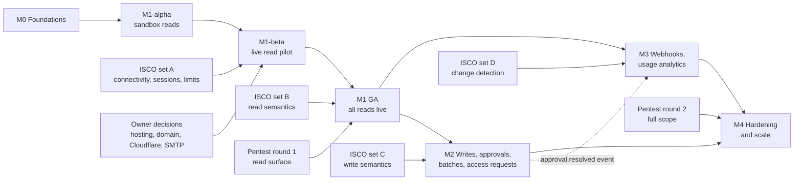

# 07 — Bawaba Delivery Plan and Milestones

> Status: draft v1 · 2026-11-03 · Binding input: [`00-decisions.md`](00-decisions.md): everything that **reads**
> data comes first (00 §9), and there is no billing, licensing, plans or quotas-for-billing in v1 (00 §2).
> Plans the delivery of [`01-architecture.md`](01-architecture.md), [`02-security.md`](02-security.md),
> [`03-api.md`](03-api.md), [`04-permissions-and-tokens.md`](04-permissions-and-tokens.md),
> [`05-operations.md`](05-operations.md) and the upstream reference [`../upstream/shamel-api.md`](../upstream/shamel-api.md).
>
> This document owns: milestone boundaries, the deliverables of each milestone, the measurable exit gates
> (acceptance criteria), the test strategy per milestone, risks, external dependencies (ISCO answers, owner
> decisions, vendors) and the effort estimate. It changes no design decision. Where the design documents disagree
> about when something ships, §13 records how this plan resolves it.

---

## 0. Conventions

| Term | Meaning |
|---|---|
| Milestone | M0 to M4. The content of M1, M2 and M3 follows 03 §0: **M1** = every read, **M2** = writes, batches, approvals and access requests, **M3** = webhooks. M0 (foundations) and M4 (hardening and scale) are added by this plan. |
| Increment | An internal, deployable cut inside a milestone (M1-α, M1-β). Increments have their own gates (§5.1). |
| GA | Exit of a milestone: every acceptance criterion met, release artifacts built, signed and published (02 §15.1), docs complete in Arabic and English, owner sign-off. |
| ew | Engineer-week: 5 focused days of one engineer, including unit and integration tests, code review and the English docs of the feature (§11.1). |
| References | "03 §9.1" = section 9.1 of `03-api.md`; "U Q18" = question Q18 of the upstream reference (U §7); "I-11" = ISCO question I-11 of 03 §27.3; "S8" = pipeline stage 8 (01 §6.3). |
| AC-Mx-nn | Acceptance criterion id. CI jobs and the release checklist cite these ids. |
| Reference node | 4 vCPU gateway node with same-DC Valkey RTT < 0.5 ms, the hardware profile of 01 §10.1. |
| Medium load | 1,000 req/min (00 §2), the workload of 05 §1.7. |

---

## 1. Planning principles

1. **Reads first (00 §9).** Nothing in M2 or M3 may delay M1. Write-related structures exist in the data model and
   the policy compiler from M1 (`vouchers:write:<type>` atoms, `writes_require_approval`, `access_requests:write`)
   so that tokens issued in M1 never need a migration. They do nothing until M2.
2. **Sandbox before live.** Increment M1-α gives AI agents `bwb_test_` tokens against `bawaba-mock` (01 §11) as
   early as possible. The owner's tools can then be built while live bring-up, ISCO answers and the edge setup
   are still in progress (00 §6: "owner switches a tool to a live token once trusted").
3. **Security gates every milestone.** It is not a phase at the end. The origin-leak suite blocks CI from the first
   route in M0 (02 §18.3). Fuzz targets run nightly from the first parser (02 §18.2). Each milestone ends with a
   threat-model delta review against 02 §4.
4. **Vertical slices.** M0 ends with a walking skeleton: one route through the whole pipeline. After that every
   feature lands end to end: spec change, generated code, upstream plan, tests, docs in both languages.
5. **Design-first contract (03 §24.1).** Every operation enters the OpenAPI document before code is written. The
   generator drops operations whose `x-bawaba-milestone` (03 §24.3) is later than the release's milestone from the
   route table and from the served spec, so docs and `llms.txt` never advertise a route that does not exist yet.
6. **ISCO answers are inputs, not blockers, where a safe fallback exists.** The fallbacks are calibration
   (01 §7.1), tolerant decoding (01 §7.4), provisional fields (03 §3.4) and fail-closed scoping (04 §4.2). §10 lists
   the few hard gates.
7. **Latent tenant from day one (01 §12).** No billing, licensing, plans or quota-for-billing fields anywhere
   (00 §2). No feature that 00 excludes: no business-data caching, no dry-run mode, no amount limits.

---

## 2. Overview

| Milestone | Goal | Key exit gate | Effort (ew, incl. 20 % contingency) | Calendar (3 engineers) |
|---|---|---|---|---|
| **M0 Foundations** | Repository, CI, config, keys, state stores, mock, contract skeleton, packaging | Walking skeleton `GET /v1/currencies` through the full pipeline against `bawaba-mock`, leak suite blocking | 20 | ≈ 7 weeks |
| **M1 Read API** | Every read endpoint live behind Cloudflare, with tokens, permissions, firewall, origin hiding, audit, docs, CLI, dashboard and alerts | All 03 §6.1 routes in production; leak suite clean; pentest round 1 with no open critical or high finding | 92 | ≈ 31 weeks (α in M1 week 14, β pilot from M1 week 24) |
| **M2 Writes** | Safe writes: idempotency, approval queue, batches, legacy writes, agent access requests, undo-friendly audit | Zero double posts under fault injection; approvals never bypassed; subset rule property-tested | 30 | ≈ 15 weeks (2 engineers, parallel to M3) |
| **M3 Expansions** | Webhooks engine and API, usage analytics UI, remaining alerts | No polling without subscribers; at-least-once delivery with permission filtering at send time | 20 | ≈ 17 weeks (1–2 engineers, parallel to M2) |
| **M4 Hardening & scale** | 01 §10 targets proven, chaos tests, topology C, full pentest, restore drills | All 01 §10.1 targets on the reference node; every 01 §13 failure mode automated | 22 | ≈ 7 weeks |
| **Total** | | | **≈ 184** (base ≈ 154) | **≈ 62 weeks** (≈ 14 months) |

Solid arrows are hard dependencies. The dotted arrow is partial: the webhooks engine needs only M1 GA, and only the
`approval.resolved` event (03 §16, §17.2) waits for the M2 approval queue.

---

## 3. Definition of done (applies to every deliverable)

- [ ] Spec first: the operation, schema, error and warning entries are in `api/openapi/` with the required `x-bawaba-*`
      extensions. Spectral lint and the forbidden-marker scan pass (03 §24.6).
- [ ] Generated code is committed and `go generate ./...` leaves a clean tree (03 §24.4).
- [ ] Unit tests (table-driven), integration tests against real PostgreSQL and Valkey (testcontainers) and the
      embedded mock, `goleak` clean, `-race` clean.
- [ ] Origin-leak suite extended to the new surface and green (02 §18.3). New parsers get a fuzz target (02 §18.2).
- [ ] Contract validation of every response in the integration suite (03 §24.6). Generated examples: at least one
      success and one error example per operation.
- [ ] Error, warning and event catalogue entries in English **and** Arabic. The i18n key check reports nothing
      missing (05 §6.3).
- [ ] Audit coverage: the feature's requests, upstream calls and admin actions produce the rows of 05 §1.2 and
      `admin_events` (02 §12.5).
- [ ] Metrics and structured logs with no secrets or bodies (05 §5.1–§5.2). CLI commands support `--json`
      (05 §7.2).
- [ ] Docs: guide section and reference updated in both languages. `bawaba docs lint` passes (05 §8.4).
- [ ] Configuration keys documented with defaults. Reload behaviour classified in the reload matrix (01 §15.4).
- [ ] Changelog entry (05 §8.1). Schema migrations follow the compatibility rules (05 §9.6).

---

## 4. M0 — Foundations

### 4.1 Goal

A buildable, testable and deployable empty product: every later feature plugs into a fixed repository layout,
configuration model, key hierarchy, state-store wiring, contract toolchain and mock. M0 ends with one route served
through the whole pipeline.

### 4.2 Deliverables

**Repository and CI**

- [ ] Single Go module with the layout of 01 §14 (`cmd/`, `internal/…`, `web/dashboard/`, `api/openapi/`,
      `deploy/`, `test/{e2e,load,chaos}/`, `tools/`). Go toolchain pinned (01 §14, 02 §15.1).
- [ ] CI pipeline (blocking on every PR): `go vet`, `staticcheck`, `gosec`, `golangci-lint` configuration,
      `go test -race`, `govulncheck ./...` (also nightly on `main`), and the custom analyzers of 02 §15.1 (banned
      `math/rand` in security packages, banned `err.Error()`/`http.Error` in response writers, banned non-strict JSON
      decoding, banned string-built JSON or SQL, restricted `Reveal()`).
- [ ] `tools/archcheck`: data-plane packages may not import control-plane handler packages (01 §1 principle 8,
      02 §12.1). Tenant guard: every sqlc query on a tenant-scoped table carries a `tenant_id` predicate (01 §12).
      The tenant guard is a proposal of this plan.
- [ ] Origin-leak suite **skeleton** (02 §18.3): `bawaba-mock` `hostile` profile with the canary set (unique
      `CANARY-<uuid>`, documentation IPs, `shamel-canary.invalid`, UNC and drive paths, ASP.NET/SQL exception text,
      LV-05 headers, redirects), the assertion library (canary scan, header allowlist subset, error-envelope schema)
      and a runner over every registered route. Blocking from the first route.
- [ ] Fuzz harness with committed corpora, nightly 10-minute runs. First targets: `FuzzStrictJSON` and
      `FuzzUpstreamDecode` (02 §18.2).
- [ ] Release pipeline: `CGO_ENABLED=0 -trimpath` reproducible builds for the platforms of 01 §4.1, CycloneDX
      SBOM, cosign keyless signing, SLSA provenance (02 §15.1). Renovate configured. `docs/deps.md` dependency review
      log.
- [ ] Benchmark harness: per-stage microbenchmarks with `benchstat` comparison (01 §10.4). The regression gate is
      enabled in M1.

**Configuration and keys**

- [ ] Bootstrap configuration (01 §15.1–§15.2): koanf layering (file, `BAWABA_` environment, `*_file` secrets),
      strict validation (unknown keys are errors, control listener must be loopback), `dev_mode` rules, SIGHUP for
      reloadable keys.
- [ ] Runtime configuration skeleton: `compiled_config` table and the loader with `atomic.Pointer` swap
      (01 §5.4). Content comes in M1.
- [ ] **Two key files** and envelope encryption (02 §9.2–§9.4, replacing the single-file delivery of 01 §15.3):
      `bawaba init` creates `master.key` (control plane only) and `data.key` (data plane only), the KEK tiers
      `KEK_control`/`KEK_data`, purpose keys, the encrypted record format with AAD (02 §9.3) and file permission
      checks. The data plane refuses to start if it can read `master.key`. `bawaba key status`.
- [ ] `internal/keyring` API used by every later component: `Seal(purpose, aad, plaintext)`, `Open(…)`,
      `MAC(purpose, …)`, with property tests for AAD binding (02 §18.1).

**State stores**

- [ ] PostgreSQL: `pgx/v5` + `pgxpool`, `sqlc`, goose migrations embedded in the binary, `bawaba migrate`. Roles
      `bawaba_migrate`, `bawaba_data` and `bawaba_control` with the grant model of 02 §12.4. `tenants` table with the
      single row `ten_default`. Daily range-partition helper (05 §1.3).
- [ ] Valkey: `valkey-go` client, key builder that always inserts the tenant segment and hash tags (01 §0), Lua
      script loader, ACL user per role, health probe. Deployment requirements checked by `doctor` (AOF
      `everysec`, `volatile-ttl`, 01 §13.2).
- [ ] Blob store interface with filesystem and S3-compatible (`minio-go`) backends, including the write-only
      credential mode for data nodes (05 §7.5).

**Mock, contract, skeleton, packaging**

- [ ] `bawaba-mock` (01 §11, 03 §21): the Shamel HTTP surface of every documented **read** endpoint and
      `/Main/Login` (U §4), with the quirks of U §7: header parameters with inconsistent casing, `filters` JSON in a
      header, form `obj`/`filters`, HTTP 500 with raw text for every error, sessions with expiry, salesman scoping and
      `getAll`, `lastupdatedate` filtering. Embedded mode (in-memory `RoundTripper`) and standalone binary and image.
      Write endpoints follow in M2.
- [ ] Deterministic Arabic fake dataset generator (01 §11): `sandbox.seed` + `sandbox.dataset_version`, PCG from
      `math/rand/v2`. Content: currencies, cities, stores, six price classes, salesmen, about 2,000 customers with
      Arabic names, about 5,000 items with Arabic and English names, groups, serials, stock per store, 24 months of
      vouchers of every type with consistent balances and account sheets.
- [ ] OpenAPI 3.1 skeleton (03 §24.2–§24.3): root document, components, `errors.yaml`, `warnings.yaml`, the Arabic
      overlay file, `.spectral.yaml` with the forbidden-marker scan, the `oasdiff` gate wired (baseline set at M1 GA).
- [ ] `cmd/bawaba-apigen` skeleton (03 §24.4): route table, operation metadata, strict query decoder, `apierr`
      constants, golden-file tests.
- [ ] Walking skeleton: request context, stage runner with all 17 stage slots (01 §6.3), operation registry
      (01 §6.1), error envelope (03 §22.1), `Bawaba-Request-Id`, and one operation (`currencies.list`) from the
      upstream client stub through normalization to the response, authenticated by a seeded test token.
- [ ] Packaging: distroless non-root Dockerfiles (02 §15.2), Compose bundles `single.yml`, `single-cloudflared.yml`
      and `connector.yml` (the last as a skeleton until the connector exists) (01 §4.1), systemd unit skeletons with
      `LoadCredential=` (02 §15.4), `bawaba-gateway healthcheck`.

### 4.3 Acceptance criteria

| Id | Criterion |
|---|---|
| AC-M0-01 | A clean clone builds and passes `make ci` in ≤ 15 min on the CI runner. `govulncheck` reports 0 reachable vulnerabilities. |
| AC-M0-02 | `docker compose -f deploy/compose/single.yml up` on a clean Linux host reaches healthy in ≤ 2 min. `GET /v1/currencies` with the seeded `bwb_test_` token returns mock currencies in the list envelope with `Bawaba-Request-Id`. |
| AC-M0-03 | `bawaba init` creates `master.key` and `data.key` with the ownership and modes of 02 §9.4. Tests prove that the gateway refuses to start on wrong permissions and that a data-plane process refuses to start when it can read `master.key`. |
| AC-M0-04 | Envelope round trips pass. Every AAD mismatch case of 02 §18.1 (row, column, tenant, purpose) fails to open. |
| AC-M0-05 | Plaintext scan: a PostgreSQL dump, Valkey dump and blob-store copy of the e2e environment contain none of the seeded plaintext canaries (test Shamel password, token secret). |
| AC-M0-06 | Mock determinism: the same seed and dataset version produce byte-identical dataset exports (SHA-256) on linux/amd64, linux/arm64 and windows/amd64. For 100 % of customers, the closing balance of the account sheet equals the customer balance. |
| AC-M0-07 | The mock serves every documented read endpoint and `/Main/Login` with the U §7 quirks. A quirk checklist test exists per quirk (Q1, Q5–Q9, Q13, Q14, Q17, Q18). |
| AC-M0-08 | The leak suite runs against the walking skeleton in the hostile profile and blocks the merge on a planted leak (verified by a deliberately failing fixture). |
| AC-M0-09 | The OpenAPI skeleton passes Spectral and the forbidden-marker scan. CI fails when generated code is stale. |
| AC-M0-10 | Release artifacts are reproducible (two builds give the same digest), signed and carry an SBOM. |

### 4.4 Test strategy

Unit and property tests for keyring, config validation and key builders. Integration tests with testcontainers
(PostgreSQL ≥ 15, Valkey ≥ 8, MinIO for S3). Golden-file tests for the generator and the dataset (hash of the export
per seed and version). The leak suite and fuzz harness start here and grow with every route. Cross-platform CI
runners (Linux, Windows) for the mock and the CLI from M0 on, because the connector, CLI and mock must run on
Windows (01 §4.1).

### 4.5 Risks and mitigations

| Risk | Impact | Mitigation |
|---|---|---|
| Mock fidelity diverges from the real Shamel (no live access yet; the manual shows C# classes, not wire JSON, U Q46) | Bugs surface only at live bring-up | Tolerant decoder by design (01 §7.4). Mock quirks are table-driven and switchable. The first live capture (M1-β) is diffed against the mock and corrections flow back. |
| `encoding/json/v2` still experimental in the pinned toolchain (01 §14) | API churn | Use `go-json-experiment/json` behind a thin internal package. Generated encoders limit the exposure. |
| Key-split complexity (two files, two KEK tiers, epoch DEKs) costs time later if it is done wrong | Rework across every component | Built and property-tested first, in M0. Every later component goes through `internal/keyring` only. |
| Disagreements between design documents (ports, edge mode names, key purpose names) | Inconsistent code | M0 resolves each into a constant, and the reconciliation notes in 01–05 point to the chosen spelling. |

### 4.6 Dependencies

- None on ISCO. Mock work is based on the transcribed manual (U §4–§7).
- Helpful but not blocking: any sample of real Shamel responses (U Q46) and error bodies (U Q1, Q15).
- Owner: choice of GitHub organization and module path (01 §14 placeholder), CI runner budget.

---

## 5. M1 — Read API

### 5.1 Goal and increments

Every read the owner listed in 00 §9 is available through `/v1` (and through `/legacy` for opted-in tokens), live,
behind Cloudflare, with the full security model, audit, docs, CLI, dashboard core and alerts. M1 is by far the
largest milestone, so it ships in three increments. Each increment is deployable and has its own gate.

| Increment | Content | Who uses it | Gate |
|---|---|---|---|
| **M1-α Sandbox reads** | All read routes, lists, snapshots, coalescing, search, combined endpoints against the embedded mock; tokens, policy, presets (CLI only); basic firewall; audit pipeline; English docs draft, OpenAPI, `llms.txt`; CLI token, preset, sandbox and agent commands. Hosted on a test hostname behind Cloudflare, with no live upstream configured. | The owner's AI agents with `bwb_test_` tokens | AC-M1-01, -02, -03, -04, -05, -07, -08, -09 in sandbox mode |
| **M1-β Live read pilot** | Connector and direct-URL mode, calibration, production hostname behind Cloudflare, full firewall, control plane and dashboard core, alerts, backups. Contract `1.0.0-beta.N` (03 §3.4). | The owner's tools on live tokens, **each with an IP allowlist restricted to the owner's own egress addresses** | AC-M1-06, -10 to -16, -19, -22, plus the α gates in connector and direct modes |
| **M1 GA** | Pentest round 1 passed and remediated, Arabic docs complete, provisional fields reviewed, contract `1.0.0` frozen. Live-token issuance without the pilot restrictions. | All tools | Every AC-M1 criterion |

The pilot restriction implements 02 §18.5 ("before go-live with live tokens"): β is a controlled pilot, and general
go-live is M1 GA. If the owner prefers the strict reading, pentest round 1 moves in front of β and β slips by the
vendor lead time (typically 2–4 weeks).

### 5.2 Deliverables

**A. Upstream access**

- [ ] Upstream client (01 §7): session manager with cluster-wide single-flight re-login and backoff (01 §7.1),
      header builder (01 §7.2, 02 §11.1), `obj`/`filters` form encoder (01 §7.3, 02 §11.2), tolerant streaming
      decoder (01 §7.4), outcome classifier with calibrated auth-failure signatures (01 §7.5), cluster-wide
      concurrency limiter with priority queue (01 §7.6), timeouts, retries for idempotent reads only and circuit
      breaker (01 §7.7–§7.9), connection pooling (01 §7.10).
- [ ] Transports: mock (in-memory), direct-URL (01 §8.7, hardening per 02 §8), tunnel (01 §8.1–§8.5). The
      cross-node relay (01 §8.6) is only needed in topology C and ships in M4.
- [ ] `bawaba-connector` (01 §8, 02 §7): WebSocket + inner mTLS 1.3 + yamux; internal PKI with CA signing in the
      control plane only (02 §7.2); enrollment with a one-time code and SAS confirmation (01 §8.2, 02 §7.3);
      credential custody and the session-holder protocol `single_holder`/`per_connector` (02 §7.5); compiled
      endpoint table and forwarding rules (01 §8.4, 02 §7.4); `writes: deny` default (02 §20.3); lifecycle and kill
      switch (02 §7.6); certificate rotation (02 §7.7); two-instance HA (01 §8.5); Linux systemd unit and Windows
      service with MSI (01 §4.1, §8.8); host hardening guide (02 §7.9).
- [ ] `bawaba upstream calibrate` (01 §7.1) and the owner-approved off-hours capacity calibration that sets
      `max_concurrency` at about 70 % of the measured knee (01 §10.4).
- [ ] Catalog media: presigned `GET /v1/media/{media_id}`, connector media fetch with root canonicalization and
      metadata stripping (03 §10.6, 02 §5.4).

**B. Read API**

- [ ] All 35 routes of 03 §6.1 with resources and field mappings per 03 §8–§13: name fixes (03 §4.1.1), decimal
      strings (03 §4.6), dates and business timezone (03 §4.5), null rules (03 §4.8), `include`/`fields` (03 §4.11).
- [ ] Combined endpoints (03 §14): customer overview, item stock across stores, item overview, through the plan
      executor (01 §7.11).
- [ ] Self-service: `GET /v1/me` and `GET /v1/me/requests` (03 §18.1–§18.2).
- [ ] Lists (03 §5): list envelope, cursor paging, snapshot lifecycle, filters and pushdowns, sorting,
      `updated_since` mapped to `lastupdatedate` (03 §5.7).
- [ ] Arabic search normalization `searchnorm.Key` (03 §5.6).
- [ ] Coalescing (local single-flight and distributed election), encrypted snapshots, token-bound views and sealed
      cursors (01 §9, 02 §20.1).
- [ ] Legacy read passthrough (03 §20, 01 §6.5): the 25 M1 paths of 03 §20.2, path canonicalization (02 §11.3),
      response encoding (03 §20.4), `/legacy/Main/Login` refusal (03 §20.5), token-gated legacy reference (05 §8.4).
- [ ] Sandbox (03 §21, 01 §11): environment routing invariant (S9), `Bawaba-Environment`, read fault scenarios of
      03 §21.3, `Server-Timing` for test tokens, placeholder media. The write overlay comes in M2.
- [ ] Errors and headers: full error catalogue with `message_ar` and `docs_url` (03 §22, 02 §10.9); response
      headers and request ids (03 §23.1–§23.3); CORS for publishable tokens (03 §23.5, 02 §10.7).

**C. Tokens, permissions and policy**

- [ ] Token formats, checksum, peppered hashes, constant-time lookup, kinds `tool`/`agent`/`publishable`,
      environments (02 §9.7, 04 §2.1–§2.3).
- [ ] Lifecycle (04 §2.4): create, instant revoke, optional expiry, 90-day unused flag, rotation, suspend and resume.
- [ ] Scopes and atoms (04 §3, 03 §2.3). Write atoms and `access_requests:write` parse and compile but have no
      routes yet.
- [ ] Data scopes with the enforcement matrix (04 §4, 03 §2.4), field hiding with groups (04 §5, 03 §2.5),
      upstream identity binding and salesman-bound credentials (04 §6), per-token IP rules (04 §7).
- [ ] Presets including the built-ins (04 §3.5). Promote to live with `bawaba token create --mirror` (04 §12).
      Publishable tokens (04 §13). Per-token rate limits with generous defaults (04 §14).
- [ ] Policy compilation, distribution and invalidation, emergency revocation, `token explain` (04 §9, 01 §5.4).

**D. Firewall, edge and origin hiding**

- [ ] Pipeline S1–S17 complete for reads (01 §6.3) in the order of 02 §10.1.
- [ ] Firewall (02 §10): global and per-token allow/deny lists (§10.2), auto-ban ladder with token containment
      (§10.3), abuse limits (§10.4), strict input validation (§10.5), size and time limits (§10.6), method,
      content-type and header rules (§10.7), response guards (§10.8), smuggling defenses (02 §11.4).
- [ ] Origin hiding (02 §5): invariants and response pipeline (§5.1–§5.2), every entry of the leak-vector register
      closed (§5.3), outbound hygiene (§5.5), upstream outcome to client error mapping (§5.6).
- [ ] Cloudflare edge (02 §6): Tunnel mode (default) and per-hostname Authenticated Origin Pulls mode (§6.1),
      client IP determination (§6.2), TLS (§6.3), zone settings, WAF rules and edge rate limits (§6.4–§6.6), the
      public path list of 03 §6.5, `deploy/cloudflare/` artifacts, `bawaba edge refresh-ranges`.
- [ ] Leak suite complete (02 §18.3): every `/v1` route, every legacy path, media, docs, OpenAPI, `llms.txt`,
      health, `/v1/me`, CLI agent output; in connector, direct and sandbox modes.

**E. Audit**

- [ ] The full audit pipeline of 05 §1: capture of every request and upstream call (§1.2); metadata rows with blind
      indexes (§1.3); content-addressed objects with record-aligned CDC, trained zstd dictionaries, epoch-DEK
      encryption and pack files (§1.4); ring, WAL, spool, backpressure and fail-closed behaviour (§1.5); retention
      classes, GC, compaction and caps (§1.6); cold metadata segments (§1.8); integrity chain and anchors (§1.9);
      control-plane search, decrypt and export (§1.10).

**F. Control plane, dashboard and CLI**

- [ ] Control plane (02 §12): separate process and user, loopback only, Cloudflare-header tripwire (§12.1); owner
      authentication with Argon2id, TOTP, lockout and sessions (02 §9.8); step-up and the admin event log (§12.5);
      PostgreSQL and Valkey role separation (§12.4).
- [ ] Dashboard core (05 §6): Overview, Tokens with Presets and the Behaviour tab, Upstreams & connectors, Firewall,
      Audit explorer, Alerts (recipients, firing instances, history, test mail), System. Arabic and English with
      RTL (05 §6.3), strict CSP (02 §12.2), server-side SVG charts.
- [ ] CLI core (05 §7): local owner mode through socket peer credentials and `bawaba login` (§7.1); remote agent
      mode basics (`me`, `usage` for the own token, `api`, `docs`, `doctor`, `version`, `sandbox reset` for the own
      namespace); output contract and exit codes (§7.2); command groups `init`, `migrate`, `doctor`, `status`,
      `owner`, `lockdown`, `security events`, `token`, `preset`, `firewall`, `upstream`, `connector`, `pki`, `audit`,
      `alerts` (list, recipients, silence, test), `key`, `backup`, `restore`, `sandbox`, `edge`, `config`, `system`,
      `completion` (§7.3).

**G. "Inform the AI", docs and alerts**

- [ ] `RateLimit-*` headers with per-token GCRA (05 §4.2, S6). `Bawaba-Warning` with heuristics H1–H8, behaviour
      score and `token_flags` (05 §4.3). `/v1/me` hints (05 §4.4). Owner visibility (05 §4.5). Usage rollups
      `usage_1m/1h/1d` and `upstream_1m/1h` (05 §5.6). Until M3 the warning `use_webhooks` is not emitted, and H2 and
      H3 point to `use_updated_since` and `use_cursor_snapshot` instead (§13).
- [ ] Bilingual docs site (05 §8, 03 §24.5): `tools/docsgen`, vendored Scalar reference, guides in English and
      Arabic (quickstart, authentication and tokens, scopes and permissions, pagination and snapshots, rate limits
      and warnings, errors, sandbox, AI integration guide, changelog, glossary), error and warning pages, OpenAPI
      `en`/`ar`, `llms.txt` and `llms-full.txt`, the build-time docs lint and the runtime guard (05 §8.4), generated
      examples (03 §24.6).
- [ ] Alert pipeline (05 §3.1–§3.2, §3.4–§3.5): event-driven and threshold alerts, dedup, throttling, escalation,
      security batch window, hourly warning digest and daily security digest with audit anchors, SMTP mailer. The
      M1 catalogue subset:
  - Security: `auth_failure_burst`, `ip_auto_banned`, `token_auto_suspended`, `token_probe_suspected`
    (02 §20.1), `scope_probe`, `enumeration`, `origin_leak_guard`, `security_invariant_violation`,
    `control_plane_tripwire`, `connector_clone_suspected`, `shamel_credentials_exposed`, `lockdown_active`,
    `owner_login_failures`.
  - Health: `connector_disconnected`, `shamel_down`, `shamel_slow`, `circuit_open`, `shamel_login_failed`,
    `plaintext_upstream_in_use`, `edge_ranges_stale`, `node_down`, `dependency_unavailable`, `config_stale`,
    `cert_expiry`, `clock_skew`, `audit_storage_near_cap`, `audit_spool_filling`, `audit_unavailable`,
    `audit_gap_detected`, `backup_failed`, `backup_stale`, `key_backup_unverified`, `schema_drift`.
  - Inform the AI: `abusive_tool`, `rate_limited_sustained` (00 §8: owner e-mail alerts on abusive tokens).

**H. Operations**

- [ ] Observability: Prometheus metrics, slog JSON logs with redaction, optional OTLP tracing, health and readiness
      endpoints (01 §10.3, 05 §5.1–§5.4).
- [ ] Backups (05 §9.1–§9.3): `backup create/list/verify`, `backup blobs sync`, off-site target, `key export`,
      `key verify --record`, `key restore`, `restore`. One manual restore rehearsal before GA. Automated drills
      come in M4.
- [ ] Upgrade and migration rules (05 §9.6) applied from the first production release.
- [ ] Incident runbook commands available and rehearsed once (02 §17): lockdown, emergency revoke, connector kill,
      key rotation.

### 5.3 Acceptance criteria

| Id | Criterion |
|---|---|
| AC-M1-01 | **Coverage.** The 35 routes of 03 §6.1, `GET /v1/me`, `GET /v1/me/requests`, `/docs`, `/healthz` and the 25 M1 legacy paths of 03 §20.2 answer per spec. Contract validation reports 0 violations over the whole e2e suite. Every operation has at least one success and one error example. |
| AC-M1-02 | **Origin hiding.** The leak suite reports 0 findings in connector, direct and sandbox modes, and it was green on every PR merged in the 4 weeks before GA. |
| AC-M1-03 | **Shared snapshots (02 §18.4).** Over at least 10,000 coalesced page walks by tokens with different data scopes and field masks on the same credential: exactly one upstream call per generation, 0 hidden-field canaries in any response, every returned record inside the token's data scope. Replayed cursors or views give `invalid_cursor` or `cursor_invalidated`, never data. |
| AC-M1-04 | **Sandbox isolation.** The live-upstream canary counter stays at 0 for every test-token request in the e2e and load suites (01 S9, 02 §18.4). |
| AC-M1-05 | **Policy.** Property tests run at least 1,000,000 random (policy, request) cases nightly with 0 violations of the deny-by-default guarantees (04 §9.5). |
| AC-M1-06 | **Revocation.** Over 1,000 revocations: propagation p99 < 1 s with pub/sub, ≤ 5 s with Valkey unavailable (01 §5.4). |
| AC-M1-07 | **Coalescing.** 200 identical concurrent requests spread over 2 nodes cause exactly 1 upstream call per generation (01 §10.4 scenario 3). |
| AC-M1-08 | **Snapshots.** Pages 2..N cause 0 upstream calls within the snapshot TTL. An expired cursor returns the 409 code of 03 §22.2. With Valkey down, multi-page results return `503 pagination_unavailable` and are never silently truncated (01 §13.2). |
| AC-M1-09 | **Arabic search.** 100 % pass on a golden corpus of at least 200 cases that covers all 12 normalization steps of 03 §5.6, built from mock dataset names (for example `احمد` matches `أحمد`, `مدرسة` matches `مدرسه`). |
| AC-M1-10 | **Performance (M1 gate; the full targets are M4).** On one reference node with the embedded mock at 0 ms and full audit: gateway overhead p99 ≤ 5 ms for responses ≤ 64 KiB, at least 2,500 small authenticated reads/s, and 1 h at 10× medium load (10,000 req/min) with 0 non-injected 5xx. The nightly `benchstat` gate (> 10 % regression fails) is active. |
| AC-M1-11 | **Firewall.** Every 02 §10.3 signal fires exactly at its default threshold in integration tests. A ban is effective on all nodes within 1 s. Publishable tokens are never suspended. Spoofed `CF-Connecting-IP`/`X-Forwarded-For` from a non-Cloudflare peer is ignored (02 §18.4). |
| AC-M1-12 | **Audit.** In a 1,000,000-request run, `audit_events` rows equal requests (0 missing) and every upstream call has its row. Stored bytes per day on the synthetic 05 §1.7.1 mix are within 1.5× of the 05 §1.7.3 estimate. With the spool full, requests get `503 audit_unavailable` (or metadata-only when the owner opted in), never silent loss. |
| AC-M1-13 | **Crypto at rest.** Dumps of PostgreSQL, Valkey and the blob store from the e2e and pilot environments contain no plaintext canary. Without `master.key` and `data.key` no audit body opens (02 §18.5 item 11, automated). |
| AC-M1-14 | **Edge.** In Tunnel mode a port scan of the origin host finds no listening public TCP port. In AOP mode a TLS handshake without the per-hostname client certificate fails. |
| AC-M1-15 | **Connector.** The Shamel host opens no inbound port. Reconnect ≤ 10 s after a gateway restart. Install, upgrade and uninstall of the Windows service pass on Windows Server 2019 and 2022. A 72 h soak with 2 instances shows 0 failed reads caused by the tunnel. |
| AC-M1-16 | **Alerts.** Every M1 alert id is triggered end to end in tests and delivered to a capture SMTP server. Critical alerts arrive ≤ 60 s after the condition. A burst of bans produces one summary per batch window. |
| AC-M1-17 | **Docs.** `bawaba docs lint` reports 0 findings. The runtime guard is active. Every error and warning code has an English and an Arabic page. The i18n check reports 0 missing keys. `llms.txt` is reachable through the Cloudflare path allowlist. |
| AC-M1-18 | **Dashboard.** All core pages are available in Arabic and English. The RTL stylesheet lint finds 0 physical properties. Headless-browser tests see 0 CSP violations. Every step-up action of 02 §12.5 demands step-up (one test per action). |
| AC-M1-19 | **CLI.** Every command supports `--json`, with golden snapshot tests of the output schema and exit codes per 05 §7.2. Remote mode refuses owner-only commands with exit code 4 without contacting the server. |
| AC-M1-20 | **Pilot.** At least 14 days of M1-β with at least two owner tools on live reads, 0 open sev-1 or sev-2 incidents, `max_concurrency` set from calibration, and the live-capture diff against the mock resolved. |
| AC-M1-21 | **Pentest round 1** (read surface, 02 §18.5 items 1–6 and 8–12) closed with 0 open critical or high findings. Mediums have an owner-accepted remediation plan. |
| AC-M1-22 | **Backups.** Daily backups green for 7 consecutive days. The master-key backup is verified (`key verify --record`). One manual restore to a scratch host passed the spot checks of 05 §9.3 step 7. |
| AC-M1-23 | **Contract.** `1.0.0` frozen in `api/openapi/released/`. Provisional fields reviewed against the ISCO answers received (03 §3.4). The `oasdiff` breaking-change gate is active. |

### 5.4 Test strategy

| Layer | What runs | When |
|---|---|---|
| Unit and property | Policy engine, data-scope matrix, field masks, token parsing, error mapper ("no upstream substring ≥ 4 chars" property), crypto, CORS, control-plane request checks (02 §18.1) | every PR |
| Fuzz | `FuzzTokenParse`, `FuzzLegacyPath`, `FuzzHeaderBuilder`, `FuzzStrictJSON`, `FuzzObjSerializer`, `FuzzUpstreamDecode`, `FuzzCursor`, `FuzzMediaPath`, `FuzzTunnelFrame`, `FuzzConnectorScrub`, `FuzzCIDRRules` (02 §18.2) | nightly, 10 min each |
| Golden normalization | Mock dataset → expected `/v1` JSON per operation and per legacy path | every PR |
| Integration and e2e | testcontainers PostgreSQL, Valkey, MinIO; embedded and external mock; two gateway nodes; connector in a container and on a Windows runner | every PR (smoke), nightly (full) |
| Adversarial | Shared snapshots, edge trust, isolation of the data-plane user, smuggling (h2spec and smuggling tools, `slowhttptest`), connector frame and enrollment attacks (02 §18.4) | nightly |
| Contract | `libopenapi-validator` over every response; examples regenerated and diffed | every PR |
| Leak suite | Hostile mock, three modes (02 §18.3) | every PR, blocking |
| Load (baseline) | k6 scenarios 1–4 and a 4 h soak (01 §10.4) | nightly |
| Live capture | Owner-approved, off-hours, read-only capture of each upstream endpoint; structural diff against the mock; calibration | once at β start, again after each ISCO answer set |
| DAST | OWASP ZAP API scan from the OpenAPI document and nuclei templates against the sandbox deployment (02 §18.4) | each release candidate |
| Timing | Latency distributions for unknown, revoked, malformed and forbidden tokens; Kolmogorov–Smirnov check (02 §18.4) | nightly, informative |

### 5.5 Risks and mitigations

| Risk | Impact | Mitigation |
|---|---|---|
| M1 is large (≈ 77 base ew) | Late value for the owner | Increments α and β; agents start building on the sandbox at α. The levers in §11.5 can move items to an M1 point release without touching security gates. |
| Where Shamel runs is unknown (00 §2) | Wrong transport built first | Both connector and direct-URL mode are in M1. Transport is a `RoundTripper` behind one interface, so the choice is per upstream configuration. |
| Shamel capacity is small or unknown (U Q47) | Gateway load harms Shamel | Cluster-wide limiter with queueing (01 §7.6), default `max_concurrency = 8` until the calibration run, background work at low priority. |
| Session semantics unknown (second login may invalidate the first, U Q14) | Login flapping between nodes or connectors | Shared session through Valkey (01 §7.1) and the `single_holder` session-holder protocol by default (02 §7.5). Calibration measures the behaviour. |
| Undocumented response shapes (`GetSalesmen` U Q24, `GetCustomerPricesAsRows` U Q25, enums U §6.4) | Contract churn after GA | Provisional fields (03 §3.4) frozen at GA. Later improvements are added as new fields, never renames. |
| `image_path` format unknown (U Q26) | Media route slips or leaks | Media is fetched by the connector from configured roots only, with presigned public URLs (02 §5.4). If the answer is late, `include=images` returns metadata only and `/v1/media` follows in a point release. |
| Record-level dedup depends on stable upstream serialization (05 §11 assumption 1) | Audit storage 4–5× higher than estimated | `bawaba audit stats` from the first live day; caps and alerts at 70/85/95 %; retention is runtime-adjustable. |
| Salesman scoping per endpoint unknown (U Q17) | Data leak for salesman-bound tokens | Data scope is enforced by Bawaba regardless of Shamel (04 §4). Unknown cases fail closed. |
| Windows environment variance at the office | Connector install problems | MSI plus a `service install` command, `bawaba doctor` on the connector host, signed binaries, tests on two Windows Server versions. |
| Arabic quality of docs and UI | Owner and users mistrust the product | Native-speaker review is part of the definition of done. Glossary-driven translation. |
| Cloudflare misconfiguration exposes the origin | Breaks the core requirement (00 §4) | Tunnel mode by default (no inbound port), AC-M1-14 scan, `doctor` edge checks, pentest recon (02 §18.5 items 1–2). |

### 5.6 Dependencies

- **M0** complete.
- **ISCO set A (hard gate for M1-β; §10):** how Shamel is reachable, HTTPS, methods per endpoint, session lifetime
  and second-login behaviour, login failure format, lockout policy, rate and concurrency limits, maximum response
  sizes, API-only user. Fallback for most items: calibration and conservative defaults. "Where is Shamel" has no
  fallback; it decides connector versus direct mode and Windows packaging priority.
- **ISCO set B (wanted before M1 GA):** read semantics that decide provisional field names and `updated_since`
  behaviour. If missing at GA, names freeze as neutral provisional names (03 §3.4).
- **Owner decisions before M1-β:** hosting (00 §2 "decide later", 01 §4.5 topology A or B), public domain and
  Cloudflare account, SMTP relay (05 §3.5), access to the Shamel host for the connector, an off-site backup target
  (05 §9.1), a Shamel API account (02 §20.2 item 5).
- **Vendors:** pentest firm booked about 6 weeks ahead of the planned window; Authenticode code-signing
  certificate for the Windows connector (02 §15.1); Arabic technical reviewer.

---

## 6. M2 — Writes

### 6.1 Goal

Tools can create customers, items, cost centers and the 13 voucher types safely: never a double post, never a
write the token is not entitled to, owner approval where configured, a complete undo-friendly record. AI agents can
request tokens and permission changes, and only the owner approves (00 §6).

### 6.2 Deliverables

- [ ] Write routes of 03 §6.3: `POST /v1/customers`, `/v1/items`, `/v1/cost-centers` and
      `/v1/vouchers/{voucher_type}` with the per-type rules matrix, code-prefix rules and Bawaba-owned fields
      (03 §15.4–§15.7); voucher-type atoms (04 §3.3); data-scope write validation (04 §4.6).
- [ ] Write path additions of 01 §6.4: mandatory `Idempotency-Key` with the semantics of 03 §15.2, Valkey record
      with the `audit_writes` unique-key backstop, synchronous write-ahead audit, never-retry, `504
      write_outcome_unknown` with owner reconciliation.
- [ ] Approval queue (04 §11, 03 §15.3, §16): held-write rules (04 §11.1), encrypted pending-write record (§11.2),
      state machine (§11.3), owner view as a business document (§11.4), re-validation (§11.5), submission without
      double posting (§11.6), outcome record (§11.7), tool notification (§11.8), sandbox approvals (§11.9);
      `/v1/approvals*`; dashboard page "Write approvals"; CLI `approval`.
- [ ] Batches: `POST /v1/batch` (03 §15.8); one approval of kind `batch` for approval-required tokens (04 §11.1);
      CLI exit code 9 for partial completion.
- [ ] Legacy writes: the 4 M2 paths of 03 §20.2 with the handling of 03 §20.3, including
      `approval_not_supported_in_legacy` and `legacy.require_idempotency_key`.
- [ ] Agent access requests (03 §18.3, 04 §10, 02 §13): endpoints of 03 §6.2 marked M2, subset rule (04 §10.3),
      state machine (04 §10.4), owner review with narrowing (04 §10.5), notification (04 §10.6), secret delivery
      sealed to the agent's X25519 key and claimed once (04 §10.7, 02 §13.3), prompt-injection and approval-fatigue
      controls (04 §10.8); dashboard page "Access requests"; CLI `access-request` and `request-token`.
- [ ] Mock write endpoints and the sandbox write overlay (01 §11, 03 §21.2) with the write fault scenarios
      `timeout`, `rejected`, `outcome_unknown`, `approve_after_10s` and `reject_after_10s` (03 §21.3).
- [ ] Undo-friendly audit (00 §6): write history per token, customer and voucher with full payload and Shamel
      reference id (05 §1.3.4 `audit_writes`); outcome record per 04 §11.7. Shamel writes are insert-only (U Q43),
      so the dashboard offers a "compensating document" guide (the reverse voucher type to post, prefilled from the
      recorded payload, created as a new write through the normal approval path) and export.
- [ ] Connector write enablement: a documented local act on the Shamel host that switches `writes: deny` to allow
      (02 §20.3).
- [ ] Alerts: `access_request_pending`, `write_approval_pending`, `write_outcome_unknown`, `write_anomaly`,
      `token_pickup_anomaly` (05 §3.3, 02 §13.4).
- [ ] Docs in both languages: writes and idempotency, approvals, access requests, AI integration guide update,
      example 03 §25.2.

### 6.3 Acceptance criteria

| Id | Criterion |
|---|---|
| AC-M2-01 | All write routes and all 13 voucher types pass contract tests. The per-type matrix is tested with at least 1 valid and 3 invalid documents per type. |
| AC-M2-02 | **Idempotency.** Same key and body: identical stored response with `Bawaba-Idempotent-Replay`. Different body: `409 idempotency_conflict`. Concurrent duplicate: `409 request_in_progress`. Valkey down: `503`, fail closed (01 §6.4, §13.2). |
| AC-M2-03 | **No double posting.** 10,000 writes against the mock with injected timeouts, connector drops and node kills create 0 duplicate documents on the mock side. Every ambiguous case surfaces as `write_outcome_unknown` plus a critical alert. |
| AC-M2-04 | **Write-ahead audit.** Kill-point tests at every step of 01 §6.4 show 0 upstream writes without a preceding `audit_writes` row. |
| AC-M2-05 | **Approvals.** Held writes reach the mock 0 times before approval. An approval causes exactly 1 upstream submission. A policy change between hold and approval is caught by re-validation (04 §11.5). Expired approvals never execute. |
| AC-M2-06 | **Subset rule.** At least 1,000,000 random grant pairs nightly with 0 violations (02 §18.1). No route or command lets an agent token approve (all return 403 or exit code 4). A test agent cannot request a live token (04 §12). |
| AC-M2-07 | **Secret delivery.** A secret is claimable exactly once, only by the requesting agent, encrypted to its key. `token_pickup_anomaly` fires on an IP mismatch. |
| AC-M2-08 | **Legacy parity.** For the same document, `/legacy` and `/v1` writes produce identical upstream `obj` payloads (golden test). |
| AC-M2-09 | **Live verification.** Supervised first live writes (at least one per write operation the owner's tools use) reconcile with Shamel by reference id, 100 % match. Connector writes were enabled locally by the owner. |
| AC-M2-10 | **Security review** of the write path and the approval and access-request UIs (XSS, bidi spoofing and untrusted-text rendering per 02 §12.2): 0 open high findings. Leak suite extended to write and approval responses: 0 findings. |
| AC-M2-11 | Docs, examples and error pages complete in both languages. |

### 6.4 Test strategy

Property tests for the subset rule and the voucher matrix. Fault injection (toxiproxy, connector kill, node kill,
Valkey restart with AOF) around each step of the write path. Mock-side duplicate detector keyed by payload hash.
Golden tests for `obj` serialization (02 §18.2 `FuzzObjSerializer`). Browser tests of the approval pages with
hostile agent-written text. Sandbox scenarios exercise the client-side reconciliation guidance. Before M2 GA, a
live capture of each write type in an owner-supervised window, because the per-type rules are conservative
assumptions until verified (03 §27.2).

### 6.5 Risks and mitigations

| Risk | Impact | Mitigation |
|---|---|---|
| Shamel has no idempotency (U Q39) | Duplicate accounting documents after a timeout | Idempotency records, write-ahead audit, never-retry, `write_outcome_unknown` with reconciliation (01 §6.4). Duplicate detection by `manual_code` once ISCO confirms rejection behaviour (I-6). |
| Per-type voucher rules are uncertain (U Q40, Q41; I-3 to I-7, I-14, I-17) | Rejected or wrong vouchers | Conservative defaults adjustable at runtime (03 §27.2), live capture before GA, approval queue default for agent-born tokens (04 §11.1). |
| Writes are insert-only (U Q43) | "Undo" cannot delete | Compensating-document workflow plus the complete record; documented limits. |
| Approval fatigue or prompt injection through request reasons | Owner approves too much | Machine-generated permission diffs, untrusted-text rendering, rate limits on requests (04 §10.8, 02 §13.4). |
| Shamel salesman scoping on writes unknown (04 §17.3 item 3) | Writes outside a salesman's customers | Bawaba data-scope validation on writes (04 §4.6) independent of Shamel. |

### 6.6 Dependencies

- **M1 GA.** Start of the write path may overlap the end of M1 once pipeline, audit and policy are stable (after
  M1-β).
- **ISCO set C (hard gate for live writes of the affected types; §10).** Without the answers, the types concerned
  stay sandbox-only or approval-only.
- Owner: decision on which tokens use the approval queue, connector write enablement on the Shamel host.

---

## 7. M3 — Expansions

### 7.1 Goal

Replace tight polling with change events (webhooks), give the owner full usage analytics, and complete the alert
catalogue. Webhooks are driven by Bawaba polling Shamel every 5 minutes by default, only for subscribed events
(00 §9).

### 7.2 Deliverables

- [ ] Webhooks engine (05 §2): poll streams with Valkey leases and the PostgreSQL epoch fence (§2.3); detectors for
      customers and items, stock, customer balances, vouchers and order status (§2.4); event store and cycle commit
      (§2.5); fan-out with permission filtering at send time (§2.6, 04 §5.6); push delivery with `Bawaba-Signature`,
      retries, dead letters, SSRF protection and origin hiding (§2.7, 02 §9.9); pull mode (§2.7.5); sandbox
      generated activity (§2.8); configuration (§2.9).
- [ ] Webhooks API (03 §6.4, §17): 11 routes, `GET /v1/event-types` (03 §17.2), the `approval.resolved` event
      (03 §16), scopes `webhooks:read`/`webhooks:write`, the `webhook_consumer` preset (04 §3.5).
- [ ] "Inform the AI" completed: `use_webhooks` warnings and `x-bawaba-webhook-events` guidance switched on
      (05 §4.2, §4.6).
- [ ] Dashboard page "Webhooks" and CLI group `webhook` (05 §6.4, §7.3).
- [ ] Usage analytics UI (05 §6.4): requests, errors and latency by token, operation and time; top consumers;
      warnings by code; behaviour scores; drill-down into the audit explorer. Owner-wide `bawaba usage`.
- [ ] Remaining alerts: `webhook_endpoint_failing`, `webhook_detection_stalled`, `token_near_expiry`, `token_unused`
      (the dashboard flag exists since M1; this adds the weekly e-mail), deprecation digest (03 §3.5). Alert
      administration UI: rule editing, quiet hours, silences (05 §3.2, §6.4).
- [ ] Grafana dashboards and Prometheus rules (05 §5.5).
- [ ] Docs in both languages: webhooks guide with signature verification in Go, Node.js, Python, C# and PHP plus
      test vectors, event pages (05 §8.1).

### 7.3 Acceptance criteria

| Id | Criterion |
|---|---|
| AC-M3-01 | With no active subscription, detectors make 0 upstream calls (counter test, 00 §9). |
| AC-M3-02 | Detection latency p95 ≤ `poll_interval` + 60 s from a change in the mock to event creation, for every detector. Delivery p95 ≤ 10 s after detection to a healthy receiver. |
| AC-M3-03 | At-least-once delivery: with worker and node kills and receiver outages up to 24 h, 0 events are lost. Redeliveries carry the same event id. |
| AC-M3-04 | Permission filtering at send time: a token that hides a field receives no event whose only change is in that field; data scope filters rows; after a scope removal deliveries stop within the configuration propagation bound (01 §5.4). |
| AC-M3-05 | SSRF suite: private, link-local, metadata, DNS-rebinding and redirect targets are all refused (02 §18.4). |
| AC-M3-06 | Signature test vectors verify in all five documented languages. |
| AC-M3-07 | Webhook polling runs in the background priority class, never exceeds its share of `max_concurrency` and is throttled first when Shamel saturates (01 §7.6). |
| AC-M3-08 | Leak suite covers webhook deliveries and pull events (02 §18.3): 0 findings. |
| AC-M3-09 | Usage UI figures equal direct rollup queries (cross-check test). |
| AC-M3-10 | 14 days of live webhook operation for at least one owner tool with no `webhook_detection_stalled` alert left unexplained, and the daily reconciliation differences explained. |

### 7.4 Test strategy

Detector tests against a scripted mock that mutates its dataset on a timeline (creates, updates, back-dated
vouchers, deletions). Leader-failover tests with lease expiry and fencing. Receiver harness with failure, latency
and redirect profiles. SSRF corpus. Language-specific signature verifiers run in CI containers. Upstream call
budget asserted from the limiter metrics.

### 7.5 Risks and mitigations

| Risk | Impact | Mitigation |
|---|---|---|
| `lastupdatedate` semantics unclear (U Q18, I-11) | Missed or duplicate events | Overlap windows, keyed record hashes and daily full reconciliation (05 §2.4.1). |
| Deletions are not observable (05 §11) | Missing `*.removed` events | `not_returned_by_upstream` detection by full reconciliation (03 §17.2), documented latency. |
| Polling load on Shamel | Slows interactive reads | Only subscribed detectors, background class, phase spreading (05 §2.3), minimum interval 1 min. |
| Push deliveries reveal the gateway's IP | Origin exposure | Owner-allowlisted hosts or an egress proxy (05 §2.1, §2.7.4). Pull mode as the default recommendation for dashboards. |

### 7.6 Dependencies

- **M1 GA** for the engine. **M2** only for `approval.resolved`.
- **ISCO set D** (§10). Without answers, detectors run with the conservative overlap settings and full
  reconciliation, at a higher upstream cost.
- Owner: allowlisted webhook receiver hosts, or an egress proxy.

---

## 8. M4 — Hardening & scale

### 8.1 Goal

Prove the performance targets and failure behaviour of 01 §10 and §13 instead of asserting them, make the scaled-out
topology C operable, pass the full external penetration test and make restore drills routine.

### 8.2 Deliverables

- [ ] Load test suite complete: all nine scenarios of 01 §10.4 on fixed reference hardware, nightly, PGO profile
      committed (`cmd/bawaba-gateway/default.pgo`), results in `test/load/results/`.
- [ ] Chaos suite in `test/chaos/`: one automated scenario per row of 01 §13.1, per function of 01 §13.2 and for
      clock skew (01 §13.3), using toxiproxy, process kills and disk-full fixtures.
- [ ] Topology C (01 §4.4): cross-node relay (01 §8.6), node registry and per-node concurrency shares when the cap is
      smaller than the node count (01 §5.5, §7.6), separate control node, load-balancer health and drain (≤ 95 s),
      rolling-deploy procedure, Valkey Cluster hash-tag validation, S3 blob store with write-only data-node
      credentials, managed PostgreSQL HA. Deployment guide and capacity sizing table from measured results.
- [ ] External penetration test round 2: the complete 02 §18.5 checklist, including writes, approvals, agent
      escalation, webhooks, topology C and the crypto-at-rest scenario with `data.key`. Remediation and retest.
      Yearly cadence set up afterwards.
- [ ] Restore drills: automated monthly `bawaba restore drill` (05 §9.4), the `restore_drill_overdue` alert,
      rehearsal of the disaster scenarios of 05 §9.5 (host loss in topology A or B, PostgreSQL corruption with
      PITR, blob-store loss, ransomware tabletop with the 02 §17 runbook).
- [ ] Security extras: timing tests promoted from informative to gating where the distributions are stable;
      expanded fuzz corpora; OSS-Fuzz integration (02 §18.2, optional).

### 8.3 Acceptance criteria

| Id | Criterion |
|---|---|
| AC-M4-01 | Every 01 §10.1 target on the reference node: overhead p50/p99/p99.9 ≤ 1/5/15 ms for responses ≤ 64 KiB; ≥ 5,000 small reads/s with full audit; ≥ 10,000 cursor page reads/s; ≤ 8 ms extra per MiB of upstream JSON; per-request heap for large lists ≤ 2 × chunk + output buffer. |
| AC-M4-02 | Horizontal scaling to 8 nodes ≥ 85 % of linear. |
| AC-M4-03 | 24 h soak: heap, goroutines and file descriptors flat (no positive trend beyond noise), `goleak` clean. |
| AC-M4-04 | 100 % of the rows of 01 §13.1 and functions of 01 §13.2 are automated scenarios that assert the documented client behaviour and the owner alert. |
| AC-M4-05 | Rolling deploy of a 3-node cluster under steady load: 0 failed requests. Killing one node: only that node's in-flight requests fail, and its connectors reconnect elsewhere within 10 s. |
| AC-M4-06 | Under 10× overload of tool traffic, Shamel's observed concurrency (connector-side counter) never exceeds `max_concurrency`. Clients get `503 upstream_busy` with `Retry-After`, never cascading timeouts. |
| AC-M4-07 | Pentest round 2: 0 open critical or high findings after retest. |
| AC-M4-08 | Automated restore drill green. Measured single-node RTO ≤ 2 h; RPO per 05 §9.5 (≤ 5 min where WAL archiving is enabled). |

### 8.4 Test strategy

Dedicated load environment with the reference node profile and a mock latency profile (`p50=80ms,p99=600ms`,
20,000 customers, 50,000 items, 01 §10.4). Chaos scenarios run weekly and before every release. Pentest in a
sandbox-plus-pilot environment with the scope of 02 §18.5. Drills on scratch infrastructure.

### 8.5 Risks and mitigations

| Risk | Impact | Mitigation |
|---|---|---|
| No stable reference hardware | Noisy, non-comparable results | Fixed instance type, pinned kernel and Go version, CPU governor fixed, results stored with environment fingerprint. |
| Pentest findings that need redesign | Late, expensive changes | Pentest round 1 in M1, threat-model reviews per milestone, DAST on every release candidate. |
| Topology C needs managed PostgreSQL and Valkey that the owner may not have chosen yet | Blocks AC-M4-05 | Topology C is validated on a test cluster; production use stays optional (01 §4.5: only for sustained heavy load or HA). |
| Load tests against the real Shamel could harm it | Outage of the accounting system | Load tests use the mock only. The one live calibration run is low-rate, off-hours and owner-approved (01 §10.4). |

### 8.6 Dependencies

- **M2** and **M3** complete (the full surface is in scope for pentest round 2 and load scenario 5).
- ISCO: U Q47 (limits), to size realistic upstream profiles; ISCO or IT consent if pentest recon covers the Shamel
  host (02 §18.5 item 1).
- Vendors and infrastructure: pentest firm, load environment, test cluster with an S3-compatible store.

---

## 9. Test strategy across milestones

| Test type | M0 | M1 | M2 | M3 | M4 |
|---|---|---|---|---|---|
| Unit and property (02 §18.1) | keyring, config | policy, tokens, firewall, error mapper | subset rule, voucher matrix | detectors, signatures | — |
| Fuzz (02 §18.2) | 2 targets | all read-path targets | `FuzzObjSerializer` on writes | webhook URL validation | corpora growth, OSS-Fuzz |
| Origin-leak suite (02 §18.3) | skeleton, blocking | complete, three modes | write and approval responses | deliveries and pull events | topology C |
| Contract (03 §24.6) | skeleton | every response | writes | webhooks | — |
| Adversarial (02 §18.4) | — | edge, isolation, snapshots, smuggling, connector | idempotency, approval bypass, agent escalation | SSRF | timing gating |
| Load (01 §10.4) | harness | scenarios 1–4 nightly, M1 gate | scenario 5 | background-class budget | all 9 scenarios, targets |
| Chaos (01 §13) | — | fail-closed checks (Valkey, PostgreSQL, spool) | write-path kill points | leader failover | full matrix |
| Live verification | — | capture, calibration, pilot | supervised writes | 14-day webhook run | — |
| External pentest (02 §18.5) | — | round 1, read surface | — | — | round 2, full scope |
| Restore | — | manual rehearsal | — | — | automated drills, DR scenarios |

---

## 10. ISCO dependency map

The owner asks ISCO (00 §11). The questions are grouped by the milestone they unblock. "Hard" means the gate
cannot pass without an answer or an explicit owner risk acceptance; "soft" means a documented fallback exists.

| Set | Questions (sources) | Needed by | Gate | Fallback without an answer |
|---|---|---|---|---|
| **A: connectivity, sessions, limits** | Where Shamel runs and how it is reachable (00 §2); HTTPS (U Q11, 02 §20.2 #1); methods per endpoint (U Q4); XML or JSON negotiation (U Q12); session lifetime, second-login invalidation, logout (U Q14, 02 §20.2 #3); login failure format (U Q15); lockout policy (01 §16); rate and concurrency limits, maximum response sizes (U Q47, 02 §20.2 #9); Windows authentication (02 §20.2 #4); API-only user with minimal rights (02 §20.2 #5, 04 §17.3 #7); bind the API site to 127.0.0.1 (02 §20.2 #6); header logging (02 §20.2 #7); versions and patch cadence (02 §20.2 #8); other exposed services (02 §20.2 #10) | M1-β | Hard for "where Shamel runs"; soft for the rest | Calibration (01 §7.1), `max_concurrency = 8`, `single_holder` sessions, upstream method table configurable per upstream |
| **B: read semantics** | `GetSalesmen` shape (U Q24, I-1, 04 §17.3 #6); `GetCustomerPricesAsRows` inputs and model (U Q25, I-2); `image_path` (U Q26, 02 §20.2 #2); salesman scoping per endpoint and without binding (U Q17, I-16, 04 §17.3 #1–2); `lastupdatedate` (U Q18, I-11); date ranges and timezone (I-8); `GetStatus` (I-9); `GetDelivery` (I-10); account statement (I-12, I-15, U Q35); last-price report (I-13, U Q21, 04 §17.3 #4); wire casing and nulls (U Q46, I-19); undocumented enums (I-3, I-20, U §6.4); currencies and rates (I-21, I-22, U Q31, Q36); default filtering (U Q34); balance semantics (U Q37); stable serialization (05 §11) | M1 GA | Soft | Provisional fields frozen at GA (03 §3.4); fail-closed data scoping; tolerant decoding; full fetch plus snapshot filters |
| **C: write semantics** | Duplicate `code`/`manual_code` rejection and message formats (I-6, U Q39); voucher accounts and receipt/payment amounts (I-4, U Q41); `PurchaseDelivery` prefix and code format (I-5, U Q40); `balance` net of discount and VAT (I-7); `InternalDelivery` destination store (I-14); `system_id` (I-17, U Q38); customer write fields (I-18, U Q29, Q30); salesman scoping on writes (04 §17.3 #3); insert-only confirmation (U Q43) | M2 GA, per voucher type | Hard for live writes of an affected type | The type stays sandbox-only, or live only through the approval queue with owner risk acceptance |
| **D: change detection** | `lastupdatedate` comparison, granularity and triggers (U Q18); `GetVouchers` date semantics and maximum range; `GetExtraVouchers` types (U Q23); `GetStatus` manual-code uniqueness; deletion observability; salesman scoping of balances, stock and vouchers; stable serialization (05 §11) | M3 GA | Soft | Overlap windows, keyed hashes, daily full reconciliation (05 §2.4), at higher upstream cost |
| **E: later** | Permission to wrap and resell the API; API versioning and change notice (00 §11) | Productization (§12) | — | Not needed in v1 |

Ask all sets at once, as early as M0, so that the answers arrive before the milestone that needs them. Every answer
received triggers a live re-capture and a mock update (§5.4).

---

## 11. Effort estimate

### 11.1 Assumptions

- A team of **3 senior Go engineers** (one leaning to security and infrastructure, one to upstream and API, one to
  operations and UI) plus a **part-time technical writer and translator** (about 0.3 FTE) for Arabic. Owner time for
  reviews, decisions and ISCO contact is not counted.
- 1 ew = 5 focused days, including tests, code review and English docs of the feature. Arabic translation and review
  are counted as separate lines.
- Not included: waiting time for ISCO answers, vendor effort of the pentest firm (only internal support and
  remediation are counted), procurement (Cloudflare, hosting, certificates), cloud costs.
- No speed-up is assumed from AI coding assistants. They may shorten implementation, but not review, security
  testing or live verification.
- Contingency: **+20 %** per milestone, shown separately. The estimates are rough (±25 %) and should be re-baselined
  at the end of M0 and at M1-α.

### 11.2 Per milestone

| Milestone | Base ew | With contingency | Calendar, 3 engineers | Main cost drivers |
|---|---|---|---|---|
| M0 Foundations | 17 | 20 | ≈ 7 weeks | mock and dataset (4.5), keyring (2.5), CI and release pipeline (2) |
| M1 Read API | 77 | 92 | ≈ 31 weeks | read resources (9), audit (7), tokens and policy (7), connector (6), upstream client (5) |
| M2 Writes | 25 | 30 | ≈ 15 weeks with 2 engineers | voucher matrix (4.5), approval queue (4.5), access requests (4) |
| M3 Expansions | 16.5 | 20 | ≈ 17 weeks with 1–2 engineers, parallel to M2 | webhooks engine (8.5) |
| M4 Hardening & scale | 18 | 21.5 | ≈ 7 weeks | topology C (4.5), load (4), pentest remediation (3.5), chaos (3) |
| **Total** | **≈ 154** | **≈ 184** | **≈ 62 weeks** (≈ 14 months) | |

With 4 engineers the total calendar shrinks to about 48 weeks (≈ 11 months: 184 ew ÷ 4 plus some coordination
loss). M1 benefits most, because its workstreams below are largely independent.

### 11.3 Workstream breakdown (base ew)

**M0 (17):** repository, CI, analyzers, release pipeline 2 · bootstrap config 1 · keyring and two key files 2.5 ·
PostgreSQL wiring and roles 1.5 · Valkey wiring 1 · blob store 1 · mock read surface, quirks and dataset 4.5 ·
OpenAPI skeleton and generator skeleton 1.5 · walking skeleton 1 · packaging 1.

**M1 (77):**

| Workstream | ew | Workstream | ew |
|---|---|---|---|
| Upstream client and transports (01 §7) | 5 | Legacy read passthrough (03 §20) | 2 |
| Connector, PKI, enrollment, Windows MSI (01 §8, 02 §7) | 6 | Control plane, owner auth, admin events (02 §12) | 3 |
| Pipeline S1–S17, registry, error mapping (01 §6) | 3 | Dashboard core, ar/en, RTL (05 §6) | 4 |
| Read resources, combined endpoints, search, media (03 §8–§14) | 9 | CLI core (05 §7) | 3 |
| Coalescing, snapshots, views, cursors (01 §9) | 3 | Inform the AI, `/v1/me`, usage rollups (05 §4, §5.6) | 3 |
| Tokens, scopes, data scopes, field hiding, presets, compile (04) | 7 | Alerts pipeline and M1 catalogue (05 §3) | 2 |
| Firewall, rate limits, Cloudflare edge (02 §6, §10) | 4.5 | Docs site, `llms.txt`, docs lint (05 §8) | 2.5 |
| Origin-hiding verification, hostile mock, fuzz targets (02 §5, §18) | 2.5 | Arabic translation and review (writer) | 2.5 |
| Audit pipeline (05 §1) | 7 | Backups and key backup (05 §9) | 2 |
| Observability (05 §5) | 1 | Live bring-up: calibration, capture, ISCO integration | 2.5 |
| Pre-GA security: internal review, pentest support, remediation | 2.5 | | |

**M2 (25):** write routes and voucher matrix 4.5 · idempotency, write-ahead audit, reconciliation 2.5 · approval
queue 4.5 · batches 2 · legacy writes 1 · access requests and subset rule 4 · mock writes and sandbox overlay 1 ·
undo-friendly audit 1.5 · write alerts and connector write enablement 1 · docs and Arabic 1.5 · live write
verification 1.5.

**M3 (16.5):** webhooks engine 8.5 (poll streams 1.5, detectors 3, event store 1, fan-out 1, delivery 1.5, pull 0.5)
· webhooks API, CLI and dashboard page 2 · `approval.resolved` and sandbox activity 0.5 · usage analytics UI 2 ·
remaining alerts and alert administration 1.5 · Grafana and Prometheus bundles 0.5 · docs and signature samples 1.5.

**M4 (18):** load suite, reference runs, PGO, performance fixes 4 · chaos suite 3 · topology C 4.5 · pentest round 2
support and remediation 3.5 · restore drills and DR rehearsals 2 · security extras 1.

### 11.4 Relative timeline (3 engineers)

| Weeks from start | Milestone or increment | Value for the owner |
|---|---|---|
| 0–7 | M0 | Repository, mock, CI; ISCO question list sent |
| 7–21 | M1 work up to α (α reached at week 21) | From week 21: AI agents build read tools against the sandbox |
| 21–31 | M1 work up to β (pilot starts at week 31) | From week 31: the owner's first tools on live reads (pilot) |
| 31–38 | Pilot (≥ 14 days), pentest round 1, remediation; M1 GA at week 38 | From week 38: all tools on live reads |
| 38–53 | M2 (two engineers) | Safe writes, approvals, agent access requests |
| 38–55 | M3 (one engineer, a second joins after M2 ends) | Webhooks, usage analytics |
| 55–62 | M4 (load harness preparation may start at week 53) | Proven scale, full pentest, drills |

### 11.5 Levers

These levers shorten M1-β or M1 GA without weakening a security gate:

- **CLI-first pilot.** The dashboard core can complete between β and GA; every owner action exists in the CLI
  (05 §7). Saves about 2–3 weeks before β.
- **Cold metadata segments (05 §1.8)** are first needed 90 days after go-live (hot retention), and GC first acts
  after 14 to 90 days (05 §1.6). Both can land in an M1 point release. Saves about 1.5 ew before GA.
- **Windows MSI** can follow the `service install` command shipped at β. Saves about 1 ew before β.
- **Legacy reads** (03 §20) matter only if an existing integration must migrate. If the owner has none, they can
  move to an M1 point release. Saves about 2 ew.
- **A fourth engineer** during M1 (§11.2).

---

## 12. Later: productization for selling (out of scope)

Selling Bawaba to other Shamel users, as a multi-tenant SaaS **and** as a self-hosted product, is "way later"
(00 §2) and **explicitly out of scope for M0–M4**. No milestone contains billing, licensing, plans, metering for
billing or tenant onboarding.

What v1 already keeps, so that selling later needs no rewrite (01 §12):

- Every table has `tenant_id NOT NULL` with tenant-scoped uniqueness. Exactly one tenant row (`ten_default`)
  exists in v1.
- Every Valkey key carries the tenant segment `<t>`. Compiled configuration is built per tenant.
- Audit deduplication never crosses tenants, so one tenant cannot probe another's content (05 §1.4.2).
- The key hierarchy allows a per-tenant KEK later without data migration (02 §9.2).
- Upstreams are first-class entities, and tokens route to an upstream, so more Shamel servers need no code change.
- The M0 tenant guard (§4.2) keeps new queries tenant-scoped while only one tenant exists.

What a productization project would add (not planned, listed so that v1 work does not block it):

| Area | Work |
|---|---|
| Admin model | A tenant-facing admin surface. The v1 control plane is single-owner and loopback-only by design (00 §7), so SaaS needs a separate, internet-facing, multi-user admin product with its own threat model. |
| Isolation | Per-tenant KEKs, per-tenant upstream concurrency and fair queueing, noisy-neighbour limits, per-tenant audit caps, tenant-scoped connectors and PKI. |
| Commercial | Billing, plans, usage metering for billing, self-hosted license keys and enforcement. All excluded from v1 (00 §2). |
| Legal | ISCO permission to wrap and resell the API (00 §11, set E in §10), data-processing agreements, regional hosting. |
| Distribution | Installer and update channel for self-hosted customers, support tooling, multi-version compatibility policy. |

---

## 13. Reconciliation notes, assumptions and open questions

**Reconciliations (milestone assignments)**

1. **Pentest timing.** The plan task puts the external pentest in M4, but 02 §18.5 requires one "before go-live with
   live tokens". Resolution: round 1 (read surface) gates M1 GA, M1-β is a restricted pilot (§5.1), and round 2
   (full scope) is in M4.
2. **`GET /v1/event-types`.** 03 §6.2 lists it without a milestone note ("M1 unless noted"), while 03 §17 marks the
   whole webhooks API, including §17.2, as M3. This plan ships it in M3 with the webhooks API: a catalogue of events
   that cannot be subscribed to would mislead agents ("inform the AI", 05 §4.1).
3. **`use_webhooks` warning.** 05 §4.3 emits it from H2 and H3. Until M3 the alternatives `use_updated_since` and
   `use_cursor_snapshot` are emitted instead, so that no response recommends a feature that does not exist yet.
4. **Restore drills and backups.** 05 §9.4 schedules monthly drills. Backup and key backup are required for the
   M1 pilot (AC-M1-22, one manual restore); the automated drill and DR rehearsals are M4.
5. **Relay.** The cross-node relay (01 §8.6) is needed only when connectors and requests land on different nodes
   (topology C), so it is in M4. M1 runs topologies A and B with one node holding the tunnels. Coalescing, rate
   limits and snapshots are still built and tested distributed (two nodes) in M1.
6. **Key files.** M0 implements the two-file hierarchy of 02 §9.2, which replaces the single master-key delivery of
   01 §15.3.
7. **05 §7.4 example.** As 04 §17.1 notes, a test agent cannot request a live token. The M2 CLI acceptance tests use
   a live agent profile or `--env test`.

**Assumptions**

- The Shamel host is Windows Server 2019 or 2022 (00 §2 "likely on a Windows server"). Other versions are added to
  the connector test matrix when known.
- The owner can provide a low-privilege Shamel API account for the live capture and calibration in M1-β.
- One production deployment (topology A or B) through M3. Topology C is validated in M4 but optional in production.
- Milestone content beyond "reads first" follows 03 §0. 03 calls that grouping a designer proposal, and this plan
  keeps it.

**Open questions for the owner**

1. Hosting choice (topology A on a cloud VPS or B on-prem, 01 §4.5): needed before M1-β.
2. Is there an existing integration that calls Shamel directly and must migrate through `/legacy`? It decides the
   legacy-read lever in §11.5.
3. Strict reading of 02 §18.5 (pentest before any live token, which delays β), or the restricted pilot proposed in §5.1?
4. Team size: 3 engineers (≈ 14 months) or 4 (≈ 11 months)?
