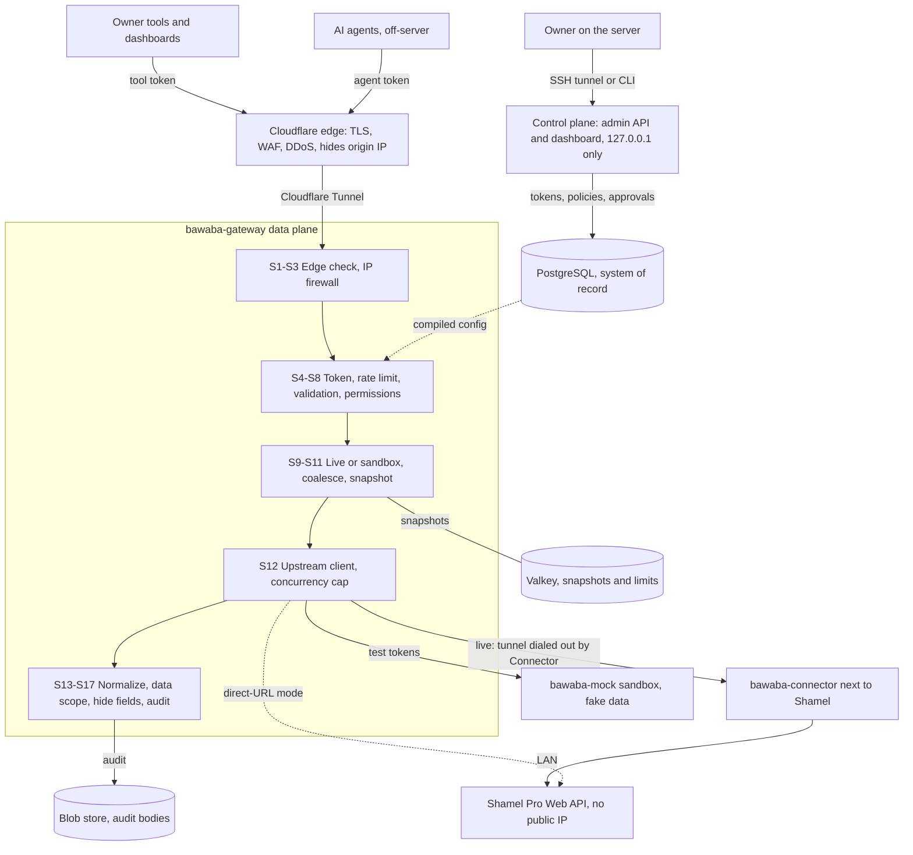

# Bawaba (بوابة): design documents

> Entry point to the design set. Status: draft · 2026-11-03.
> [`00-decisions.md`](00-decisions.md) is binding. If any document here disagrees with it, 00 wins.
> References are written "02 §7.5", meaning section 7.5 of `02-security.md`.

---

## 1. What Bawaba is, and why

Shamel Pro (by ISCO, Nablus) already has a Web API, but it is built for a single trusted caller. Anyone with a Shamel
username and password can do everything that user can do. There are no per-tool permissions, errors come back as raw
server text, there is no paging, and every caller needs a network path to Shamel itself. **Bawaba** ("gateway") is
a secure Go service that sits in front of that API. Every tool or dashboard gets **its own API token**, limited to
exactly the data and actions it needs. Shamel itself stays hidden: no client ever learns its address, its software
or its passwords.

Most of the owner's tools will be built by **AI agents**, so Bawaba is designed for that. Agents never touch Shamel or
its credentials. They work against a **sandbox** with realistic fake data until the owner switches a tool to live
data. They can only *ask* for more access, and only the owner, on the server, can approve. Selected tools can be
required to have every write approved by the owner before it reaches Shamel. Every request is kept in an encrypted
audit log. Data is always live (no caching of business data). The documentation and response headers teach agents to
build tools that do not overload Shamel. Version 1 serves the owner's own company only, but it is built to scale
across several servers and to support more than one Shamel server later.

---

## 2. Architecture at a glance

How to read it:

- **Data plane** (`bawaba-gateway`). Serves `/v1`, `/legacy` and `/docs`. Every request runs the same ordered
  17-stage pipeline (S1–S17, 01 §6.3; the security view is 02 §10.1). Tokens and policies come from compiled
  config held in memory, so reads never wait on PostgreSQL. Nodes are stateless: shared state lives in PostgreSQL,
  Valkey and the blob store.
- **Connector** (`bawaba-connector`). Runs next to Shamel (Windows service or Linux). It dials *out* through
  Cloudflare: WebSocket, then inner mutual TLS 1.3, then multiplexed typed frames (01 §8.1). It keeps the Shamel
  password and session itself (02 §7.5). It only accepts typed calls from a fixed endpoint table, so it is not an
  open proxy. Direct-URL mode is the fallback when no Connector can be installed (01 §8.7, 02 §8).
- **Control plane.** A separate process and OS user, listening only on `127.0.0.1` and a Unix socket. It is the only
  place where tokens are issued, approvals given and firewall rules changed. It is the only process that loads
  `master.key` (01 §5.3, 02 §12.1). The owner reaches it by SSH tunnel (dashboard) or with the local `bawaba` CLI.
- **Sandbox.** `bwb_test_` tokens are routed to `bawaba-mock` and can never reach a live upstream (01 §11).

---

## 3. Key decisions

| Topic | Decision | Designed in |
|---|---|---|
| Scope | Owner's own company only in v1. Latent tenant model and multi-upstream entity. No billing or licensing. | 00 §2, 01 §12 |
| Deployment | Topology A (cloud VPS behind Cloudflare, Connector in the office) recommended. B = one on-prem box, C = scaled-out cluster. Docker Compose and standalone binaries. | 01 §4 |
| Edge | Cloudflare in front. Default `edge.mode: tunnel` (cloudflared to a Unix socket, no open ports), with authenticated origin pulls as the alternative. | 02 §6.1, 01 §5.2 |
| Origin hiding | No upstream byte, header, URL or error text is ever forwarded. Responses are decoded and rebuilt, errors are mapped to codes, and a leak suite blocks CI. | 02 §5, 02 §18.3 |
| Connector transport | Outbound WebSocket, then inner mTLS 1.3 (Bawaba tunnel CA), then yamux, then typed protobuf frames. | 01 §8.1, 02 §7.4 |
| Shamel credential custody | Tunnel mode: passwords are sealed to the Connector, which logs in and holds the session. The gateway stores only ciphertext. | 02 §7.5, 01 §7.1 |
| Plane separation | Control plane is a separate process, OS user, DB role and Valkey user. Loopback only, no network route from the data plane. | 01 §5.3, 02 §12.1 |
| Keys | Two root key files: `master.key` (control plane, backed up offline) and `data.key` (data plane, re-issuable). AES-256-GCM envelopes. | 02 §9.2, 01 §15.3 |
| Tokens | `bwb_live_` / `bwb_test_` / `bwb_pk_*` with 256-bit secrets, a checksum and a secret-scanning pattern. Stored only as HMAC hashes. Never expire by default. | 02 §9.7, 04 §2 |
| Pipeline | One ordered pipeline S1–S17 for `/v1` and `/legacy`. No PostgreSQL on the read hot path. | 01 §6.3, 02 §10.1 |
| Permissions | `<resource>:<action>` scopes, per-voucher-type writes and presets. Deny by default. | 04 §3, 04 §9.5 |
| Data scoping | Six dimensions: stores, salesmen, customers, currencies, price classes, voucher types. Vouchers are visible only whole. | 04 §4, 03 §2.4 |
| Field hiding | Path-based masks over a sensitive-field catalogue (purchase price, balances, credit limits, accounts). | 04 §5 |
| Shamel identity | Each upstream has a default service account. A token can be pinned to a Shamel user, such as a salesman. | 04 §6 |
| AI agents | "Request, you approve". The subset rule means an agent can never ask for more than it holds, and agents never approve. | 04 §10.3, 02 §13 |
| Write approval queue | Writes from selected tokens wait for the owner, are re-validated, and are submitted without double posting. | 04 §11, 03 §15.3 |
| Freshness | Always live. Identical concurrent calls are coalesced. Page 1 is fetched live; later pages reuse a ~60 s snapshot through token-bound views and cursors. | 01 §9, 03 §5.3 |
| Protect Shamel | Cluster-wide concurrency cap (default 8) with fair queueing, a circuit breaker, and retries only for reads. | 01 §7.6, 01 §7.9 |
| Numbers | Money, quantities and rates are decimal strings, never JSON floats. | 03 §4.6 |
| Errors | Bilingual error envelope with stable codes and a request id. Upstream text goes only to the audit log. | 03 §22, 02 §5.6 |
| Idempotency | `Idempotency-Key` on writes, keyed by token **lineage**, so it survives token rotation. | 03 §15.2, 04 §2.4.5 |
| Rate limits and "inform the AI" | Generous per-token buckets, including upstream cost units. `RateLimit-*` and `Bawaba-Warning` headers. Owner alerts on abusive tools. | 03 §23, 04 §14, 05 §4 |
| Legacy passthrough | `/legacy/<Shamel path>`, opt-in per token, strict allowlist, same pipeline. | 03 §20 |
| Sandbox | Test tokens go to `bawaba-mock`, which has a deterministic Arabic dataset and fault injection. | 01 §11, 03 §21, 04 §12 |
| Audit | Every request and response body, encrypted. Content-addressed de-duplication and zstd. Tiered retention (metadata 2 y, read bodies 90 d). | 05 §1 |
| Webhooks | Change detection polls every 5 min, only for subscribed events. HMAC-signed deliveries with retries. | 05 §2, 03 §17 |
| Admin UI and CLI | Server-rendered Go templates and htmx (no SPA), Arabic and English with RTL. Full `bawaba` CLI with `--json`. | 05 §6, 05 §7 |
| Alerts and backups | E-mail alerts over SMTP. Data backups are separate from the offline key backup, with restore drills. | 05 §3, 05 §9 |
| Delivery | Reads first: M0 foundations, M1 reads, M2 writes, M3 webhooks, M4 hardening. About 14 months with 3 engineers. | 07 §2, 07 §11 |

---

## 4. Document index

| Document | What it covers |
|---|---|
| [`00-decisions.md`](00-decisions.md) | Binding requirements and decisions from the owner interview. Read first; everything else must agree with it. |
| [`01-architecture.md`](01-architecture.md) | Components, deployment topologies, planes and listeners, the S1–S17 pipeline, upstream client, Connector transport, coalescing and snapshots, performance, failure modes, repository layout, configuration. |
| [`02-security.md`](02-security.md) | Threat model, origin hiding, Cloudflare edge, Connector PKI and credential custody, keys and cryptography, firewall and auto-ban, admin isolation, AI-agent containment, incident runbook, security tests. Authoritative on security mechanisms. |
| [`03-api.md`](03-api.md) | The public `/v1` contract: conventions, pagination and search, every endpoint and its Shamel mapping, writes and batches, webhooks API, `/legacy`, sandbox, error and warning catalogues, OpenAPI 3.1 toolchain. |
| [`04-permissions-and-tokens.md`](04-permissions-and-tokens.md) | Token record and lifecycle, scopes and presets, data scoping, field hiding, Shamel identity binding, policy compilation, agent access requests and the subset rule, write approval queue, per-token rate limits. |
| [`05-operations.md`](05-operations.md) | Audit log storage, webhooks engine, e-mail alerts, "inform the AI", observability, admin dashboard, CLI, documentation site, backups, disaster recovery and upgrades. |
| [`07-milestones.md`](07-milestones.md) | Delivery plan M0–M4: deliverables, acceptance criteria, tests, risks, ISCO and owner dependencies, effort estimate. |
| [`08-isco-questions.md`](08-isco-questions.md) | The question list to send to ISCO (Arabic and English cover message, 55 questions, 10 marked priority), with a traceability appendix. |
| [`../upstream/shamel-api.md`](../upstream/shamel-api.md) | Transcription of ISCO's Shamel Pro Web API manual: endpoints, models, enumerations, and the quirks and gaps list (`Qnn`). |
| [`../pdf/Bawaba-Visual-Overview.pdf`](../pdf/Bawaba-Visual-Overview.pdf) | About 20 hand-designed pages summarising the design visually. The best starting point for the owner. |
| [`../pdf/Bawaba-Design-Reference.pdf`](../pdf/Bawaba-Design-Reference.pdf) | This README, every design document and the upstream reference in one PDF, with rendered diagrams and bookmarks. |
| [`../../tools/pdf/`](../../tools/pdf/README.md) | How to rebuild both PDFs (`npm install`, then `npm run build`). Rebuild after changing any document. |

There is no document 06. Table sketches live in the document that owns each feature (for example 04 §2.2 and
05 §1.3).

---

## 5. How to read this

**Owner** (decisions, approvals, running it):

1. This README, then the **Visual Overview PDF**.
2. [`00-decisions.md`](00-decisions.md), to check that it still says what you want.
3. 07 §2 (milestones), §11 (effort) and §13 (open questions for you).
4. 08 §0–§2 (how to send the ISCO questions, and the priority list).
5. Day-to-day operation: 05 §6 (dashboard), 05 §7 (CLI), 05 §3 (alerts), 05 §9 (backups and the key backup),
   02 §17 (incident runbook), 04 §10.5 and §11.4 (what you see when approving).

**Engineer or AI agent implementing it:**

1. 00 (binding), then the upstream reference (Shamel's real behaviour and quirks).
2. 01 for the shape of the system, especially §2, §5, §6 (the pipeline order is normative) and §15.
3. 02 for every security mechanism. Where 01 summarises security, 02 is authoritative.
4. 04 for the authorization model. 04 §10.3 is the authoritative subset rule.
5. 03 for the wire contract. The OpenAPI 3.1 spec is generated from it (03 §24).
6. 05 for audit, webhooks, alerts, dashboard, CLI and backups.
7. 07 for build order and the definition of done (07 §3). Each acceptance criterion `AC-Mx-nn` is a test target.
8. 08, for which behaviour is still unconfirmed. Treat fields marked *(provisional)* (03 §3.4) as subject to rename.

Where documents seem to disagree, use this precedence: 00, then the owning document named in each document's
header, then the cross-document notes at the end of 02, 03, 04, 05 and 07.

---

## 6. Glossary

**Shamel terms**

| Arabic | English | In Bawaba |
|---|---|---|
| سند | voucher (any accounting document) | `/v1/vouchers`, `type` field, `vouchers:write:<voucher_type>` |
| فاتورة مبيعات | sales invoice | `sales_invoice` (9) |
| مردودات مبيعات | sales return | `sales_return` (4) |
| طلبية | order (sales order) | `order` (0), `/v1/order-status` |
| ارسالية | delivery (goods dispatch) | `sales_delivery` (10), `purchase_delivery` (2), `internal_delivery` (16) |
| قبض | receipt | `receipt` (24) |
| صرف | payment | `payment` (27) |
| قيد | journal entry | `journal` (28) |
| اشعار دائن / اشعار مدين | credit note / debit note | `credit_note` (22) / `debit_note` (23) |
| مستودع | store, warehouse | `/v1/stores`, `store_id`, data-scope dimension `stores` |
| صنف | item | `/v1/items` |
| فئة سعر | price class (1–6) | `/v1/price-classes`, dimension `price_classes` |
| مندوب | salesman | `/v1/salesmen`, dimension `salesmen`, Shamel salesman scoping |
| مركز تكلفة | cost center | `/v1/reports/cost-center-statement`, scope `cost_centers` |
| كشف حساب | account statement | `/v1/reports/account-statement` |
| شيك | cheque | `cheques[]` on vouchers, `unpaid_cheques` / `returned_cheques` balances |
| زبون | customer | `/v1/customers` |
| عملة | currency | `/v1/currencies`, `currency_code`, dimension `currencies` |

**Bawaba terms**

| Term | Meaning |
|---|---|
| Data plane | The public `bawaba-gateway` processes that serve `/v1`, `/legacy` and `/docs`. Stateless and horizontally scalable (01 §2). |
| Control plane | The admin API, dashboard, approvals, token issuing and key management. A separate process on `127.0.0.1` only, with no route from the data plane (01 §5.3). |
| Connector | `bawaba-connector`, an agent installed next to Shamel. It dials out to the gateway over an encrypted tunnel, so Shamel needs no public address (01 §8). |
| Upstream | One Shamel server and how it is reached: `tunnel`, `direct` or `mock` (01 §0). |
| Lineage | The identity shared by a token and its rotated successors. Idempotency keys, approvals and webhooks follow the lineage (04 §2.4.5). |
| Data scope | A token's allowed rows: stores, salesmen, customers, currencies, price classes, voucher types (04 §4). |
| Field hiding | Removing named fields (e.g. `purchase_price`) from every response a token receives (04 §5). |
| Snapshot | The unfiltered result of one live page-1 fetch, kept encrypted for ~60 s so later pages are consistent. Read only through the token's own view and cursor (01 §9.4). |
| Coalescing | Identical concurrent requests (same upstream, Shamel user and parameters) share one live Shamel call (01 §9.1). |
| Approval queue | Writes from selected tokens are held until the owner approves them on the server (04 §11). |
| Access request | An agent token's request for a new token or more permissions, limited by the subset rule and approved only by the owner (04 §10). |
| Subset rule | An agent can never request or grant more than its own token holds (04 §10.3). |
| Sandbox | `bwb_test_` tokens served by `bawaba-mock` with realistic fake data. They can never reach live Shamel (01 §11, 03 §21). |
| Compiled config | The immutable in-memory form of tokens, policies and firewall lists, built by the control plane and loaded by every data-plane node (01 §5.4). |

---

## 7. Open questions

**Owner decisions still needed** (most are needed before the M1-β live pilot, 07 §5.6):

- **Hosting:** topology A (cloud VPS) or B (on-prem box) (01 §4.5, 07 §13).
- **Where Shamel runs today** (office LAN, exposed or hosted), and access to its host for the Connector. This decides
  Connector versus direct-URL mode and how urgent Windows packaging is (00 §2, 07 §5.6).
- **Public domain and Cloudflare account** for the `api.` and `connect.` hostnames (02 §6.4).
- **SMTP relay** for alert e-mails (05 §3.5).
- **Off-site backup target**, and a **low-privilege Shamel API account** for calibration and the live capture
  (05 §9.1, 02 §20.2).
- **Team size:** 3 engineers (about 14 months) or 4 (about 11 months) (07 §11.2).
- **Legacy integrations:** does anything call Shamel directly today? If not, `/legacy` reads can move out of M1
  (07 §11.5).
- **Pentest timing:** pentest before any live token (delays β), or the proposed restricted pilot with round 1 gating
  M1 GA (07 §13, 02 §18.5).
- **Vendors to book:** pentest firm (about 6 weeks ahead), Authenticode code-signing certificate for the Windows
  Connector, and an Arabic technical reviewer (07 §5.6).

**ISCO**

- [`08-isco-questions.md`](08-isco-questions.md) holds the merged ISCO list (55 questions, 10 priority: session
  lifetime, HTTPS, error format, rate limits, paging, `lastupdatedate`, `GetSalesmen`, duplicate prevention,
  versioning, licensing). The answers gate M1-β, M1 GA, M2 and M3 by question set (07 §10). Still to decide: whether
  to ask about future commercial use now (08 §0, ISCO-53).

**Design items to confirm**

- Assumptions to check against live Shamel with `bawaba upstream calibrate`:
  - Shamel's capacity (`max_concurrency` 8).
  - What a second login does (`single_holder`).
  - Office uplink of at least 2 Mbit/s.
  - Stable response serialization, which drives the audit de-duplication ratio.

  See 01 §16.1 and 05 §11.
- Per-voucher-type write rules are conservative defaults, to verify against a live capture before M2 (03 §27.2).
- No final data model (DDL) document exists yet. 04 §2.2 and 05 defer to one; consolidate it in M0.
- Naming harmonisation is still open: webhook config key spellings, ID prefixes, upstream id format (05 §11).
