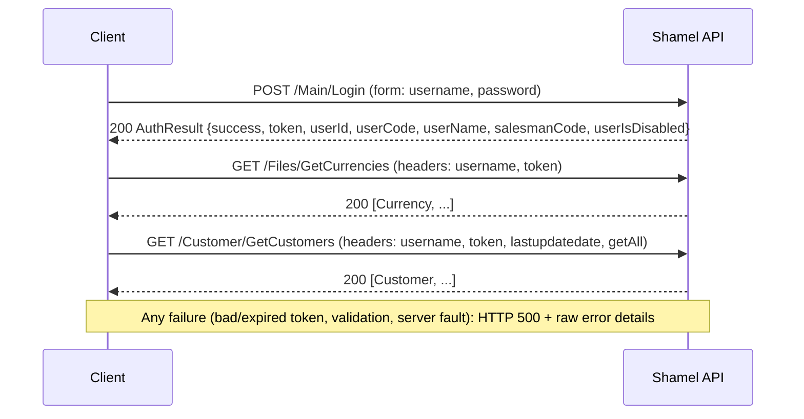

# Shamel Pro Web API: Upstream Reference (Transcription)

> **What this is.** A faithful, structured transcription of the vendor manual *"Shamel Pro API Manual"* by ISCO
> (Isra' Software & Computer), 20 pages. Its Arabic title is "التكامل مع برنامج الشامل للمحاسبة – API – العرض الفني"
> ("Integration with the Shamel accounting program – API – technical presentation").
> It describes the **upstream** API that Bawaba sits in front of. It is **not** the Bawaba API. Bawaba's own
> contract is defined in `docs/design/`, and the binding requirements are in `docs/design/00-decisions.md`.
> Transcribed 2026-11-03.

## 0. Transcription conventions

- Paths, header names, form-field names, class names, field names and types are reproduced **exactly as printed**,
  misspellings and inconsistent casing included. They are the real wire names.
- Only typesetting artefacts where whitespace was lost are corrected: `classAuthResult` → `class AuthResult`,
  `stringcurrency_name` → `string currency_name`, `stringbank_code`, `stringVatReg`, `stringcustomer`,
  `stringstart_date`, `Itemitm` → `Item itm`, `List<VoucherCheqs>cheqs` → `List<VoucherCheqs> cheqs`.
- In the manual's code blocks, Arabic comments are printed with their words in reverse order (RTL text inside LTR
  code blocks). Here they are given in correct reading order, followed by an English translation.
- *(inferred)* marks anything the manual does not state, such as the HTTP methods of the 23 endpoints without a "post
  parameter" and likely meanings of undocumented fields. Everything without that marker is stated in the manual.
  Quoted text ("…") is verbatim.
- "p. N" refers to the PDF page number.
- The manual shows C# declarations, not JSON. Wire JSON property names are **assumed** to equal the declared field
  names, with the same casing. This must be confirmed against a live capture (see Q46).
- The cover page (p. 1) lists the vendor's postal address (Nablus, Palestine), email, website, phone and fax. None of
  it is reproduced here.
- `Qnn` identifiers refer to the numbered items in §7 and are stable for cross-referencing from design docs.

---

## 1. Endpoint summary

All endpoints except `/Main/Login` require the `username` and `token` request headers (§2.2). Paths are printed
exactly as in the manual. Four of them lack a leading slash, and one starts with a lower-case action name.

| # | Controller | Path (as printed) | R/W | Method | Key inputs | Returns | Page |
|---|---|---|---|---|---|---|---|
| 1 | Main | `/Main/Login` | auth | POST (stated) | form `username`, `password` | `AuthResult` | 4 |
| 2 | Files | `/Files/GetCurrencies` | R | GET *(inferred)* | – | `List<Currency>` | 4–5 |
| 3 | Files | `/Files/GetCurrencyRates` | R | GET *(inferred)* | – | `List<CurrencyRate>` (latest 10) | 5 |
| 4 | Files | `/Files/GetBanks` | R | GET *(inferred)* | – | `List<Bank>` | 5 |
| 5 | Files | `/Files/GetBanksBranchs` | R | GET *(inferred)* | – | `List<BankBranch>` | 5 |
| 6 | Files | `/Files/GetCities` | R | GET *(inferred)* | – | `List<City>` | 6 |
| 7 | Files | `/Files/GetStores` | R | GET *(inferred)* | – | `List<Store>` (printed as `class City`) | 6 |
| 8 | Files | `/Files/GetPriceClasses` | R | GET *(inferred)* | – | `List<PriceClass>` (6 rows) | 6 |
| 9 | Files | `/Files/GetSalesmen` | R | GET *(inferred)* | **undocumented** | **undocumented** | 6 |
| 10 | Customer | `/Customer/GetCustomers` | R | GET *(inferred)* | hdr `lastupdatedate`, `code`, `vatreg`, `getBalance`, `getStopped`, `getClassifications`, `getContacts`, `getAll` | `List<Customer>` (read) | 6–8 |
| 11 | Customer | `/Customer/GetCustomerBalances` | R | GET *(inferred)* | hdr `customerCode`, `vatreg` | `List<CustomerBalance>` | 8 |
| 12 | Customer | `/Customer/Post` | W | POST (stated) | form `obj` = JSON `Customer` (write) | `PostResponse` | 8–9 |
| 13 | Customer | `Customer/GetCustomerPricesAsRows` | R | GET *(inferred)* | **none documented** | unnamed price-row object (`CustomerPriceRow`) | 16–17 |
| 14 | Item | `/Item/GetItems` | R | GET *(inferred)* | hdr `lastupdatedate`, `serial`, `itemCode`, `store`, `model` | `List<Item>` (read) | 9–10 |
| 15 | Item | `/Item/GetItemsStores` | R | GET *(inferred)* | hdr `lastupdatedate`, `itemcode` | `List<ItemStore>` | 10–11 |
| 16 | Item | `/Item/getItemDetails` | R | GET *(inferred)* | hdr `itemCode` | `ItemDetails` ("list" per manual) | 11 |
| 17 | Item | `/Item/GetItemsGroups` | R | GET *(inferred)* | – | `List<ItemGroup>` | 11 |
| 18 | Item | `/Item/GetItemsCatalog` | R | GET *(inferred)* | – | `List<ItemCatalog>` | 11 |
| 19 | Item | `/Item/GetItemsSerials` | R | GET *(inferred)* | hdr `customer`, `serial` | `List<ItemSerial>` | 11–12 |
| 20 | Item | `/Item/Post` | W | POST (stated) | form `obj` = JSON `Item` (write) | `PostResponse` | 19–20 |
| 21 | Report | `/Report/GetLastPriceReport` | R | GET *(inferred)* | hdr `ItemCode`, `barcode` | `List<LastPriceRepColumn>` | 12 |
| 22 | Report | `/Report/GetAccountsheet` | R | POST (stated: "post parameter") | form `obj` = JSON `AccountsheetFilters` (customer) | `List<AccountsheetColumns>` | 12–13 |
| 23 | Voucher | `/Voucher/Post2` | W | POST (stated) | form `obj` = JSON `Voucher` (full) | `Result` (voucher variant) | 13–16 |
| 24 | Voucher | `/Voucher/GetDelivery` | R | GET *(inferred)* | – (implicit: logged-in salesman) | `Voucher` (delivery variant) | 16 |
| 25 | Voucher | `/Voucher/GetStatus` | R | GET *(inferred)* | hdr `manual` | order status `0..4` | 16 |
| 26 | Voucher | `Voucher/GetVoucher` | R | GET *(inferred)* | hdr `voucher_code`, `getCustomerBalance` | `Voucher` (full) | 17 |
| 27 | Voucher | `Voucher/GetVouchers` | R | GET *(inferred)* | hdr `filters` (JSON), `getCustomerBalance` | array of `Voucher` | 17 |
| 28 | Voucher | `Voucher/GetExtraVouchers` | R | GET *(inferred)* | hdr `filters` (JSON), `getCustomerBalance` | array of short `Voucher` (`ExtraVoucher`) | 17–18 |
| 29 | CostCenter | `/CostCenter/Post` | W | POST (stated) | form `obj` = JSON `CostCenterDTO` | `Result` (cost-center variant) | 18–19 |
| 30 | CostCenter | `/CostCenter/GetCostCenterAccountsheet` | R | POST (stated: "post parameter") | form `filters` = JSON `AccountsheetFilters` (cost center) | `List<AccountsheetColumns>` | 19 |

Totals: 30 endpoints. There is 1 auth endpoint, 25 reads (2 of them via form POST) and 4 writes: customer, item,
voucher and cost center. All 4 writes are **insert-only**. No update, delete or void endpoint exists.

---

## 2. Overview

### 2.1 General behaviour (p. 4)

Verbatim:

> "Shamel Pro API is restful web API , any error occurred the service will return Http error 500 with the error details"
>
> "Every request (except login request) to the service must be filled by the following values in the http header:"
> `Headers["username"]`, `Headers["token"]`
>
> "Date format is always yyyy-MM-dd"

Observed shape:

- **Style.** RPC over HTTP using `/{Controller}/{Action}` paths. The vendor calls it "restful", but it is not
  resource-oriented. The C# class notation and controller/action naming suggest ASP.NET MVC or Web API conventional
  routing *(inferred)*.
- **Endpoint location.** The manual documents no scheme, host, port, base path or version prefix. These depend on the
  deployment. HTTPS support is not mentioned.
- **Inputs.** Reads take parameters in **HTTP request headers**, never in the query string. Writes and two reports take
  one **form field** whose value is a **JSON string** (`obj`, or `filters` for the cost-center report).
- **Outputs.** JSON. The manual says "as Json" only for `PostResponse` and `Result`, and JSON is assumed elsewhere.
  Lists come back as bare JSON arrays with no envelope, no count and no paging.
- **Errors.** Every error, whatever its cause, is returned as **HTTP 500** "with the error details". No error
  schema is documented. Write endpoints can also report failure inside a 200 body (`Success=false` plus
  `ErrorMessage`).
- **Dates.** `yyyy-MM-dd`, carried as strings. The one documented time field (`VoucherHeader.time`) uses `hhmmss`.
- **Pagination.** None anywhere.
- **Incremental sync.** Only the `lastupdatedate` header on `/Customer/GetCustomers`, `/Item/GetItems` and
  `/Item/GetItemsStores` supports it.

### 2.2 Authentication (p. 2, p. 4)

1. `POST /Main/Login` with body `application/x-www-form-urlencoded` containing `username` and `password`.
2. The response is `AuthResult`. The manual says: "Keep the token to send it with every request".
3. Every later request sends the request headers `username: <same username>` and `token: <AuthResult.token>`.



Page 2 says that "any operation requires three main elements": user number (رقم المستخدم), password (كلمة المرور)
and token ("you could have it by call login method"). On the wire, the password is sent only to `/Main/Login`.
After that, only `username` and `token` are sent.

The manual does not document token lifetime, expiry, refresh, logout, the effect of a second login, or how a
failed login is reported (Q14–Q16).

**Salesman scoping.** `AuthResult.salesmanCode` binds a user to a salesman. `/Customer/GetCustomers` returns only that
salesman's customers unless `getAll=true` is sent. `/Voucher/GetDelivery` returns "the delivery that is prepared to the
salesman". The manual does not say whether other endpoints are scoped the same way (Q17).

### 2.3 Wire examples (illustrative, not from the manual)

These snippets are illustrative. Placeholder values are in `<…>`.

```http
GET /Item/GetItemsStores HTTP/1.1
Host: <shamel-host>
Accept: application/json
username: <shamel-username>
token: <AuthResult.token>
lastupdatedate: 2026-10-01
itemcode: <item-code>
```

```http
POST /Voucher/Post2 HTTP/1.1
Host: <shamel-host>
Content-Type: application/x-www-form-urlencoded
username: <shamel-username>
token: <AuthResult.token>

obj=%7B%22header%22%3A%7B%22type%22%3A0%2C%22customer_code%22%3A%22<code>%22%2C...%7D%2C%22items%22%3A%5B...%5D%7D
```

The decoded `obj` for an order (type `0`) looks like this. Field names come from §4.

```json
{"header":{"type":0,"date":"2026-11-03","time":"101500","currency":"NIS","rate":1,"customer_code":"<code>",
  "manual_code":"<paper-ref>","salesman":"<salesman>","order_store":1,"system_id":1500},
 "items":[{"pos":0,"code":"<item>","unit":1,"store":1,"quantity":2,"price":10.5,"bonus":0,"discount":0}],
 "cheqs":[],"accounts":[]}
```

### 2.4 Parameter inventory

Every header and form-field name in the manual, with its exact casing. HTTP header names are case-insensitive, but
send them exactly as printed anyway (Q5).

| Name (exact) | Kind | Used by | Value format |
|---|---|---|---|
| `username` | header | all except Login | Shamel login name |
| `token` | header | all except Login | `AuthResult.token` |
| `lastupdatedate` | header | GetCustomers, GetItems, GetItemsStores | `yyyy-MM-dd` *(inferred from global rule)*; empty = everything |
| `code` | header | GetCustomers | customer code |
| `vatreg` | header | GetCustomers, GetCustomerBalances | VAT registration number |
| `getBalance` | header | GetCustomers | `"true"` |
| `getStopped` | header | GetCustomers | `"true"` |
| `getClassifications` | header | GetCustomers | `"true"` |
| `getContacts` | header | GetCustomers | `"true"` |
| `getAll` | header | GetCustomers | `true` (printed unquoted) |
| `customerCode` | header | GetCustomerBalances | customer code; empty = all |
| `serial` | header | GetItems, GetItemsSerials | serial number |
| `itemCode` | header | GetItems, getItemDetails | item code |
| `itemcode` | header | GetItemsStores | item code |
| `ItemCode` | header | GetLastPriceReport | item code |
| `store` | header | GetItems | store id |
| `model` | header | GetItems | model |
| `barcode` | header | GetLastPriceReport | barcode |
| `customer` | header | GetItemsSerials | customer code |
| `manual` | header | GetStatus | order manual (paper) code *(inferred)* |
| `voucher_code` | header | GetVoucher | voucher code (contains an underscore, see Q7) |
| `getCustomerBalance` | header | GetVoucher, GetVouchers, GetExtraVouchers | `true` |
| `filters` | **header** | GetVouchers, GetExtraVouchers | JSON `VoucherFilters` |
| `username`, `password` | form | Login | x-www-form-urlencoded |
| `obj` | form | Customer/Post, Item/Post, Voucher/Post2, CostCenter/Post, Report/GetAccountsheet | JSON string |
| `filters` | **form** | CostCenter/GetCostCenterAccountsheet | JSON string |

---

## 3. Capabilities (pp. 2–3, translated)

Page 2 is headed "الخصائص الفنية لالية التكامل مع الشامل" ("Technical properties of the integration mechanism with
Shamel"), with the English subtitle "Shamel Web API Specifications". The original spelling is kept, including missing
hamzas. Typos are marked [sic].

**Security** (الامان حيث تتطلب اي عملية ثلاث عناصر رئيسية, "Security: any operation requires three main elements"):

- User number (رقم المستخدم). In practice this is the `username`.
- Password (كلمة المرور)
- Token. Printed in English: "you could have it by call login method".

**Data retrieval** (امكانية سحب البيانات التالية, "Ability to pull the following data"):

| Capability (English) | Arabic (as printed) | Endpoint(s) |
|---|---|---|
| Pull currencies | سحب العملات | `/Files/GetCurrencies` |
| Pull exchange rates | سحب اسعار الصرف | `/Files/GetCurrencyRates` |
| Pull banks and their branches | سحب البنوك وفروعها | `/Files/GetBanks`, `/Files/GetBanksBranchs` |
| Pull cities | سحب المدن | `/Files/GetCities` |
| Pull stores (warehouses) | سحب المستودعات | `/Files/GetStores` |
| Pull price classes | سحب فئات الاسعار | `/Files/GetPriceClasses` |
| Pull customers | سحب الزبائن | `/Customer/GetCustomers` |
| Pull customer balances | سحب ارصدة الزبائن | `/Customer/GetCustomerBalances` (also `getBalance` on GetCustomers) |
| Pull items | سحب الاصناف | `/Item/GetItems` |
| Pull item quantities in stores | سحب كميات الاصناف في المستودعات | `/Item/GetItemsStores` |
| Pull quantities of a specific item | سحب كمات [sic: كميات] صنف معين | `/Item/getItemDetails`, or `/Item/GetItemsStores` + `itemcode` |
| Pull the items catalog (images) | سحب كتالوج الاصناف | `/Item/GetItemsCatalog` |

**Data entry** (امكانية ادخال البيانات التالية, "Ability to enter the following data"):

| Capability (English) | Arabic (as printed) | Endpoint / `VoucherTypes` |
|---|---|---|
| New customer | زبون جديد | `/Customer/Post` |
| New item | صنف جديد | `/Item/Post` |
| New cost center | مركز تكلفة جديد | `/CostCenter/Post` |
| Sales order | طلبية مبيعات | `/Voucher/Post2`, `Order = 0` |
| New voucher: | سند جديد: | `/Voucher/Post2` |
| – Sales invoice | فاتورة مبيعات | `SalesInvoice = 9` |
| – Sales return | مردود مبيعات | `ReturnSalesInvoice = 4` |
| – Purchase delivery | ارسالية مشتريات | `PurchaseDelivery = 2` |
| – Receipt voucher | سند قبض | `Receipt = 24` |
| – Payment voucher | سند صرف | `Payment = 27` |
| – Invoice from a delivery | فاتورة من ارسالية | no dedicated enum value. Presumably `SalesInvoice = 9` with `delivery_id` / `delivery_pos` set *(inferred)*, see Q40 |
| – Credit note | إشعار دائن | `Credit = 22` |
| – Debit note | إشعار مدين | `Debit = 23` |
| – Journal voucher | سند قيد | `Journal = 28` |
| – Goods-issue (stock-out) voucher | سند إخراج بضاعة | `Stockout = 12` |
| – Internal delivery | ارسالية داخلية | `InternalDelivery = 16` |
| – Sales delivery | ارسالية مبيعات | `SalesDelivery = 10` |

**Reports** (امكانية استدعاء التقارير التالية, "Ability to call the following reports"):

| Capability (English) | Arabic (as printed) | Endpoint |
|---|---|---|
| Accounting account statement | كشف حساب محاسبي | `/Report/GetAccountsheet` |
| Last prices report | تقرير اخر الأسعار | `/Report/GetLastPriceReport` |
| Cost-center account statement report | تقرير كشف حساب لمركز تكلفة | `/CostCenter/GetCostCenterAccountsheet` |

Some endpoints are documented but not listed as capabilities: `GetSalesmen`, `GetItemsGroups`, `GetItemsSerials`,
`GetCustomerPricesAsRows`, `GetDelivery`, `GetStatus`, `GetVoucher`, `GetVouchers` and `GetExtraVouchers`. The enum
member `ReturnedPendingSalesDelivery = 5` is also missing from the capability list.

---

## 4. Endpoints

Every endpoint below uses the same template. The auth headers `username` and `token` are required on every endpoint
except Login and are not repeated. Each response block lists every field and type as printed. Field meanings and
Arabic translations are in §5.

**Method rule.** The manual never names an HTTP method outright, but it implies POST for 7 endpoints by saying "post
parameter": Login, the four `*/Post*` writes and the two accountsheet reports (pp. 4, 8, 12, 13, 18, 19). These are
marked POST (stated). It names no method for the other 23 endpoints; they are reads with no body, so they are GET
*(inferred)*, which must be verified live (Q4).

### 4.1 Main

#### `/Main/Login` (p. 4)

| Aspect | Detail |
|---|---|
| Method | POST (stated: "post parameter (x-www-form-urlencoded)") |
| Purpose | Authenticate a Shamel user and obtain a session token. |
| Inputs | Form `username` (string), form `password` (string). `Content-Type: application/x-www-form-urlencoded`. No `username`/`token` headers. |
| Response | `AuthResult` |
| Notes | "Keep the token to send it with every request". Token lifetime and failure behaviour are undocumented (Q14–Q16). `salesmanCode` determines salesman scoping (Q17). |

```csharp
class AuthResult { bool success; string token; int userId; string userCode; string userName; string salesmanCode; bool userIsDisabled; }
```

### 4.2 Files (master data)

None of the Files endpoints take inputs beyond the auth headers.

#### `/Files/GetCurrencies` (pp. 4–5)

| Aspect | Detail |
|---|---|
| Method | GET *(inferred)* |
| Purpose | "Get all currencies" |
| Inputs | – |
| Response | `List<Currency>` |
| Notes | A currency has both an `int id` and a `string code`. Other endpoints refer to currencies by code string (Q36). |

```csharp
class Currency { int id; string code; string currency_name; string units; string division; }
```

#### `/Files/GetCurrencyRates` (p. 5)

| Aspect | Detail |
|---|---|
| Method | GET *(inferred)* |
| Purpose | "Get latest 10 currency rate" |
| Inputs | – (no currency or date filter) |
| Response | `List<CurrencyRate>` |
| Notes | Fixed limit of 10. Unclear whether that is 10 in total or per currency (Q31). Type printed as `String` (capital S). |

```csharp
class CurrencyRate { String currency_code; double rate; string date; bool is_base; }
```

#### `/Files/GetBanks` (p. 5)

| Aspect | Detail |
|---|---|
| Method | GET *(inferred)* |
| Purpose | "Get All Banks" |
| Inputs | – |
| Response | `List<Bank>` |
| Notes | – |

```csharp
class Bank { string code; string name; }
```

#### `/Files/GetBanksBranchs` (p. 5)

| Aspect | Detail |
|---|---|
| Method | GET *(inferred)* |
| Purpose | "Get all branchs" [sic] |
| Inputs | – (cannot filter by bank) |
| Response | `List<BankBranch>` |
| Notes | The path is misspelled (Branchs). `bank_code` refers to `Bank.code` *(inferred)*. |

```csharp
class BankBranch { string code; string name; string bank_code; }
```

#### `/Files/GetCities` (p. 6)

| Aspect | Detail |
|---|---|
| Method | GET *(inferred)* |
| Purpose | "Get all cities" |
| Inputs | – |
| Response | `List<City>` |
| Notes | Customers and vouchers reference `City.id` (int). |

```csharp
class City { int id; string name; }
```

#### `/Files/GetStores` (p. 6)

| Aspect | Detail |
|---|---|
| Method | GET *(inferred)* |
| Purpose | "Get all stores" |
| Inputs | – |
| Response | `List<Store>`. The manual prints the class as **`class City`**, a copy-paste error (Q27). This document calls it `Store`. |
| Notes | `type` values are undocumented. `car_code` suggests that some stores are vehicles for van sales *(inferred)*. `orgnization_code` is misspelled. |

```csharp
class City /* = Store */ { int id; string name; int type; string car_code; string orgnization_code; }
```

#### `/Files/GetPriceClasses` (p. 6)

| Aspect | Detail |
|---|---|
| Method | GET *(inferred)* |
| Purpose | "Get the 6 price classes name" |
| Inputs | – |
| Response | `List<PriceClass>` (always 6) |
| Notes | The 6 classes correspond to `Item.sale_parice1..6` *(inferred)*. `Customer.price_class` is typed `double` (Q33). |

```csharp
class PriceClass { int id; string name; }
```

#### `/Files/GetSalesmen` (p. 6)

| Aspect | Detail |
|---|---|
| Method | GET *(inferred)* |
| Purpose | Presumably lists salesmen *(inferred from name)*. |
| Inputs | **Undocumented** |
| Response | **Undocumented.** The manual prints only the heading. |
| Notes | Salesman codes appear in `AuthResult.salesmanCode`, `Customer.salesman_code`, `Customer(write).Salesman` and `VoucherHeader.salesman`. The response shape is an open question for ISCO (Q24). |

### 4.3 Customer

#### `/Customer/GetCustomers` (pp. 6–8)

| Aspect | Detail |
|---|---|
| Method | GET *(inferred)* |
| Purpose | List customers, with optional incremental sync and optional sub-collections. |
| Response | `List<Customer>` (read model) |

Inputs (request headers, all optional):

| Header | Type | Semantics (manual text) |
|---|---|---|
| `lastupdatedate` | date string | "Get all customers if lastupdatedate is empty , if not get all customers that updated after lastupdatedate" |
| `code` | string | "to get one customer with the filled 'code'". The response is still a list. |
| `vatreg` | string | "to filter on vatreg field" (the field is `VATReg`) |
| `getBalance` | `"true"` | "to return customer's current balance, customer's not payed cheqs balance and customer's returned cheqs balance". This fills `balance`, `notPayedCheqsBalance` and `returnedCheqsBalance`. |
| `getStopped` | `"true"` | "to return only stopped customers" |
| `getClassifications` | `"true"` | "to return customer classifications" (fills `classifications`) |
| `getContacts` | `"true"` | "to return customer's contacts" (fills `contacts`) |
| `getAll` | `true` | "To get all customers even not the salesman's customers" |

Notes:
- By default the result is limited to the logged-in user's salesman.
- It is not stated whether stopped customers are included when `getStopped` is absent (Q34).
- The manual does not say what the balance fields contain without `getBalance`. Presumably 0 *(inferred)*.

```csharp
class Customer {
  string code; string name; string phone; string street; string street2; string referee1; string referee2;
  string salesman_code; double price_class; double credit_limit; double discount; int city; string currency;
  int level; string town; string city_name; string citizen_code; int attr; string man_name; int trans_permissions;
  string VATReg; int creditType; double balance; double notPayedCheqsBalance; double returnedCheqsBalance;
  bool stopped; string latitude; string longitude; string id_number; bool taxable; string paymentTermsCode;
  List<CustomerClassificaiton> classifications; List<CustomerContact> contacts;
}
class CustomerClassificaiton { int pos; string name; }
class CustomerContact { int pos; string name; string detail; int type; string typeName; }
```

#### `/Customer/GetCustomerBalances` (p. 8)

| Aspect | Detail |
|---|---|
| Method | GET *(inferred)* |
| Purpose | "Get list of customer balances" |
| Response | `List<CustomerBalance>` |

Inputs (request headers):

| Header | Type | Semantics (manual text) |
|---|---|---|
| `customerCode` | string, optional | "if customerCode is empty it will return all customers balances" |
| `vatreg` | string, optional | "Fill Header[vatreg] if you want to get customer by vatreg." |

Notes:
- The header names are printed without quotes (`Header[customerCode]`).
- A customer can have several rows, one per currency. `pos` presumably orders them *(inferred)*.
- It is not stated whether this endpoint is salesman-scoped (Q17).

```csharp
class CustomerBalance { string code; int pos; string currency; string date; double balance; double rate; }
```

#### `/Customer/Post` (pp. 8–9)

| Aspect | Detail |
|---|---|
| Method | POST (stated) |
| Purpose | "Insert new customer" |
| Inputs | Form field `obj`: "obj string must be in Json format of the following class", the `Customer` **write** model. |
| Response | `PostResponse` "as Json". "If the process succeeded, the value will contain the inserted code of the customer". |
| Notes | The write model is PascalCase and has different fields from the read model (Q29). The customer code is assigned by Shamel. There are no fields for currency, credit limit or discount. `MobileNumber` is commented as "fax" (Q30). |

```csharp
class Customer /* write */ {
  string Name; string VatReg; string Address; string MobileNumber; string PhoneNumber; string Salesman;
  string Street; int City; string Town; string Referee; string RefereeMobile; int CustomerLevel; int PriceClass;
}
class PostResponse { bool Success; string ErrorMessage; string value; }
```

#### `Customer/GetCustomerPricesAsRows` (pp. 16–17)

| Aspect | Detail |
|---|---|
| Method | GET *(inferred)* |
| Purpose | Not stated. Presumably customer- or price-class-specific item prices and discounts, one row per combination *(inferred from the name and fields)*. |
| Inputs | **None documented**, so it is unclear how to filter by customer or item (Q25). |
| Response | "Return the following object". The class is unnamed and is called `CustomerPriceRow` here. It is presumably a list *(inferred)*. |
| Notes | The path has **no leading slash**. `stock_code` presumably means the item code *(inferred)*. `discount_type` values are undocumented. `orgnization_code` is misspelled. |

```csharp
/* unnamed */ { string code; string price_class_name; string customer_code; string stock_code; double discount;
  int discount_type; double price; string currency_code; string main_unit; string orgnization_code; double tax; }
```

### 4.4 Item

#### `/Item/GetItems` (pp. 9–10)

| Aspect | Detail |
|---|---|
| Method | GET *(inferred)* |
| Purpose | List items, with optional incremental sync and filters. |
| Response | `List<Item>` (read model) |

Inputs (request headers, all optional):

| Header | Type | Semantics (manual text) |
|---|---|---|
| `lastupdatedate` | date string | "Get all items if lastupdatedate is empty , if not get all items that updated after lastupdatedate" |
| `serial` | string | "to get items with this serial only" |
| `itemCode` | string | "to get items with this itemCode only" |
| `store` | store id | "to get items with this store only" |
| `model` | model | "to get items with this model only". The read model has no `model` field (Q29). |

Notes:
- The response contains sensitive fields: `purchase_price`, `credit_account` and `debit_account`.
- It is not stated whether this endpoint is salesman-scoped.

```csharp
class Item /* read */ {
  string code; string name; string nameEn;
  string unit1; string unit2; string unit3; string unit4; string unit5; string unit6;
  double unit2_relation; double unit3_relation; double unit4_relation; double unit5_relation; double unit6_relation;
  double sale_parice1; double sale_parice2; double sale_parice3; double sale_parice4; double sale_parice5; double sale_parice6;
  string barcode; string factory_code; string orginal_code;
  int stopped; int paused; int type; int has_serial; int has_measure; int has_color; int has_expiry; int eval_unit;
  double purchase_price;
  string item_group_code; string item_group_name; string item_group_father_code; string item_group_father_name;
  double unit_price_1; double unit_price_2; double unit_price_3; double unit_price_4; double unit_price_5; double unit_price_6;
  string credit_account; string debit_account;
  string curr1; string curr2; string curr3; string curr4; string curr5; string curr6;
  string orgnization_code;
}
```

#### `/Item/GetItemsStores` (pp. 10–11)

| Aspect | Detail |
|---|---|
| Method | GET *(inferred)* |
| Purpose | "Get all items quantities" (stock per item per store) |
| Response | `List<ItemStore>` |

Inputs (request headers):

| Header | Type | Semantics (manual text) |
|---|---|---|
| `lastupdatedate` | date string, optional | "Fill Headers["lastupdatedate"]". No further semantics are given. Presumably it works like GetItems *(inferred)*. |
| `itemcode` | string, optional | "Fill Headers ["itemcode"] to get item by code." This is all lower-case, unlike `itemCode` elsewhere (Q5). |

Notes: there is no `store` filter.

```csharp
class ItemStore { string item_code; int store; double qnty; string shelf; string main_unit; }
```

#### `/Item/getItemDetails` (p. 11)

| Aspect | Detail |
|---|---|
| Method | GET *(inferred)* |
| Purpose | One item together with its per-store quantities. |
| Inputs | Header `itemCode` (string). Required *(inferred)*. |
| Response | `ItemDetails`. The manual says "It return list of this structure", but the shape suggests a single object (Q32). |
| Notes | The action name starts with a lower-case `g`. ASP.NET routing is normally case-insensitive *(inferred)*. |

```csharp
class ItemDetails { Item itm; List<ItemStore> itmStores; }
```

#### `/Item/GetItemsGroups` (p. 11)

| Aspect | Detail |
|---|---|
| Method | GET *(inferred)* |
| Purpose | Item group tree. |
| Inputs | – |
| Response | `List<ItemGroup>` |
| Notes | The comment on `code` says "Item has itemGroupCode field that refer to this field", but the field in `Item` is actually `item_group_code` (Q28). The parent link is `parentCode` here and `item_group_father_code` in `Item`. |

```csharp
public class ItemGroup { string code; /* Item has itemGroupCode field that refer to this field */ string name; string parentCode; int level; }
```

#### `/Item/GetItemsCatalog` (p. 11)

| Aspect | Detail |
|---|---|
| Method | GET *(inferred)* |
| Purpose | "Get all items image" |
| Inputs | – (no item filter) |
| Response | `List<ItemCatalog>` |
| Notes | The format of `image_path` is undocumented. It may be an internal URL or a server file path, which could reveal Shamel's origin. No endpoint for fetching image bytes is documented (Q26). |

```csharp
class ItemCatalog { string item_code; string image_path; }
```

#### `/Item/GetItemsSerials` (pp. 11–12)

| Aspect | Detail |
|---|---|
| Method | GET *(inferred)* |
| Purpose | "Get all items with serials only" |
| Response | `List<ItemSerial>` |

Inputs (request headers, optional):

| Header | Type | Semantics (manual text) |
|---|---|---|
| `customer` | string | "to get serials with this customer code only" |
| `serial` | string | "to get serials with this serial code only" |

Notes: `status` values are undocumented. `start_grantee_date` and `end_grantee_date` are misspellings of "guarantee".

```csharp
class ItemSerial { string name; string itemCode; string serial; int status; int store; string start_grantee_date; string end_grantee_date; }
```

#### `/Item/Post` (pp. 19–20)

| Aspect | Detail |
|---|---|
| Method | POST (stated) |
| Purpose | "Insert new Item" |
| Inputs | Form field `obj`: a JSON string of the `Item` **write** model. |
| Response | `PostResponse` "as Json". Unlike Customer/Post, the manual does not say what `value` contains. Presumably it is the item code *(inferred)*. |
| Notes | The client supplies the item `code`. Write names differ from read names (Q29): `original_code` vs `orginal_code`, `price1` vs `sale_parice1`, `group` vs `item_group_code`, `currency` vs `curr1..6`. `trademark`, `producing_company`, `style` and `model` are write-only, and none of their lookup lists can be read (Q42). |

```csharp
class Item /* write */ { string code; string unit1; string name; int type; double price1; string currency; string group;
  string barcode; string original_code; string factory_code; int trademark; int producing_company; int style; int model; string note; }
class PostResponse { bool Success; string ErrorMessage; string value; }
```

### 4.5 Report

#### `/Report/GetLastPriceReport` (p. 12)

| Aspect | Detail |
|---|---|
| Method | GET *(inferred)* |
| Purpose | Last-prices report: recent sale prices for an item *(inferred)*. |
| Response | `List<LastPriceRepColumn>` |

Inputs (request headers):

| Header | Type | Semantics (manual text) |
|---|---|---|
| `ItemCode` | string | "ItemCode is mandatory" |
| `barcode` | string | "ItemCode is optional". This contradicts the line above. It probably means "barcode is optional" (Q21). |

Notes:
- `ItemCode` is capitalised (Q5).
- No customer filter is documented, so it is unclear whose last prices are returned (Q21).
- `code` probably means the voucher code *(inferred)*.

```csharp
class LastPriceRepColumn { string date; string code; double price; string currency; double quantity; double bonus; string unit; string customer; }
```

#### `/Report/GetAccountsheet` (pp. 12–13)

| Aspect | Detail |
|---|---|
| Method | POST (stated: "post parameter with key name [obj]") |
| Purpose | Customer account statement (كشف حساب محاسبي). |
| Inputs | Form field `obj`: "obj string must be in Json format of the following class", the customer variant of `AccountsheetFilters`. |
| Response | `List<AccountsheetColumns>` |
| Notes | This is a read carried in a form body. All amounts in the response are **strings** (Q35). |

```csharp
class AccountsheetFilters /* customer */ { string customerCode; string currencyCode; string fromDate; string toDate;
  bool showOtherCurrencies; bool showStocks; bool showCheqs; bool showNotPayedCheqs; bool showReturnedCheq; }
class AccountsheetColumns { string date; string code; string type; string credit; string debit; string start_date; string balance; string note; }
```

### 4.6 Voucher

#### `/Voucher/Post2` (pp. 13–16)

| Aspect | Detail |
|---|---|
| Method | POST (stated) |
| Purpose | "Insert new voucher". One endpoint covers every voucher type (§6.1). |
| Inputs | Form field `obj`: a JSON string of the full `Voucher` model: `VoucherHeader`, `VoucherItems[]`, `VoucherCheqs[]`, `VoucherAccounts[]`. |
| Response | `Result` (voucher variant) "as Json". "If the process succeeded, the refrenceId will contain the inserted code of the voucher". |

Rules stated in the manual:
- `VoucherHeader.type` is one of `VoucherTypes` (§6.1).
- `VoucherHeader.code` is optional. If it is not sent, Shamel assigns a number. If it is sent, "it must start with
  the following character", the type's prefix letter (§6.2).
- `VoucherHeader.system_id`: "value must be between 1000 and 2000" (Q38).
- `accounts` is mandatory **only** in journal vouchers.
- `VoucherItems.voucher_code` and `VoucherItems.name` must **not** be filled on insert.
- `VoucherItems.measure`, `.color` and `.serials` are "not used".
- `VoucherItems.pos` starts from zero.
- `VoucherItems.discount` is a percentage from 0 to 100.
- `VoucherItems.vat` is the tax amount for a quantity of 1.

Notes: the name "Post2" implies an earlier `/Voucher/Post`, which is undocumented (Q22). Upstream offers no
idempotency, so whether a duplicate `code` or `manual_code` is rejected is unknown (Q39).

```csharp
class Voucher { VoucherHeader header; List<VoucherItems> items; List<VoucherCheqs> cheqs; List<VoucherAccounts> accounts; }
class VoucherHeader { int type; string code; string date; string time; string currency; double rate; string customer_code;
  int city; string manual_code; bool is_posted; bool is_printed; double discount; double balance; string update_date;
  string note; string note2; double vat; string delivery_id; string salesman; double cheq_balance; string date_to_deliver;
  string time_to_deliver; int payment_type; int order_store; double customer_balance; int system_id; }
class VoucherItems { string voucher_code; int pos; string code; string name; int unit; int store; int measure; int color;
  double quantity; double price; double bonus; double discount; double vat; double sold_qnty; double delivery_pos;
  string note; string[] serials; string costcenter1; string costcenter2; string costcenter3; string costcenter4;
  string costcenter5; string costcenter6; }
class VoucherCheqs { string cheq_num; string account_num; string bank_code; string branch_code; string due_date; double rate; string currency; double amount; }
class VoucherAccounts { int position; string account_code; double amount; int debit_credit; string costcenter1; string costcenter2;
  string costcenter3; string costcenter4; string costcenter5; string costcenter6; string note; }
class Result { bool Success; string[] ErrorMessage; string refrenceId; }
```

#### `/Voucher/GetDelivery` (p. 16)

| Aspect | Detail |
|---|---|
| Method | GET *(inferred)* |
| Purpose | "Get the delivery that is prepared to the salesman" |
| Inputs | None documented. Implicitly the logged-in user's salesman *(inferred)*. |
| Response | "It return object of Voucher class", the delivery variant with no `accounts`. |
| Notes | A single object. Behaviour when there are zero or several prepared deliveries is undocumented (Q23). |

```csharp
class Voucher /* delivery */ { VoucherHeader header; List<VoucherItems> items; List<VoucherCheqs> cheqs; }
```

#### `/Voucher/GetStatus` (p. 16)

| Aspect | Detail |
|---|---|
| Method | GET *(inferred)* |
| Purpose | "Return the order status" |
| Inputs | Header `manual`, printed `Header[manual]`. Presumably the order's `manual_code`, not its voucher `code` *(inferred)*. |
| Response | Order status: `0` not ready, `1` ready, `2` closed, `3` sent partially, `4` sent (§6.3). The representation (bare integer or JSON) is undocumented. |
| Notes | Applies to orders (`Order = 0`) *(inferred)*. The result for an unknown `manual` value is undocumented. |

#### `Voucher/GetVoucher` (p. 17)

| Aspect | Detail |
|---|---|
| Method | GET *(inferred)* |
| Purpose | Fetch one voucher. |
| Response | Full `Voucher`: header, items, cheqs, accounts. |

Inputs (request headers):

| Header | Type | Semantics (manual text) |
|---|---|---|
| `voucher_code` | string, required | "Set the voucher header in header["voucher_code"]". This means the voucher **code**. |
| `getCustomerBalance` | `true`, optional | "if you want to get the customer balance at the invoice time. If the header is not set or set to false, 0 is returned." |

Notes:
- The path has **no leading slash**.
- The header name contains an underscore (Q7).
- The balance is presumably returned in `VoucherHeader.customer_balance` *(inferred)*.
- Unlike GetVouchers, the manual does not say "excluding the invoice itself" here (Q37).

#### `Voucher/GetVouchers` (p. 17)

| Aspect | Detail |
|---|---|
| Method | GET *(inferred)* |
| Purpose | List vouchers in a date range. |
| Response | "return array of Voucher". Presumably the full `Voucher` *(inferred)*. |

Inputs (request headers):

| Header | Type | Semantics (manual text) |
|---|---|---|
| `filters` | JSON string, required | "add header["filters"] that represent the following object". See `VoucherFilters` below. `customerCode` and `currencyCode` are "optional", while `fromDate` and `toDate` are not marked optional. |
| `getCustomerBalance` | `true`, optional | "if you want to get the customer balance at the invoice time (excluding the invoice itself). If the header is not set or set to false, 0 is returned." |

Notes:
- The path has **no leading slash**.
- This endpoint puts **JSON in a request header** (Q6).
- There is no voucher-type filter, no paging and no maximum date range.

```csharp
/* VoucherFilters (unnamed) */ { string customerCode /* optional */; string currencyCode /* optional */; string fromDate; string toDate; }
```

#### `Voucher/GetExtraVouchers` (pp. 17–18)

| Aspect | Detail |
|---|---|
| Method | GET *(inferred)* |
| Purpose | Not explained. The fields suggest a lightweight list of customer-affecting vouchers with amount, direction and running customer balance *(inferred)*. |
| Inputs | Same as GetVouchers: header `filters` (JSON `VoucherFilters`) and header `getCustomerBalance` ("excluding the invoice itself"). |
| Response | "return array of Voucher". Here `Voucher` is a **different, short class** printed as `public class Voucher`. This document calls it `ExtraVoucher`. |
| Notes | The path has **no leading slash**. `cr_dr` values are undocumented. What "extra" means is unknown (Q23). |

```csharp
public class Voucher /* = ExtraVoucher */ { int type; string code; string date; string customer_code; double amount;
  string currency; double rate; int cr_dr; double customer_balance_at_voucher_date; }
```

### 4.7 CostCenter

#### `/CostCenter/Post` (pp. 18–19)

| Aspect | Detail |
|---|---|
| Method | POST (stated) |
| Purpose | Insert a new cost center. The manual says **"Insert new customer"** and "put the customer info in post parameter", copy-paste errors (Q20). |
| Inputs | Form field `obj`: a JSON string of `CostCenterDTO`. |
| Response | `Result` (cost-center variant) "as Json". It has **no** `value` or `refrenceId`, so no created identifier is returned. |
| Notes | `father` is presumably the parent cost-center code *(inferred)*. `type` is a string here, with undocumented values. The format of `date` is presumably `yyyy-MM-dd`. No endpoint lists cost centers. |

```csharp
class CostCenterDTO { string code; string name; string name_en; string father; string type; string date; }
class Result /* cost center */ { bool Success; string ErrorMessage; }
```

#### `/CostCenter/GetCostCenterAccountsheet` (p. 19)

| Aspect | Detail |
|---|---|
| Method | POST (stated: "post parameter with key name [filters]") |
| Purpose | Cost-center account statement (تقرير كشف حساب لمركز تكلفة). |
| Inputs | Form field **`filters`**, not `obj`: "filters string must be in Json format of the following class", the cost-center variant of `AccountsheetFilters`. |
| Response | `List<AccountsheetColumns>`, the same class as in Report/GetAccountsheet. |
| Notes | The `type` filter is an `int` with undocumented values. `filters` is a form field here but a header on GetVouchers (Q6). |

```csharp
class AccountsheetFilters /* cost center */ { string fromCostcenter; string toCostcenter; string account; int type;
  string currencyCode; string fromDate; string toDate; bool showOtherCurrencies; }
class AccountsheetColumns { string date; string code; string type; string credit; string debit; string start_date; string balance; string note; }
```

---

## 5. Models

Types are exactly as printed. "Meaning" gives the manual's comment where one exists: English as written, or Arabic
translated with the original in parentheses. Otherwise it gives *(inferred)* guesses or "undocumented". Model names in
*italics* are names assigned here because the manual leaves the class unnamed or reuses a name.

### 5.1 AuthResult (p. 4), used by `/Main/Login`

| Field | Type | Meaning |
|---|---|---|
| `success` | bool | Login succeeded *(inferred)*. |
| `token` | string | Session token. "Keep the token to send it with every request". |
| `userId` | int | Shamel user id *(inferred)*. |
| `userCode` | string | User code *(inferred)*. |
| `userName` | string | User display name *(inferred)*. |
| `salesmanCode` | string | Salesman bound to this user, which drives salesman scoping *(inferred)*. |
| `userIsDisabled` | bool | The user account is disabled *(inferred)*. |

### 5.2 Currency (pp. 4–5), used by `/Files/GetCurrencies`

| Field | Type | Meaning |
|---|---|---|
| `id` | int | Numeric currency id. |
| `code` | string | Currency code. Not necessarily ISO 4217: vouchers use values such as `"NIS"` and `"$"` (Q36). |
| `currency_name` | string | Currency name. |
| `units` | string | Undocumented. Probably the name of the main unit *(inferred)*. |
| `division` | string | Undocumented. Probably the name of the sub-unit, e.g. cents *(inferred)*. |

### 5.3 CurrencyRate (p. 5), used by `/Files/GetCurrencyRates`

| Field | Type | Meaning |
|---|---|---|
| `currency_code` | String | Currency code (refers to `Currency.code`). |
| `rate` | double | Exchange rate. |
| `date` | string | Rate date, `yyyy-MM-dd`. |
| `is_base` | bool | Base (local) currency flag *(inferred)*. |

### 5.4 Bank (p. 5)

| Field | Type | Meaning |
|---|---|---|
| `code` | string | Bank code. `VoucherCheqs.bank_code` refers to it. |
| `name` | string | Bank name. |

### 5.5 BankBranch (p. 5)

| Field | Type | Meaning |
|---|---|---|
| `code` | string | Branch code. `VoucherCheqs.branch_code` refers to it. |
| `name` | string | Branch name. |
| `bank_code` | string | Parent bank, `Bank.code` *(inferred)*. |

### 5.6 City (p. 6)

| Field | Type | Meaning |
|---|---|---|
| `id` | int | City id. `Customer.city` and `VoucherHeader.city` refer to it. |
| `name` | string | City name. |

### 5.7 *Store* (p. 6, printed as `class City`)

| Field | Type | Meaning |
|---|---|---|
| `id` | int | Store id. `ItemStore.store`, `VoucherItems.store`, `VoucherHeader.order_store` and the `store` header refer to it. |
| `name` | string | Store name. |
| `type` | int | Store type. Values undocumented. |
| `car_code` | string | Undocumented. Probably the vehicle assigned to a van store *(inferred)*. |
| `orgnization_code` | string | [sic] Organization code. Undocumented. |

### 5.8 PriceClass (p. 6)

| Field | Type | Meaning |
|---|---|---|
| `id` | int | Price class number. "the 6 price classes". |
| `name` | string | Price class name. |

### 5.9 Customer (read model) (p. 7), used by `/Customer/GetCustomers`

| Field | Type | Meaning |
|---|---|---|
| `code` | string | Customer code (account number). |
| `name` | string | Customer name. |
| `phone` | string | Phone. |
| `street` | string | Street (address line 1). |
| `street2` | string | Street 2. |
| `referee1` | string | Referee or guarantor 1 *(inferred from the write model's `Referee`)*. |
| `referee2` | string | Referee 2, or referee 1's phone *(inferred, ambiguous; see Q29)*. |
| `salesman_code` | string | Assigned salesman. |
| `price_class` | **double** | Price class number (1..6). Typed double, unlike `int` elsewhere (Q33). |
| `credit_limit` | double | Credit limit. Sensitive. |
| `discount` | double | Default discount. Whether it is a percentage or an amount is undocumented. |
| `city` | int | `City.id`. |
| `currency` | string | Account currency code. |
| `level` | int | Customer level (written as `CustomerLevel`). |
| `town` | string | Town or village code. No lookup endpoint exists. |
| `city_name` | string | City name, denormalized. |
| `citizen_code` | string | Undocumented. |
| `attr` | int | Undocumented. |
| `man_name` | string | Undocumented. Probably the contact or responsible person's name *(inferred)*. |
| `trans_permissions` | int | Undocumented. Probably transaction permission flags *(inferred)*. |
| `VATReg` | string | VAT registration ("licensed dealer") number. Filtered by the `vatreg` header. |
| `creditType` | int | Undocumented. |
| `balance` | double | Current balance. Only with `getBalance="true"`. Sensitive. |
| `notPayedCheqsBalance` | double | [sic] Balance of not-yet-paid (uncleared) cheques. Only with `getBalance`. |
| `returnedCheqsBalance` | double | Balance of returned (bounced) cheques. Only with `getBalance`. |
| `stopped` | bool | Customer is stopped (blocked or inactive). |
| `latitude` | string | GPS latitude, as a string. |
| `longitude` | string | GPS longitude, as a string. |
| `id_number` | string | Identity number *(inferred)*. |
| `taxable` | bool | Subject to tax. |
| `paymentTermsCode` | string | Payment terms code. No lookup endpoint exists. |
| `classifications` | List<CustomerClassificaiton> | Only with `getClassifications="true"`. |
| `contacts` | List<CustomerContact> | Only with `getContacts="true"`. |

### 5.10 CustomerClassificaiton [sic] (pp. 7–8)

| Field | Type | Meaning |
|---|---|---|
| `pos` | int | Position or index *(inferred)*. |
| `name` | string | Classification name. |

### 5.11 CustomerContact (p. 8)

| Field | Type | Meaning |
|---|---|---|
| `pos` | int | Position or index *(inferred)*. |
| `name` | string | Contact name. |
| `detail` | string | Contact value, such as a number or address *(inferred)*. |
| `type` | int | Contact type id. Values undocumented. |
| `typeName` | string | Contact type name. |

### 5.12 CustomerBalance (p. 8), used by `/Customer/GetCustomerBalances`

| Field | Type | Meaning |
|---|---|---|
| `code` | string | Customer code. |
| `pos` | int | Undocumented. Probably the row or currency position *(inferred)*. |
| `currency` | string | Currency code of this balance row. |
| `date` | string | Undocumented. Probably the balance or last-movement date *(inferred)*. |
| `balance` | double | Balance in `currency`. |
| `rate` | double | Exchange rate *(inferred)*. |

### 5.13 Customer (write model) (p. 9), the `obj` of `/Customer/Post`

| Field | Type | Meaning (translated from Arabic) | Likely read-model field *(inferred)* |
|---|---|---|---|
| `Name` | string | Customer name (اسم الزبون) | `name` |
| `VatReg` | string | Customer's licensed-dealer / VAT registration number (مشتغل مرخص الزبون) | `VATReg` |
| `Address` | string | Street (الشارع). Printed without `//`. | `street` |
| `MobileNumber` | string | **Fax** (فاكس) [sic, contradicts the name] | – |
| `PhoneNumber` | string | Phone 1 (تلفون 1) | `phone` |
| `Salesman` | string | Default salesman. If there are no salesmen, leave it unfilled. (المندوب الافتراضي – في حال عدم وجود مندوبين لا يتم تعبئته) | `salesman_code` |
| `Street` | string | Street 2 (شارع 2) | `street2` |
| `City` | int | City number (رقم المدينة) | `city` |
| `Town` | string | Village code (كود القرية) | `town` |
| `Referee` | string | Referee 1 (معرف 1) | `referee1` |
| `RefereeMobile` | string | Referee 1 phone (تلفون معرف 1) | `referee2` ? |
| `CustomerLevel` | int | Customer level (مستوى الزبون) | `level` |
| `PriceClass` | int | Price class number (رقم فئة السعر) | `price_class` (double) |

### 5.14 PostResponse (pp. 9, 20), returned by `/Customer/Post` and `/Item/Post`

| Field | Type | Meaning |
|---|---|---|
| `Success` | bool | The insert succeeded. |
| `ErrorMessage` | string | Error text when `Success` is false. A **single string**, compare §5.32. |
| `value` | string | Customer/Post: "If the process succeeded, the value will contain the inserted code of the customer". Item/Post: not stated (presumably the item code). |

### 5.15 Item (read model) (pp. 9–10), used by `/Item/GetItems` and `ItemDetails.itm`

| Field(s) | Type | Meaning |
|---|---|---|
| `code` | string | Item code. |
| `name` | string | Item name (usually Arabic). |
| `nameEn` | string | English item name. |
| `unit1`, `unit2`, `unit3`, `unit4`, `unit5`, `unit6` | string (each) | Unit names. `unit1` is the main unit (وحدة الصنف الرئيسية in the write model). |
| `unit2_relation`, `unit3_relation`, `unit4_relation`, `unit5_relation`, `unit6_relation` | double (each) | Conversion factor of unit N relative to the main unit *(inferred)*. `unit1` has no relation field. |
| `sale_parice1`, `sale_parice2`, `sale_parice3`, `sale_parice4`, `sale_parice5`, `sale_parice6` | double (each) | [sic "price"] Sale price for price class 1..6 *(inferred)*. |
| `barcode` | string | Barcode. |
| `factory_code` | string | Factory (manufacturer) number (رقم المصنع, per the write model). |
| `orginal_code` | string | [sic "original"] Original number (الرقم الاصلي). The write model spells it `original_code`. |
| `stopped` | int | Item stopped. 0/1 *(inferred)*. An int here, whereas `Customer.stopped` is bool. |
| `paused` | int | Undocumented. 0/1 *(inferred)*. |
| `type` | int | Item type (نوع الصنف). Values undocumented. |
| `has_serial` | int | Serial-tracked item. 0/1 *(inferred)*. |
| `has_measure` | int | Has sizes (measure). 0/1 *(inferred)*. |
| `has_color` | int | Has colours. 0/1 *(inferred)*. |
| `has_expiry` | int | Tracks expiry dates. 0/1 *(inferred)*. |
| `eval_unit` | int | Undocumented. Probably the valuation unit index *(inferred)*. |
| `purchase_price` | double | Purchase price. Sensitive. |
| `item_group_code` | string | Group code, `ItemGroup.code`. |
| `item_group_name` | string | Group name. |
| `item_group_father_code` | string | Parent group code. |
| `item_group_father_name` | string | Parent group name. |
| `unit_price_1`, `unit_price_2`, `unit_price_3`, `unit_price_4`, `unit_price_5`, `unit_price_6` | double (each) | Undocumented. Probably the price per unit 1..6 *(inferred)*. How these differ from `sale_pariceN` is unclear. |
| `credit_account` | string | Credit GL account. Sensitive. |
| `debit_account` | string | Debit GL account. Sensitive. |
| `curr1`, `curr2`, `curr3`, `curr4`, `curr5`, `curr6` | string (each) | Currency of price N *(inferred)*. |
| `orgnization_code` | string | [sic] Organization code. Undocumented. |

That is 51 fields in total.

### 5.16 ItemStore (p. 11), used by `/Item/GetItemsStores` and `ItemDetails.itmStores`

| Field | Type | Meaning |
|---|---|---|
| `item_code` | string | Item code. |
| `store` | int | `Store.id`. |
| `qnty` | double | Quantity on hand, in the main unit *(inferred)*. |
| `shelf` | string | Shelf or bin location. |
| `main_unit` | string | Main unit name. |

### 5.17 ItemDetails (p. 11), used by `/Item/getItemDetails`

| Field | Type | Meaning |
|---|---|---|
| `itm` | Item | The item (read model). |
| `itmStores` | List<ItemStore> | Quantities per store. |

### 5.18 ItemGroup (p. 11), used by `/Item/GetItemsGroups`

| Field | Type | Meaning |
|---|---|---|
| `code` | string | "Item has itemGroupCode field that refer to this field". The actual Item field is `item_group_code`. |
| `name` | string | Group name. |
| `parentCode` | string | Parent group code. |
| `level` | int | Depth in the group tree *(inferred)*. |

### 5.19 ItemCatalog (p. 11), used by `/Item/GetItemsCatalog`

| Field | Type | Meaning |
|---|---|---|
| `item_code` | string | Item code. |
| `image_path` | string | Image location. Format undocumented: an internal URL or file path (Q26). |

### 5.20 ItemSerial (p. 12), used by `/Item/GetItemsSerials`

| Field | Type | Meaning |
|---|---|---|
| `name` | string | Item name *(inferred)*. |
| `itemCode` | string | Item code. |
| `serial` | string | Serial number. |
| `status` | int | Serial status. Values undocumented. |
| `store` | int | `Store.id`. |
| `start_grantee_date` | string | [sic "guarantee"] Warranty start date. |
| `end_grantee_date` | string | [sic] Warranty end date. |

### 5.21 Item (write model) (p. 20), the `obj` of `/Item/Post`

| Field | Type | Meaning (translated from Arabic) |
|---|---|---|
| `code` | string | Item number (رقم الصنف) |
| `unit1` | string | Item's main unit (وحدة الصنف الرئيسية) |
| `name` | string | Item name (اسم الصنف) |
| `type` | int | Item type (نوع الصنف) |
| `price1` | double | Main-unit price (سعر الوحدة الرئيسية) |
| `currency` | string | Currency (العملة) |
| `group` | string | Belongs to group, i.e. the parent item group code (تابع لصنف) |
| `barcode` | string | Barcode (الباركود) |
| `original_code` | string | Original number (الرقم الاصلي) |
| `factory_code` | string | Factory number (رقم المصنع) |
| `trademark` | int | Trademark / brand (العلامة التجارية) |
| `producing_company` | int | Producing company (الشركة المنتجة) |
| `style` | int | Style (الطراز) |
| `model` | int | Model (الموديل) |
| `note` | string | Item note (ملاحظة النصف [sic: ملاحظة الصنف]) |

### 5.22 LastPriceRepColumn (p. 12), used by `/Report/GetLastPriceReport`

| Field | Type | Meaning |
|---|---|---|
| `date` | string | Transaction date. |
| `code` | string | Undocumented. Probably the voucher code *(inferred)*. |
| `price` | double | Price. |
| `currency` | string | Currency code. |
| `quantity` | double | Quantity. |
| `bonus` | double | Bonus quantity. |
| `unit` | string | Unit name. |
| `customer` | string | Customer (code or name, undocumented). |

### 5.23 AccountsheetFilters, customer variant (p. 12), the `obj` of `/Report/GetAccountsheet`

| Field | Type | Meaning |
|---|---|---|
| `customerCode` | string | Customer (account) code. |
| `currencyCode` | string | Statement currency. |
| `fromDate` | string | Start date, `yyyy-MM-dd`. |
| `toDate` | string | End date, `yyyy-MM-dd`. |
| `showOtherCurrencies` | bool | Include movements in other currencies *(inferred)*. |
| `showStocks` | bool | Include item and stock lines *(inferred)*. |
| `showCheqs` | bool | Include cheques. |
| `showNotPayedCheqs` | bool | [sic] Include unpaid cheques. |
| `showReturnedCheq` | bool | Include returned cheques. Singular, unlike the field above. |

### 5.24 AccountsheetFilters, cost-center variant (p. 19), the `filters` of `/CostCenter/GetCostCenterAccountsheet`

| Field | Type | Meaning |
|---|---|---|
| `fromCostcenter` | string | First cost center of the range. |
| `toCostcenter` | string | Last cost center of the range. |
| `account` | string | Account code. |
| `type` | int | Undocumented. |
| `currencyCode` | string | Currency. |
| `fromDate` | string | Start date. |
| `toDate` | string | End date. |
| `showOtherCurrencies` | bool | Include other currencies *(inferred)*. |

### 5.25 AccountsheetColumns (pp. 13, 19), returned by both accountsheet reports

| Field | Type | Meaning |
|---|---|---|
| `date` | string | Movement date. |
| `code` | string | Voucher code *(inferred)*. |
| `type` | string | Voucher type. A **string** here, unlike `int` in vouchers. |
| `credit` | string | Credit amount, **as a string**. |
| `debit` | string | Debit amount, **as a string**. |
| `start_date` | string | Undocumented. Possibly the due or value date *(inferred)*. |
| `balance` | string | Running balance, **as a string** *(inferred)*. |
| `note` | string | Note. |

### 5.26 Voucher, full variant (pp. 13, 17), the `obj` of `/Voucher/Post2` and the response of `Voucher/GetVoucher` (and presumably `Voucher/GetVouchers`)

| Field | Type | Meaning (translated from Arabic) |
|---|---|---|
| `header` | VoucherHeader | Voucher information (معلومات الحركة) |
| `items` | List<VoucherItems> | Voucher item-line details (تفاصيل اصناف الحركة) |
| `cheqs` | List<VoucherCheqs> | Cheques (الشيكات) |
| `accounts` | List<VoucherAccounts> | Accounts. Mandatory in journal vouchers only. (الحسابات، اجبارية في سند القيد فقط) |

### 5.27 Voucher, delivery variant (p. 16), returned by `/Voucher/GetDelivery`

| Field | Type | Meaning |
|---|---|---|
| `header` | VoucherHeader | Voucher information. |
| `items` | List<VoucherItems> | Item lines. |
| `cheqs` | List<VoucherCheqs> | Cheques. |

There is no `accounts` field.

### 5.28 VoucherHeader (pp. 13–14)

| Field | Type | Meaning (translated from Arabic unless quoted) |
|---|---|---|
| `type` | int | Voucher type (نوع الحركة). See `VoucherTypes`, §6.1. |
| `code` | string | Voucher number. If none is sent, Shamel assigns one. (رقم الحركة، اذا لم يتم ارسال رقم الحركة يتم اعطائها رقم من الشامل). If provided it must start with the type's prefix letter (§6.2). |
| `date` | string | Voucher date (تاريخ الحركة), "(yyyy-MM-dd)". |
| `time` | string | Voucher time (وقت الحركة), "(hhmmss)". |
| `currency` | string | Currency code (كود العملة), "(eg. "NIS","$")". |
| `rate` | double | Currency exchange rate (سعر صرف العملة). |
| `customer_code` | string | Customer number (رقم الزبون). |
| `city` | int | No comment. `City.id` *(inferred)*. |
| `manual_code` | string | Used to record the paper reference number, if one exists (يتم استخدامه لتدوين رقم المرجعي الورقي ان وجد). |
| `is_posted` | bool | Whether the voucher is entered as posted or not (هل يتم ادخال حالة الحركة مرحلة ام لا). |
| `is_printed` | bool | Whether the voucher is entered as printed or not (هل يتم ادخال حالة الحركة مطبوعة ام لا). |
| `discount` | double | Total invoice discount amount (قيمة الخصم الكلي للفاتورة). |
| `balance` | double | Invoice value with the invoice discount (قيمة الفاتورة مع خصم الفاتورة). Ambiguous whether this is net of discount (Q41). |
| `update_date` | string | No comment. Format undocumented. |
| `note` | string | Note (ملاحظة). |
| `note2` | string | Note 2 (ملاحظة 2). |
| `vat` | double | Tax amount (قيمة الضريبة). Presumably the voucher's total tax *(inferred; the manual says only "قيمة الضريبة")*. |
| `delivery_id` | string | Number of the consignment ("for sale") delivery (رقم الارسالية برسم البيع). |
| `salesman` | string | Salesman number (رقم المندوب). |
| `cheq_balance` | double | Total value of cheques (مجموع قيمة الشيكات). |
| `date_to_deliver` | string | Delivery date for the order (تاريخ التسليم للطلبية). |
| `time_to_deliver` | string | Delivery time for the order (وقت التسليم للطلبية). |
| `payment_type` | int | Payment type (نوع الدفعة). Values undocumented. |
| `order_store` | int | Order's store (مستودع الطلبية), `Store.id`. |
| `customer_balance` | double | No comment. Customer balance at the voucher time, filled when `getCustomerBalance=true` *(inferred)*. Otherwise "0 is returned". |
| `system_id` | int | "value must be between 1000 and 2000". Purpose undocumented (Q38). |

### 5.29 VoucherItems (p. 14)

| Field | Type | Meaning (translated from Arabic) |
|---|---|---|
| `voucher_code` | string | Voucher number. Must not be filled on insert. (رقم الحركة، لا يجب تعبئته في الادخال) |
| `pos` | int | Item's order in the voucher, starting from zero (ترتيب الصنف في الحركة، يبدا من صفر). |
| `code` | string | Item number (رقم الصنف). |
| `name` | string | Item name. Must not be filled on insert. (اسم الصنف، لا يجب تعبئته في الادخال) |
| `unit` | int | Item unit (وحدة الصنف). Presumably the index 1..6 into `unitN` *(inferred)*. |
| `store` | int | Store (المستودع). |
| `measure` | int | Item size. Not used. (قياس الصنف، غير مستخدم) |
| `color` | int | Item colour. Not used. (لون الصنف، غير مستخدم) |
| `quantity` | double | Item quantity (كمية الصنف). |
| `price` | double | Price (السعر). |
| `bonus` | double | Bonus quantity (كمية البونص). |
| `discount` | double | Discount percentage, 0-100 (نسبة الخصم). |
| `vat` | double | Tax amount for a quantity of 1 (قيمة الضريبة لكمية 1). |
| `sold_qnty` | double | Sold quantity (الكمية المباعة). |
| `delivery_pos` | double | Item's line number in the consignment delivery (رقم الصنف في الارسالية برسم البيع). A position typed as double. |
| `note` | string | Item note (ملاحظة اصنف [sic: الصنف]). |
| `serials` | string[] | Not used (غير مستخدم). |
| `costcenter1` … `costcenter6` | string (each) | No comment. Cost-center codes for six dimensions *(inferred)*. |

### 5.30 VoucherCheqs (p. 14)

| Field | Type | Meaning (translated from Arabic) |
|---|---|---|
| `cheq_num` | string | Cheque number (رقم الشيك). |
| `account_num` | string | Account number (رقم الحساب). |
| `bank_code` | string | Bank number (رقم البنك), `Bank.code`. |
| `branch_code` | string | Bank branch number (رقم فرع البنك), `BankBranch.code`. |
| `due_date` | string | Due date (تاريخ الاستحقاق). |
| `rate` | double | No comment. Exchange rate. |
| `currency` | string | No comment. Currency code. |
| `amount` | double | Cheque amount (قيمة الشيك). |

### 5.31 VoucherAccounts (pp. 14–15)

The manual gives no comments for this model.

| Field | Type | Meaning |
|---|---|---|
| `position` | int | Line position. Named `pos` in `VoucherItems`. |
| `account_code` | string | GL account code. |
| `amount` | double | Amount. |
| `debit_credit` | int | Debit/credit side. Values undocumented. |
| `costcenter1` … `costcenter6` | string (each) | Cost-center codes. |
| `note` | string | Note. |

### 5.32 Result, voucher variant (p. 15), returned by `/Voucher/Post2`

| Field | Type | Meaning |
|---|---|---|
| `Success` | bool | The insert succeeded. |
| `ErrorMessage` | **string[]** | List of error messages. An array here, unlike `PostResponse`. |
| `refrenceId` | string | [sic "reference"] Number of the inserted voucher (رقم الحركة التي تم ادخالها). "If the process succeeded, the refrenceId will contain the inserted code of the voucher". |

### 5.33 Result, cost-center variant (p. 19), returned by `/CostCenter/Post`

| Field | Type | Meaning |
|---|---|---|
| `Success` | bool | The insert succeeded. |
| `ErrorMessage` | **string** | Error text. No identifier is returned. |

### 5.34 *VoucherFilters* (p. 17, unnamed), the `filters` header of `Voucher/GetVouchers` and `Voucher/GetExtraVouchers`

| Field | Type | Meaning |
|---|---|---|
| `customerCode` | string | "optional" |
| `currencyCode` | string | "optional" |
| `fromDate` | string | Start date. Not marked optional. |
| `toDate` | string | End date. Not marked optional. |

### 5.35 *ExtraVoucher* (p. 18, printed as `public class Voucher`), returned by `Voucher/GetExtraVouchers`

| Field | Type | Meaning |
|---|---|---|
| `type` | int | Voucher type (`VoucherTypes`) *(inferred)*. |
| `code` | string | Voucher code. |
| `date` | string | Voucher date. |
| `customer_code` | string | Customer code. |
| `amount` | double | Voucher amount. |
| `currency` | string | Currency code. |
| `rate` | double | Exchange rate. |
| `cr_dr` | int | Credit/debit direction. Values undocumented. |
| `customer_balance_at_voucher_date` | double | Customer balance at the voucher date, excluding this voucher. Only with `getCustomerBalance=true`, otherwise 0. |

### 5.36 CostCenterDTO (p. 18), the `obj` of `/CostCenter/Post`

| Field | Type | Meaning |
|---|---|---|
| `code` | string | Cost-center code. |
| `name` | string | Name (Arabic). |
| `name_en` | string | English name. |
| `father` | string | Parent cost-center code *(inferred)*. |
| `type` | string | Undocumented. A string here, whereas the cost-center accountsheet filter `type` is an int. |
| `date` | string | Undocumented date. `yyyy-MM-dd` *(inferred)*. |

### 5.37 *CustomerPriceRow* (pp. 16–17, unnamed), returned by `Customer/GetCustomerPricesAsRows`

| Field | Type | Meaning |
|---|---|---|
| `code` | string | Undocumented. Probably the row or price-list code *(inferred)*. |
| `price_class_name` | string | Price class name. |
| `customer_code` | string | Customer code. |
| `stock_code` | string | Item code *(inferred)*. |
| `discount` | double | Discount. |
| `discount_type` | int | Discount type, e.g. percent or amount *(inferred)*. Values undocumented. |
| `price` | double | Price. |
| `currency_code` | string | Currency code. |
| `main_unit` | string | Main unit name. |
| `orgnization_code` | string | [sic] Organization code. |
| `tax` | double | Tax (rate or amount, undocumented). |

---

## 6. Enumerations

### 6.1 `VoucherTypes` (`VoucherHeader.type`, p. 15)

The table is sorted by value. The manual's order is 9, 4, 5, 24, 27, 0, 22, 23, 28, 16, 2, 12, 10. The "Bawaba
`voucher_type`" column gives the snake_case names fixed by the shared design conventions, which are used in
`vouchers:write:<voucher_type>`.

| Enum member | Value | Arabic (manual) | English | Code prefix (§6.2) | Bawaba `voucher_type` |
|---|---|---|---|---|---|
| `Order` | 0 | طلبية | Sales order | `O` | `order` |
| `PurchaseDelivery` | 2 | ارسالية مشتريات | Purchase delivery (goods received) | **none listed** (Q40) | `purchase_delivery` |
| `ReturnSalesInvoice` | 4 | مردودات مبيعات | Sales returns | `S` | `sales_return` |
| `ReturnedPendingSalesDelivery` | 5 | مردود من ارسالية برسم البيع | Return from a consignment (on-sale) delivery | `F` | `returned_pending_sales_delivery` |
| `SalesInvoice` | 9 | فاتورة مبيعات | Sales invoice | `I` | `sales_invoice` |
| `SalesDelivery` | 10 | ارسالية مبيعات | Sales delivery | `V` | `sales_delivery` |
| `Stockout` | 12 | اخراج بضاعة | Goods issue (stock-out) | `B` | `stockout` |
| `InternalDelivery` | 16 | ارسالية داخلية | Internal delivery (transfer between stores) | `N` | `internal_delivery` |
| `Credit` | 22 | اشعار دائن | Credit note | `C` | `credit_note` |
| `Debit` | 23 | اشعار مدين | Debit note | `D` | `debit_note` |
| `Receipt` | 24 | قبض | Receipt (money in) | `R` | `receipt` |
| `Payment` | 27 | صرف | Payment (money out) | `P` | `payment` |
| `Journal` | 28 | قيد | Journal entry | `J` | `journal` |

The values are not contiguous. 1, 3, 6–8, 11, 13–15, 17–21, 25 and 26 are unused or undocumented, and some may be
other Shamel voucher types that the API does not expose.

### 6.2 Voucher code prefix letters (pp. 15–16)

"VoucherHeader.code if you want to fill it, it must start with the following character". The pairs are listed in the
manual's order:

`SalesInvoice I`, `ReturnSalesInvoice S`, `ReturnedPendingSalesDelivery F`, `Receipt R`, `Payment P`, `Order O`,
`Credit C`, `Debit D`, `Journal J`, `InternalDelivery N`, `Stockout B`, `SalesDelivery V`.

`PurchaseDelivery` (2) has **no prefix** listed. The format after the prefix (length, digits only or not) is
undocumented.

### 6.3 Order status (`/Voucher/GetStatus`, p. 16)

The manual gives English labels only.

| Value | Meaning |
|---|---|
| 0 | not ready |
| 1 | ready |
| 2 | closed |
| 3 | sent partially |
| 4 | sent |

### 6.4 Enum-like fields with undocumented values

These need ISCO answers or live sampling:
- `Store.type`
- `Customer.creditType`, `Customer.attr`, `Customer.trans_permissions`, `Customer.level`
- `CustomerContact.type`
- `Item.type`, `Item.eval_unit`, and the `Item.stopped`, `paused` and `has_*` flags (assumed 0/1)
- `ItemSerial.status`
- `VoucherHeader.payment_type`
- `VoucherAccounts.debit_credit`
- `ExtraVoucher.cr_dr`
- `CustomerPriceRow.discount_type`
- `AccountsheetColumns.type` (string)
- cost-center `AccountsheetFilters.type` (int)
- `CostCenterDTO.type` (string)
- `VoucherItems.unit`
- `Item(write)` fields `trademark`, `producing_company`, `style` and `model`

---

## 7. Quirks, gaps and inconsistencies

Each item says what the manual shows and why it matters to a gateway implementer. IDs are stable.

### 7.1 Transport and protocol

- **Q1. Every error is HTTP 500 with raw details.** Bad token, validation failure, not-found and server crash all
  produce 500 "with the error details". These details may include exception text, SQL or paths. Upstream status
  codes cannot tell client errors from server errors. *Impact:* never forward upstream error text. Classify by
  call context and by sanitized pattern-matching, and fall back to a generic upstream error.
- **Q2. Business failures can also be HTTP 200.** `PostResponse` and `Result` carry `Success=false` plus
  `ErrorMessage`. *Impact:* handle a write failure both as a 500 and as a 200 with `Success=false`.
- **Q3. Inconsistent result shapes.** There are three shapes:
  - `PostResponse {Success, ErrorMessage: string, value}` from Customer/Post and Item/Post.
  - `Result {Success, ErrorMessage: string[], refrenceId}` from Voucher/Post2.
  - `Result {Success, ErrorMessage: string}` from CostCenter/Post, which returns no created id.

  Two different classes are both named `Result`. *Impact:* each write endpoint needs its own decoder. The CostCenter
  id can only be the client-supplied `code`.
- **Q4. HTTP methods are mostly not documented.** The manual implies POST by saying "post parameter" for 7 endpoints:
  Login, the four writes and the two accountsheet reports. It names no method for the other 23, and reads that take
  headers are assumed to be GET. *Impact:* the method per endpoint must be configurable and verified against a live server or bawaba-mock
  capture.
- **Q5. Parameters go in custom request headers, with inconsistent casing.**
  - The item code header is `itemCode` (GetItems, getItemDetails), `itemcode` (GetItemsStores) and `ItemCode`
    (GetLastPriceReport).
  - The customer is identified by `code` (GetCustomers), `customerCode` (GetCustomerBalances) and `customer`
    (GetItemsSerials).
  - Header names are case-insensitive under RFC 9110, and ASP.NET reads them case-insensitively, so this is probably
    harmless.

  *Impact:* still send each name exactly as printed. Go's `net/http` canonicalizes keys (`itemCode` → `Itemcode`), so
  assign `req.Header["itemCode"]` directly if exact casing ever matters.
- **Q6. JSON inside a request header.** GetVouchers and GetExtraVouchers send `filters` as a JSON object in a header.
  The same name `filters` is a **form field** on GetCostCenterAccountsheet. *Impact:*
  - Header size limits apply, typically 8–16 KB at intermediaries.
  - Quoting and non-ASCII values are fragile in headers.
  - Header values often end up in access logs.
  - Build the JSON compactly and keep it ASCII-safe.
- **Q7. A header name contains an underscore: `voucher_code`.** nginx drops headers with underscores by default
  (`underscores_in_headers off`), and some proxies and WAFs reject them. *Impact:* any reverse proxy between the
  connector and Shamel must allow underscores. Document this for deployments.
- **Q8. Boolean header values are written inconsistently.** The manual shows `"true"` quoted (getBalance, getStopped,
  getClassifications, getContacts) and `true` unquoted (getAll, getCustomerBalance). On the wire both are the text
  `true`. Whether `True` or `1` is accepted is unknown. *Impact:* always send lowercase `true`, and omit the header for
  false.
- **Q9. Writes use a JSON string inside a form field.** The value of `obj` (or `filters`) is a JSON document, which is
  then form-URL-encoded. Only Login states `x-www-form-urlencoded`, and the encoding for `obj` posts is assumed.
  Whether property-name matching is case-insensitive is unknown, though Json.NET is case-insensitive by default
  *(inferred)*. *Impact:* encode twice (JSON, then URL encoding) and use the exact printed property names.
- **Q10. Paths are inconsistent.**
  - Four paths are printed without a leading slash: `Customer/GetCustomerPricesAsRows`, `Voucher/GetVoucher`,
    `Voucher/GetVouchers` and `Voucher/GetExtraVouchers`.
  - One action is lower-case: `/Item/getItemDetails`.
  - One path is misspelled: `/Files/GetBanksBranchs`.
  - Routing is presumably case-insensitive.

  *Impact:* normalize the paths to `/Controller/Action` in the upstream client table. Keep the printed spellings in the
  legacy-passthrough allowlist.
- **Q11. No base URL, scheme or version is documented, and HTTPS is not mentioned.** Credentials (`password` at login,
  then `token`) may travel in clear text on the LAN. *Impact:* this is a reason for the connector or tunnel model. Ask
  ISCO whether HTTPS is supported.
- **Q12. Response format negotiation.** If this is ASP.NET Web API, it may return XML unless the request sends
  `Accept: application/json` *(inferred)*. *Impact:* always send `Accept: application/json`, and reject non-JSON
  responses.
- **Q13. No pagination, limits, sorting or totals.** Full lists come back in one response, and these can be large:
  GetCustomers, GetItems, GetItemsStores, GetItemsCatalog, GetCustomerPricesAsRows, GetItemsSerials, and GetVouchers
  over wide date ranges. *Impact:* this is the reason for snapshot pagination and coalescing. It also means upstream
  calls need generous timeouts and response-size caps.

### 7.2 Authentication and session

- **Q14. Token lifetime is unknown.** The manual does not document expiry, sliding renewal, refresh, logout, or
  whether a new login invalidates earlier tokens for the same user. *Impact:*
  - Re-login on an auth-looking 500 with single-flight protection, so that parallel requests do not stampede Login.
  - Never let a client observe the session.
- **Q15. Login failure semantics are unknown.** A failed login might return `success=false` with HTTP 200, or HTTP 500.
  `userIsDisabled` exists, but it is not stated whether a disabled user can still get a token. *Impact:* treat
  `success=false`, `userIsDisabled=true` or an empty `token` as a failed login.
- **Q16. It is unknown what goes in the `username` header.** It is presumably the login name passed to `/Main/Login`,
  not `userCode` or `userId`.
- **Q17. Salesman scoping is implicit.**
  - GetCustomers is scoped to the user's salesman unless `getAll=true`.
  - GetDelivery depends on the salesman.
  - For other endpoints (balances, vouchers, items) scoping is unknown.

  *Impact:* a token pinned to a salesman user keeps Shamel's scoping. Bawaba must decide whether to send `getAll` for
  service accounts.

### 7.3 Endpoint-specific gaps

- **Q18. `lastupdatedate` semantics are unclear.**
  - The format is presumably date-only `yyyy-MM-dd`, which means day granularity.
  - "updated after" may be exclusive, which would mean changes made earlier on the same day are missed.
  - The timezone is not stated.
  - Deletions are not signalled.
  - Balance changes probably do not update the customer's last-update date.
  - Only GetCustomers, GetItems and GetItemsStores support it.

  *Impact:* change detection must re-fetch with overlap (for example from yesterday) and diff. It cannot rely on
  `lastupdatedate` alone.
- **Q19. Single-record lookups still return lists.** GetCustomers with `code` "get[s] one customer" but returns a list.
  *Impact:* treat an empty list as not-found, and treat a list with more than one item as an anomaly.
- **Q20. `/CostCenter/Post` is described as "Insert new customer"** and "put the customer info". These are copy-paste
  errors, and the endpoint actually inserts a `CostCenterDTO`.
- **Q21. GetLastPriceReport contradicts itself.** It says "ItemCode is mandatory", and after the `barcode` line it says
  "ItemCode is optional". The second statement probably means barcode is optional. No customer filter is documented,
  so it is unclear whether the report is per customer or global.
- **Q22. `/Voucher/Post2` implies an older `/Voucher/Post`**, which is undocumented. Never call or allowlist it.
- **Q23. Several voucher endpoints are vague.**
  - GetDelivery returns one object. Behaviour with no prepared delivery, or with several, is unknown.
  - The meaning of "Extra" in GetExtraVouchers is not stated.
  - GetVouchers says "array of Voucher" without saying which of the three `Voucher` classes.
- **Q24. `/Files/GetSalesmen` is undocumented.** There is no description, no inputs and no response model. It needs a
  live capture or an ISCO answer.
- **Q25. `Customer/GetCustomerPricesAsRows` has no inputs and an unclear model.** It is unclear whether it returns all
  customers' special prices in one call. The manual says "the following object", which presumably means a list.
- **Q26. `ItemCatalog.image_path` can leak the origin.** It may be a UNC path, a local path or an internal URL that
  exposes Shamel's host. No image-download endpoint is documented. *Impact:* never pass the value through. Rewrite it
  to a Bawaba-proxied URL, or omit it until the format is confirmed.

### 7.4 Models and naming

- **Q27. Duplicate and colliding class names.**
  - GetStores is documented as `class City`.
  - Three different `Voucher` classes exist: full, delivery, and short (GetExtraVouchers).
  - Two `Result` classes differ.
  - There are two `AccountsheetFilters`, two `Customer` and two `Item` classes.
  - `AccountsheetColumns` is printed twice, identically.

  *Impact:* Go types need distinct names, e.g. `Store`, `ExtraVoucher`, `VoucherResult`, `CostCenterResult`.
- **Q28. `ItemGroup.code` says "Item has itemGroupCode field".** The actual field is `item_group_code`. The parent link
  is named `parentCode` in ItemGroup and `item_group_father_code` in Item.
- **Q29. Read and write models do not match.**
  - Customer: the read model is snake_case and the write model is PascalCase. Field mappings are only inferable:
    `Address`→`street`, `Street`→`street2`, `PhoneNumber`→`phone`, `Referee`→`referee1`,
    `RefereeMobile`→`referee2`(?), `Salesman`→`salesman_code`, `CustomerLevel`→`level`, `VatReg`→`VATReg`.
    `MobileNumber` has no read counterpart.
  - Item: `original_code` vs `orginal_code`, `price1` vs `sale_parice1`, `group` vs `item_group_code`, `currency` vs
    `curr1`.
  - The Item fields `trademark`, `producing_company`, `style` and `model` are write-only. GetItems can filter by
    `model`, but the read model does not return it.
- **Q30. Comments contradict field names.** `Customer(write).MobileNumber` is commented "فاكس" (fax).
  `Customer(write).Address` is commented "الشارع" (street) without `//`. The Item write `note` comment is a typo,
  "ملاحظة النصف" instead of "ملاحظة الصنف".
- **Q31. GetCurrencyRates returns only the "latest 10".** It has no date or currency filter, so historical rates are
  not available. It is unclear whether the limit is 10 in total or per currency.
- **Q32. getItemDetails says "list" for a single-object shape.** The response is `ItemDetails {itm, itmStores}`.
  Decode both an object and an array.
- **Q33. `Customer.price_class` is typed `double`.** The write model `PriceClass` and `PriceClass.id` are `int`.
  *Impact:* coerce to an integer and validate the range 1..6.
- **Q34. Default filtering is ambiguous.** `getStopped="true"` returns *only* stopped customers. Whether the default
  includes stopped customers is unknown.
- **Q35. Amounts are strings in `AccountsheetColumns`.** `credit`, `debit` and `balance` are strings, and the number
  format is unknown: decimal separator, thousands grouping, sign or empty for zero. `type` is also a string here, but
  an int in vouchers. *Impact:* parse defensively into decimal and fail closed on unknown formats.
- **Q36. Currencies are identified inconsistently.**
  - `Currency` has both `id` (int) and `code` (string).
  - Vouchers use codes like `"NIS"` and `"$"`, which are symbols and not ISO 4217.
  - `Item` uses `curr1..6`.
  - Customer prices use `currency_code`.

  *Impact:* use Shamel `Currency.code` as the join key, and expose ISO-like codes only through an explicit mapping
  table.
- **Q37. Customer-balance semantics differ between endpoints.** For GetVoucher the manual says "at the invoice time".
  For GetVouchers and GetExtraVouchers it adds "(excluding the invoice itself)". When the header is not sent, "0 is
  returned", which cannot be told apart from a real zero balance. *Impact:* send `getCustomerBalance=true` whenever the
  value is exposed, and never interpret 0 as a balance when it was not requested.
- **Q38. `VoucherHeader.system_id` must be "between 1000 and 2000".** Its purpose is undocumented. It probably
  identifies the integrating external system, and the bounds may be inclusive or exclusive. *Impact:* make it a
  per-upstream config value in that range, and ask ISCO what it means.
- **Q39. Upstream has no idempotency.** A retried `Post2`, `Customer/Post` or `Item/Post` after a timeout may create a
  duplicate. A client-supplied `VoucherHeader.code` (with prefix) or `manual_code` might be rejected as a duplicate,
  but this is unknown. *Impact:* never auto-retry upstream writes. Gateway idempotency must store the outcome, and
  `manual_code` can carry a reconciliation reference.
- **Q40. Gaps in the voucher type documentation.**
  - `PurchaseDelivery` (2) has no code prefix letter.
  - The capability list's "invoice from delivery" (فاتورة من ارسالية) has no enum value. Presumably it is
    `SalesInvoice` with `delivery_id` and `delivery_pos` set.
  - `SalesDelivery` is printed in a different font in both the enum and the prefix table, which suggests it was added
    later.
  - The enum literal is missing commas after `Stockout = 12`, a typesetting slip.
- **Q41. Some voucher semantics are ambiguous.**
  - `VoucherHeader.balance` is "invoice value with the invoice discount", which may or may not be net of discount.
  - `VoucherHeader.time` is `hhmmss`: 12- or 24-hour is unclear, and 24-hour is assumed.
  - `update_date` has no stated format.
  - `VoucherItems.discount` is a **percentage** while `VoucherHeader.discount` is an **amount**.
  - `VoucherItems.vat` is **per unit of quantity** ("لكمية 1"), while `VoucherHeader.vat` is presumably the **total**
    *(inferred; the manual says only "قيمة الضريبة")*.
  - `VoucherItems.delivery_pos` is a position typed `double`.
  - `VoucherItems` mixes input fields with output-only fields (`voucher_code` and `name` must not be filled on insert)
    and unused fields (`measure`, `color`, `serials`).
  - `VoucherAccounts` is required only for `Journal`.
- **Q42. Codes are referenced without lookup endpoints.** The following codes have no endpoint to list them:
  - salesmen (the endpoint exists but is undocumented)
  - GL accounts (`credit_account`, `debit_account`, `account_code`)
  - cost centers (insert only)
  - towns (`town` / `Town`)
  - payment terms (`paymentTermsCode`)
  - customer classifications and contact types
  - item types
  - trademarks, producing companies, styles and models
  - organizations (`orgnization_code`)
  - payment types

  *Impact:* validation of these codes can only be partial. Shamel remains the authority.
- **Q43. Writes are insert-only.** There is no update, delete, cancel or void endpoint for any entity. *Impact:* undo
  means a manual correction in Shamel or a compensating voucher, such as a credit note or return. The audit trail must
  keep the Shamel reference id.
- **Q44. Booleans and flags have inconsistent types.** `Customer.stopped` is `bool`. `Item.stopped`, `paused` and
  `has_*` are `int`. `AuthResult.success` is lower-case while `PostResponse.Success` is PascalCase.
- **Q45. Naming conventions are mixed within models.** Customer (read) mixes snake_case (`salesman_code`), camelCase
  (`creditType`, `notPayedCheqsBalance`) and PascalCase-ish names (`VATReg`). Item mixes `nameEn` with snake_case.
  ItemSerial mixes `itemCode` with `start_grantee_date`.
- **Q46. Wire JSON casing and nullability are unverified.** The manual shows C# fields, not JSON. The default
  serializer probably keeps the declared names, but camelCase contract resolvers are also common. Nullability is never
  stated: any string may be `null` or empty, and numbers may be `0` or `null`. *Impact:* decode case-insensitively, or
  verify casing once with a live capture. Bawaba-mock fixtures must match real captures.
- **Q47. Rate limits, concurrency limits and timeouts are undocumented.** *Impact:* this justifies the global upstream
  concurrency cap. Ask ISCO for the actual limits.
- **Q48. Arabic data.** Names are typically Arabic, and only some entities have English names (`Item.nameEn`,
  `CostCenterDTO.name_en`). JSON is presumably UTF-8 *(inferred)*. Arabic must never be sent in headers.

### 7.5 Misspellings and wire names

The first six rows are fixed by the shared design conventions. The rest are recommended fixes, with final names set
by the Bawaba API design.

| Upstream wire name | Where | Intended | Bawaba `/v1` |
|---|---|---|---|
| `sale_parice1`…`sale_parice6` | Item (read) | sale_price | `sale_price…` (convention) |
| `orgnization_code` | Store, Item (read), CustomerPriceRow | organization | `organization_code` (convention) |
| `start_grantee_date`, `end_grantee_date` | ItemSerial | guarantee | `…_guarantee_date` (convention) |
| `refrenceId` | Result (voucher) | referenceId | `reference_id` (convention) |
| `CustomerClassificaiton` | class name | Classification | `classification(s)` (convention) |
| `GetBanksBranchs` | path | Branches | `branches` (convention) |
| `orginal_code` | Item (read) | original_code (the write model spells it correctly) | fix (recommended) |
| `notPayedCheqsBalance`, `showNotPayedCheqs` | Customer (read), AccountsheetFilters | not paid | fix (recommended) |
| `showReturnedCheq` | AccountsheetFilters | plural, matching the sibling fields | fix (recommended) |
| `qnty`, `itm`, `itmStores`, `cheqs`, `cheq_num` | various | quantity, item, item_stores, cheques | expand (recommended) |
| ملاحظة النصف | Item (write) comment | ملاحظة الصنف (item note) | n/a |
| ملاحظة اصنف | VoucherItems.note comment | ملاحظة الصنف | n/a |
| سحب كمات | p. 2 capability list | سحب كميات (quantities) | n/a |
